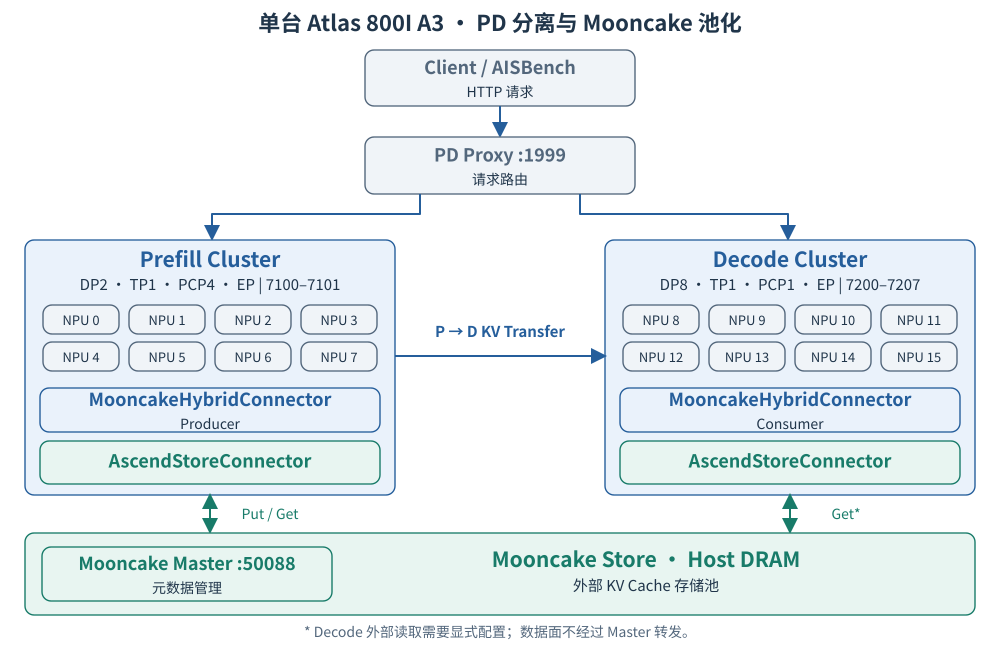
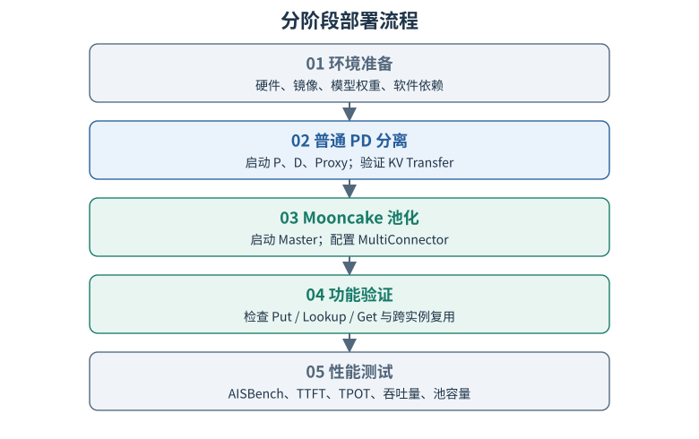
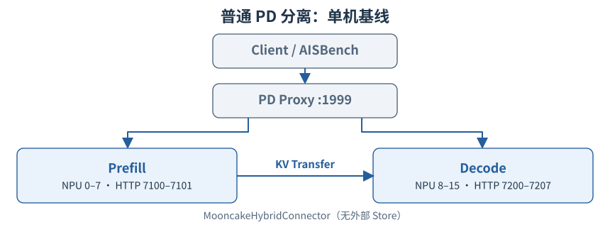
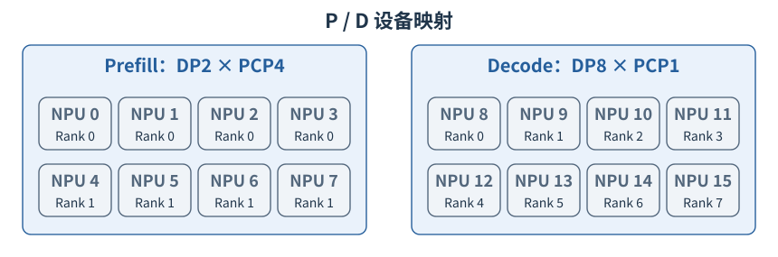
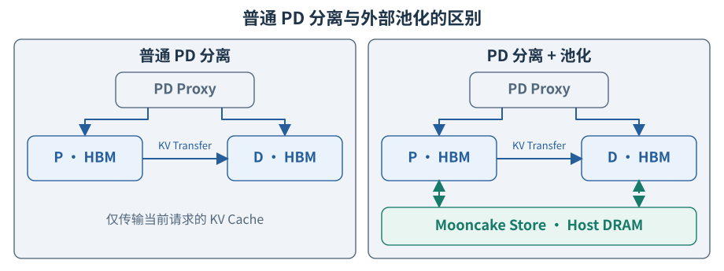
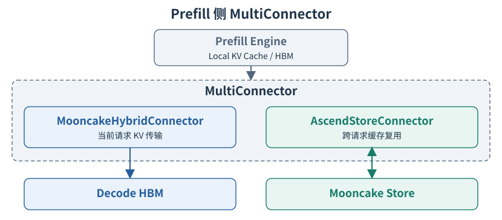
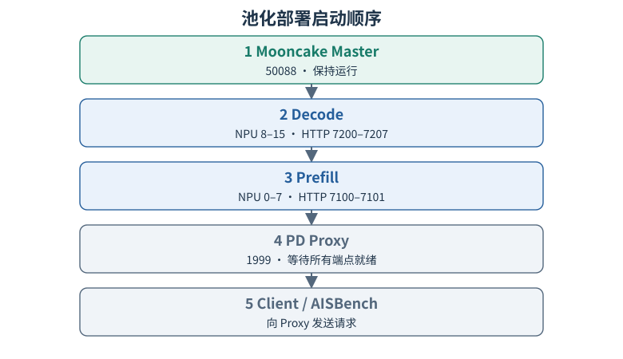
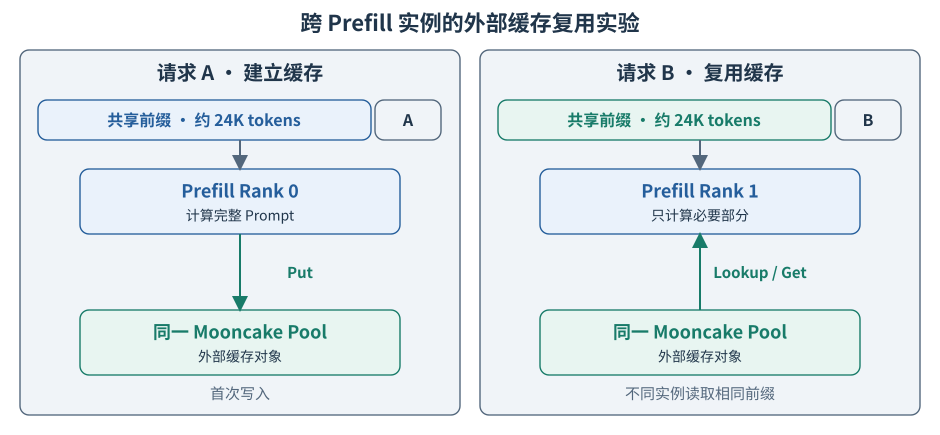
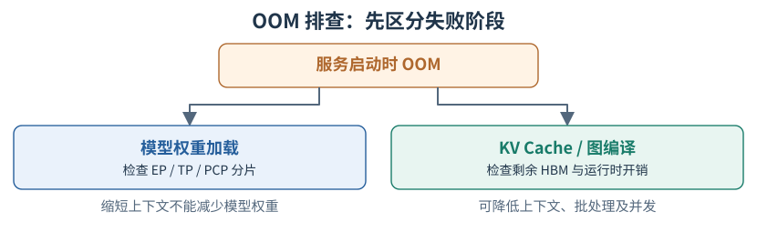

# 单台 A3 服务器部署 DeepSeek-V4-Flash：PD 分离 + Mooncake KV Cache 池化

> **适用版本：** vLLM-Ascend v0.30.0。本文将上一轮对话整理为部署操作指导书，保留官方脚本的启动方式及单机适配参数。假设 Atlas 800I A3 运行时可见 16 个 NPU die。示例 IP `192.168.1.100`、网卡 `eth0`、模型目录均须按实际环境替换。
>
> **适用边界：** 单台 A3 + DeepSeek-V4-Flash + PD 分离 + Mooncake Pool 是基于官方示例推导的适配方案，并非官方已实测通过的完整配置；本文没有在真实 A3 硬件上运行。原回答中的命令和版本参数在本次格式转换中未重新联网核验。应以实际镜像、对应版本官方文档及启动日志为准。

## 一、官方部署方案与当前环境的差异

参考资料：

- [DeepSeek-V4-Flash 官方模型部署指南（v0.30.0）](https://docs.vllm.ai/projects/ascend/zh-cn/v0.30.0/tutorials/models/DeepSeek-V4-Flash.html)
- [KV Cache Pool（Ascend Store）官方配置指南（v0.30.0）](https://docs.vllm.ai/projects/ascend/zh-cn/v0.30.0/user_guide/feature_guide/kv_cache_pool_ascend_store.html)
- [PD 分离（Mooncake，单节点）官方部署指南（v0.30.0）](https://docs.vllm.ai/projects/ascend/zh-cn/v0.30.0/tutorials/features/pd_disaggregation_mooncake_single_node.html)

官方模型文档第 5.2、5.3 节的配置不能直接照搬到单机部署。

| 对比项 | 官方 A3 池化方案 | 单台 A3 适配方案 |
| --- | --- | --- |
| 服务器数量 | 2 台 A3 | 1 台 A3 |
| Prefill | 独占一台服务器 | 使用部分 NPU |
| Decode | 独占一台服务器 | 使用剩余 NPU |
| PD 分离方式 | 跨服务器分离 | 单服务器内分离 |
| PD 传输组件 | MooncakeHybridConnector | MooncakeHybridConnector |
| 池化连接器 | AscendStoreConnector | AscendStoreConnector |
| 池化存储后端 | Memcache | Mooncake |
| 部署目的 | 性能验证 | 功能验证、原理学习及性能实验 |

官方 A3 示例采用两台服务器，每台使用 16 个 NPU die。模型指南中的 A3 池化示例采用 Memcache，而 Mooncake 池化的完整模型示例位于 A2 章节；通用 KV Cache Pool 指南将 A3 列入 Mooncake 后端的支持范围。因此需要综合 A3 模型部署参数、混合注意力 PD 传输及池化配置、A3 Mooncake Store 环境配置。

**建议实施路径：首先验证普通 PD 分离，再引入 Mooncake KV Cache Pool，最后进行功能验证和性能调优。**

## 二、单台 A3 的部署拓扑

### 2.1 NPU 资源划分

假设服务器为 Atlas 800I A3（128 GB × 8，运行时可见 16 个 NPU die），第一轮尝试采用 **8 die Prefill + 8 die Decode**。

| 参数 | Prefill | Decode |
| --- | ---: | ---: |
| NPU die ID | 0–7 | 8–15 |
| DP | 2 | 8 |
| TP | 1 | 1 |
| PCP | 4 | 1 |
| PP | 1 | 1 |
| EP | 开启 | 开启 |
| HTTP 服务端口 | 7100–7101 | 7200–7207 |
| DP RPC 端口 | 12321 | 12325 |
| KV 传输基础端口 | 30000 | 30100 |

P、D 是两个独立的模型执行集群，而不是一个模型的前半部分和后半部分。

Prefill 使用的设备数量：

$$
N_P=DP_P\times TP_P\times PCP_P=2\times1\times4=8
$$

Decode 使用的设备数量：

$$
N_D=DP_D\times TP_D\times PCP_D=8\times1\times1=8
$$

将官方 Prefill 的 PCP8 缩减为 PCP4，同时将 Decode 的 DP16 缩减为 DP8，是针对单机硬件资源的适配。**首要验证目标是模型权重及 KV Cache 能否在各自 8 个 die 上成功加载和分配。** 如果资源不足，需要调整并行策略或增加硬件，而不是只修改连接器。

### 2.2 系统总体拓扑

<p align="center">
  
</p>
<p align="center"><em>图 1　单台 A3 的 PD 分离与 Mooncake KV Cache 池化逻辑拓扑（NPU ID 为运行时设备编号）</em></p>

### 2.3 两种 Mooncake 组件的区别

| 组件 | 主要作用 |
| --- | --- |
| `MooncakeHybridConnector` | 将当前请求的 KV Cache 从 Prefill 传输至 Decode |
| `AscendStoreConnector` | 向外部池保存可复用 KV Cache，或从外部池加载 |
| `Mooncake Store` | 承担外部 KV Cache 存储 |
| `mooncake_master` | 管理缓存对象元数据、存储位置及驱逐 |
| `MultiConnector` | 使多个 KV Connector 协同工作 |
| `PD Proxy` | 负责 P、D 实例之间的请求路由 |

**采用 Mooncake 实现 PD 分离，不等于已经启用 Mooncake KV Cache 池化。** 普通 PD 分离只需要 PD 传输连接器；引入外部池后，还需要通过 `MultiConnector` 集成 `AscendStoreConnector` 并将后端设置为 `mooncake`。

## 三、整体部署流程

建议先在同一个 Docker 容器中，通过多个终端分别启动 Prefill、Decode、Mooncake Master 和 Proxy，避免初期引入额外的容器间通信问题。

<p align="center">
  
</p>
<p align="center"><em>图 2　分阶段部署流程</em></p>

第一轮部署暂不引入 SSD Offload，只实现基于 Host DRAM 的 KV Cache Pool，以减少排查变量。

## 四、阶段一：环境准备

### 步骤 1：检查服务器硬件和网络环境

在宿主机执行：

```bash
# NPU 状态及显存占用
npu-smi info

# 设备文件
ls /dev/davinci*

# 主机内存、CPU 架构与磁盘容量
free -h
uname -m
df -h

# IP、网卡与 NPU 网络配置
ip -br addr
cat /etc/hccn.conf

# 驱动版本
cat /usr/local/Ascend/driver/version.info
```

| 检查项 | 要求 |
| --- | --- |
| NPU die 数量 | 本方案假设为 16 |
| NPU 显存 | 确认每个 die 的实际可用显存 |
| Host DRAM | 满足两套模型加载及外部池容量需求 |
| NPU 互联 | 确认 HCCS 等通信链路正常 |
| 服务器 IP | P、D、Master、Proxy 共用 |
| 网卡名称 | HCCL、GLOO 等环境变量使用 |

根据上一轮对 [v0.30.0 KV Cache Pool 官方指南](https://docs.vllm.ai/projects/ascend/zh-cn/v0.30.0/user_guide/feature_guide/kv_cache_pool_ascend_store.html) 的梳理，A3 还应关注 HDK、CANN 和灵衢计算网络版本配套，其中 CANN 要求不低于 9.1.0；部署前请再次核对实际软件组合。

### 步骤 2：准备模型权重

官方 A3 示例使用的量化权重：

```text
DeepSeek-V4-Flash-0731-w8a8
```

建议模型存储路径：

```text
/root/.cache/DeepSeek-V4-Flash-0731-w8a8
```

模型下载入口见 [官方模型文档第 3.1 节](https://docs.vllm.ai/projects/ascend/zh-cn/v0.30.0/tutorials/models/DeepSeek-V4-Flash.html)。此前使用的 `deepseek-v4-flash-w8a8-mtp` 与该 DSpark checkpoint 不应直接视为等价，投机解码参数需要与 checkpoint 匹配。

### 步骤 3：启动 Docker 容器

参考 [官方 A3 Docker 配置](https://docs.vllm.ai/projects/ascend/zh-cn/v0.30.0/tutorials/models/DeepSeek-V4-Flash.html)：

```bash
export IMAGE=quay.io/ascend/vllm-ascend:v0.30.0-a3
docker pull "$IMAGE"
```

在宿主机创建部署目录：

```bash
mkdir -p /deploy/prefill
mkdir -p /deploy/decode
mkdir -p /deploy/mooncake
mkdir -p /deploy/proxy
mkdir -p /deploy/logs
```

启动容器（保留官方配置主体，额外挂载 `/deploy`）：

```bash
docker run --rm \
    --name vllm-ascend \
    --shm-size=512g \
    --net=host \
    --privileged=true \
    --device /dev/davinci0 \
    --device /dev/davinci1 \
    --device /dev/davinci2 \
    --device /dev/davinci3 \
    --device /dev/davinci4 \
    --device /dev/davinci5 \
    --device /dev/davinci6 \
    --device /dev/davinci7 \
    --device /dev/davinci8 \
    --device /dev/davinci9 \
    --device /dev/davinci10 \
    --device /dev/davinci11 \
    --device /dev/davinci12 \
    --device /dev/davinci13 \
    --device /dev/davinci14 \
    --device /dev/davinci15 \
    --device /dev/davinci_manager \
    --device /dev/devmm_svm \
    --device /dev/hisi_hdc \
    -v /usr/local/dcmi:/usr/local/dcmi \
    -v /usr/local/Ascend/driver/tools/hccn_tool:/usr/local/Ascend/driver/tools/hccn_tool \
    -v /usr/local/bin/npu-smi:/usr/local/bin/npu-smi \
    -v /usr/local/Ascend/driver/lib64/:/usr/local/Ascend/driver/lib64/ \
    -v /usr/local/Ascend/driver/version.info:/usr/local/Ascend/driver/version.info \
    -v /etc/ascend_install.info:/etc/ascend_install.info \
    -v /etc/hccn.conf:/etc/hccn.conf \
    -v /root/.cache:/root/.cache \
    -v /deploy:/deploy \
    -it "$IMAGE" bash
```

后续每次打开新终端时，在宿主机执行：

```bash
docker exec -it vllm-ascend bash
```

### 步骤 4：检查容器内部环境

```bash
npu-smi info
pip show vllm
pip show vllm-ascend
pip show mooncake-transfer-engine-npu
ldd --version
which mooncake_master
ls /root/.cache/DeepSeek-V4-Flash-0731-w8a8
```

若镜像已经安装兼容版本 Mooncake，不建议直接覆盖安装。Python wheel、底层原生库与 Master 需要保持兼容。

## 五、阶段二：实现普通 PD 分离

这一阶段暂不启动 Mooncake Master，也不配置 `AscendStoreConnector`，只验证 PD 传输链路。

<p align="center">
  
</p>
<p align="center"><em>图 3　普通 PD 分离部署拓扑（尚未启用外部缓存池）</em></p>

### 步骤 1：准备官方启动脚本

按照 [官方文档第 5.2 节 A3 部署示例](https://docs.vllm.ai/projects/ascend/zh-cn/v0.30.0/tutorials/models/DeepSeek-V4-Flash.html) 准备：

- `launch_online_dp.py`：官方 DP 多进程启动器。
- `run_dp_template.sh`：官方 vLLM 实例启动模板。
- `load_balance_proxy_server_example.py`：[官方 PD 分离代理源码](https://github.com/vllm-project/vllm-ascend/blob/main/examples/disaggregated_prefill_v1/load_balance_proxy_server_example.py)。优先使用与安装版本匹配的源码，而不是直接混用最新 main 分支。

不额外编写封装脚本。P、D 使用相同的 `launch_online_dp.py`，但各自拥有不同的 `run_dp_template.sh`。

```text
/deploy/
├── prefill/
│   ├── launch_online_dp.py
│   └── run_dp_template.sh
├── decode/
│   ├── launch_online_dp.py
│   └── run_dp_template.sh
├── mooncake/
├── proxy/
│   └── load_balance_proxy_server_example.py
└── logs/
```

### 步骤 2：理解官方 `launch_online_dp.py`

官方启动器根据 DP、TP、PCP 为每个 rank 分配设备：

```python
devices_per_rank = tp_size * pcp_size
```

Prefill 的 DP=2、TP=1、PCP=4，两个 rank 分别使用 NPU 0–3、4–7。Decode 启动器默认也从设备 0 开始分配，因此直接以 DP8 启动会与 Prefill 冲突，需要修改 D 侧设备映射。

<p align="center">
  
</p>
<p align="center"><em>图 4　单机适配后的 P/D 设备映射</em></p>

### 步骤 3：修改 Prefill 启动模板

文件：`/deploy/prefill/run_dp_template.sh`。

将官方 P 模板保存到该位置，再按以下单机适配参数修改（请替换真实 IP 和网卡）：

```bash
nic_name="eth0"
local_ip="192.168.1.100"

unset http_proxy https_proxy
unset HTTP_PROXY HTTPS_PROXY

export HCCL_IF_IP=$local_ip
export GLOO_SOCKET_IFNAME=$nic_name
export TP_SOCKET_IFNAME=$nic_name
export HCCL_SOCKET_IFNAME=$nic_name

export VLLM_RPC_TIMEOUT=3600000
export VLLM_EXECUTE_MODEL_TIMEOUT_SECONDS=30000

export HCCL_EXEC_TIMEOUT=204
export HCCL_CONNECT_TIMEOUT=120
export HCCL_BUFFSIZE=1800

export OMP_PROC_BIND=false
export OMP_NUM_THREADS=10
export PYTORCH_NPU_ALLOC_CONF=expandable_segments:True

export TASK_QUEUE_ENABLE=1
export HCCL_OP_EXPANSION_MODE="AIV"

export VLLM_USE_V2_MODEL_RUNNER=1
export PYTHONHASHSEED=0

export ASCEND_RT_VISIBLE_DEVICES=$1

vllm serve /root/.cache/DeepSeek-V4-Flash-0731-w8a8 \
    --host 0.0.0.0 \
    --port $2 \
    --data-parallel-size $3 \
    --data-parallel-rank $4 \
    --data-parallel-address $5 \
    --data-parallel-rpc-port $6 \
    --tensor-parallel-size $7 \
    --prefill-context-parallel-size $8 \
    --enable-expert-parallel \
    --seed 1024 \
    --served-model-name dsv4 \
    --max-model-len 32768 \
    --max-num-batched-tokens 8192 \
    --max-num-seqs 8 \
    --no-disable-hybrid-kv-cache-manager \
    --model-loader-extra-config '{"enable_multithread_load":true,"num_threads":32}' \
    --speculative-config '{"num_speculative_tokens":5,"method":"dspark","enforce_eager":true}' \
    --trust-remote-code \
    --block-size 32 \
    --attention_config.indexer_kv_dtype int8 \
    --tokenizer-mode deepseek_v4 \
    --tool-call-parser deepseek_v4 \
    --enable-auto-tool-choice \
    --reasoning-parser deepseek_v4 \
    --gpu-memory-utilization 0.94 \
    --quantization ascend \
    --enable-prefix-caching \
    --enforce-eager \
    --additional-config '{"enable_cpu_binding":true,"enable_fused_mc2":1}' \
    --kv-transfer-config '{
        "kv_connector":"MooncakeHybridConnector",
        "kv_role":"kv_producer",
        "kv_port":"30000",
        "kv_load_failure_policy":"fail",
        "kv_connector_extra_config":{
            "prefill":{"dp_size":2,"tp_size":1,"pp_size":1,"pcp_size":4},
            "decode":{"dp_size":8,"tp_size":1,"pp_size":1,"pcp_size":1}
        }
    }'
```

相比官方双机示例，主要调整如下：

| 参数 | 官方 A3 示例 | 单机适配 |
| --- | ---: | ---: |
| P PCP | 8 | 4 |
| D DP | 16 | 8 |
| `max-model-len` | 512000 | 32768 |
| `max-num-batched-tokens`（P） | 16384 | 8192 |
| `max-num-seqs`（P） | 16 | 8 |
| 模型加载线程数 | 128 | 32 |

初期降低上下文长度、批处理规模、并发及加载线程数，以控制资源开销。

### 步骤 4：修改 Decode 启动模板

文件：`/deploy/decode/run_dp_template.sh`。

```bash
nic_name="eth0"
local_ip="192.168.1.100"

unset http_proxy https_proxy
unset HTTP_PROXY HTTPS_PROXY

export HCCL_IF_IP=$local_ip
export GLOO_SOCKET_IFNAME=$nic_name
export TP_SOCKET_IFNAME=$nic_name
export HCCL_SOCKET_IFNAME=$nic_name

export HCCL_OP_EXPANSION_MODE="AIV"
export TASK_QUEUE_ENABLE=1

export VLLM_RPC_TIMEOUT=3600000
export VLLM_EXECUTE_MODEL_TIMEOUT_SECONDS=30000

export HCCL_EXEC_TIMEOUT=204
export HCCL_CONNECT_TIMEOUT=120
export HCCL_BUFFSIZE=2400

export OMP_PROC_BIND=false
export OMP_NUM_THREADS=10
export PYTORCH_NPU_ALLOC_CONF=expandable_segments:True

export VLLM_USE_V2_MODEL_RUNNER=1
export PYTHONHASHSEED=0

# 单机部署：将 D 侧设备编号从 0–7 映射到 8–15
export ASCEND_RT_VISIBLE_DEVICES=$(( $1 + 8 ))

vllm serve /root/.cache/DeepSeek-V4-Flash-0731-w8a8 \
    --host 0.0.0.0 \
    --port $2 \
    --data-parallel-size $3 \
    --data-parallel-rank $4 \
    --data-parallel-address $5 \
    --data-parallel-rpc-port $6 \
    --tensor-parallel-size $7 \
    --enable-expert-parallel \
    --seed 1024 \
    --served-model-name dsv4 \
    --max-model-len 32768 \
    --max-num-batched-tokens 480 \
    --max-num-seqs 16 \
    --async-scheduling \
    --block-size 32 \
    --attention_config.indexer_kv_dtype int8 \
    --no-disable-hybrid-kv-cache-manager \
    --no-enable-prefix-caching \
    --trust-remote-code \
    --tokenizer-mode deepseek_v4 \
    --model-loader-extra-config '{"enable_multithread_load":true,"num_threads":32}' \
    --tool-call-parser deepseek_v4 \
    --enable-auto-tool-choice \
    --reasoning-parser deepseek_v4 \
    --gpu-memory-utilization 0.95 \
    --quantization ascend \
    --speculative-config '{"num_speculative_tokens":5,"method":"dspark"}' \
    --compilation-config '{"cudagraph_mode":"FULL_DECODE_ONLY"}' \
    --kv-transfer-config '{
        "kv_connector":"MooncakeHybridConnector",
        "kv_role":"kv_consumer",
        "kv_port":"30100",
        "kv_load_failure_policy":"fail",
        "kv_connector_extra_config":{
            "prefill":{"dp_size":2,"tp_size":1,"pp_size":1,"pcp_size":4},
            "decode":{"dp_size":8,"tp_size":1,"pp_size":1,"pcp_size":1}
        }
    }' \
    --additional-config '{
        "ascend_compilation_config":{
            "enable_npugraph_ex":true,
            "enable_static_kernel":false
        },
        "enable_cpu_binding":true,
        "multistream_overlap_shared_expert":true
    }'
```

**核心修改：** `export ASCEND_RT_VISIBLE_DEVICES=$(( $1 + 8 ))`。该算术偏移仅适用于 D 侧 TP1、PCP1、每个 rank 对应一个设备编号的情况；应检查官方启动器传入的 `$1` 确为单个设备 ID。未来 D 侧改为 TP2 时，需要处理设备列表映射。

### 步骤 5：检查 P、D 关键参数

| 参数 | P、D 配置要求 |
| --- | --- |
| 模型权重 | 完全一致 |
| 量化方式 | 均为 `ascend` |
| `block-size` | 均为 32 |
| `max-model-len` | 均为 32768 |
| Indexer KV dtype | 均为 int8 |
| Model Runner | 均为 V2 |
| DSpark token 数 | 均为 5 |
| Hybrid KV Cache Manager | 均启用 |
| Connector 内 P/D 并行配置 | 完全一致 |
| `PYTHONHASHSEED` | 均为 0 |

**① Hybrid KV Cache Manager：** `--no-disable-hybrid-kv-cache-manager`。DeepSeek-V4 包含不同压缩比例的混合注意力机制，需保留混合缓存管理器配置。

**② Block Size：** `--block-size 32`。第一轮先遵循该版本 DSpark 示例，不同时调整此前实验中的 block size 128。

**③ PCP 与 Model Runner：** `export VLLM_USE_V2_MODEL_RUNNER=1`。当前 PCP 配置依赖 Model Runner V2，不再引入 V1 的 `enable_dsa_cp` 配置。参见 [官方模型部署文档](https://docs.vllm.ai/projects/ascend/zh-cn/v0.30.0/tutorials/models/DeepSeek-V4-Flash.html)。

### 步骤 6：检查脚本语法并备份

```bash
cd /deploy/prefill
bash -n run_dp_template.sh
cp run_dp_template.sh run_dp_template.sh.baseline
```

```bash
cd /deploy/decode
bash -n run_dp_template.sh
cp run_dp_template.sh run_dp_template.sh.baseline
```

**`.baseline` 文件由上述 `cp` 命令创建，不是官方自带文件。** 后续引入池化时用于差异比较。

### 步骤 7：启动 Decode

容器终端一：

```bash
cd /deploy/decode
python launch_online_dp.py \
    --dp-size 8 \
    --tp-size 1 \
    --pcp-size 1 \
    --dp-size-local 8 \
    --dp-rank-start 0 \
    --dp-address 192.168.1.100 \
    --dp-rpc-port 12325 \
    --vllm-start-port 7200 \
    2>&1 | tee /deploy/logs/decode.log
```

| DP Rank | NPU die | HTTP 端口 |
| ---: | ---: | ---: |
| 0 | 8 | 7200 |
| 1 | 9 | 7201 |
| 2 | 10 | 7202 |
| 3 | 11 | 7203 |
| 4 | 12 | 7204 |
| 5 | 13 | 7205 |
| 6 | 14 | 7206 |
| 7 | 15 | 7207 |

8 个 Decode rank 通过 EP 协同执行 MoE 模型，并不是每个 die 都独立保存一份完整的模型权重。

### 步骤 8：启动 Prefill

容器终端二：

```bash
cd /deploy/prefill
python launch_online_dp.py \
    --dp-size 2 \
    --tp-size 1 \
    --pcp-size 4 \
    --dp-size-local 2 \
    --dp-rank-start 0 \
    --dp-address 192.168.1.100 \
    --dp-rpc-port 12321 \
    --vllm-start-port 7100 \
    2>&1 | tee /deploy/logs/prefill.log
```

| DP Rank | NPU die | HTTP 端口 |
| ---: | --- | ---: |
| 0 | 0、1、2、3 | 7100 |
| 1 | 4、5、6、7 | 7101 |

P、D 的 DP/EP 集群相互独立，可以共用服务器 IP，但必须使用不同的 DP RPC 端口。

### 步骤 9：检查 P、D 实例状态

```bash
npu-smi info
```

```bash
for port in {7100..7101}; do
    echo "Checking Prefill $port"
    curl -s -o /dev/null -w "%{http_code}\n" \
        http://192.168.1.100:$port/health
done
```

```bash
for port in {7200..7207}; do
    echo "Checking Decode $port"
    curl -s -o /dev/null -w "%{http_code}\n" \
        http://192.168.1.100:$port/health
done
```

预期所有端点返回 HTTP 200。**这是单机部署最重要的可行性检查点。** 若出现权重加载 OOM、KV Cache 分配不足或图编译失败，应先解决资源问题。

### 步骤 10：启动 PD Proxy

容器终端三：

```bash
cd /deploy/proxy
export SERVER_IP=192.168.1.100

python load_balance_proxy_server_example.py \
    --host "$SERVER_IP" \
    --port 1999 \
    --prefiller-hosts \
        "$SERVER_IP" "$SERVER_IP" \
    --prefiller-ports \
        7100 7101 \
    --decoder-hosts \
        "$SERVER_IP" "$SERVER_IP" \
        "$SERVER_IP" "$SERVER_IP" \
        "$SERVER_IP" "$SERVER_IP" \
        "$SERVER_IP" "$SERVER_IP" \
    --decoder-ports \
        7200 7201 7202 7203 \
        7204 7205 7206 7207 \
    2>&1 | tee /deploy/logs/proxy.log
```

使用官方非 Layerwise Proxy 实现先 Prefill、后 Decode 的请求路由。[Proxy 官方源码](https://github.com/vllm-project/vllm-ascend/blob/main/examples/disaggregated_prefill_v1/load_balance_proxy_server_example.py)。

### 步骤 11：验证普通 PD 分离

容器终端四：

```bash
curl http://192.168.1.100:1999/v1/chat/completions \
    -H "Content-Type: application/json" \
    -d '{
        "model":"dsv4",
        "messages":[{"role":"user","content":"请介绍一下大模型推理中的KV Cache。"}],
        "max_tokens":128,
        "temperature":0,
        "stream":false
    }'
```

检查 P、D 日志中均有相应请求活动，KV Transfer 无报错，Proxy 返回正常生成结果。普通 PD 分离功能验证完成后才进入下一阶段。

## 六、阶段三：引入 Mooncake KV Cache Pool

### 6.1 引入池化后需要修改什么？

<p align="center">
  
</p>
<p align="center"><em>图 5　普通 PD 分离与 PD 分离 + KV Cache Pool 对比</em></p>

不改变 NPU 划分和 Proxy 路由方式，仅增加以下内容：

| 新增或修改项 | 作用 |
| --- | --- |
| Mooncake 软件依赖 | 提供外部池化存储能力 |
| `mooncake.json` | 配置 Store |
| `mooncake_master` | 启动元数据管理服务 |
| 环境变量 | 指定 Store 配置和通信环境 |
| `MultiConnector` | 集成两种连接器 |
| `AscendStoreConnector` | 实现外部 KV Cache 访问 |
| D 侧 Prefix Caching | 为 D 侧加载池化 KV 实验提供条件 |

### 步骤 1：停止原有 P、D、Proxy 服务

先停止 Proxy，不再接收新请求，等待已有请求结束，再停止 P 和 D。在各自终端使用 `Ctrl+C`，随后检查：

```bash
ps -ef | grep -E 'vllm|launch_online_dp|load_balance_proxy'
npu-smi info
```

确认原有进程退出。不需要重新创建 Docker 容器。

### 步骤 2：检查并安装 Mooncake

```bash
ldd --version
pip show mooncake-transfer-engine-npu
which mooncake_master
```

尚未安装时，参考 [v0.30.0 通用池化指南](https://docs.vllm.ai/projects/ascend/zh-cn/v0.30.0/user_guide/feature_guide/kv_cache_pool_ascend_store.html) 的基础安装命令：

```bash
python3 -m pip install \
    mooncake-transfer-engine-npu==0.3.11.post1 \
    --extra-index-url https://mirrors.aliyun.com/pypi/web/simple
```

| 功能 | 上一轮整理的官方依赖要求 |
| --- | --- |
| 基础 Mooncake Pool | ≥ 0.3.11.post1 |
| 非默认租户 | ≥ 0.3.12 |
| 模型文档 A2 SSD 实测配置 | 0.3.13 ABI |
| Layerwise | ≥ 0.3.14 |

第一轮使用默认租户、不启用 SSD、不启用 Layerwise。优先保留镜像内已安装且兼容的版本，并确认实际版本支持 DSv4 Hybrid Connector 与 Store 的组合。

### 步骤 3：配置 `mooncake.json`

```bash
cd /deploy/mooncake
vi mooncake.json
```

```json
{
    "metadata_server": "P2PHANDSHAKE",
    "protocol": "ascend",
    "device_name": "",
    "master_server_address": "192.168.1.100:50088",
    "global_segment_size": "1GB",
    "local_buffer_size": "1GB",
    "preferred_segment": false,
    "prefer_alloc_in_same_node": true,
    "enable_ssd_offload": false,
    "tenant_id": "default"
}
```

| 参数 | 作用 |
| --- | --- |
| `metadata_server` | Mooncake 元数据握手方式 |
| `protocol` | 使用 Ascend 对应通信协议 |
| `device_name` | 通信设备配置 |
| `master_server_address` | Mooncake Master 地址 |
| `global_segment_size` | 单个参与客户端注册到池中的存储容量 |
| `local_buffer_size` | 客户端本地传输缓冲区大小 |
| `preferred_segment` | 是否优先使用本地 segment |
| `prefer_alloc_in_same_node` | 优先在同一节点分配缓存 |
| `enable_ssd_offload` | 是否启用 SSD 扩展存储 |
| `tenant_id` | 缓存租户标识 |

#### 如何理解 `global_segment_size`？

它不是整台服务器的 KV Cache Pool 容量。假设有 $N$ 个客户端成功注册，各注册一个容量为 $S$ 的 segment，则理论注册容量为：

$$
C_{\mathrm{pool}}=N\times S
$$

例如 16 个客户端各注册 1 GiB，则理论容量为 16 GiB。以下表格替代原对话中的交互式容量计算器（按 GiB 估算；`GB` 字符串实际解析规则、注册客户端数量和 segment 容量须以运行时为准）。

| 客户端数 | 单客户端容量 | 理论注册容量 | 90% 水位对应容量 |
| ---: | ---: | ---: | ---: |
| 8 | 1 GiB | 8 GiB | 7.2 GiB |
| 16 | 1 GiB | 16 GiB | 14.4 GiB |
| 16 | 2 GiB | 32 GiB | 28.8 GiB |
| 16 | 4 GiB | 64 GiB | 57.6 GiB |
| 32 | 1 GiB | 32 GiB | 28.8 GiB |

不包含传输缓冲区、元数据、模型进程及运行时其他内存开销。首次部署建议从 `1GB` 开始，随后根据实际注册容量及主机剩余内存逐步扩大。

### 步骤 4：启动 Mooncake Master

打开独立容器终端：

```bash
cd /deploy/mooncake
mooncake_master \
    --port 50088 \
    --eviction_high_watermark_ratio 0.9 \
    --eviction_ratio 0.1 \
    --default_kv_lease_ttl 11000 \
    --enable_offload=false \
    --client_ttl=120 \
    2>&1 | tee /deploy/logs/mooncake_master.log
```

| 参数 | 含义 |
| --- | --- |
| `port` | Master 服务端口 |
| `eviction_high_watermark_ratio` | 缓存驱逐高水位 |
| `eviction_ratio` | 触发驱逐时的对象驱逐比例 |
| `default_kv_lease_ttl` | KV 对象租约时间（毫秒） |
| `enable_offload` | 是否启用 SSD Offload |
| `client_ttl` | 客户端心跳存活时间（秒） |

检查监听端口：

```bash
ss -lntp | grep 50088
```

本方案采用嵌入式客户端方式，**无需额外启动 `mooncake_client`**。后续 P、D worker 启动时，`AscendStoreConnector` 初始化 Store 客户端并连接 Master。参考 [官方池化指南](https://docs.vllm.ai/projects/ascend/zh-cn/v0.30.0/user_guide/feature_guide/kv_cache_pool_ascend_store.html)。

### 步骤 5：为 Prefill 和 Decode 增加池化环境变量

在 P、D 的 `run_dp_template.sh` 中，`vllm serve` 命令之前增加（已存在的 `PYTHONHASHSEED` 保留一次即可）：

```bash
export PYTHONHASHSEED=0
export MOONCAKE_CONFIG_PATH=/deploy/mooncake/mooncake.json
export LD_LIBRARY_PATH=/usr/local/Ascend/ascend-toolkit/latest/python/site-packages/mooncake:$LD_LIBRARY_PATH
```

A3 HCCS 场景官方通用 Mooncake 配置还包括：

```bash
export ACL_OP_INIT_MODE=1
export ASCEND_ENABLE_USE_FABRIC_MEM=1
```

以上配置以实际驱动、CANN 和 FabricMem 支持为前提。官方支持通过 `ASCEND_GLOBAL_RESOURCE_CONFIG` 分别控制 PD 传输与 Store 传输所用物理链路。首轮部署暂不引入复杂流量分离策略，先验证功能。

### 步骤 6：修改 Prefill 的 KV Transfer 配置

```bash
vi /deploy/prefill/run_dp_template.sh
```

将原来的 `--kv-transfer-config` 整体替换为：

```bash
--kv-transfer-config '{
    "kv_connector":"MultiConnector",
    "kv_role":"kv_producer",
    "kv_port":"30000",
    "kv_load_failure_policy":"fail",
    "kv_connector_extra_config":{
        "connectors":[
            {
                "kv_connector":"MooncakeHybridConnector",
                "kv_role":"kv_producer",
                "kv_port":"30000",
                "kv_connector_extra_config":{
                    "prefill":{"dp_size":2,"tp_size":1,"pp_size":1,"pcp_size":4},
                    "decode":{"dp_size":8,"tp_size":1,"pp_size":1,"pcp_size":1}
                }
            },
            {
                "kv_connector":"AscendStoreConnector",
                "kv_role":"kv_producer",
                "kv_connector_extra_config":{
                    "backend":"mooncake",
                    "lookup_rpc_port":"0",
                    "use_layerwise":false
                }
            }
        ]
    }
}'
```

同时保留：

```bash
--enable-prefix-caching
```

#### P 侧两个 Connector 的工作关系

<p align="center">
  
</p>
<p align="center"><em>图 6　Prefill 侧 MultiConnector 逻辑结构</em></p>

`MooncakeHybridConnector` 保证当前请求从 P 转移至 D；`AscendStoreConnector` 使 P 可以访问外部池并保存后续请求可能复用的缓存。两条路径承担不同任务，**不表示数据必须先写入池再传输给 Decode**。

### 步骤 7：修改 Decode 的 KV Transfer 配置

```bash
vi /deploy/decode/run_dp_template.sh
```

将原有的 `--no-enable-prefix-caching` 修改为 `--enable-prefix-caching`。

将 `--kv-transfer-config` 替换为下列配置（保留原命令后续 `--additional-config` 前的续行符 `\`）：

```bash
--kv-transfer-config '{
    "kv_connector":"MultiConnector",
    "kv_role":"kv_consumer",
    "kv_port":"30100",
    "kv_load_failure_policy":"fail",
    "kv_connector_extra_config":{
        "connectors":[
            {
                "kv_connector":"MooncakeHybridConnector",
                "kv_role":"kv_consumer",
                "kv_port":"30100",
                "kv_connector_extra_config":{
                    "prefill":{"dp_size":2,"tp_size":1,"pp_size":1,"pcp_size":4},
                    "decode":{"dp_size":8,"tp_size":1,"pp_size":1,"pcp_size":1}
                }
            },
            {
                "kv_connector":"AscendStoreConnector",
                "kv_role":"kv_consumer",
                "kv_connector_extra_config":{
                    "backend":"mooncake",
                    "lookup_rpc_port":"2",
                    "use_layerwise":false,
                    "consumer_is_to_load":true,
                    "consumer_is_to_put":false
                }
            }
        ]
    }
}' \
```

这里参考官方 DeepSeek-V4-Flash Mooncake 池化示例中的连接器组合，而不是直接使用 Qwen 通用示例的 `MooncakeConnectorV1`。

**① `consumer_is_to_load`: true**：允许 D 侧从外部池加载缓存。但并不意味着 Decode 每生成一个 Token 都必须访问 Store；正常 Decode 主要访问自身 HBM 中的 KV Cache。

**② `consumer_is_to_put`: false**：第一轮不让 D 侧向外部池写入缓存，优先验证 P 侧写入、P 侧复用和 D 侧外部加载行为。后续再单独测试 Decode Cache 保存。

**③ `lookup_rpc_port`**：P 为 `0`、D 为 `2`，避免同一 IPC 命名空间的 Lookup RPC 端点冲突。按照上一轮对官方 A3 池化示例的梳理，当前实现会在基础值上叠加 DP rank。

| 角色 | DP rank | Lookup RPC 基础值 | 规划端点编号 |
| --- | --- | ---: | --- |
| P | 0–1 | 0 | 0–1 |
| D | 0–7 | 2 | 2–9 |

须根据实际安装版本源码及初始化日志确认最终端点名称；它不是对外 HTTP 端口，也不等同于 `kv_port`。

### 步骤 8：检查池化前后的修改差异

Prefill：

```bash
cd /deploy/prefill
bash -n run_dp_template.sh
diff -u run_dp_template.sh.baseline run_dp_template.sh
```

Decode：

```bash
cd /deploy/decode
bash -n run_dp_template.sh
diff -u run_dp_template.sh.baseline run_dp_template.sh
```

`.baseline` 在阶段二步骤 6 创建。此处应仅看到 Mooncake 环境变量、Prefix Caching 开关及 KV Connector 配置变动。不要同时修改模型、设备划分、并行策略及大量性能参数。

### 步骤 9：重新启动 P、D 和 Proxy

<p align="center">
  
</p>
<p align="center"><em>图 7　池化部署启动顺序</em></p>

Master 在步骤 4 已启动并保持运行。

Decode：

```bash
cd /deploy/decode
python launch_online_dp.py \
    --dp-size 8 \
    --tp-size 1 \
    --pcp-size 1 \
    --dp-size-local 8 \
    --dp-rank-start 0 \
    --dp-address 192.168.1.100 \
    --dp-rpc-port 12325 \
    --vllm-start-port 7200 \
    2>&1 | tee /deploy/logs/decode_pool.log
```

Prefill：

```bash
cd /deploy/prefill
python launch_online_dp.py \
    --dp-size 2 \
    --tp-size 1 \
    --pcp-size 4 \
    --dp-size-local 2 \
    --dp-rank-start 0 \
    --dp-address 192.168.1.100 \
    --dp-rpc-port 12321 \
    --vllm-start-port 7100 \
    2>&1 | tee /deploy/logs/prefill_pool.log
```

所有端点健康后，使用阶段二步骤 10 完全相同的 Proxy 命令启动代理。

## 七、阶段四：验证 KV Cache Pool 是否真正生效

**推理成功不代表 Mooncake Pool 已经正常实现跨请求复用。** 建议分四层验证。

### 7.1 验证 Mooncake Store 初始化

```bash
grep -Ei 'mooncake|ascendstore|store|segment|register|lookup' \
    /deploy/logs/prefill_pool.log

grep -Ei 'mooncake|ascendstore|store|segment|register|lookup' \
    /deploy/logs/decode_pool.log

tail -f /deploy/logs/mooncake_master.log
```

| 检查内容 | 预期结果 |
| --- | --- |
| MultiConnector 初始化 | 成功 |
| MooncakeHybridConnector 初始化 | 成功 |
| AscendStoreConnector 初始化 | 成功 |
| Store 客户端连接 Master | 成功 |
| 内存 segment 注册 | 成功 |
| Lookup RPC 服务初始化 | 成功 |

不同软件版本的日志文本可能不同，上述为检查方向，并非固定日志字符串。

### 7.2 验证一次完整推理请求

```bash
curl http://192.168.1.100:1999/v1/chat/completions \
    -H "Content-Type: application/json" \
    -d '{
        "model":"dsv4",
        "messages":[{"role":"user","content":"请详细解释PagedAttention的工作原理。"}],
        "max_tokens":128,
        "temperature":0
    }'
```

确认池化不会破坏原有 PD 分离推理流程。

### 7.3 验证跨请求、跨实例前缀复用

```text
请求 A = 共同前缀 + 问题 A
请求 B = 共同前缀 + 问题 B
```

考虑 DeepSeek-V4 混合 KV Cache 对齐粒度可能影响短前缀命中，第一轮建议约 24K Token 的共同前缀，并确认其超过实际运行时缓存对齐粒度、总长度未超上下文限制。

<p align="center">
  
</p>
<p align="center"><em>图 8　请求 A 建立外部缓存，请求 B 在另一 Prefill 实例尝试复用</em></p>

请求 A 由 Prefill Rank 0 计算完整 Prompt，将符合条件的缓存块写入池；请求 B 由 Rank 1 处理，尝试通过 Lookup/Get 加载共享前缀，只计算必要部分。

如果 A、B 始终被分配到同一 Prefill 实例，没有外部池也可能通过本地 Prefix Cache 命中，无法证明池化作用。因此，通过官方 Proxy 发送请求后，必须根据日志确认二者实际路由到不同的 P API 端点。若未命中不同实例，则控制测试路由或重复诊断请求；同时确认 A 的外部写入完成。

### 7.4 监控本地与外部 Prefix Cache 指标

Prefill 端点：

```bash
for port in {7100..7101}; do
    echo "===== Prefill $port ====="
    curl -s http://192.168.1.100:$port/metrics \
        | grep -E 'prefix_cache_(hits|queries)'
done
```

Decode 端点：

```bash
for port in {7200..7207}; do
    echo "===== Decode $port ====="
    curl -s http://192.168.1.100:$port/metrics \
        | grep -E 'prefix_cache_(hits|queries)'
done
```

| Metrics | 含义 |
| --- | --- |
| `vllm:prefix_cache_queries` | 本地前缀缓存查询 Token 数 |
| `vllm:prefix_cache_hits` | 本地前缀缓存命中 Token 数 |
| `vllm:external_prefix_cache_queries` | 外部缓存查询 Token 数 |
| `vllm:external_prefix_cache_hits` | 外部缓存命中 Token 数 |
| `vllm:kv_cache_usage_perc` | KV Cache 使用率 |

Counter 名称可能包含 `_total` 后缀，以实际 `/metrics` 为准。KV Cache 使用率需单独查询，例如：

```bash
curl -s http://192.168.1.100:7100/metrics | grep 'kv_cache_usage_perc'
```

使用请求前后指标增量计算外部命中率（查询增量大于 0 时）：

$$
R_{\mathrm{external}}=\frac{\Delta H_{\mathrm{external}}}{\Delta Q_{\mathrm{external}}}\times100\%
$$

**外部缓存命中指标不一定仅统计 Mooncake Store，也可能包含 P-to-D 的 KV Connector 传输。** 要证明 Store 命中，需要结合 P 侧外部命中增量、Store Lookup/Get 日志及普通 PD 分离基线判断。

参考：[vLLM 官方 Metrics 文档](https://docs.vllm.ai/en/stable/design/metrics.html)、[Ascend Store 配置指南](https://docs.vllm.ai/projects/ascend/zh-cn/v0.30.0/user_guide/feature_guide/kv_cache_pool_ascend_store.html)。

## 八、阶段五：性能测试与调优

### 8.1 实验组设计

| 实验组 | PD 分离 | 本地 Prefix Cache | Mooncake Pool |
| --- | --- | --- | --- |
| A | 开启 | P 开启、D 关闭 | 关闭 |
| B | 开启 | P/D 均开启 | 关闭 |
| C | 开启 | P/D 均开启 | 开启 |
| D（后续扩展） | 开启 | P/D 均开启 | DRAM + SSD |

- A：普通 PD 分离基线。
- B：控制 D 侧 Prefix Caching 开关带来的影响（前提是实际版本支持普通 PD 下 D 侧启用 Prefix Caching）。
- C：研究外部池的独立收益。
- D：研究 SSD 扩展池容量的影响。

**B 与 C 的对比尤为重要。** 否则同时修改 Prefix Caching 开关和池化配置，会使性能变化难以归因。

### 8.2 建议测试参数

| 实验参数 | 建议初始值 |
| --- | --- |
| 输入长度 | 8K、16K、24K、28K |
| 输出长度 | 128、256 |
| 目标前缀共享比例 | 0%、50%、90% |
| 并发数 | 1、2、4、8 |
| `global_segment_size` | 1GB、2GB、4GB、8GB |
| `block-size` | 固定为 32 |
| PD 并行策略 | 第一轮保持不变 |
| SSD Offload | 关闭 |

可使用 [AISBench Prefix Cache 插件](https://ais-bench-benchmark.readthedocs.io/zh-cn/latest/advanced_tutorials/prefix_cache.html) 构造指定前缀共享比例的工作负载。目标比例不代表实际命中率；实际命中受混合注意力缓存对齐粒度、池容量、路由、缓存驱逐等因素影响。

### 8.3 关注的性能指标

| 指标 | 研究目的 |
| --- | --- |
| TTFT | 缓存复用能否减少 Prefill 时间 |
| TPOT | 外部池访问是否对 Decode 产生额外影响 |
| E2EL | 端到端时延是否改善 |
| Request Throughput | 单位时间完成的请求数量 |
| Token Throughput | 单位时间处理或生成的 Token 数量 |
| Local Prefix Cache Hit Rate | 本地缓存复用情况 |
| External Prefix Cache Hit Rate | 外部缓存复用情况 |
| Mooncake Put/Get 延迟 | 池化传输开销 |
| KV Cache Usage | NPU HBM 缓存占用情况 |
| Host DRAM Usage | 外部池主机内存开销 |
| Preemption Count | NPU 缓存压力及抢占情况 |

Mooncake Pool 的主要收益来自减少重复 Prefill 计算，但要考虑外部查询、加载开销。简化收益模型：

$$
\Delta T=T_{\mathrm{saved\ compute}}-T_{\mathrm{lookup}}-T_{\mathrm{load}}
$$

当节省的计算时间超过外部缓存访问开销时，才有相应时延收益（实际还受并行重叠、排队与写入开销影响）。

## 九、常见问题及排查方向

| 问题 | 优先排查方向 |
| --- | --- |
| P 或 D 加载模型时 OOM | 8 die 是否能容纳权重、运行时及 KV Cache |
| P/D 抢占相同 NPU | D 模板设备编号偏移 |
| DP 初始化失败 | P/D DP RPC 端口是否冲突 |
| Proxy 请求失败 | 10 个 API 端点是否健康 |
| KV Transfer 失败 | P/D 的 DP、TP、PCP 与 Connector 配置是否一致 |
| Mooncake Master 连接失败 | IP、50088 端口、软件版本及库依赖 |
| Lookup RPC 地址冲突 | P/D 端点编号是否重叠 |
| FabricMem 分配失败 | HDK、CANN、FabricMem 及内存对齐配置 |
| Pool 命中率为 0 | 前缀对齐粒度、Token 一致性、写入是否完成 |
| TTFT 没有改善 | 本地命中干扰、外部加载开销、工作负载过短 |
| Host DRAM 耗尽 | 注册容量、缓冲区、模型加载内存 |

<p align="center">
  
</p>
<p align="center"><em>图 9　OOM 发生阶段及排查方向</em></p>

- **权重加载阶段 OOM：** 检查 EP/TP/PCP 分片与设备数量。减小 `max-model-len` 不能降低模型权重本身大小。
- **KV Cache 或图编译阶段 OOM：** 检查剩余 HBM 与运行时开销，尝试降低上下文长度、批处理 Token 数和并发规模。

如果普通 PD 分离的模型权重无法加载，则外部 KV Cache Pool 不能解决模型权重容量不足的问题。

## 十、最终部署检查清单

- [ ] 确认 A3 运行时可见 16 个 NPU die。
- [ ] 确认模型 checkpoint 与 DSpark 配置匹配。
- [ ] 确认 vLLM-Ascend、CANN、HDK、Mooncake 版本兼容。
- [ ] 准备官方 `launch_online_dp.py`。
- [ ] 准备 P/D 各自的 `run_dp_template.sh`。
- [ ] 确认 P 使用 NPU 0–7，D 使用 NPU 8–15。
- [ ] 确认普通 PD 分离推理正常。
- [ ] 备份普通 PD 分离启动模板。
- [ ] 创建 `mooncake.json`。
- [ ] 启动 `mooncake_master`。
- [ ] P/D 均配置 `MultiConnector`。
- [ ] 确认 `AscendStoreConnector` 使用 `mooncake` 后端。
- [ ] 检查所有 P/D 实例健康状态。
- [ ] 启动 Proxy 并验证推理。
- [ ] 验证跨实例 KV Cache Pool 复用。
- [ ] 执行 AISBench 对照性能实验。

## 十一、总结与建议

| 配置项 | 推荐初始配置 |
| --- | --- |
| 模型 | DeepSeek-V4-Flash-0731-w8a8 |
| 镜像 | v0.30.0-a3 |
| Docker 容器数量 | 1 |
| Prefill | DP2、TP1、PCP4、EP |
| Decode | DP8、TP1、PCP1、EP |
| NPU 资源划分 | 8 die + 8 die |
| PD 传输 | MooncakeHybridConnector |
| KV Cache Pool 连接器 | AscendStoreConnector |
| 池化后端 | Mooncake |
| 初始存储介质 | Host DRAM |
| `global_segment_size` | 1GB |
| `max-model-len` | 32768 |
| `block-size` | 32 |
| SSD Offload | 暂不启用 |
| Layerwise | 暂不启用 |

当前需要优先验证两项不确定性：

1. DeepSeek-V4-Flash W8A8 权重能否在 P、D 各自的 8 个 die 上加载，并预留足够 KV Cache 空间。
2. 当前安装版本的 Mooncake Hybrid 传输与 Store 能否在同一主机、同一容器下正常协同工作。

因此，优先完成第五节普通 PD 分离部署，成功后再配置第六节 Mooncake Cache Pool。**本方案为基于官方文档推导的单机适配方案，不是已经在 A3 实机上验证通过的配置。**

## 参考链接

1. [vLLM-Ascend v0.30.0：DeepSeek-V4-Flash 模型部署](https://docs.vllm.ai/projects/ascend/zh-cn/v0.30.0/tutorials/models/DeepSeek-V4-Flash.html)
2. [vLLM-Ascend v0.30.0：KV Cache Pool（Ascend Store）](https://docs.vllm.ai/projects/ascend/zh-cn/v0.30.0/user_guide/feature_guide/kv_cache_pool_ascend_store.html)
3. [vLLM-Ascend v0.30.0：PD 分离（Mooncake，单节点）](https://docs.vllm.ai/projects/ascend/zh-cn/v0.30.0/tutorials/features/pd_disaggregation_mooncake_single_node.html)
4. [vLLM-Ascend 官方源码：PD Proxy](https://github.com/vllm-project/vllm-ascend/blob/main/examples/disaggregated_prefill_v1/load_balance_proxy_server_example.py)（实际部署请选择匹配版本）
5. [vLLM 官方 Metrics 文档](https://docs.vllm.ai/en/stable/design/metrics.html)
6. [AISBench：Prefix Cache 插件](https://ais-bench-benchmark.readthedocs.io/zh-cn/latest/advanced_tutorials/prefix_cache.html)
