# 大模型推理中的上下文并行：原理、实现机制与完整计算流程

本文将前面几轮讨论整合起来，从 Transformer 的计算过程出发，系统梳理 **Context Parallelism（CP）**，重点解释 vLLM 中的 **Prefill Context Parallelism（PCP）** 和 **Decode Context Parallelism（DCP）**。

全文围绕同一个简化模型展开：

- 输入序列长度：8 Tokens
- Transformer 层数：2
- 参与计算的 GPU：2 张
- 上下文并行度：2
- 生成 3 个新 Token

为保证概念清晰，先讲通用原理，再分别解释 PCP 和 DCP，最后把两者的计算流程联系起来。

# 一、上下文并行的基本概念

## 1.1 什么是上下文并行？

**上下文并行（Context Parallelism，CP）是一种沿 Token 序列长度维度划分计算任务或缓存存储任务的并行技术。**

其核心思想是：将同一条长上下文序列分布到多个 GPU/NPU 上，使不同设备共同完成模型的计算。

例如，假设输入序列包含 8 个 Token：

$$
X=[x_1,x_2,x_3,x_4,x_5,x_6,x_7,x_8]
$$

使用两张 GPU 进行上下文并行，可以让每张 GPU 负责 4 个 Token 对应的计算。

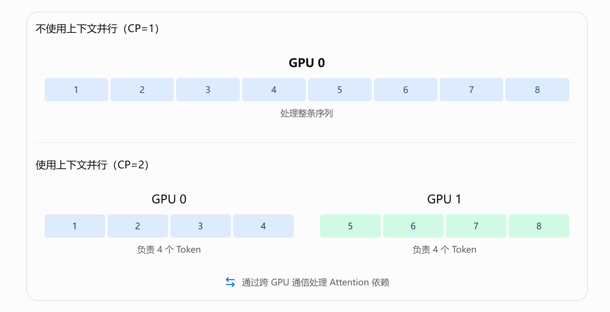

*图 1：CP=1 与 CP=2 的序列划分示意（连续切分仅用于解释基本概念）。*

上图采用最简单的连续切分，仅用于建立概念。后面会介绍 PCP 实际采用的 Head-Tail 切分方式。

这里有两个必须明确的概念。

**第一，上下文并行分割的是计算或存储任务，而不是割裂 Token 之间的依赖。**

对于因果 Self-Attention，Token 8 依然必须能够关注 Token 1～8，即使它们分布在不同 GPU 上。

**第二，上下文并行不改变模型的数学计算目标。**

在等价的全注意力实现中，使用 CP 前后的模型输出应当一致，允许存在浮点数计算顺序不同造成的微小误差。

## 1.2 为什么需要上下文并行？

对于大模型推理，需要分别考虑 Prefill 和 Decode 阶段。

### Prefill 阶段：长序列计算量大

假设用户输入 32K Tokens，模型需要同时处理大量 Query、Key 和 Value。

标准全注意力计算为：

$$
\operatorname{Attention}(Q,K,V)
=\operatorname{Softmax}\left(
\frac{QK^\top}{\sqrt{d_k}}+M
\right)V
$$

其中 $M$ 表示因果 Mask。

对于序列长度 $S$，稠密全注意力的主要计算复杂度为：

$$
O(S^2d)
$$

随着 $S$ 增大，Prefill 的计算负载显著增加。

PCP 可以将不同 Query Token 的计算任务分配到多个 GPU 上并行执行，从而降低长输入的 Prefill 延迟，改善 TTFT（Time To First Token）。

### Decode 阶段：历史 KV Cache 占用大量显存

进入 Decode 后，模型通常每次处理一个新 Token。

虽然新 Token 数量很少，但它需要关注完整的历史上下文。

例如，当前上下文包含 32K Tokens，生成下一个 Token 时，Attention 仍然需要访问历史 32K Tokens 的 KV Cache。

对于普通 MHA/GQA 模型，KV Cache 的理论大小可以写为：

$$
M_{\mathrm{KV}}=2LSH_{\mathrm{KV}}d_hb
$$

其中：

| 符号 | 含义 |
|---|---|
| $L$ | Transformer 层数 |
| $S$ | 已缓存的 Token 数 |
| $H_{\mathrm{KV}}$ | KV Head 数 |
| $d_h$ | 每个 KV Head 的维度 |
| $b$ | 每个元素的字节数 |

当上下文长度或并发请求数增加时，KV Cache 容易成为显存瓶颈。

DCP 可以将历史 KV Cache 沿 Token 维度分布到多个 GPU，减少重复存储，提高可支持的长上下文容量和并发量。

因此，vLLM 将两者区分为 PCP 和 DCP。参见 [vLLM Context Parallel Deployment][vllm-cp] 和 [vLLM-Ascend 官方说明][ascend-cp-latest]。

| 比较项 | PCP | DCP |
|---|---|---|
| 全称 | Prefill Context Parallelism | Decode Context Parallelism |
| 主要目标 | 加速长输入 Prefill | 降低 Decode KV Cache 冗余 |
| 主要划分对象 | 当前序列的 Query 计算任务 | 历史 KV Cache |
| 主要性能收益 | 降低 TTFT | 提升 KV 容量、并发和吞吐潜力 |
| 核心挑战 | 不同 Query 需要跨 GPU 访问 KV | 全局 Attention 如何由局部结果合并 |

## 1.3 理解 PCP 和 DCP 前，需要掌握的一个关键点

考虑任意 Transformer 层。

Token $i$ 的 Query、Key 和 Value 均来自该层输入的隐藏状态：

$$
q_i^{(l)}=z_i^{(l)}W_Q^{(l)}
$$

$$
k_i^{(l)}=z_i^{(l)}W_K^{(l)}
$$

$$
v_i^{(l)}=z_i^{(l)}W_V^{(l)}
$$

其中 $z_i^{(l)}$ 是第 $l$ 层经过必要归一化处理后的 Token 表示。

但是，Token $i$ 的 Attention 输出需要利用此前所有 Token 的 KV：

$$
\boxed{
a_i^{(l)}
=\operatorname{Attention}
(q_i^{(l)},K_{1:i}^{(l)},V_{1:i}^{(l)})
}
$$

因此：

**QKV 投影可以针对不同 Token 分别计算，但全局 Attention 需要访问跨 Token 的信息。**

这就是上下文并行需要跨 GPU 通信的根本原因。

---

# 二、PCP：Prefill 上下文并行的完整计算过程

## 2.1 实验设置

我们构造一个简化的 Decoder-only Transformer。

| 参数 | 数值 |
|---|---|
| 输入长度 | 8 Tokens |
| Transformer 层数 | 2 |
| GPU 数量 | 2 |
| PCP | 2 |
| TP / DCP / PP | 1 / 1 / 1 |
| 隐藏维度 | 8 |
| Query Heads | 2 |
| KV Heads | 1 |
| Head Dimension | 4 |
| 注意力机制 | 因果全注意力 |
| KV 通信方式 | All-Gather |

为了保持后面的例子一致，模型采用两个 Query Heads 共享一个 KV Head 的简化 MQA 结构。

这里假设两个 GPU 都拥有完整的模型权重，但各自处理不同 Token 的隐藏状态。

我们以 **vLLM-Ascend 的 Head-Tail PCP + All-Gather KV** 为例。vLLM 官方还介绍了通过 Ring Attention 分块交换 KV 的另一类 PCP 实现思路。参见 [vLLM-Ascend Context Parallel Design][ascend-cp-v030] 和 [NVIDIA Megatron Core Context Parallel][nvidia-cp]。

## 2.2 第一步：输入 Token 切分

输入序列为：

$$
X=[x_1,x_2,x_3,x_4,x_5,x_6,x_7,x_8]
$$

### 为什么不直接前四个、后四个进行切分？

因为因果 Attention 中，不同 Token 能够关注的位置数量不同。

| Token | 可关注的 Token 数 |
|---|---:|
| 1 | 1 |
| 2 | 2 |
| 3 | 3 |
| 4 | 4 |
| 5 | 5 |
| 6 | 6 |
| 7 | 7 |
| 8 | 8 |

假设简单连续切分：

GPU 0 负责 Token 1～4，对应每个 Head 的有效 QK 配对数：

$$
1+2+3+4=10
$$

GPU 1 负责 Token 5～8：

$$
5+6+7+8=26
$$

GPU 1 的有效 Attention 计算明显更多。

### Head-Tail 切分

vLLM-Ascend 的 PCP 采用 Head-Tail（首尾配对）策略。

对于 PCP=2，先将序列分为 $2\times2=4$ 个片段。

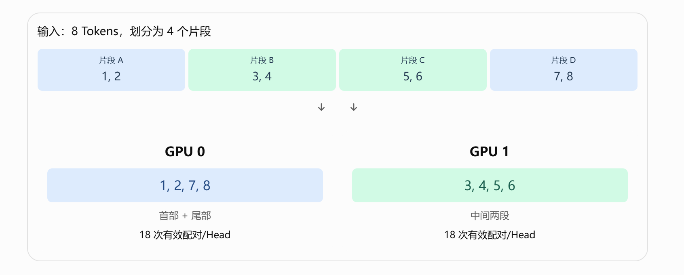

*图 2：Head-Tail 切分均衡了两卡有效因果 Attention 的 Query-Key 配对数量。*

因此，后续采用：

$$
\boxed{\text{GPU 0}:\{1,2,7,8\}}
$$

$$
\boxed{\text{GPU 1}:\{3,4,5,6\}}
$$

虽然 Token 的排列发生了变化，但每个 Token 的原始位置不变。实际因果 Mask 和 RoPE 仍依据原始序列位置构建。参见 [vLLM-Ascend 设计文档][ascend-cp-v030]。

## 2.3 第二步：Embedding，进入 Transformer 第 1 层

假设输入 Embedding 得到：

$$
H^{(0)}\in\mathbb{R}^{8\times8}
$$

其中每个 Token 的隐藏状态：

$$
h_i^{(0)}\in\mathbb{R}^{8}
$$

经过序列切分：

GPU 0：

$$
H_0^{(0)}
=[h_1^{(0)},h_2^{(0)},h_7^{(0)},h_8^{(0)}]
$$

GPU 1：

$$
H_1^{(0)}
=[h_3^{(0)},h_4^{(0)},h_5^{(0)},h_6^{(0)}]
$$

这里使用按行堆叠的隐藏状态表示，两个 GPU 的本地隐藏状态形状均为：

$$
\boxed{4\times8}
$$

接下来，两张 GPU 并行执行 Transformer 第 1 层。

## 2.4 第三步：第 1 层的 QKV 投影

假设模型采用 Pre-LN 结构，首先对本地隐藏状态执行 LayerNorm，然后进行 QKV 投影。

对于任意 Token：

$$
Q^{(1)}=ZW_Q^{(1)}
$$

$$
K^{(1)}=ZW_K^{(1)}
$$

$$
V^{(1)}=ZW_V^{(1)}
$$

其中：

$$
Z=\operatorname{LN}(H^{(0)})
$$

两张 GPU 分别计算自己负责的 4 个 Token。

| 张量 | GPU 0 形状 | GPU 1 形状 |
|---|---|---|
| Q | $4\times2\times4$ | $4\times2\times4$ |
| K | $4\times1\times4$ | $4\times1\times4$ |
| V | $4\times1\times4$ | $4\times1\times4$ |

注意：Q 有两个 Head，K/V 只有一个共享 Head。

到目前为止，所有计算都能由两张 GPU 独立完成，因为 QKV 投影不需要跨 Token 信息。

## 2.5 第四步：All-Gather KV

现在开始计算 Attention。

以 GPU 0 负责的 Token 8 为例：

$$
a_8^{(1)}
=\operatorname{Attention}
(q_8^{(1)},K_{1:8}^{(1)},V_{1:8}^{(1)})
$$

但 GPU 0 本地仅计算了 Token 1、2、7、8 的 KV。

它缺少：

$$
K_{3:6}^{(1)},V_{3:6}^{(1)}
$$

这些 KV 在 GPU 1 上。

因此，两张 GPU 需要交换当前 Transformer 层的 KV。

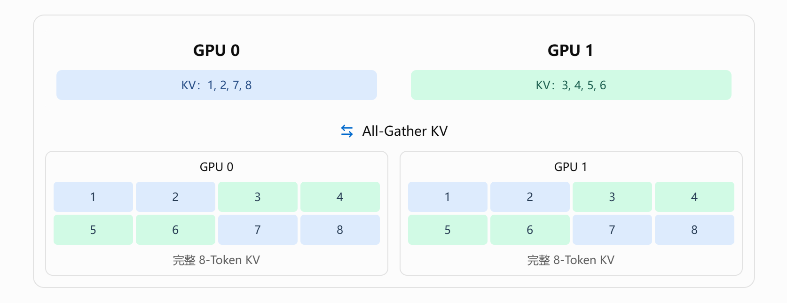

*图 3：两个 GPU 汇集当前层 K/V，获得完整的 8-Token KV。*

All-Gather 完成后，两张 GPU 都能够临时访问当前层的完整 KV：

$$
K_{\mathrm{all}}^{(1)}
\in\mathbb{R}^{8\times1\times4}
$$

$$
V_{\mathrm{all}}^{(1)}
\in\mathbb{R}^{8\times1\times4}
$$

但是 **Q 不需要进行 All-Gather**。

因为每张 GPU 的任务就是计算自己负责的 Query Token 对应的 Attention 输出。

## 2.6 第五步：各 GPU 计算 Attention

现在：

- GPU 0 拥有 4 个本地 Query，以及完整的 8 个 Token 的 KV。
- GPU 1 同样拥有 4 个本地 Query，以及完整的 8 个 Token 的 KV。

因此，两张 GPU 可以分别计算：

$$
A_0^{(1)}
=\operatorname{Attention}
(Q_0^{(1)},K_{\mathrm{all}}^{(1)},V_{\mathrm{all}}^{(1)})
$$

$$
A_1^{(1)}
=\operatorname{Attention}
(Q_1^{(1)},K_{\mathrm{all}}^{(1)},V_{\mathrm{all}}^{(1)})
$$

这里均包含正确的因果 Mask。

每张 GPU 的 Attention Score 形状为：

$$
4\times2\times8
$$

得到的 Attention 输出形状为：

$$
4\times2\times4
$$

可以通过下面的矩阵理解计算过程。

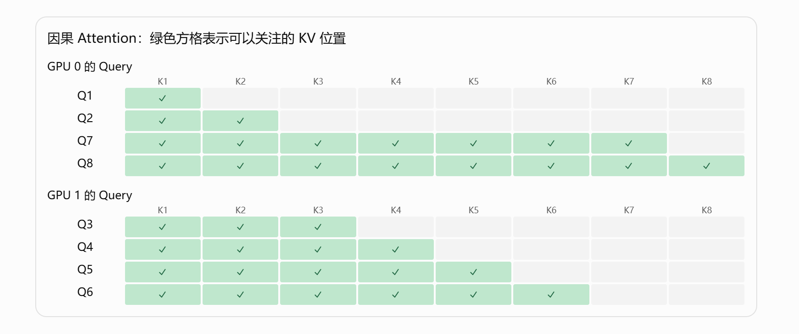

*图 4：绿色表示允许关注的 KV 位置，灰色表示因果 Mask 屏蔽的位置。*

以 Token 7 和 Token 4 为例：

GPU 0 计算：

$$
a_7^{(1)}
=\operatorname{Attention}
(q_7^{(1)},K_{1:7}^{(1)},V_{1:7}^{(1)})
$$

GPU 1 计算：

$$
a_4^{(1)}
=\operatorname{Attention}
(q_4^{(1)},K_{1:4}^{(1)},V_{1:4}^{(1)})
$$

可以看到：

即使 Token 7 位于 GPU 0、Token 4 位于 GPU 1，各自依然能够访问正确的完整前序上下文。

这就是 PCP 在保持因果 Attention 正确性的同时，实现不同 Query Token 并行计算的原理。

## 2.7 第六步：第 1 层输出投影、残差与 FFN

完成 Attention 后，两张 GPU 各自得到本地 4 个 Token 的 Attention 输出。

接下来计算：

$$
U^{(1)}
=H^{(0)}+\operatorname{OutProj}(A^{(1)})
$$

$$
H^{(1)}
=U^{(1)}
+\operatorname{FFN}^{(1)}
(\operatorname{LN}(U^{(1)}))
$$

由于此时的输出投影、LayerNorm、FFN 和残差连接不涉及不同 Token 之间的依赖，因此可以各自独立计算。

第 1 层最终得到：

| GPU 0 | GPU 1 |
|---|---|
| $h_1^{(1)}$ | $h_3^{(1)}$ |
| $h_2^{(1)}$ | $h_4^{(1)}$ |
| $h_7^{(1)}$ | $h_5^{(1)}$ |
| $h_8^{(1)}$ | $h_6^{(1)}$ |

每张 GPU 的第 1 层输出形状仍为：

$$
4\times8
$$

这里有一个重要结论：

**第 1 层结束后，不需要将所有隐藏状态恢复为完整的 $8\times8$ 张量，再送入第 2 层。**

两张 GPU 直接使用各自的本地隐藏状态继续计算。

## 2.8 第七步：进入 Transformer 第 2 层

第 2 层的计算流程与第 1 层相同。

但是要特别注意，**第 2 层必须重新计算 QKV，而不是复用第 1 层的 QKV。**

因为第 2 层的输入已经变成第 1 层输出：

$$
Q^{(2)}
=\operatorname{LN}(H^{(1)})W_Q^{(2)}
$$

$$
K^{(2)}
=\operatorname{LN}(H^{(1)})W_K^{(2)}
$$

$$
V^{(2)}
=\operatorname{LN}(H^{(1)})W_V^{(2)}
$$

两张 GPU 分别完成本地 QKV 投影后，需要进行**第 2 次 All-Gather KV**。

获取第二层完整 KV 后，再分别执行 Attention、输出投影、残差和 FFN。

最终得到：

GPU 0：

$$
H_0^{(2)}
=[h_1^{(2)},h_2^{(2)},h_7^{(2)},h_8^{(2)}]
$$

GPU 1：

$$
H_1^{(2)}
=[h_3^{(2)},h_4^{(2)},h_5^{(2)},h_6^{(2)}]
$$

至此，两个 Transformer 层全部计算完成。

## 2.9 第八步：从 Transformer 输出到生成 Token 9

对于自回归 Decoder-only 模型，预测下一个 Token 主要使用输入序列最后一个位置的隐藏状态。

本例最后一个输入位置是 Token 8。

因此：

$$
h_8^{(2)}
\rightarrow
\operatorname{FinalNorm}
\rightarrow
\operatorname{LMHead}
\rightarrow
\mathrm{Logits}_9
$$

再经过采样得到：

$$
\boxed{x_9}
$$

因为 Token 8 位于 GPU 0，所以其最终隐藏状态已在 GPU 0 上计算完成。实际系统根据并行配置，可能还需要输出顺序恢复和必要的通信。

**注意：Token 9 已经被采样生成，但 Token 9 本身尚未经过 Transformer，其 KV Cache 还没有产生。**

本轮 Prefill 的最终计算过程可归纳如下：

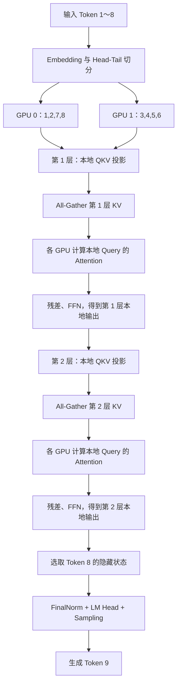

### PCP 过程中，KV Cache 究竟保存在哪里？

这里必须区分两种 KV 数据：

**Attention 临时使用的 KV：** 在 All-Gather 之后，每张 GPU 暂时拥有本层完整的 K、V，以便完成本层 Attention。

**持久化 KV Cache：** 用于后续 Decode，具体存储方式由 PCP、DCP、TP 及 Attention 后端共同决定。

对于我们采用的 **vLLM-Ascend v0.30.0、PCP=2、DCP=1、TP=1** 配置，官方设计文档说明，每个 PCP Rank 保留本序列对应的完整 KV Cache，而非永久只保留本地的 4 个 Token 的 KV。

因此，本例中两个 GPU 在 Prefill 结束后的持久化 KV Cache 可以表示为：

| 设备 | 第 1 层 KV Cache | 第 2 层 KV Cache |
|---|---|---|
| GPU 0 | Token 1～8 | Token 1～8 |
| GPU 1 | Token 1～8 | Token 1～8 |

这并不影响 PCP 的计算并行，因为**序列的计算切分和 KV Cache 的持久化存储布局是两个不同的问题**。

如果同时启用 DCP，则持久化 KV Cache 可以进一步沿 Token 维度分片。参见 [vLLM-Ascend v0.30.0 设计文档][ascend-cp-v030]。

## 2.10 PCP 的核心总结

对于 8 个输入 Token、2 层 Transformer、PCP=2：

| 计算阶段 | GPU 0 | GPU 1 | 是否需要跨 GPU 通信 |
|---|---|---|---|
| Embedding | 4 Tokens | 4 Tokens | 通常不需要 |
| 第 1 层 QKV | 本地 4 Tokens | 本地 4 Tokens | 不需要 |
| 第 1 层 Attention | 本地 Q + 全局 KV | 本地 Q + 全局 KV | **All-Gather KV** |
| 第 1 层 FFN | 本地 4 Tokens | 本地 4 Tokens | 不需要 |
| 第 2 层 QKV | 本地 4 Tokens | 本地 4 Tokens | 不需要 |
| 第 2 层 Attention | 本地 Q + 全局 KV | 本地 Q + 全局 KV | **再次 All-Gather KV** |
| 第 2 层 FFN | 本地 4 Tokens | 本地 4 Tokens | 不需要 |
| 最终输出 | Token 8 隐藏状态 | 其他本地状态 | 根据输出布局决定 |

这里的通信列仅指本例 PCP 对 Transformer 主干的额外通信，不包含真实模型可能存在的其他通信操作。

PCP 可以概括为：

$$
\boxed{
\text{切分 Query 计算}
\rightarrow
\text{获取全局 KV}
\rightarrow
\text{各 GPU 并行计算 Attention}
}
$$

它通过分摊长序列计算工作来改善 Prefill 性能，代价是 Attention 层额外的跨 GPU KV 通信。

---

# 三、DCP：Decode 上下文并行的完整计算过程

前面已经完成了 PCP 的完整计算流程。

接下来，我们继续使用相同的两层 Transformer 模型，分析 DCP 如何完成 Decode。

## 3.1 首先明确：DCP 与 PCP 的部署配置不同

为了便于解释 DCP，我们使用：

| 参数 | 设置 |
|---|---|
| GPU 数量 | 2 |
| TP | 2 |
| PCP | 1 |
| DCP | 2 |
| Transformer 层数 | 2 |
| Query Heads | 2 |
| KV Heads | 1 |
| Head Dimension | 4 |

这里有一个容易产生误解的地方。

前面的 PCP 例子使用 `TP=1、PCP=2、DCP=1`，而本节 DCP 例子使用 `TP=2、PCP=1、DCP=2`。

**这代表两种独立的并行部署示例，而不是说同一个 vLLM 实例在 Prefill 结束后，会自动将 PCP=2 改成 TP=2、DCP=2。**

在真实系统中，DCP 可以在单一服务实例中启用，也可以结合受支持的 PCP 配置使用。如果采用 P/D 分离、不同拓扑的两个实例，还需要匹配的 KV Cache 传输和布局转换机制。

本节为了单独解释 DCP，假设 8 个 Token 的 Prefill 已经在当前 `TP=2、DCP=2` 配置下完成，历史 KV Cache 也已经按照 DCP 规则存储。

在 vLLM 中，独立 DCP 可以复用已有的 TP Rank，而不需要另外增加 GPU。它尤其适用于 TP 使某些 KV Heads 被重复存储的情况。参见 [vLLM Context Parallel Deployment][vllm-cp]。

## 3.2 第一步：Prefill 完成后的 KV Cache 分布

输入仍为：

$$
X=[x_1,x_2,x_3,x_4,x_5,x_6,x_7,x_8]
$$

我们假设 `cp_kv_cache_interleave_size=1`，也就是按照单 Token 粒度交错存储。

因此：

$$
\text{GPU 0}:\{1,3,5,7\}
$$

$$
\text{GPU 1}:\{2,4,6,8\}
$$

对于每个 Transformer 层，都按照相同的位置归属规则存储该层 KV。

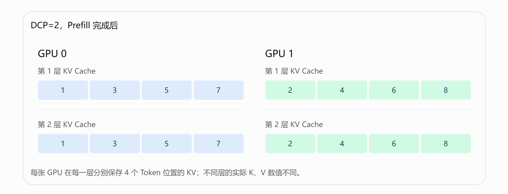

*图 5：每张 GPU 在每一层分别保存 4 个 Token 位置的 KV；不同层的 K、V 数值相互独立。*

如果使用普通 TP=2、DCP=1，在这个只有一个共享 KV Head 的模型中，两张 GPU 原本可能需要重复保存完整历史 KV Cache。

采用 DCP=2 后，每张 GPU 只需保存一部分序列位置的数据。

但这随即产生了一个问题：

**如果没有任何一张 GPU 拥有完整的历史 KV Cache，新的 Token 如何计算全局 Attention？**

这就是 DCP 的核心。

# 四、Decode 第 1 次迭代：输入 Token 9，生成 Token 10

## 4.1 第一步：Token 9 输入模型

假设 Prefill 已经采样出 Token 9。

现在需要将 Token 9 输入模型，经过两个 Transformer 层，生成 Token 10。

Embedding 后得到：

$$
h_9^{(0)}\in\mathbb{R}^{8}
$$

因为 TP=2，Attention 的两个 Query Heads 分别由两张 GPU 负责。

GPU 0：

$$
q_9^{(1,0)}\in\mathbb{R}^{4}
$$

GPU 1：

$$
q_9^{(1,1)}\in\mathbb{R}^{4}
$$

这与 PCP 不同。

PCP 的两张 GPU 分别处理不同 Token 的 Query；而这里的两张 GPU 处理的是**同一个 Token 9 的不同 Query Heads**。

与此同时，模型还需要计算 Token 9 在当前层的 K、V：

$$
k_9^{(1)},v_9^{(1)}\in\mathbb{R}^{4}
$$

根据交错存储规则，Token 9 对应 GPU 0：

$$
\operatorname{Owner}(9)=(9-1)\bmod2=0
$$

因此 GPU 0 负责保存 Token 9 的本层 KV。

此时第一层 KV Cache 分布为：

| GPU 0 | GPU 1 |
|---|---|
| 1、3、5、7、**9** | 2、4、6、8 |

这里的写入发生在每层计算时：第 1 层产生并写入第 1 层 KV，之后第 2 层才计算并写入第 2 层 KV。

## 4.2 第二步：All-Gather Q

Token 9 的 Attention 需要访问 Token 1～9 的 KV。

但 GPU 0、GPU 1 各自只有部分 KV。

一种直观方案是 All-Gather KV，让两张 GPU 都拿到完整历史 KV。

但是这种方式会引入大量的 KV 通信，并削弱 DCP 将 KV 分片处理的价值。

因此，DCP 采用不同的思路：

**既然 Decode 阶段 Query 很少，而历史 KV 很多，就优先交换 Query，让 Query 去访问各 GPU 本地的 KV Cache。**

对于本例：

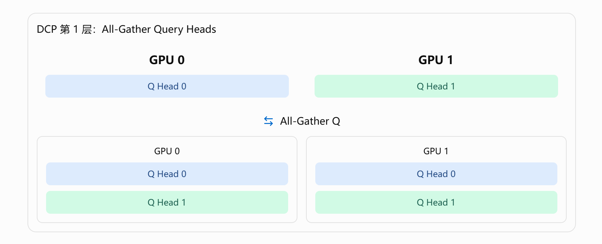

*图 6：两个 GPU 各自计算一个 Query Head，随后通过 All-Gather 获得完整 Query Heads。*

All-Gather 后，两张 GPU 都拥有 Token 9 的完整 Query：

$$
Q_9^{(1)}
=\begin{bmatrix}
q_9^{(1,0)}\\
q_9^{(1,1)}
\end{bmatrix}
\in\mathbb{R}^{2\times4}
$$

而 KV Cache 仍然分片存储，没有进行完整的跨 GPU KV 汇集。

## 4.3 第三步：各 GPU 计算局部 Attention

现在：

GPU 0 拥有：

$$
I_0=\{1,3,5,7,9\}
$$

GPU 1 拥有：

$$
I_1=\{2,4,6,8\}
$$

两张 GPU 都有相同的完整 Query，因此可以分别计算两个 Query Heads 在本地 KV 分片上的 Attention。

GPU 0：

$$
O_0^{(1)}
=\operatorname{Attention}
(Q_9^{(1)},K_{I_0}^{(1)},V_{I_0}^{(1)})
$$

GPU 1：

$$
O_1^{(1)}
=\operatorname{Attention}
(Q_9^{(1)},K_{I_1}^{(1)},V_{I_1}^{(1)})
$$

本例中 GPU 0 的 KV 长度为 5，GPU 1 的 KV 长度为 4。

所以对应 Attention Score 的形状分别为：

$$
\text{GPU 0}:\ 2\times5
$$

$$
\text{GPU 1}:\ 2\times4
$$

每个 GPU 计算结束后，得到两个 Query Heads 的局部 Attention 输出：

$$
O_0^{(1)},O_1^{(1)}
\in\mathbb{R}^{2\times4}
$$

除此之外，各 GPU 还需要得到每个 Query Head 对应的 LSE 统计量：

$$
L_0^{(1)},L_1^{(1)}
\in\mathbb{R}^{2}
$$

这是后续合并局部 Attention 的必要信息。

## 4.4 第四步：使用 LSE 合并全局 Attention

这里是 DCP 最重要的数学原理。

为了简化公式，我们只观察一个 Query Head，并省略层数下标。

假设两张 GPU 分别计算得到：

$$
O_0,\quad O_1
$$

局部 Attention 的 Softmax 分母为：

$$
Z_0=\sum_{j\in I_0}e^{s_j}
$$

$$
Z_1=\sum_{j\in I_1}e^{s_j}
$$

其中：

$$
s_j=\frac{q^\top k_j}{\sqrt{d_k}}
$$

### 为什么不能直接平均两个 Attention 输出？

因为 GPU 0 和 GPU 1 只在各自的 KV 子集上执行了 Softmax。

正确的全局 Attention 是：

$$
\boxed{
O=\frac{Z_0O_0+Z_1O_1}{Z_0+Z_1}
}
$$

而不是：

$$
O=\frac{O_0+O_1}{2}
$$

特别是不同 GPU 上 KV 数量不同，或者 Attention Score 分布不同时，直接平均就会产生错误。

### 为什么引入 LSE？

定义：

$$
L_0=\log Z_0,\qquad L_1=\log Z_1
$$

LSE（Log-Sum-Exp）的定义为：

$$
L_i=\log\sum_{j\in I_i}e^{s_j}
$$

在实际实现中，会使用数值稳定的计算方式：

$$
L_i=m_i+\log\sum_{j\in I_i}e^{s_j-m_i}
$$

其中：

$$
m_i=\max_{j\in I_i}s_j
$$

这样可以避免直接计算过大的指数值造成浮点上溢。

得到 $L_0,L_1$ 后，计算全局 LSE：

$$
L=\log(e^{L_0}+e^{L_1})
$$

实际使用稳定的 `logsumexp` 算法。

全局 Attention 输出就可以写为：

$$
\boxed{
O=e^{L_0-L}O_0+e^{L_1-L}O_1
}
$$

该公式与 $Z$ 加权公式在数学上完全等价，但数值稳定性更好。

这也是 vLLM 官方 DCP 设计采用 LSE 合并局部 Attention 输出的核心原因。参见 [vLLM DCP 算子源码][vllm-dcp-src]。

### 结合具体数字计算

假设在 Token 9 的一个 Query Head 中，所有 Attention Scores 都为 0。

为了演示，令 Value 为：

GPU 0：

$$
V_0=[1,3,5,7,0]
$$

GPU 1：

$$
V_1=[2,4,6,8]
$$

因为所有 Scores 为 0，局部 Softmax 为均匀分布。

因此：

$$
O_0=\frac{1+3+5+7+0}{5}=3.2
$$

$$
O_1=\frac{2+4+6+8}{4}=5
$$

LSE 分别为：

$$
L_0=\log5
$$

$$
L_1=\log4
$$

全局 LSE：

$$
L=\log9
$$

因此：

$$
O=e^{\log5-\log9}\times3.2
+e^{\log4-\log9}\times5
$$

$$
O=\frac59\times3.2+\frac49\times5
$$

$$
\boxed{O=4}
$$

而如果直接平均两个局部输出：

$$
\frac{3.2+5}{2}=4.1
$$

显然不正确。

因此我们可以理解：**LSE 用于恢复每个局部 Attention 结果在全局 Softmax 中应该占据的权重。**

## 4.5 第五步：跨 GPU 通信如何完成 LSE 合并？

需要区分数学上的合并公式与工程上的通信操作。

在 vLLM 的一种常见 DCP 通信实现 `ag_rs` 中，整体过程为：

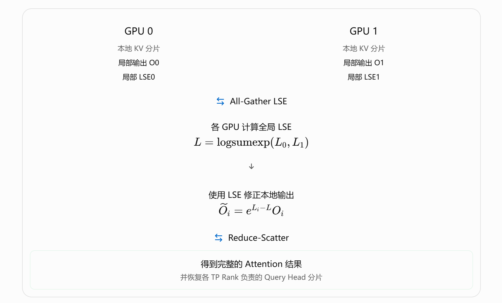

*图 7：`ag_rs` 通信方式先 All-Gather LSE，再本地修正局部输出，最后 Reduce-Scatter 合并。*

具体而言：

第一，使用 All-Gather 交换 $L_0,L_1$，使各 GPU 都可以计算全局 LSE。

第二，每张 GPU 本地计算：

$$
\widetilde O_i=e^{L_i-L}O_i
$$

第三，通过 Reduce-Scatter 将修正后的局部结果相加，并按 Query Head 分发。

对于本例，最终：

- GPU 0 得到 Query Head 0 的完整 Attention 输出。
- GPU 1 得到 Query Head 1 的完整 Attention 输出。

这里需要特别注意：

**在 `ag_rs` 实现中，All-Gather 汇集的是 LSE，而不是将 $O_0,O_1,L_0,L_1$ 全部进行 All-Gather。**

vLLM 的 `cp_lse_ag_out_rs()` 就采用了这一路径。

vLLM 还提供 `a2a` 通信实现，它通过 All-to-All 交换局部 Attention 输出和 LSE，然后完成加权合并。具体实现由所选后端决定。参见 [DCP 官方源码][vllm-dcp-src]。

## 4.6 第六步：完成第 1 层剩余计算

完成 DCP Attention 后，GPU 0、GPU 1 分别得到自己负责的 Query Head 对应的完整 Attention 输出。

随后继续执行 Transformer 第 1 层的输出投影、残差连接和 FFN。

由于这里还存在 TP=2，因此线性层的权重仍然按照 TP 方式划分。

例如，Attention 的输出投影可以表示为：

$$
u_9^{(1)}
=h_9^{(0)}
+\sum_{r=0}^{1}O_r^{(1)}W_{O,r}^{(1)}
$$

其中 $O_r^{(1)}$ 表示已经完成 DCP 全局合并后、分配到 TP Rank $r$ 的 Attention 输出。

跨 TP Rank 的求和可以通过 All-Reduce 等方式完成。

接着执行 FFN 和残差连接：

$$
h_9^{(1)}
=u_9^{(1)}
+\operatorname{FFN}^{(1)}
(\operatorname{LN}(u_9^{(1)}))
$$

于是得到第 1 层的最终隐藏状态：

$$
h_9^{(1)}\in\mathbb{R}^{8}
$$

## 4.7 第七步：进入 Transformer 第 2 层

此时 Token 9 进入第 2 层。

第 2 层重新计算 QKV：

$$
Q_9^{(2)},K_9^{(2)},V_9^{(2)}
$$

注意，不能复用第 1 层的 QKV。

第 2 层的 Token 9 KV 同样由 GPU 0 负责持久化存储。

然后重复完整的 DCP Attention：

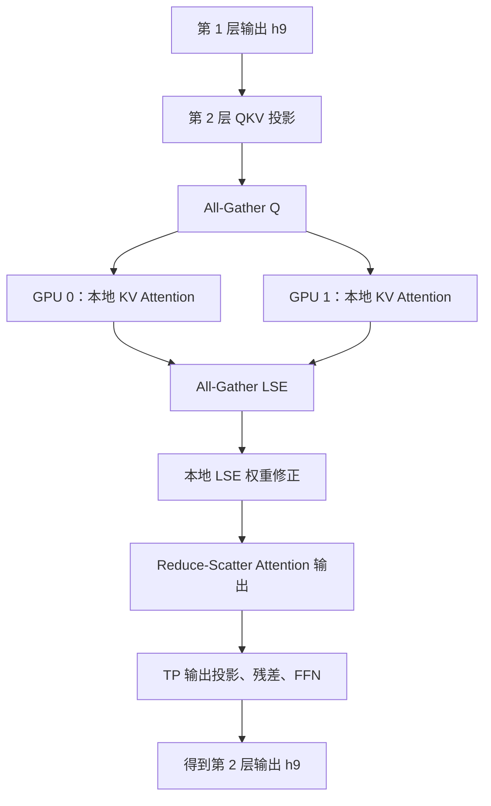

第二层结束后得到：

$$
h_9^{(2)}\in\mathbb{R}^{8}
$$

经过 FinalNorm、LM Head 和采样：

$$
h_9^{(2)}
\rightarrow
\mathrm{Logits}_{10}
\rightarrow
\boxed{x_{10}}
$$

至此，**第 1 次 Decode 迭代全部完成**。

此时：

- Token 9 的第 1 层 KV 已经存入 GPU 0。
- Token 9 的第 2 层 KV 已经存入 GPU 0。
- Token 10 已经生成，但还没有经过 Transformer。
- 因此 Token 10 的 KV Cache 尚不存在。

# 五、Decode 后续迭代：生成 Token 11、12

后续 Decode 不再需要重新处理完整的输入序列。

每次只将上一次采样得到的新 Token 输入模型，并复用已经建立的历史 KV Cache。

## 5.1 第 2 次 Decode：输入 Token 10，生成 Token 11

当前 KV Cache 包含 Token 1～9。

其分布为：

$$
\text{GPU 0}:\{1,3,5,7,9\}
$$

$$
\text{GPU 1}:\{2,4,6,8\}
$$

模型将 Token 10 输入第 1 层。

Token 10 的 KV 存储位置为：

$$
\operatorname{Owner}(10)=(10-1)\bmod2=1
$$

因此，新产生的 KV 写入 GPU 1。

随后对每一层执行以下计算：

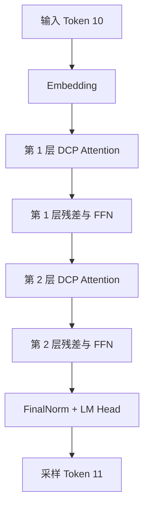

其中，每一层的 DCP Attention 都包括：

$$
\text{Query 分发}
\rightarrow
\text{本地 KV Attention}
\rightarrow
\text{LSE 合并}
$$

得到第二层隐藏状态后：

$$
h_{10}^{(2)}
\rightarrow
\mathrm{Logits}_{11}
\rightarrow
\boxed{x_{11}}
$$

第二次 Decode 完成后，两个 Transformer 层的 KV Cache 位置分布都是：

| GPU 0 | GPU 1 |
|---|---|
| 1、3、5、7、9 | 2、4、6、8、10 |

两张 GPU 各存储 5 个 Token 位置的 KV。

## 5.2 第 3 次 Decode：输入 Token 11，生成 Token 12

接下来，Token 11 输入模型。

因为：

$$
\operatorname{Owner}(11)=(11-1)\bmod2=0
$$

所以 Token 11 的 KV Cache 由 GPU 0 负责存储。

同样执行两层 Transformer：

$$
h_{11}^{(0)}
\xrightarrow{\text{Layer 1}}
h_{11}^{(1)}
\xrightarrow{\text{Layer 2}}
h_{11}^{(2)}
$$

在每一层中，都使用 DCP 方式完成 Attention 计算。

最终：

$$
h_{11}^{(2)}
\rightarrow
\mathrm{Logits}_{12}
\rightarrow
\boxed{x_{12}}
$$

至此，第三次 Decode 迭代完成。

## 5.3 整个 Decode 过程中，KV Cache 如何变化？

通过下面的表格可以看到每轮 Decode 后的 KV Cache 分布。

| 阶段 | 当前输入 | 当前输出 | GPU 0 的 KV 位置 | GPU 1 的 KV 位置 |
|---|---|---|---|---|
| Prefill 结束 | 1～8 | 9 | 1、3、5、7 | 2、4、6、8 |
| Decode 1 | 9 | 10 | 1、3、5、7、9 | 2、4、6、8 |
| Decode 2 | 10 | 11 | 1、3、5、7、9 | 2、4、6、8、10 |
| Decode 3 | 11 | 12 | 1、3、5、7、9、11 | 2、4、6、8、10 |

这张表对第 1 层和第 2 层均成立，但是不同层的 KV 数据是独立的。

需要注意一个自回归生成过程中的计数问题：

如果你的目标是**整个请求总共生成 3 个 Token**，那么它们是 Token 9、10、11。因为 Token 9 已经通过 Prefill 的最终 Logits 产生，所以只需要后面两次 Decode 迭代。

如果你的目标是 **Prefill 完成后，再执行 3 次 Decode 迭代**，那么就会生成 Token 10、11、12，总共输出 4 个新 Token。

这两种说法都可以使用，但在设计实验时需要明确是哪一种。

---

# 六、PCP 和 DCP 为什么采用不同的通信方式？

现在可以从根本上理解两者的差异。

## 6.1 Prefill：Query 多，KV 也多

假设上下文包含 32K Tokens。

Prefill 需要计算大量 Query 对应的 Attention。

使用 PCP=4 后，每张 GPU 只负责约 8K 个 Query Token。

此时，为了正确计算 Attention，可以通过 All-Gather KV 或 Ring Attention 等机制访问整段上下文。

因此 PCP 的典型计算模式是：

$$
\boxed{
\text{本地部分 Query}+\text{完整上下文 KV}
}
$$

其核心目的是将长序列的 Query 计算分布到多个 GPU。

## 6.2 Decode：Query 少，历史 KV 多

假设当前 Decode 需要处理 1 个新 Token，而历史上下文包含 32K Tokens。

这时：

$$
S_Q=1,\qquad S_{\mathrm{KV}}\approx32768
$$

如果每次都跨 GPU 汇集完整 KV，通信量可能非常大。

因此 DCP 采用不同的方式：

$$
\boxed{
\text{当前 Query}+\text{本地部分历史 KV}
}
$$

每张 GPU 只针对自己存储的 KV 分片计算 Attention，然后合并局部 Attention 输出。

对于我们采用的 `ag_rs` 实现，主要涉及：

$$
\operatorname{AllGather}(Q)
$$

$$
\operatorname{LocalAttention}(Q,K_i,V_i)
\rightarrow(O_i,L_i)
$$

$$
\operatorname{AllGather}(L_i)
$$

$$
\operatorname{ReduceScatter}\left(e^{L_i-L}O_i\right)
$$

因此，PCP 和 DCP 的通信策略有所不同，本质上是为了适应 Prefill 与 Decode 的不同计算特点。

---

# 七、PCP 与 DCP 的完整对比

| 维度 | PCP | DCP |
|---|---|---|
| 主要应用阶段 | Prefill | Decode |
| 典型输入特点 | 一次处理大量 Query Tokens | 每轮处理少量 Query Tokens |
| 核心划分维度 | 当前输入序列的 Query Token | 历史 KV Cache 的 Token |
| 每张 GPU 的 Query | 各自负责不同 Token | 典型 TP-DCP 中需要获得相关的完整 Query Heads |
| 每张 GPU 的 KV | 可以临时汇集完整 KV | 持久化保存部分历史 KV |
| 典型 Attention | 本地 Query + 全局 KV | 全部相关 Query + 本地 KV |
| 跨设备通信 | All-Gather KV 或分块 KV 通信 | All-Gather Q、LSE 与输出归约 |
| 单卡计算量 | 减少需要处理的 Query 数量 | 减少需要处理的历史 KV 数量 |
| 主要优化指标 | TTFT | KV 显存占用、并发、吞吐 |
| 主要代价 | KV 通信和同步开销 | Query、LSE、局部结果通信开销 |

这里的 All-Gather、Reduce-Scatter 描述对应本文选取的典型实现，并非所有版本和 Attention 后端都采用完全相同的通信流程。

---

# 八、理解上下文并行还需要注意的几个问题

## 8.1 PCP 不等于每张 GPU 的 KV Cache 都减少一半

PCP 划分的是 Prefill 的计算工作。

在某些 PCP-only 配置中，虽然每张 GPU 仅计算部分 Query，但持久化 KV Cache 依然可能在不同 PCP Rank 上重复存储。

因此，**不能仅根据 PCP=2 就推断单卡 KV Cache 显存占用减少 50%。**

这也是为什么 PCP 和 DCP 在实现中被分开设计。

## 8.2 DCP 不等于模型计算速度一定提高两倍

假设 DCP=2，历史 KV Cache 的有效 Token 位置均匀分布到两张 GPU。

那么每张 GPU 所需读取的历史 KV 数据可能减少约一半，但这不代表整个 Decode 延迟减少一半。

因为 Decode 还包含 QKV 投影、输出投影、FFN、跨 GPU 通信、采样等操作。

另外，两个 GPU 之间还需要执行 Query 分发和 Attention 结果合并。

因此 DCP 的主要价值通常是**降低 KV Cache 冗余，提高可支持的上下文或并发容量，并改善系统吞吐潜力**，而不是保证单请求 Decode 加速。

## 8.3 KV Cache 的逻辑分片不等于物理显存精确等比例减少

本例采用 8 个 Token，主要是为了容易理解计算过程。

真实 vLLM 使用分页式 KV Cache。

如果 `block_size=128`，则一个物理 KV Block 的容量对应 128 个本地 Token 槽位。

即使某张 GPU 当前只有 4 个有效 Token 位置，也可能需要为它们分配完整的物理 Block。

对于 DCP=2，vLLM-Ascend 官方文档中定义的全注意力虚拟 Block 可以覆盖：

$$
\text{Virtual Block Size}
=\text{block\_size}\times\text{DCP Size}
$$

所以：

$$
128\times2=256
$$

表示一个虚拟 Block 对应 256 个全局 Token 位置，而不是每张 GPU 都需要存储这 256 个 Token 的 KV。

**因此，DCP 的逻辑 Token 分片与实际显存占用、Block 分配粒度需要分别理解。** 参见 [vLLM-Ascend 设计文档][ascend-cp-v030]。

## 8.4 两层 Transformer 的 KV Cache 必须分开计算和保存

这是前面的两个例子共同体现的重要原则。

对于 Token $i$，在第 1 层：

$$
K_i^{(1)},V_i^{(1)}
$$

在第 2 层：

$$
K_i^{(2)},V_i^{(2)}
$$

通常有：

$$
K_i^{(1)}\ne K_i^{(2)}
$$

$$
V_i^{(1)}\ne V_i^{(2)}
$$

因为每层的隐藏状态及其投影权重不同。

无论使用 PCP 还是 DCP，都不能在不同 Transformer 层之间直接复用这些 KV。

## 8.5 不同注意力架构和版本存在实现差异

前面的例子采用 MQA 式简化模型，适合学习基本原理。

对于 MLA、GQA、SFA、DSA 等不同注意力机制，具体缓存内容、缓存分组和跨卡通信可能有所差异。

尤其需要注意，vLLM-Ascend 较新的官方文档说明，自 v0.32.0 起，针对 GQA 模型的 DCP 已进入弃用流程，而 MLA、SFA 的 DCP 仍受到支持。因此不能将某个版本的 MQA/GQA 教学示例直接当作所有模型和版本的可运行配置。参见 [vLLM-Ascend 最新使用指南][ascend-cp-latest]。

---

# 九、最终知识框架

可以用下面的流程图建立对 PCP 和 DCP 的整体认识。

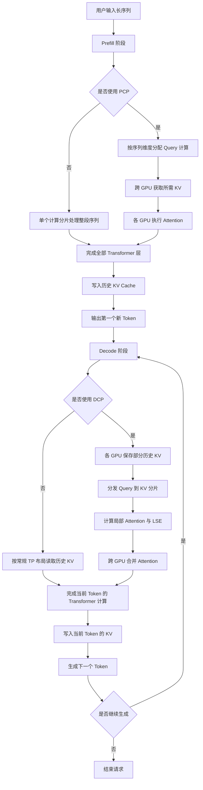

*注：该图描述逻辑推理流程；PCP、DCP 可以在受支持的配置中独立启用或组合使用。图中的 KV 写入不代表所有 KV 都只能在模型最后写入，实际各层在本层计算时更新对应缓存。*

## 十、用两句话真正理解 PCP 和 DCP

**PCP：一条长输入包含大量 Query，多个 GPU 分别负责不同的 Query Token，通过跨卡访问 KV，共同完成长序列的 Prefill 计算。**

**DCP：Decode 阶段每次只有少量 Query，但存在大量历史 KV，多个 GPU 分别存储并处理部分历史 KV，通过 LSE 等机制合并局部 Attention，得到全局结果。**

它们共同遵循的原则是：

$$
\boxed{
\text{分布式计算或存储}
+
\text{必要的跨设备通信}
=
\text{完整上下文 Attention}
}
$$

对于后续进一步研究 vLLM 的 Prefix Caching、KV Cache Block Table、Hybrid KV Cache Manager 和长上下文推理性能，这个区分尤其重要：**PCP 侧重 Query 计算如何分布；DCP 侧重 KV 存储和局部 Attention 如何协同。** 不要将两者混为一谈。

## 官方参考资料

本文以以下官方文档和源码为主要依据：

1. [vLLM：Context Parallel Deployment][vllm-cp]
2. [vLLM-Ascend v0.30.0：Context Parallel Design][ascend-cp-v030]
3. [vLLM：DCP Attention 通信与 LSE 合并源码][vllm-dcp-src]
4. [NVIDIA Megatron Core：Context Parallel Overview][nvidia-cp]
5. [vLLM-Ascend：最新上下文并行使用指南][ascend-cp-latest]

[vllm-cp]: https://docs.vllm.ai/en/stable/serving/context_parallel_deployment/
[ascend-cp-v030]: https://docs.vllm.ai/projects/ascend/en/v0.30.0/developer_guide/Design_Documents/context_parallel.html
[vllm-dcp-src]: https://docs.vllm.ai/en/latest/api/vllm/v1/attention/ops/dcp/
[nvidia-cp]: https://docs.nvidia.com/megatron-core/developer-guide/latest/user-guide/features/context_parallel.html
[ascend-cp-latest]: https://docs.vllm.ai/projects/ascend/en/latest/user_guide/feature_guide/context_parallel.html
