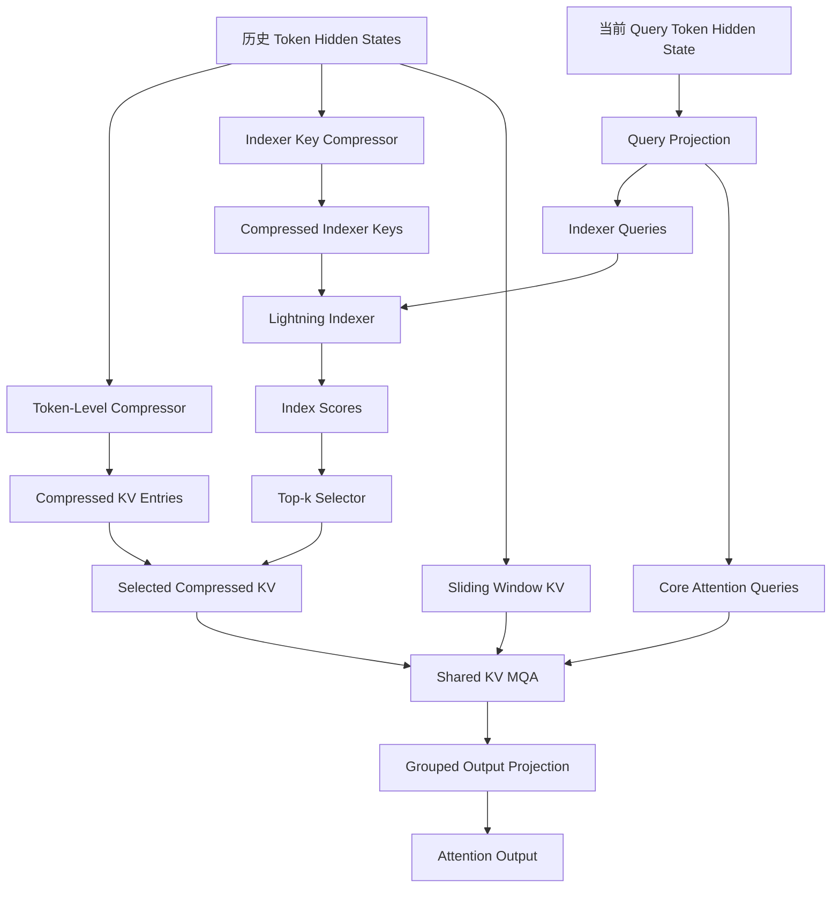

# DeepSeek-V4：CSA 与 HCA 注意力机制技术梳理

> 参考资料：DeepSeek-V4: Towards Highly Efficient Million-Token Context Intelligence，第 2.3 节（技术报告第 9–13 页）。

## 一、总体设计：为什么引入 CSA 和 HCA？

### 1.1 传统注意力机制面临的问题

随着大模型上下文长度不断增加，传统 Attention 主要面临两个性能瓶颈：

**（1）Attention 计算开销较大**

- Prefill 阶段：序列长度为 \(n\)，注意力计算复杂度通常为 \(O(n^2)\)。
- Decode 阶段：生成一个新 Token 时，需要与历史 Token 进行注意力计算。

**（2）KV Cache 存储开销较大**

一般而言：

\[
M_{\mathrm{KV}}\propto n\times n_{\mathrm{kv}}\times d_{\mathrm{head}}
\]

### 1.2 DeepSeek-V4 的解决思路

DeepSeek-V4 引入两种高效注意力机制：

- **CSA（Compressed Sparse Attention）**：KV 压缩 + 稀疏选择。
- **HCA（Heavily Compressed Attention）**：高度压缩 KV + 稠密注意力。

| 比较维度 | CSA | HCA |
|---|---|---|
| 压缩比例 | \(m\) | \(m'\gg m\) |
| 压缩方式 | 相邻窗口重叠压缩 | 非重叠压缩 |
| Lightning Indexer | 使用 | 不使用 |
| Top-k Selector | 使用 | 不使用 |
| 核心 Attention | 稀疏访问 | 稠密访问 |
| Sliding Window | 使用 | 使用 |
| Shared KV MQA | 使用 | 使用 |

## 二、CSA：Compressed Sparse Attention

### 2.1 CSA 的总体执行流程

