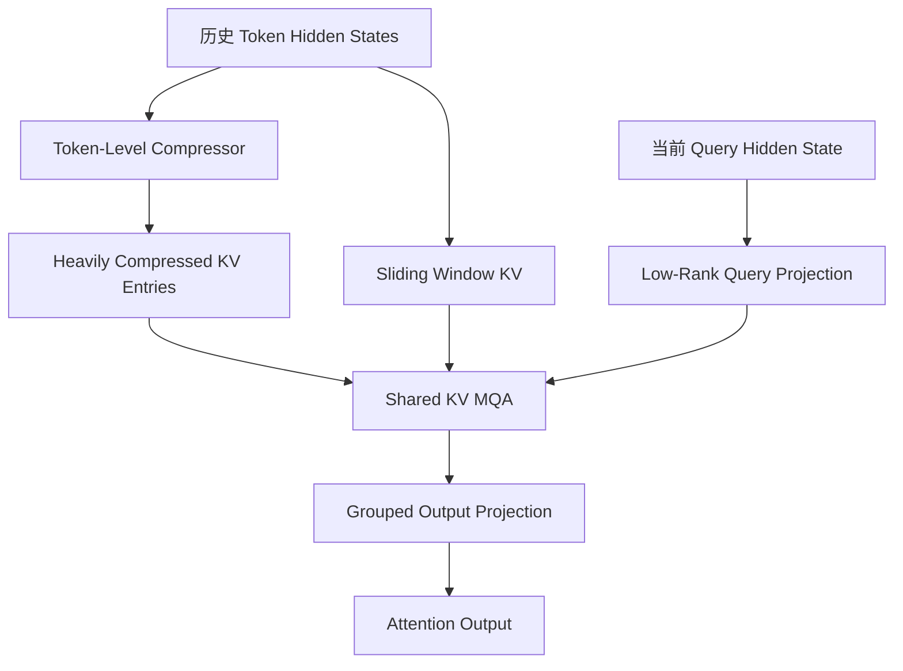

# DeepSeek-V4：CSA 与 HCA 注意力机制技术梳理

> 参考资料：DeepSeek-V4: Towards Highly Efficient Million-Token Context Intelligence，第 2.3 节（技术报告第 9–13 页）。
>
> 学习目标：理解 CSA 和 HCA 的设计动机、KV Cache 压缩原理、Lightning Indexer、核心注意力计算方式、共有技术机制，以及它们对长上下文推理性能和 KV Cache 管理的影响。

## 一、总体设计：为什么引入 CSA 和 HCA？

### 1.1 传统注意力机制面临的问题

随着大模型上下文长度不断增加，传统 Attention 主要面临两个性能瓶颈：

（1）Attention 计算开销较大

对于标准的全量自注意力：

- Prefill 阶段：序列长度为 $n$，注意力计算复杂度通常为 $O(n^2)$。
- Decode 阶段：生成一个新 Token 时，需要与历史 Token 进行注意力计算，其计算量随历史长度增加。

当上下文长度达到 100 万 Token 时，Attention 计算将成为推理过程中的重要性能瓶颈。

（2）KV Cache 存储开销较大

传统 Attention 需要缓存历史 Token 对应的 Key 和 Value。

一般而言：

$$
M_{\mathrm{KV}}\propto n\times n_{\mathrm{kv}}\times d_{\mathrm{head}}
$$

其中：

- $n$：已缓存的 Token 数量。
- $n_{\mathrm{kv}}$：KV Head 数量。
- $d_{\mathrm{head}}$：每个 KV Head 的维度。

这里省略了层数、K/V 两份数据及元素字节数等系数。

随着上下文长度增长，KV Cache 占用也持续增加，从而限制可支持的最大上下文长度与并发请求数量。

### 1.2 DeepSeek-V4 的解决思路

DeepSeek-V4 引入了两种高效注意力机制：

- CSA（Compressed Sparse Attention，压缩稀疏注意力）：先对历史 KV Entry 进行序列维度压缩，再利用稀疏选择机制，仅访问部分相关的压缩 KV Entry。
- HCA（Heavily Compressed Attention，高度压缩注意力）：对历史 KV Entry 进行更大比例的压缩，并在压缩后的 KV Entry 上执行稠密注意力。

两者的核心区别如下：

| 比较维度              | CSA          | HCA                      |
| ----------------- | ------------ | ------------------------ |
| 主要思路              | KV 压缩 + 稀疏选择 | 高比例 KV 压缩                |
| 压缩比例              | $m$      | $m'$，且 $m'\gg m$ |
| 压缩方式              | 相邻窗口重叠压缩     | 非重叠压缩                    |
| Lightning Indexer | 使用           | 不使用                      |
| Top-k Selector    | 使用           | 不使用                      |
| 核心 Attention      | 稀疏访问压缩 KV    | 稠密访问压缩 KV                |
| 滑动窗口              | 使用           | 使用                       |
| Key/Value 共享      | 是            | 是                        |
| Query Heads       | 多个           | 多个                       |

可以用两句话概括：

$$
\boxed{\mathrm{CSA}=\mathrm{KV\ Compression}+\mathrm{Sparse\ Attention}}
$$

$$
\boxed{\mathrm{HCA}=\mathrm{Heavy\ KV\ Compression}+\mathrm{Dense\ Attention}}
$$

DeepSeek-V4 将 CSA 和 HCA 交错布置在不同的 Attention 层中，形成混合注意力架构。

## 二、CSA：Compressed Sparse Attention

### 2.1 CSA 的总体执行流程

CSA 主要包含四个阶段：

1. Compressed KV Entries：对历史 KV Entry 进行压缩。
2. Lightning Indexer：计算当前 Query 与历史压缩块的索引相关性得分。
3. Top-k Selector：筛选相关性得分最高的 $k$ 个历史压缩 KV Entry。
4. Shared Key-Value MQA：使用筛选后的 KV Entry 和滑动窗口 KV 执行核心注意力计算。

整体流程可以表示为：

```mermaid
flowchart TD
    A["历史 Token Hidden States"] --> B["Token-Level Compressor"]
    A --> C["Indexer Key Compressor"]
    B --> D["Compressed KV Entries"]
    C --> E["Compressed Indexer Keys"]
    Q["当前 Query Token Hidden State"] --> F["Query Projection"]
    F --> G["Indexer Queries"]
    F --> H["Core Attention Queries"]
    G --> I["Lightning Indexer"]
    E --> I
    I --> J["Index Scores"]
    J --> K["Top-k Selector"]
    D --> L["Selected Compressed KV"]
    K --> L
    A --> M["Sliding Window KV"]
    L --> N["Shared KV MQA"]
    M --> N
    H --> N
    N --> O["Grouped Output Projection"]
    O --> P["Attention Output"]
```



需要注意：为了便于理解，流程图省略了压缩权重生成、Head 权重计算、RMSNorm、RoPE 和 Attention Sink 等细节。

### 2.2 CSA 的基本符号与维度

假设输入序列为：

$$
H\in\mathbb R^{n\times d}
$$

主要符号定义如下：

| 符号          | 含义                           |
| ----------- | ---------------------------- |
| $n$     | 原始序列长度                       |
| $d$     | Transformer Hidden Size      |
| $m$     | CSA 的 Token 压缩比例             |
| $c$     | Core Attention 的 KV Entry 维度 |
| $c_I$   | Lightning Indexer Key 的特征维度  |
| $d_c$   | Query 低秩压缩维度                 |
| $n_h^I$ | Indexer Query Head 数量        |
| $n_h$   | Core Attention Query Head 数量 |
| $k$     | Top-k 选择数量                   |
| $t$     | 当前 Query Token 的位置           |
| $s$     | 历史压缩 KV Block 的索引            |

其中，$d,c,c_I,d_c$ 是不同的特征维度，不要求它们相等。

### 2.3 第一阶段：Compressed KV Entries

#### （1）实现目的

CSA 首先通过 Token-Level Compressor，将每 $m$ 个历史 Token 对应的 KV 信息压缩为一个 KV Entry。

原始序列长度为：

$$
n
$$

压缩后的 KV Entry 数量约为：

$$
\frac{n}{m}
$$

例如：

$$
n=1024,\qquad m=16
$$

则原始 1024 个 Token 被压缩为 64 个 KV Entry。

这里的压缩发生在序列维度，并不是简单地减少单个 KV 向量的特征维度。

#### （2）生成原始 KV 表示和压缩权重

CSA 首先通过四个线性投影生成两组 KV 表示以及对应的压缩权重得分。

KV 表示：

$$
C^a=HW_{KV}^a
$$

$$
C^b=HW_{KV}^b
$$

压缩权重得分：

$$
Z^a=HW_Z^a
$$

$$
Z^b=HW_Z^b
$$

其中：

$$
C^a,C^b,Z^a,Z^b\in\mathbb R^{n\times c}
$$

对应的投影矩阵为：

$$
W_{KV}^a,W_{KV}^b,W_Z^a,W_Z^b \in\mathbb R^{d\times c}
$$

各个张量的作用：

| 张量        | 作用               |
| --------- | ---------------- |
| $C^a$ | 当前窗口参与压缩的 KV 表示  |
| $C^b$ | 前一个窗口参与压缩的 KV 表示 |
| $Z^a$ | 当前窗口的压缩权重得分      |
| $Z^b$ | 前一个窗口的压缩权重得分     |

#### （3）重叠窗口压缩

CSA 不只是将每个独立的 $m$-Token 窗口压缩成一个 KV Entry，而是采用相邻窗口重叠参与压缩的方式。

对于第 $i$ 个压缩 KV Entry：

- 从 $C^a$ 中取当前窗口的 $m$ 个 Token。
- 从 $C^b$ 中取前一个窗口的 $m$ 个 Token。
- 将两组表示按照学习得到的权重加权聚合。

对应的索引范围为：

$$
C^a_{mi:m(i+1)-1}
$$

$$
C^b_{m(i-1):mi-1}
$$

每组数据的维度都是：

$$
m\times c
$$

因此，一个压缩 KV Entry 实际融合了相邻两个窗口中共 $2m$ 个候选 KV 表示。

但由于相邻压缩结果之间存在窗口重叠，最终压缩后的 Entry 数量仍然约为 $n/m$，而不是 $n/(2m)$。

#### （4）计算压缩权重

论文公式 (11)：

$$
\begin{aligned} & [S^a_{mi:m(i+1)-1};S^b_{m(i-1):mi-1}] \\ &= \operatorname{Softmax}_{\mathrm{row}} \left( [Z^a_{mi:m(i+1)-1}+B^a; Z^b_{m(i-1):mi-1}+B^b] \right) \end{aligned}
$$

其中：

$$
B^a,B^b\in\mathbb R^{m\times c}
$$

是可学习的位置偏置。

拼接后的矩阵维度为：

$$
\boxed{2m\times c}
$$

这里的 $\operatorname{Softmax}_{\mathrm{row}}$ 表示沿着行维度归一化。

因此：

- 对每个特征维度，沿 $2m$ 个 Token 位置计算 Softmax。
- 输出矩阵的每一列之和为 1。
- 并不是每一行之和为 1。

对于第 $r$ 个特征维度：

$$
\sum_{j=1}^{2m}S_{j,r}=1
$$

对应 PyTorch 操作：

```python
# A: [2*m, c]
S = torch.softmax(A, dim=0)
```

这意味着每个特征维度都可以独立学习从哪些历史 Token 中提取信息。

#### （5）生成压缩 KV Entry

论文公式 (12)：

$$
\begin{aligned} C_i^{\mathrm{Comp}} =& \sum_{j=mi}^{m(i+1)-1}S_j^a\odot C_j^a \\ &+ \sum_{j=m(i-1)}^{mi-1}S_j^b\odot C_j^b \end{aligned}
$$

其中：

- $\odot$：Hadamard Product，即逐元素乘法。
- $S_j^a,S_j^b\in\mathbb R^c$：对应 Token 的压缩权重。
- $C_j^a,C_j^b\in\mathbb R^c$：对应 Token 的 KV 表示。

最终：

$$
C_i^{\mathrm{Comp}}\in\mathbb R^c
$$

整个压缩 KV 矩阵为：

$$
\boxed{ C^{\mathrm{Comp}}\in\mathbb R^{(n/m)\times c} }
$$

这一阶段的核心作用，是将较长的原始 Token 序列压缩为较短的 KV Entry 序列，从而减少长期 KV 存储需求。

论文还规定，当 $i=0$ 时，前一个窗口不存在，使用负无穷压缩权重得分及零值 KV 进行边界填充。

### 2.4 第二阶段：Lightning Indexer

经过 KV 压缩后，虽然历史 KV Entry 数量已经减少至约 $n/m$，但如果仍对所有压缩 Entry 执行核心注意力，计算量仍会随上下文长度增长。

因此，CSA 引入 Lightning Indexer，用于从全部历史压缩 Entry 中筛选当前 Query 最相关的部分。

它的计算过程可以分为四步。

#### （1）生成 Compressed Indexer Keys

Lightning Indexer 使用与 Core KV Compressor 类似的压缩方式，生成单独的索引 Key。

$$
\boxed{ K^{I\mathrm{Comp}}\in\mathbb R^{(n/m)\times c_I} }
$$

注意：

$$
C^{\mathrm{Comp}}\in\mathbb R^{(n/m)\times c}
$$

$$
K^{I\mathrm{Comp}}\in\mathbb R^{(n/m)\times c_I}
$$

这两种表示具有不同用途：

| 表示                       | 功能                      |
| ------------------------ | ----------------------- |
| $K^{I\mathrm{Comp}}$ | 计算索引相关性得分，选择历史压缩块       |
| $C^{\mathrm{Comp}}$  | 在核心注意力中同时充当 Key 和 Value |

因此，$c_I$ 与 $c$ 不要求相等。论文在这部分没有规定二者必须满足某种大小关系。

#### （2）生成 Indexer Queries

对于当前 Query Token $t$，其 Hidden State 为：

$$
h_t\in\mathbb R^d
$$

首先执行低秩降维：

$$
c_t^Q=h_tW^{DQ} \tag{13}
$$

其中：

$$
W^{DQ}\in\mathbb R^{d\times d_c}
$$

因此：

$$
c_t^Q\in\mathbb R^{d_c}
$$

随后进行升维：

$$
q_t^I=c_t^QW^{IUQ} \tag{14}
$$

其中：

$$
W^{IUQ}\in\mathbb R^{d_c\times(c_In_h^I)}
$$

得到：

$$
q_t^I\in\mathbb R^{c_In_h^I}
$$

将其划分为 $n_h^I$ 个 Indexer Query Head：

$$
q_t^I= [q_{t,1}^I;\ldots;q_{t,n_h^I}^I]
$$

每个 Head 的维度为：

$$
\boxed{q_{t,h}^I\in\mathbb R^{c_I}}
$$

为什么先降维再升维？

主要是为了采用低秩参数化，避免直接进行从 $d$ 到 $c_In_h^I$ 的大型线性映射。

直接投影需要的参数量为：

$$
P_{\mathrm{direct}}=dc_In_h^I
$$

低秩投影需要的参数量为：

$$
P_{\mathrm{lowrank}}=dd_c+d_cc_In_h^I
$$

当 $d_c$ 足够小时，可以降低参数规模和线性投影计算开销。

此外，低秩中间表示 $c_t^Q$ 还会被后续 Core Attention Query 复用。

#### （3）计算各个 Indexer Head 的权重

论文公式 (15)：

$$
w_t^I=h_tW^w \tag{15}
$$

其中：

$$
W^w\in\mathbb R^{d\times n_h^I}
$$

因此：

$$
w_t^I\in\mathbb R^{n_h^I}
$$

即：

$$
w_t^I= [w_{t,1}^I,\ldots,w_{t,n_h^I}^I]
$$

这里的 $w_{t,h}^I$ 表示当前 Query Token 对第 $h$ 个 Indexer Head 的加权系数。

该权重由当前 Hidden State 动态生成，因此不同 Query Token 可以使用不同的 Head 组合方式。

需要注意，论文没有对 $w_t^I$ 施加 Softmax，因此它不是一个必须非负、且总和为 1 的概率分布。

#### （4）计算 Index Scores

对于当前 Query Token $t$，以及历史压缩块 $s$，定义索引分数：

$$
\boxed{ I_{t,s}= \sum_{h=1}^{n_h^I} w_{t,h}^I \operatorname{ReLU} \left( q_{t,h}^I\cdot K_s^{I\mathrm{Comp}} \right) } \tag{16}
$$

其中：

| 符号                         | 含义                             | 维度        |
| -------------------------- | ------------------------------ | --------- |
| $q_{t,h}^I$           | 第 $h$ 个 Indexer Query Head | $c_I$ |
| $K_s^{I\mathrm{Comp}}$ | 第 $s$ 个历史压缩块的 Indexer Key  | $c_I$ |
| $w_{t,h}^I$           | 第 $h$ 个 Indexer Head 权重    | 标量        |
| $I_{t,s}$             | 当前 Token 与压缩块 $s$ 的相关性得分   | 标量        |

计算可以分为：

1. 将每个 Indexer Query Head 与同一个压缩 Indexer Key 计算内积。
2. 对内积结果应用 ReLU。
3. 通过当前 Token 生成的 Head 权重进行加权求和。

这里有两个值得注意的设计：

第一，所有 Indexer Query Heads 共享同一个 Indexer Key。

因此，并不需要为每个 Indexer Head 分别存储一套历史 Indexer Key。

第二，$I_{t,s}$ 是索引相关性得分，而不是最终的 Attention Weight。

它的作用只是决定哪些历史压缩 KV Entry 应该参与后续核心注意力。

此外，论文要求：

$$
s<\left\lfloor\frac{t}{m}\right\rfloor
$$

这意味着当前 Query 只能检索已经完成的历史压缩块，而不能检索当前尚未完成的压缩块，从而满足因果约束。

### 2.5 第三阶段：Top-k Selector

对于当前 Token $t$，Lightning Indexer 会生成一组历史压缩块的索引得分：

$$
I_{t,:} = [I_{t,0},I_{t,1},\ldots]
$$

随后通过 Top-k Selector，选择得分最高的 $k$ 个历史压缩块：

$$
\Omega_t=\operatorname{TopK}(I_{t,:},k)
$$

再根据选中的压缩块索引，从 Core KV Cache 中读取对应的压缩 KV Entry：

$$
\boxed{ C_t^{\mathrm{SprsComp}} = \{C_s^{\mathrm{Comp}}\mid s\in\Omega_t\} } \tag{17}
$$

在候选块数量不少于 $k$ 时：

$$
C_t^{\mathrm{SprsComp}}\in\mathbb R^{k\times c}
$$

例如，假设：

$$
n=1024,\quad m=16,\quad k=8
$$

那么：

- 原始历史 Token 数量：1024。
- 压缩后的 KV Entry 数量：64。
- 当前 Query 选中的压缩 KV Entry 数量：8。

最终核心注意力只需要访问这 8 个压缩 Entry，以及额外的滑动窗口 KV。

需要特别区分两个概念：

- KV Compression：减少长期存储的历史 KV Entry 数量。
- Top-k Selection：减少当前 Query 核心注意力需要访问的历史压缩 KV Entry 数量。

未被当前 Query 选中的压缩 Entry 并不会因此自动从缓存中删除，因为后续 Query 可能需要访问它们。

### 2.6 第四阶段：Shared Key-Value Multi-Query Attention

完成 Top-k 选择后，CSA 开始执行真正的核心注意力计算。

#### （1）生成 Core Attention Queries

Core Attention 与 Lightning Indexer 共享低秩中间表示：

$$
c_t^Q=h_tW^{DQ}
$$

随后：

$$
q_t=c_t^QW^{UQ} \tag{18}
$$

其中：

$$
W^{UQ}\in\mathbb R^{d_c\times(cn_h)}
$$

因此：

$$
q_t\in\mathbb R^{cn_h}
$$

将其拆分为 $n_h$ 个 Query Head：

$$
q_t=[q_{t,1};\ldots;q_{t,n_h}]
$$

每个 Query Head 的维度为：

$$
q_{t,h}\in\mathbb R^c
$$

这里的 $n_h$ 是 Core Attention Query Head 数量，而不是 Lightning Indexer 的 $n_h^I$。

#### （2）Shared KV MQA

论文公式 (19)：

$$
\boxed{ o_{t,h} = \operatorname{CoreAttn} \left( q_{t,h}, C_t^{\mathrm{SprsComp}}, C_t^{\mathrm{SprsComp}} \right) }
$$

这里的关键是：

$$
\boxed{K=V=C_t^{\mathrm{SprsComp}}}
$$

也就是说：

- 多个 Query Head。
- 所有 Query Head 共享同一组 KV Entry。
- 同一个 KV Entry 同时充当 Key 和 Value。

这与传统的 MHA 存在明显区别。

| 注意力类型                     | Query   | Key        | Value        |
| ------------------------- | ------- | ---------- | ------------ |
| MHA                       | 多个 Head | 每个 Head 独立 | 每个 Head 独立   |
| 常规 MQA                    | 多个 Head | 所有 Head 共享 | 所有 Head 共享   |
| DeepSeek-V4 Shared KV MQA | 多个 Head | 所有 Head 共享 | 与 Key 使用同一表示 |

注意，实际 CSA 核心注意力还会加入最近 $n_{\mathrm{win}}$ 个 Token 对应的未压缩 KV Entry，这部分将在后面统一说明。

#### （3）Grouped Output Projection

每个 Core Attention Head 的输出为：

$$
o_{t,h}\in\mathbb R^c
$$

多个 Head 拼接：

$$
o_t=[o_{t,1};\ldots;o_{t,n_h}]
$$

因此：

$$
o_t\in\mathbb R^{cn_h}
$$

由于 $cn_h$ 可能很大，直接将其投影到模型隐藏维度 $d$ 会产生较大的矩阵乘法开销。

因此，DeepSeek-V4 使用 Grouped Output Projection：

1. 将 $n_h$ 个 Head 分成 $g$ 组。
2. 每组分别投影到较小的中间维度 $d_g$。
3. 将所有组的中间输出拼接。
4. 最后统一投影回 $d$ 维。

其中每组原始输入维度为：

$$
\frac{cn_h}{g}
$$

每组压缩到：

$$
d_g<\frac{cn_h}{g}
$$

拼接后得到：

$$
gd_g
$$

最终：

$$
\hat o_t\in\mathbb R^d
$$

Grouped Output Projection 的主要目的，是降低较大多头输出维度带来的投影计算开销。

## 三、HCA：Heavily Compressed Attention

### 3.1 HCA 的实现目的

HCA 与 CSA 一样，目标都是提高超长上下文的注意力计算效率并降低 KV Cache 占用。

但两者采用的技术路线不同：

- CSA 采用相对较低的 KV 压缩比例，并利用 Lightning Indexer 执行稀疏选择。
- HCA 采用更高的 KV 压缩比例，从而能够直接对全部历史压缩 KV Entry 执行稠密注意力。

HCA 的压缩比例为：

$$
m'
$$

并且：

$$
\boxed{m'\gg m}
$$

因此，在相同上下文长度下，HCA 需要保存的压缩 KV Entry 通常明显少于 CSA。

### 3.2 HCA 的总体执行流程



与 CSA 相比，HCA 不需要：

- Lightning Indexer。
- Index Scores。
- Top-k Selector。

因此，HCA 的整体计算路径更短。

### 3.3 HCA 的 KV 压缩机制

#### （1）生成原始 KV 表示和压缩权重

HCA 首先对输入 Hidden States 进行线性映射：

$$
C=HW^{KV} \tag{20}
$$

$$
Z=HW^Z \tag{21}
$$

其中：

$$
C,Z\in\mathbb R^{n\times c}
$$

$$
W^{KV},W^Z\in\mathbb R^{d\times c}
$$

与 CSA 不同，HCA 仅使用一组 KV 表示和压缩权重得分，而不是两组。

#### （2）非重叠窗口压缩

HCA 将每个包含 $m'$ 个 Token 的窗口独立压缩为一个 KV Entry。

对于第 $i$ 个压缩窗口：

$$
Z_{m'i:m'(i+1)-1}\in\mathbb R^{m'\times c}
$$

加入位置偏置：

$$
B\in\mathbb R^{m'\times c}
$$

然后计算：

$$
S_{m'i:m'(i+1)-1} = \operatorname{Softmax}_{\mathrm{row}} \left( Z_{m'i:m'(i+1)-1}+B \right) \tag{22}
$$

与 CSA 一样，这里的 Softmax 沿行维度执行，因此每个特征维度在 $m'$ 个 Token 位置上的压缩权重之和为 1。

随后：

$$
\boxed{ C_i^{\mathrm{Comp}} = \sum_{j=m'i}^{m'(i+1)-1} S_j\odot C_j } \tag{23}
$$

最终得到：

$$
C^{\mathrm{Comp}}\in\mathbb R^{(n/m')\times c}
$$

注意：HCA 不采用 CSA 的相邻窗口重叠压缩。

例如：

- $n=1024$。
- $m'=128$。

则：

$$
1024\rightarrow 8
$$

原始 1024 个 Token 对应的信息被聚合成 8 个压缩 KV Entry。

这里的数字仅用于说明压缩机制，并不代表实际模型配置。

### 3.4 HCA 的 Core Attention

HCA 采用与 CSA 相同的低秩 Query 生成方式：

$$
c_t^Q=h_tW^{DQ} \tag{24}
$$

$$
q_t=c_t^QW^{UQ} \tag{25}
$$

其中：

$$
q_t\in\mathbb R^{cn_h}
$$

每个 Query Head：

$$
q_{t,h}\in\mathbb R^c
$$

随后执行 Shared KV MQA：

$$
\boxed{ o_{t,h} = \operatorname{CoreAttn} \left( q_{t,h}, C^{\mathrm{Comp}}, C^{\mathrm{Comp}} \right) } \tag{26}
$$

与 CSA 最大的区别在于：

HCA 不使用 Top-k 选择，而是访问当前 Query 可见的全部历史压缩 KV Entry。

因此，虽然 HCA 使用稠密注意力，但它的稠密注意力计算发生在高度压缩后的序列上，并不是原始的全部 Token 上。

最后，HCA 同样采用 Grouped Output Projection，将多头输出映射回隐藏维度 $d$。

## 四、CSA 和 HCA 共同使用的关键技术

除了压缩策略与稀疏选择方式不同，CSA 和 HCA 还共享多项重要设计。

### 4.1 Sliding Window Attention

#### （1）为什么需要滑动窗口？

CSA 和 HCA 都要求当前 Query 只能访问已经完成的历史压缩块，以满足因果注意力约束。

这意味着当前 Query 无法通过压缩 Entry 读取其所在压缩块内的其他 Token。

同时，近期 Token 往往包含重要的局部细节，过度压缩可能造成信息损失。

因此，DeepSeek-V4 为 CSA 和 HCA 都引入了额外的滑动窗口 KV 分支。

#### （2）如何实现？

对于当前 Query Token，额外生成最近 $n_{\mathrm{win}}$ 个 Token 对应的未压缩 KV Entry。

这些 KV Entry 与历史压缩 KV Entry 共同参与 Core Attention。

因此，CSA 的核心注意力输入可以概括为：

$$
\boxed{ KV_{\mathrm{CSA}} = KV_{\mathrm{TopKComp}} \cup KV_{\mathrm{Window}} }
$$

HCA 的核心注意力输入为：

$$
\boxed{ KV_{\mathrm{HCA}} = KV_{\mathrm{HistoricalComp}} \cup KV_{\mathrm{Window}} }
$$

这里的集合符号仅用于表示两类 KV 来源的合并。

因此，CSA 和 HCA 都包含两类不同粒度的 KV 信息：

- Compressed KV：表示较长距离的历史信息。
- Sliding Window KV：保留最近 Token 的细粒度信息。

对于 CSA，在忽略边界与可见性限制时：

$$
N_{\mathrm{CoreKV}}\approx k+n_{\mathrm{win}}
$$

对于 HCA：

$$
N_{\mathrm{CoreKV}}\approx\frac{n}{m'}+n_{\mathrm{win}}
$$

这也说明 HCA 的核心注意力计算量仍会随历史压缩 Entry 数量增长，而 CSA 的 Top-k 压缩 Entry 数量可以保持固定。

### 4.2 Query 和 KV Entry 的 RMSNorm

CSA 与 HCA 都会在 Core Attention 计算前，对以下表示额外执行 RMSNorm：

- 每个 Query Head。
- 共享的压缩 KV Entry。

主要目的是避免 Attention Logits 过大，提高训练过程的数值稳定性。

这一设计对于 Shared KV MQA 尤其重要，因为 Query 与共享 KV 的内积尺度会直接影响注意力得分。

### 4.3 Partial RoPE

CSA 与 HCA 都采用部分旋转位置编码（Partial Rotary Positional Embedding）。

技术报告明确指出：

- Query 向量的最后 64 维使用 RoPE。
- KV Entry 的最后 64 维使用 RoPE。
- Core Attention 输出的最后 64 维还需要执行反向旋转。

原因是：

传统注意力中 Key 和 Value 是不同的表示，而 DeepSeek-V4 的 Shared KV MQA 使用：

$$
K=V
$$

因此，当 KV Entry 经过 RoPE 后，Value 也携带位置旋转信息。

核心注意力对 Value 进行加权求和后，输出也会携带这些位置旋转信息。

为处理这一问题，论文对输出最后 64 维执行相应的反向旋转，使输出体现相对位置信息。

需要注意，技术报告第 13 页只概述了这一设计。关于不同压缩 Entry 的位置编号及具体旋转实现，应以官方源码为准。

### 4.4 Attention Sink

DeepSeek-V4 在 CSA 与 HCA 的核心注意力中引入 Attention Sink。

传统 Softmax Attention 中，某个 Query Head 分配给全部有效 KV Entry 的注意力权重之和为：

$$
\sum_j a_{h,i,j}=1
$$

而 DeepSeek-V4 引入可学习的 Sink Logit：

$$
z'_h
$$

其注意力权重为：

$$
\boxed{ a_{h,i,j} = \frac{\exp(z_{h,i,j})} {\sum_k\exp(z_{h,i,k})+\exp(z'_h)} } \tag{27}
$$

因此：

$$
\sum_j a_{h,i,j}\leq1
$$

这样，模型不再必须把全部注意力权重分配给已有的 KV Entry。

对于某些 Query，模型可以使分配给真实 KV Entry 的权重总量接近 0。

需要区分：Attention Sink 是注意力归一化机制，不是额外存储在 KV Cache 中的普通历史 Token。

### 4.5 KV Cache 混合精度存储

技术报告第 13 页还介绍了 KV Entry 的混合精度存储策略：

| KV Entry 部分 | 精度   |
| ----------- | ---- |
| RoPE 对应的维度  | BF16 |
| 其余维度        | FP8  |

由于 RoPE 维度只占一部分，因此相比全部使用 BF16，混合精度存储能够进一步降低 KV Cache 容量。

此外：

- Lightning Indexer 的注意力计算使用 FP4 精度。
- DeepSeek-V4 相比 DeepSeek-V3.2 使用更小的 Attention Top-k。
- CSA/HCA 的混合架构进一步减少 KV Cache 存储和核心注意力计算开销。

这些优化共同提高了超长上下文推理效率。

## 五、CSA 和 HCA 的核心区别与联系

### 5.1 从数据流角度比较

CSA：

$$
\boxed{ n \xrightarrow{\mathrm{Compression}} \frac{n}{m} \xrightarrow{\mathrm{Indexer+TopK}} k \xrightarrow{+\mathrm{Window}} \mathrm{CoreAttn} }
$$

HCA：

$$
\boxed{ n \xrightarrow{\mathrm{HeavyCompression}} \frac{n}{m'} \xrightarrow{+\mathrm{Window}} \mathrm{CoreAttn} }
$$

两者最核心的区别是：

- CSA 保留相对更多的历史压缩 KV Entry，再通过 Indexer 动态选择。
- HCA 使用更高压缩率，使全部历史压缩 Entry 都能以较低成本参与注意力。

### 5.2 从功能角度比较

| 维度           | CSA                         | HCA                            |
| ------------ | --------------------------- | ------------------------------ |
| 历史信息保留粒度     | 相对较细                        | 相对较粗                           |
| 历史信息访问方式     | Query 相关的动态 Top-k           | 对历史压缩 Entry 稠密访问               |
| 额外索引计算       | 有                           | 无                              |
| 历史压缩 KV 存储规模 | 约 $n/m$                 | 约 $n/m'$                   |
| 核心注意力访问规模    | 约 $k+n_{\mathrm{win}}$ | 约 $n/m'+n_{\mathrm{win}}$ |
| 主要优势         | 减少核心注意力访问量                  | 减少 KV Entry 总数                 |
| 主要权衡         | 额外的索引计算与存储                  | 更高压缩率可能损失细粒度历史信息               |

最后一项属于对架构的合理分析，不代表技术报告已经定量证明了相应信息损失。

### 5.3 为什么要混合使用？

CSA 和 HCA 采用不同的历史信息表示与访问策略。

从架构设计上看：

- CSA 可以保留相对细粒度的历史压缩表示，并根据 Query 动态选择相关历史信息。
- HCA 将历史信息高度压缩，使稠密访问全部历史压缩 Entry 的成本降低。

将二者交错配置，可以在不同层中利用两种不同的计算与表示方式。

但应注意，报告第 1–14 页没有给出完整的逐层配置，也没有明确规定 CSA 层只负责局部检索、HCA 层只负责全局语义等严格分工。

## 六、从 KV Cache 管理的角度理解 CSA 和 HCA

这是理解 DeepSeek-V4 推理系统时最值得关注的部分。

### 6.1 CSA/HCA 改变了 KV Cache 的逻辑结构

传统 Attention 的 KV Cache 通常可以理解为按照 Token 位置保存 KV 表示。

而 CSA/HCA 采用了序列维度压缩，导致历史 KV 不再只是一组逐 Token 存储的表示。

从逻辑结构来看，至少需要考虑：

| 缓存信息                    | CSA    | HCA    |
| ----------------------- | ------ | ------ |
| Compressed Core KV      | 需要     | 需要     |
| Sliding Window KV       | 需要     | 需要     |
| Compressed Indexer Keys | 需要     | 不需要    |
| 未完成压缩块的中间状态             | 需要相应处理 | 需要相应处理 |

其中，“未完成压缩块的中间状态”是根据在线自回归推理需求推导出的实现关注点，报告这部分没有明确给出其具体存储格式。

### 6.2 CSA 的 Top-k 不等于 KV Cache 淘汰

这点尤其重要。

CSA 的 Lightning Indexer 选择：

$$
\Omega_t=\operatorname{TopK}(I_{t,:},k)
$$

只是确定当前 Query 需要读取哪些历史压缩 KV Entry。

未被选中的历史 Entry 仍可能被后续 Token 访问。

因此：

$$
\text{Top-k Selection}\neq\text{KV Cache Eviction}
$$

也不能将 CSA 的 Top-k 理解为缓存命中率。

它本质上是模型注意力计算中的动态稀疏选择机制。

### 6.3 Compression Size 不等于 KV Cache Block Size

CSA 中的 $m$、HCA 中的 $m'$，定义的是：

多少个原始 Token 的信息被聚合为一个压缩 KV Entry。

而 vLLM 中的 Block Size，通常是 KV Cache 分配与管理的逻辑块粒度。

二者不是同一个概念：

| 参数                      | 所属层次      | 主要作用                |
| ----------------------- | --------- | ------------------- |
| $m$                 | CSA 模型架构  | 历史 Token 压缩比例       |
| $m'$                | HCA 模型架构  | 高度压缩比例              |
| $k$                 | CSA 注意力选择 | 每次选中的压缩 KV Entry 数量 |
| $n_{\mathrm{win}}$ | 滑动窗口注意力   | 近期未压缩 KV 的访问范围      |
| vLLM Block Size         | 推理引擎缓存管理  | KV Cache 分配与调度粒度    |

因此，不能直接根据 $m$ 或 $m'$ 推断 vLLM 的 Storage Block Size 或 Scheduler Block Size。

具体如何建立映射、分配缓存、处理未完成压缩块及支持 Prefix Caching，需要进一步阅读官方推理源码。

### 6.4 对 Decode 性能的影响

对于长度为 $n$ 的历史上下文，可以从三个方面分析。

（1）Core Attention FLOPs

忽略维度等常数项：

CSA：

$$
O(k+n_{\mathrm{win}})
$$

HCA：

$$
O(n/m'+n_{\mathrm{win}})
$$

这里仅表示单 Query 的核心注意力访问长度规模，不包括 Query Projection、Indexer、输出投影等其他计算。

（2）Indexer 计算开销

CSA 虽然通过 Top-k 将核心注意力访问的压缩 Entry 数量限制为 $k$，但 Indexer 仍需要为历史候选压缩块计算相关性得分。

因此，它的索引计算规模仍与历史压缩块数量有关：

$$
O\left(\frac{n}{m}n_h^Ic_I\right)
$$

这是按照公式 (16) 计算的朴素算术复杂度量级，不代表实际硬件 Kernel 的延迟模型。

HCA 不需要这部分计算。

（3）KV Cache 读取与存储开销

CSA 的核心注意力只读取选中的历史压缩 KV Entry，但是 Indexer 还需要读取候选的 Compressed Indexer Keys。

HCA 不需要 Indexer Keys，但核心注意力需要访问全部可见的历史压缩 KV Entry。

因此，两者的实际性能取决于：

- 压缩比例。
- Top-k 数量。
- Indexer Key 维度。
- 滑动窗口大小。
- KV Cache 数据精度。
- Kernel 实现和内存访问效率。

不能仅根据 $k$ 与 $n/m'$ 的大小判断 CSA 和 HCA 哪个延迟更低。

## 七、技术报告中的效率收益

报告第 1 页和第 5 页给出了 100 万 Token 上下文下，与 DeepSeek-V3.2 相比的效率数据。

| 指标               | DeepSeek-V4-Pro | DeepSeek-V4-Flash |
| ---------------- | --------------- | ----------------- |
| 单 Token 推理 FLOPs | V3.2 的 27%      | V3.2 的 10%        |
| 累计 KV Cache 大小   | V3.2 的 10%      | V3.2 的 7%         |
| FLOPs 降低倍数       | 约 3.7×          | 约 9.8×            |
| KV Cache 缩小倍数    | 约 9.5×          | 约 13.7×           |

这里的结果来自模型整体架构与精度优化的共同作用，不能全部归因于 CSA/HCA。

此外，报告第 13 页指出，在 100 万 Token 上下文下，以 Head Dimension 为 128 的 BF16 GQA8 为基准，DeepSeek-V4 的 KV Cache 大小可降至其约 2%。

这些是报告中的估算与对比结果，并不意味着实际 TTFT、TPOT 或吞吐量会按相同比例改善。

## 八、最终总结：快速掌握 CSA 和 HCA 的核心知识

### 8.1 CSA 核心流程

$$
\boxed{ \text{KV Compression} \rightarrow \text{Lightning Indexer} \rightarrow \text{Top-k Selection} \rightarrow \text{Shared KV MQA} }
$$

实现目的：

- 通过 KV 压缩降低历史缓存数量。
- 通过 Lightning Indexer 识别当前 Query 相关的历史压缩块。
- 通过 Top-k 减少核心注意力访问量。
- 通过 Shared KV MQA 减少多头 KV 存储冗余。
- 通过 Sliding Window 保留近期细粒度信息。

### 8.2 HCA 核心流程

$$
\boxed{ \text{Heavy KV Compression} \rightarrow \text{Shared KV MQA} }
$$

实现目的：

- 通过更大的压缩比例显著降低历史 KV Entry 数量。
- 省去 Indexer 和 Top-k 筛选过程。
- 在高度压缩的历史 KV Entry 上执行稠密注意力。
- 通过 Sliding Window 弥补近期细粒度信息的缺失。

### 8.3 需要特别掌握的 6 个结论

1. CSA 和 HCA 都是在序列维度压缩 KV。 其核心不是将每个 KV 向量变短，而是减少代表历史 Token 的 KV Entry 数量。
2. CSA 的压缩使用跨相邻窗口的信息，HCA 使用非重叠窗口。 CSA 每个压缩结果融合最多 $2m$ 个候选表示，但输出数量仍约为 $n/m$。
3. Lightning Indexer 的 Head 不等于 Core Attention 的 Head。 Indexer Head 用于相关性打分，Core Attention Head 用于实际注意力计算。
4. Lightning Indexer Key 和 Core KV Entry 是两种不同表示。 前者是 $c_I$ 维、用于打分；后者是 $c$ 维、用于实际 Attention。
5. CSA 的 Top-k 不是缓存淘汰机制。 它控制当前 Query 使用哪些历史压缩 Entry，不决定哪些 KV Cache 被永久删除。
6. CSA/HCA 的核心注意力都采用 Shared KV MQA，并且包含滑动窗口。 因此，实际注意力访问集合不仅包含历史压缩 KV，还包含近期未压缩 KV。

最终可以将两者的设计思想概括为：CSA 通过“先压缩、再选择”降低长历史注意力计算量；HCA 通过“高度压缩、稠密访问”降低长历史存储与计算成本。DeepSeek-V4 将两者交错组合，从而实现更高效的超长上下文推理。

说明：以上以所上传技术报告的第 2.3 节为依据。具体压缩比例、Head 数量、Top-k、滑动窗口长度、层分布及 KV Cache 的物理存储布局，不能仅由第 1–14 页确定，需要进一步核对 DeepSeek-V4 官方模型配置与推理实现。
