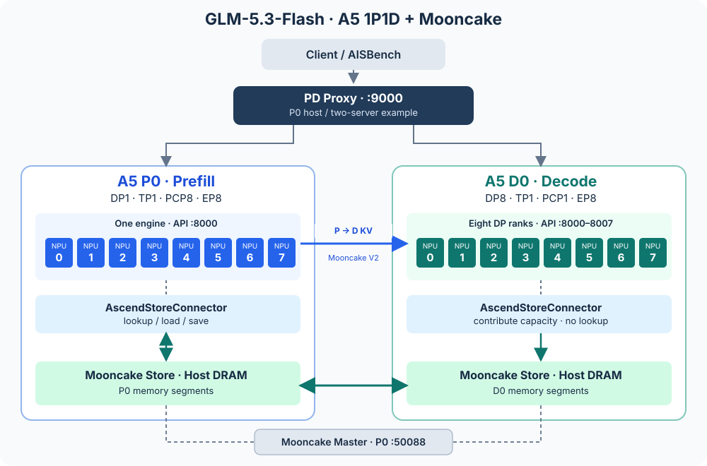
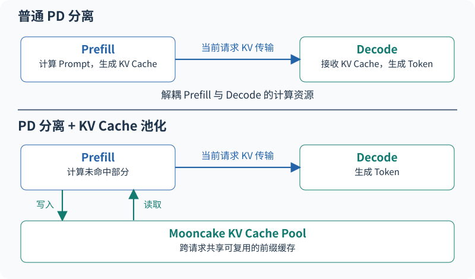
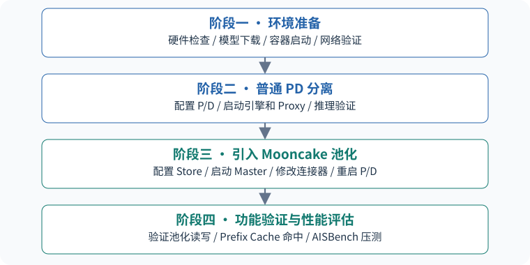
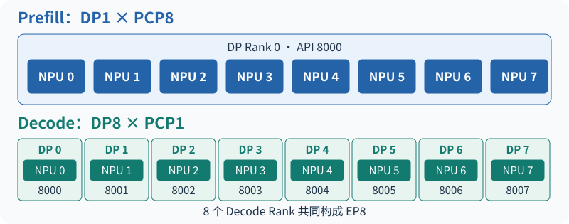
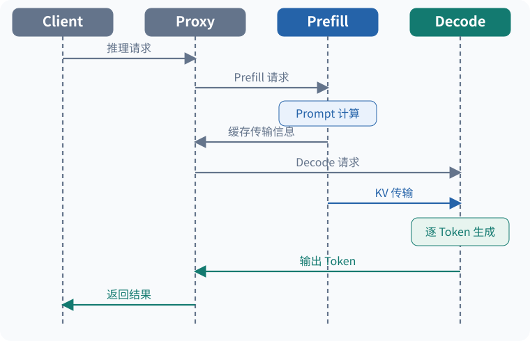
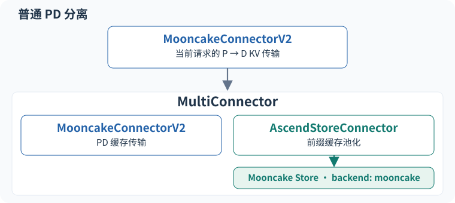
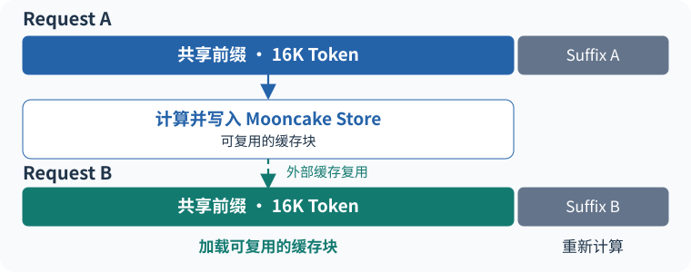
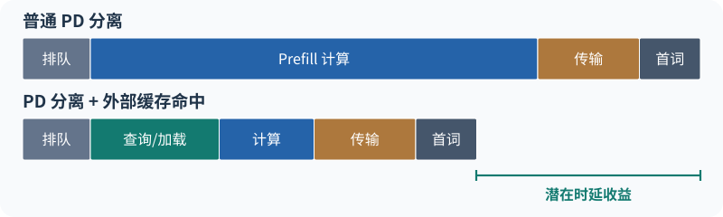

# A5 双机部署 GLM-5.3-Flash：PD 分离与 Mooncake KV Cache 池化

本文以 vLLM-Ascend 官方模型部署教程和 KV Cache Pool 特性指南为基础，采用 **两台 A5 服务器、16 张 NPU、1P1D 的部署架构**，实现 GLM-5.3-Flash 的 Prefill-Decode 分离及跨节点 KV Cache 池化。

主要参考资料：

- [GLM-5.3-Flash 官方部署教程](https://docs.vllm.ai/projects/ascend/zh-cn/latest/tutorials/models/GLM5.3-Flash.html)
- [KV Cache Pool（Ascend Store）官方部署指南](https://docs.vllm.ai/projects/ascend/zh-cn/latest/user_guide/feature_guide/kv_cache_pool_ascend_store.html)
- [vLLM-Ascend 官方源码仓库](https://github.com/vllm-project/vllm-ascend)

截至 2026 年 11 月 26 日，GLM-5.3-Flash 官方教程采用 `releases/v0.32.0rc` 分支的部署配置。其中，第 5.3 节介绍普通 PD 分离，第 5.4 节采用 Memcache 作为池化存储后端。

本文 **保留官方 GLM-5.3-Flash 的 A5 双机拓扑及 PD 分离配置，结合 KV Cache Pool 指南中的 Mooncake 后端配置完成池化适配**。这是基于两份官方文档组合得到的部署方案。[模型部署教程](https://docs.vllm.ai/projects/ascend/zh-cn/latest/tutorials/models/GLM5.3-Flash.html) · [池化部署指南](https://docs.vllm.ai/projects/ascend/zh-cn/latest/user_guide/feature_guide/kv_cache_pool_ascend_store.html)

---

## 一、总体部署架构

### 1.1 硬件与软件配置

| 配置项 | 配置内容 |
|---|---|
| 硬件平台 | Ascend 950DT（A5） |
| 服务器数量 | 2 台 |
| 单机 NPU 数量 | 8 张 |
| 单卡 HBM 容量 | 96 GB |
| NPU 总数 | 16 张 |
| 模型 | GLM-5.3-Flash |
| 模型权重 | GLM-5.3-Flash-w8a8-mxfp8 |
| 主 KV Cache 精度 | FP8 |
| Indexer Cache 精度 | FP8 |
| 推理框架 | vLLM + vLLM-Ascend |
| Model Runner | V2 |
| 部署模式 | 1P1D |
| PD 传输连接器 | MooncakeConnectorV2 |
| 池化连接器 | AscendStoreConnector |
| 池化存储后端 | Mooncake |
| 池化存储介质 | Host DRAM |

模型权重、设备数量以及并行策略沿用[官方 A5 部署配置](https://docs.vllm.ai/projects/ascend/zh-cn/latest/tutorials/models/GLM5.3-Flash.html)。

### 1.2 P、D 节点资源划分

| 配置项 | Prefill 节点（P0） | Decode 节点（D0） |
|---|---:|---:|
| 物理服务器 | A5 服务器 1 | A5 服务器 2 |
| NPU 数量 | 8 | 8 |
| DP | 1 | 8 |
| TP | 1 | 1 |
| PCP | 8 | 1 |
| EP | 8 | 8 |
| DCP | 1 | 1 |
| DP 引擎数量 | 1 | 8 |
| API 端口 | 8000 | 8000–8007 |
| 主要职责 | Prompt 处理 | Token 生成 |

其中：

- **Prefill 节点采用 PCP8**：将输入序列的上下文计算分布到 8 张 NPU 上，提高长序列 Prefill 的处理效率。
- **Decode 节点采用 DP8**：形成 8 个 DP rank，配合 EP8 进行专家并行计算，并提供 8 个 Decode 服务端点。
- **两个节点分别部署模型**：P、D 节点之间传输请求相关的缓存数据，而不是在两个节点之间拆分模型层。

因此，1P1D 指的是一个物理 Prefill 节点和一个物理 Decode 节点，而不是只有两个 vLLM 进程。[官方模型教程](https://docs.vllm.ai/projects/ascend/zh-cn/latest/tutorials/models/GLM5.3-Flash.html)

### 1.3 整体部署拓扑

<p align="center"></p>
<p align="center">图 1 A5 双机 GLM-5.3-Flash PD 分离与 Mooncake 池化拓扑</p>

[查看高清 SVG 矢量拓扑图](./figures/01-topology.svg)

图例：蓝色表示 PD 缓存传输，绿色表示池化缓存读写，灰色表示控制与调度。

这里涉及三个核心组件。

| 组件 | 主要作用 |
|---|---|
| PD Proxy Server | 接收请求，协调 P、D 引擎的请求调度 |
| MooncakeConnectorV2 | 将当前请求的缓存从 P 节点传输到 D 节点 |
| AscendStoreConnector | 将可复用的前缀缓存写入共享池，并在后续请求中查询和读取 |

Mooncake Master 负责共享池的元数据管理、资源分配和缓存驱逐，实际缓存数据存储在 P、D 节点贡献的内存空间中。

### 1.4 PD 分离与 KV Cache 池化的关系

两者解决的是不同的问题。

<p align="center"></p>

例如，两个请求具有相同的 16K Token 前缀：

- **请求 A**：P 节点计算 Prompt，向 D 节点传输缓存，同时将满足池化条件的前缀缓存写入 Mooncake Store。
- **请求 B**：P 节点查询本地缓存及外部共享池，加载命中的前缀缓存，仅对未命中的部分执行必要计算，随后将 D 节点所需的缓存传输过去。

对于 GLM-5.3-Flash 这种混合注意力模型，实际复用范围还取决于缓存组、块对齐及循环状态检查点的保留策略。

---

## 二、整体部署流程

完成环境准备后，建议将部署过程划分为三个阶段：**首先验证普通 PD 分离，再引入 Mooncake 池化，最后进行性能测试与调优。**

<p align="center"></p>

下面按照这一流程展开，继续使用官方提供的 `launch_online_dp.py`、`run_dp_template.sh` 和 Proxy 脚本，不额外封装 vLLM 启动命令。

## 三、环境准备

### 3.1 规划服务器地址及端口

假设两台服务器的 IP 如下，实际部署时替换为真实地址。

| 参数 | Prefill 节点 | Decode 节点 |
|---|---|---|
| 节点名称 | P0 | D0 |
| 主机 IP | 192.168.1.101 | 192.168.1.102 |
| 网络接口 | eth0 | eth0 |
| NPU 编号 | 0–7 | 0–7 |
| 容器名称 | vllm-ascend | vllm-ascend |

服务端口规划如下。

| 服务 | 部署位置 | 端口 |
|---|---|---|
| Prefill API | P0 | 8000 |
| Decode API | D0 | 8000–8007 |
| DP RPC | P0、D0 | 12325 |
| PD Proxy | P0 | 9000 |
| Prefill KV Port 基址 | P0 | 30100 |
| Decode KV Port 基址 | D0 | 30800 |
| Mooncake Master | P0 | 50088 |
| P 池化 Lookup IPC | P0 | 37000 |
| D 池化 Lookup IPC | D0 | 37100–37107 |

这里将 Proxy 部署在 P0 的 `9000` 端口，从而仅使用两台服务器完成部署，并避免与 P0 的 vLLM API 端口冲突。

除此之外，HCCL、Mooncake 握手及传输引擎还可能使用其他通信端口，需要结合实际软件配置放行。

### 3.2 下载模型权重

A5 对应的模型为：

**GLM-5.3-Flash-w8a8-mxfp8**

下载地址：[ModelScope — GLM-5.3-Flash-w8a8-mxfp8](https://www.modelscope.cn/models/Eco-Tech/GLM-5.3-Flash-w8a8-mxfp8)

在两台服务器上准备相同的模型权重。

```bash
pip install modelscope

modelscope download \
    --model Eco-Tech/GLM-5.3-Flash-w8a8-mxfp8 \
    --local_dir /root/.cache/models/GLM-5.3-Flash-w8a8-mxfp8
```

后续统一使用：

```bash
MODEL_PATH=/root/.cache/models/GLM-5.3-Flash-w8a8-mxfp8
```

如果两台服务器具有共享存储，也可以将权重放在共享目录中。

A5 使用 MXFP8 量化权重，主 KV Cache 和 Indexer Cache 均采用 FP8。相关配置为：

```bash
--quantization ascend
--kv-cache-dtype fp8
--attention-config.indexer_kv_dtype fp8
```

### 3.3 检查硬件与网络环境

在 P0、D0 两台服务器上分别执行：

```bash
npu-smi info
ip -br addr
ip route
free -h
ldd --version
```

在 P0 上测试：

```bash
ping -c 4 192.168.1.102
```

在 D0 上测试：

```bash
ping -c 4 192.168.1.101
```

随后按照官方多节点通信测试流程检查 HCCL 和设备侧互联。

Mooncake 后端涉及的主要软件依赖如下。

| 组件 | 官方池化指南要求 |
|---|---|
| HDK | ≥ 25.6 |
| CANN | ≥ 9.1.0 |
| Mooncake | ≥ 0.3.11.post1 |
| glibc | ≥ 2.35 |
| 设备通信 | UBOE / UB |

以上为池化功能的基础版本要求，实际应使用与 GLM-5.3-Flash 模型镜像匹配的软件栈。[官方池化指南](https://docs.vllm.ai/projects/ascend/zh-cn/latest/user_guide/feature_guide/kv_cache_pool_ascend_store.html)

### 3.4 启动 Docker 容器

在两台 A5 服务器上分别执行。

首先准备部署文件目录：

```bash
mkdir -p /root/.cache/deploy/glm53
```

指定官方教程使用的镜像：

```bash
export IMAGE=quay.io/ascend/vllm-ascend:nightly-releases-v0.32.0rc-a5
export NAME=vllm-ascend
```

拉取镜像：

```bash
docker pull "$IMAGE"
```

启动容器。以下命令在模型教程的 Docker 配置基础上，增加 Mooncake Pool 所需的设备与配置挂载。

```bash
docker run --rm \
    -e ASCEND_VISIBLE_DEVICES=0-7 \
    --name "$NAME" \
    --net=host \
    --shm-size=1g \
    --device=/dev/ummu \
    --device=/dev/uburma \
    -v /usr/bin/urma_admin:/usr/bin/urma_admin \
    -v /usr/local/Ascend/driver:/usr/local/Ascend/driver \
    -v /etc/hccl_rootinfo.json:/etc/hccl_rootinfo.json \
    -v /etc/hixlep/:/etc/hixlep/ \
    -v /etc/hccn.conf:/etc/hccn.conf:ro \
    -v /root/.cache:/root/.cache \
    -v /usr/local/sbin:/usr/local/sbin \
    -v /lib/route.conf:/lib/route.conf \
    -itd "$IMAGE" bash
```

这里使用 Ascend Docker Runtime 完成 NPU 设备映射。

进入容器：

```bash
docker exec -it vllm-ascend bash
```

验证容器环境：

```bash
npu-smi info
python3 -m pip show vllm
python3 -m pip show vllm-ascend
python3 -m pip show mooncake-transfer-engine-npu
command -v mooncake_master
```

检查通信设备：

```bash
ls -l /dev/ummu
ls -l /dev/uburma
cat /etc/hccn.conf
```

Docker 镜像与挂载依据分别来自[官方模型教程第 4 节](https://docs.vllm.ai/projects/ascend/zh-cn/latest/tutorials/models/GLM5.3-Flash.html)和 [Mooncake 后端环境准备章节](https://docs.vllm.ai/projects/ascend/zh-cn/latest/user_guide/feature_guide/kv_cache_pool_ascend_store.html)。

---

## 四、普通 PD 分离部署

这一阶段暂不启用外部 KV Cache Pool，仅建立 P、D 节点之间的缓存传输通路。

### 4.1 准备部署文件

在两台服务器的容器内分别执行：

```bash
cd /root/.cache/deploy/glm53
```

准备两个官方脚本：

```text
glm53/
├── launch_online_dp.py    # DP 引擎启动器
└── run_dp_template.sh     # vLLM 启动配置
```

其中：

- `launch_online_dp.py`：两台服务器使用相同的文件，直接复制[官方教程第 5.3 节](https://docs.vllm.ai/projects/ascend/zh-cn/latest/tutorials/models/GLM5.3-Flash.html)提供的完整 Python 脚本。
- `run_dp_template.sh`：P、D 节点分别使用各自的启动配置。

### 4.2 理解 launch_online_dp.py

该脚本负责根据 DP、TP、PCP 的配置启动相应数量的 vLLM 引擎，并为每个引擎分配 NPU 和端口。

每个本地 DP rank 使用的设备数量为：

$$
N_{\mathrm{device}}=TP\times PCP
$$

节点使用的设备总数为：

$$
N_{\mathrm{node}}=DP_{\mathrm{local}}\times TP\times PCP
$$

对于 P0：

$$
1\times1\times8=8
$$

对于 D0：

$$
8\times1\times1=8
$$

启动器向 `run_dp_template.sh` 传入八个位置参数。

| 参数 | 含义 | P0 示例 |
|---|---|---|
| `$1` | 可见 NPU 设备列表 | 0,1,2,3,4,5,6,7 |
| `$2` | API 端口 | 8000 |
| `$3` | DP Size | 1 |
| `$4` | DP Rank | 0 |
| `$5` | DP Address | 192.168.1.101 |
| `$6` | DP RPC Port | 12325 |
| `$7` | TP Size | 1 |
| `$8` | PCP Size | 8 |

<p align="center"></p>

官方启动器在 DP Size 为 1 时，会自动移除模板中的 `--data-parallel-rank` 等外部 DP 负载均衡相关参数。

### 4.3 配置 Prefill 节点

在 P0 上创建：

```bash
vi run_dp_template.sh
```

从[官方 A5 PD 分离章节](https://docs.vllm.ai/projects/ascend/zh-cn/latest/tutorials/models/GLM5.3-Flash.html)复制 Prefill 的完整模板。

修改文件开头的三个环境参数：

```bash
local_ip="192.168.1.101"
nic_name="eth0"
MODEL_PATH="/root/.cache/models/GLM-5.3-Flash-w8a8-mxfp8"
```

其主要环境变量如下：

```bash
export VLLM_USE_V2_MODEL_RUNNER=1

export HCCL_IF_IP=$local_ip
export GLOO_SOCKET_IFNAME=$nic_name
export TP_SOCKET_IFNAME=$nic_name
export HCCL_SOCKET_IFNAME=$nic_name

export PYTORCH_NPU_ALLOC_CONF=expandable_segments:True
export HCCL_BUFFSIZE=3072
export HCCL_OP_EXPANSION_MODE="AIV"

export ASCEND_RT_VISIBLE_DEVICES="$1"
```

vLLM 服务的核心启动参数如下，其余量化、解析器及模型优化参数沿用官方模板：

```bash
vllm serve "$MODEL_PATH" \
    --host 0.0.0.0 \
    --port $2 \
    --data-parallel-size $3 \
    --data-parallel-rank $4 \
    --data-parallel-address $5 \
    --data-parallel-rpc-port $6 \
    --tensor-parallel-size $7 \
    --prefill-context-parallel-size $8 \
    --enable-expert-parallel \
    --served-model-name glm \
    --kv-cache-dtype fp8 \
    --attention-config.indexer_kv_dtype fp8 \
    --max-num-seqs 32 \
    --max-model-len 1048576 \
    --max-num-batched-tokens 32768 \
    --enable-prefix-caching \
    --gpu-memory-utilization 0.95 \
    --enforce-eager \
    --use-replayssm
```

上述代码用于理解核心参数，实际执行的 `run_dp_template.sh` 仍使用完整官方模板。

普通 PD 分离的连接器配置关系如下：

```json
{
    "kv_connector": "MooncakeConnectorV2",
    "kv_role": "kv_producer",
    "engine_id": "0",
    "kv_port": "30100",
    "kv_connector_extra_config": {
        "prefill": {
            "dp_size": 1,
            "tp_size": 1,
            "pcp_size": 8
        },
        "decode": {
            "dp_size": 8,
            "tp_size": 1,
            "pcp_size": 1
        }
    }
}
```

`kv_producer` 表示当前节点负责产生并向 Decode 节点提供缓存。

### 4.4 配置 Decode 节点

在 D0 上同样创建：

```bash
vi run_dp_template.sh
```

复制官方 A5 Decode 模板，并修改：

```bash
local_ip="192.168.1.102"
nic_name="eth0"
MODEL_PATH="/root/.cache/models/GLM-5.3-Flash-w8a8-mxfp8"
```

P、D 节点的关键差异如下。

| 参数 | Prefill | Decode |
|---|---:|---:|
| `HCCL_BUFFSIZE` | 3072 | 2048 |
| `max-num-seqs` | 32 | 60 |
| `max-num-batched-tokens` | 32768 | 360 |
| `max-model-len` | 1048576 | 1048576 |
| `gpu-memory-utilization` | 0.95 | 0.95 |
| MTP Token 数量 | 5 | 5 |
| 执行模式 | Eager | FULL_DECODE_ONLY |
| KV Role | kv_producer | kv_consumer |
| Engine ID | 0 | 1 |
| KV Port | 30100 | 30800 |

Decode 的连接器配置为：

```json
{
    "kv_connector": "MooncakeConnectorV2",
    "kv_role": "kv_consumer",
    "engine_id": "1",
    "kv_port": "30800",
    "kv_connector_extra_config": {
        "prefill": {
            "dp_size": 1,
            "tp_size": 1,
            "pcp_size": 8
        },
        "decode": {
            "dp_size": 8,
            "tp_size": 1,
            "pcp_size": 1
        }
    }
}
```

官方还针对两个角色分别设置了 FlashComm、MC2、专家计算重叠、重计算调度及 NPU Graph 等参数，首次部署建议保留这些设置。[官方模型教程](https://docs.vllm.ai/projects/ascend/zh-cn/latest/tutorials/models/GLM5.3-Flash.html)

### 4.5 启动 Prefill 引擎

在 P0 上执行：

```bash
cd /root/.cache/deploy/glm53
export P0_IP=192.168.1.101
```

检查脚本语法：

```bash
bash -n run_dp_template.sh
```

启动引擎：

```bash
python launch_online_dp.py \
    --template ./run_dp_template.sh \
    --dp-size 1 \
    --tp-size 1 \
    --pcp-size 8 \
    --dp-size-local 1 \
    --dp-rank-start 0 \
    --dp-address "$P0_IP" \
    --dp-rpc-port 12325 \
    --vllm-start-port 8000 \
    2>&1 | tee prefill.log
```

该命令启动一个使用全部 8 张 NPU 的 Prefill 引擎。

### 4.6 启动 Decode 引擎

在 D0 上执行：

```bash
cd /root/.cache/deploy/glm53
export D0_IP=192.168.1.102
```

启动：

```bash
python launch_online_dp.py \
    --template ./run_dp_template.sh \
    --dp-size 8 \
    --tp-size 1 \
    --dp-size-local 8 \
    --dp-rank-start 0 \
    --dp-address "$D0_IP" \
    --dp-rpc-port 12325 \
    --vllm-start-port 8000 \
    2>&1 | tee decode.log
```

该命令启动 8 个 Decode DP rank，对应 8 个 API 端点。

### 4.7 检查引擎运行状态

在 P0 上执行：

```bash
curl -f http://192.168.1.101:8000/health
```

检查全部 Decode 端点：

```bash
for port in {8000..8007}; do
    echo "Checking Decode port: $port"
    curl -fsS \
        "http://192.168.1.102:$port/health" \
        && echo "OK"
done
```

检查 NPU 资源占用：

```bash
npu-smi info
```

确认 P、D 节点的模型加载、KV Cache 初始化和通信初始化均已完成。

### 4.8 启动 PD Proxy Server

官方示例采用独立主机运行 Proxy。本方案将 Proxy 放在 P0 节点的 `9000` 端口，实现纯双机部署。

在 P0 容器的新终端中执行：

```bash
P0_IP=192.168.1.101
D0_IP=192.168.1.102
```

启动官方 Proxy：

```bash
python /vllm-workspace/vllm-ascend/examples/disaggregated_prefill_v1/load_balance_proxy_server_example.py \
    --host 0.0.0.0 \
    --port 9000 \
    --prefiller-hosts "$P0_IP" \
    --prefiller-ports 8000 \
    --decoder-hosts \
        "$D0_IP" "$D0_IP" "$D0_IP" "$D0_IP" \
        "$D0_IP" "$D0_IP" "$D0_IP" "$D0_IP" \
    --decoder-ports \
        8000 8001 8002 8003 \
        8004 8005 8006 8007 \
    2>&1 | tee proxy.log
```

### 4.9 验证普通 PD 分离

向 Proxy 发送推理请求：

```bash
curl http://192.168.1.101:9000/v1/chat/completions \
    -H "Content-Type: application/json" \
    -d '{
        "model": "glm",
        "messages": [
            {
                "role": "user",
                "content": "请介绍大模型推理中的KV Cache。"
            }
        ],
        "max_tokens": 256,
        "temperature": 0
    }'
```

<p align="center"></p>
<p align="center">图 2 PD 分离请求执行流程（逻辑示意）</p>

如果能够获得完整、正常的模型响应，同时 P、D 节点具有对应的请求处理和缓存传输记录，则普通 PD 分离部署完成。

---

## 五、部署 Mooncake KV Cache Pool

普通 PD 分离验证完成后，在现有部署架构上增加池化功能。

### 5.1 池化前后的配置变化

<p align="center"></p>
<p align="center">图 3 MultiConnector 组合连接器架构</p>

与普通 PD 分离相比，主要增加四项内容：

1. 创建 Mooncake 存储配置文件 `mooncake.json`。
2. 启动 `mooncake_master` 服务。
3. 增加池化相关环境变量。
4. 将 P、D 节点的连接器替换为 `MultiConnector`。

原有 P、D 并行策略、模型参数、DP 启动器和 Proxy 保持不变。

### 5.2 停止普通 PD 服务并备份配置

在 P0、D0 上停止对应的 vLLM 服务，并停止 Proxy。

随后在两个节点上分别执行：

```bash
cd /root/.cache/deploy/glm53
cp run_dp_template.sh run_dp_template.sh.baseline
```

这里的 `run_dp_template.sh.baseline` 是通过上述 `cp` 命令创建的备份文件，用于保留已验证成功的普通 PD 配置。

### 5.3 创建 mooncake.json

在 P0、D0 容器上分别执行：

```bash
cd /root/.cache/deploy/glm53
vi mooncake.json
```

两个节点使用相同的配置：

```json
{
    "metadata_server": "P2PHANDSHAKE",
    "protocol": "ascend",
    "device_name": "",
    "master_server_address": "192.168.1.101:50088",
    "global_segment_size": "20GB",
    "preferred_segment": false,
    "prefer_alloc_in_same_node": true,
    "enable_ssd_offload": false,
    "tenant_id": "default"
}
```

参数含义如下。

| 参数 | 作用 |
|---|---|
| `metadata_server` | 使用 P2P 握手机制 |
| `protocol` | 使用 Ascend 传输协议 |
| `master_server_address` | Mooncake Master 服务地址 |
| `global_segment_size` | 每张卡对应 worker 注册到共享池的内存容量 |
| `preferred_segment` | 是否优先选择本地 Segment |
| `prefer_alloc_in_same_node` | 是否优先在同一节点分配缓存 |
| `enable_ssd_offload` | 是否启用 SSD 缓存卸载 |
| `tenant_id` | 缓存所属租户 |

首次部署采用纯 DRAM 池化，暂不开启 SSD Offload。[官方池化指南](https://docs.vllm.ai/projects/ascend/zh-cn/latest/user_guide/feature_guide/kv_cache_pool_ascend_store.html)

### 5.4 规划 KV Cache 池容量

`global_segment_size` 是每个设备 worker 贡献的池化内存大小，而非整个服务器的池容量。

本方案将其初始设置为 `20GB`，如果 16 个 worker 均完成容量注册，则理论注册容量为：

$$
C_{\mathrm{pool}}=(8+8)\times20=320\ \mathrm{GiB}
$$

原对话的交互式容量计算器在 Markdown 中转换为公式与静态示例。设 P、D 节点每 worker 注册容量分别为 $S_P$、$S_D$（GiB），则：

$$
C_{\mathrm{pool}}=8S_P+8S_D
$$

| Prefill 每卡 | Decode 每卡 | P0 贡献 | D0 贡献 | 理论总容量 | 90% 驱逐水位 |
|---:|---:|---:|---:|---:|---:|
| 20 GiB | 20 GiB | 160 GiB | 160 GiB | 320 GiB | 288 GiB |

需要区分两类内存：

| 内存类型 | 作用 | 配置方式 |
|---|---|---|
| NPU HBM | 模型运行、计算及本地 KV Cache | `gpu-memory-utilization` |
| Host DRAM | Mooncake 外部共享缓存池 | `global_segment_size` |

20 GB/worker 是本文选择的初始实验值。实际注册容量应结合 `free -h`、模型加载期间的主机内存峰值以及 Master 注册日志确定。

### 5.5 启动 Mooncake Master

只需在 P0 上运行一个 Master 服务。

在 P0 容器的新终端中执行：

```bash
cd /root/.cache/deploy/glm53

mooncake_master \
    --port 50088 \
    --eviction_high_watermark_ratio 0.9 \
    --eviction_ratio 0.1 \
    --default_kv_lease_ttl 11000 \
    --enable_offload=false \
    --client_ttl=120 \
    2>&1 | tee mooncake_master.log
```

参数说明：

| 参数 | 含义 |
|---|---|
| `port` | Master 监听端口 |
| `eviction_high_watermark_ratio` | 缓存驱逐触发水位 |
| `eviction_ratio` | 缓存驱逐比例 |
| `default_kv_lease_ttl` | KV 对象默认租约时间，单位 ms |
| `enable_offload` | 是否开启 SSD Offload |
| `client_ttl` | 客户端存活超时 |

在 P0 上检查监听状态：

```bash
ss -lntp | grep 50088
```

在 D0 上检查 Master 连通性：

```bash
nc -zv 192.168.1.101 50088
```

Mooncake Store 客户端由 vLLM 中的 AscendStoreConnector 初始化，因此嵌入式模式下不需要额外启动独立的 `mooncake_client` 进程。[官方池化指南](https://docs.vllm.ai/projects/ascend/zh-cn/latest/user_guide/feature_guide/kv_cache_pool_ascend_store.html)

### 5.6 添加池化环境变量

在 P0 和 D0 的 `run_dp_template.sh` 中，在原有 `export` 环境变量区域增加：

```bash
# Mooncake KV Cache Pool
export PYTHONHASHSEED=0
export MOONCAKE_CONFIG_PATH=/root/.cache/deploy/glm53/mooncake.json
```

对于 A5 的 UB / UBOE 通信配置，参考 Mooncake 后端指南：

```bash
# A5 UBOE communication
export ASCEND_GLOBAL_RESOURCE_CONFIG='{"comm_resource_config.protocol_desc":["uboe:device"]}'

# A5 UB communication
export ASCEND_LOCAL_COMM_RES='{"version":"1.3"}'
```

通信资源配置应与服务器实际 UB/UBOE 互联环境匹配。

其中 `PYTHONHASHSEED=0` 用于统一不同进程间的 Python 哈希行为，有利于跨实例前缀缓存标识的一致性。

### 5.7 修改 Prefill 节点连接器

在 P0 上编辑：

```bash
vi run_dp_template.sh
```

保留原有 vLLM 启动命令，仅将末尾的 `--kv-transfer-config` 替换为以下配置：

```bash
--kv-transfer-config \
'{
    "kv_connector": "MultiConnector",
    "kv_role": "kv_producer",
    "engine_id": "0",
    "kv_connector_extra_config": {
        "connectors": [
            {
                "kv_connector": "MooncakeConnectorV2",
                "kv_role": "kv_producer",
                "kv_port": "30100",
                "kv_connector_extra_config": {
                    "prefill": {
                        "dp_size": 1,
                        "tp_size": 1,
                        "pcp_size": 8
                    },
                    "decode": {
                        "dp_size": 8,
                        "tp_size": 1,
                        "pcp_size": 1
                    }
                }
            },
            {
                "kv_connector": "AscendStoreConnector",
                "kv_role": "kv_producer",
                "kv_connector_extra_config": {
                    "backend": "mooncake",
                    "use_layerwise": false,
                    "lookup_rpc_port": '"$((37000 + $4))"'
                }
            }
        ]
    }
}'
```

此时 P 节点具有两种缓存操作能力。

| 连接器 | 功能 |
|---|---|
| MooncakeConnectorV2 | 为当前请求提供 P → D 缓存传输 |
| AscendStoreConnector | 查询、读取和写入外部共享池中的前缀缓存 |

特别注意以下配置：

```json
"backend": "mooncake"
```

它决定 AscendStoreConnector 使用 Mooncake Store 作为池化后端。

```json
"use_layerwise": false
```

采用非逐层池化模式，与当前 GLM-5.3-Flash A5 模型教程的池化模式保持一致。

### 5.8 修改 Decode 节点连接器

在 D0 上编辑：

```bash
vi run_dp_template.sh
```

同样仅替换末尾的 `--kv-transfer-config`：

```bash
--kv-transfer-config \
'{
    "kv_connector": "MultiConnector",
    "kv_role": "kv_consumer",
    "engine_id": "1",
    "kv_connector_extra_config": {
        "connectors": [
            {
                "kv_connector": "MooncakeConnectorV2",
                "kv_role": "kv_consumer",
                "kv_port": "30800",
                "kv_connector_extra_config": {
                    "prefill": {
                        "dp_size": 1,
                        "tp_size": 1,
                        "pcp_size": 8
                    },
                    "decode": {
                        "dp_size": 8,
                        "tp_size": 1,
                        "pcp_size": 1
                    }
                }
            },
            {
                "kv_connector": "AscendStoreConnector",
                "kv_role": "kv_consumer",
                "kv_connector_extra_config": {
                    "backend": "mooncake",
                    "use_layerwise": false,
                    "enable_lookup": false,
                    "save_decode_cache": false,
                    "lookup_rpc_port": '"$((37100 + $4))"'
                }
            }
        ]
    }
}'
```

这里的两个关键参数是：

```json
"enable_lookup": false,
"save_decode_cache": false
```

在当前部署策略下，D 节点主要负责生成 Token，并通过 MooncakeConnectorV2 获取当前请求所需的缓存。

D 节点贡献共享池的 DRAM 容量，但不主动从外部池查找前缀，也不主动保存新生成的 Decode Cache。这使池化逻辑集中在 P 节点。

### 5.9 理解 Lookup RPC Port

`lookup_rpc_port` 用于标识池化调度器与 worker 之间的本地 IPC 端点。

由于 D 节点有 8 个 DP rank，需要为不同 rank 设置不同的标识。

| 节点 | DP Rank | Lookup RPC Port |
|---|---:|---:|
| Prefill | 0 | 37000 |
| Decode | 0 | 37100 |
| Decode | 1 | 37101 |
| Decode | 2 | 37102 |
| Decode | 3 | 37103 |
| Decode | 4 | 37104 |
| Decode | 5 | 37105 |
| Decode | 6 | 37106 |
| Decode | 7 | 37107 |

这里的 `$4` 即 `launch_online_dp.py` 传递的 DP Rank。

它与 PD 传输的 `kv_port`、DP RPC 端口以及 Master 端口分别承担不同职责。[官方模型教程](https://docs.vllm.ai/projects/ascend/zh-cn/latest/tutorials/models/GLM5.3-Flash.html) · [官方池化指南](https://docs.vllm.ai/projects/ascend/zh-cn/latest/user_guide/feature_guide/kv_cache_pool_ascend_store.html)

### 5.10 检查配置修改结果

在 P0、D0 上分别执行：

```bash
cd /root/.cache/deploy/glm53
bash -n run_dp_template.sh
python -m json.tool mooncake.json
diff -u run_dp_template.sh.baseline run_dp_template.sh
```

预期差异主要为：

- 增加 Mooncake 相关环境变量。
- 将单一连接器修改为 MultiConnector。
- 增加 AscendStoreConnector 配置。

模型权重、并行策略、FP8 Cache、MTP、模型长度以及角色调优参数保持不变。

### 5.11 重新启动 P、D 引擎

确认 Mooncake Master 正常运行。

然后重复执行第 4.5 节和第 4.6 节的引擎启动命令：

**Prefill 节点：**

```bash
python launch_online_dp.py \
    --template ./run_dp_template.sh \
    --dp-size 1 \
    --tp-size 1 \
    --pcp-size 8 \
    --dp-size-local 1 \
    --dp-rank-start 0 \
    --dp-address 192.168.1.101 \
    --dp-rpc-port 12325 \
    --vllm-start-port 8000 \
    2>&1 | tee prefill_pool.log
```

**Decode 节点：**

```bash
python launch_online_dp.py \
    --template ./run_dp_template.sh \
    --dp-size 8 \
    --tp-size 1 \
    --dp-size-local 8 \
    --dp-rank-start 0 \
    --dp-address 192.168.1.102 \
    --dp-rpc-port 12325 \
    --vllm-start-port 8000 \
    2>&1 | tee decode_pool.log
```

待所有服务端点健康后，按照第 4.8 节启动 Proxy。

至此，PD 分离与 Mooncake KV Cache Pool 的部署配置完成。

---

## 六、验证 KV Cache 池化是否生效

能够正常返回模型响应，只能说明推理链路可用。要确认池化生效，还需要验证外部缓存的注册、写入、查询和加载过程。

### 6.1 检查 Mooncake 相关日志

在 P0 上执行：

```bash
grep -Ei \
    'mooncake|ascendstore|segment|register|error' \
    mooncake_master.log
```

检查 Prefill 日志：

```bash
grep -Ei \
    'mooncake|ascendstore|lookup|cache|error' \
    prefill_pool.log
```

在 D0 上检查：

```bash
grep -Ei \
    'mooncake|ascendstore|segment|register|error' \
    decode_pool.log
```

重点检查以下内容：

| 检查内容 | 预期结果 |
|---|---|
| Mooncake Master | 正常运行 |
| Store Client | 成功初始化 |
| Memory Segment | 成功注册 |
| PD Connector | 成功初始化 |
| AscendStoreConnector | 成功初始化 |
| Pool Put | 能够写入缓存 |
| Pool Lookup/Get | 能够查询、读取缓存 |

### 6.2 检查 Prefix Cache Metrics

在 P0 上执行：

```bash
curl -s http://192.168.1.101:8000/metrics \
    | grep -E 'prefix_cache|kv_cache|kv_connector'
```

重点关注以下指标，具体暴露名称以当前镜像为准。

| 指标 | 含义 |
|---|---|
| `vllm:prefix_cache_queries_total` | 本地前缀缓存查询 Token 数 |
| `vllm:prefix_cache_hits_total` | 本地前缀缓存命中 Token 数 |
| `vllm:external_prefix_cache_queries_total` | 外部缓存查询 Token 数 |
| `vllm:external_prefix_cache_hits_total` | 外部缓存命中 Token 数 |
| `vllm:kv_cache_usage_perc` | 本地 KV Cache 使用率 |

外部命中指标是区分普通 Prefix Caching 与 KV Cache 池化的重要依据。[vLLM Metrics 官方文档](https://docs.vllm.ai/en/latest/usage/metrics/)

### 6.3 设计共享前缀验证实验

考虑到后续还需要研究 Prefix Cache 命中率对 TTFT 的影响，可以先构造两条具有长共享前缀的请求。

<p align="center"></p>
<p align="center">图 4 Mooncake 外部前缀缓存复用实验示意图</p>

建议采用以下实验流程：

| 步骤 | 操作 |
|---|---|
| 1 | 建立冷缓存实验环境 |
| 2 | 记录 P 节点 Metrics 初始值 |
| 3 | 发送请求 A，等待请求完成及池化写入完成 |
| 4 | 确认共享前缀已写入 Mooncake Store |
| 5 | 通过版本支持的方式清除或淘汰本地前缀缓存，同时保留外部池对象 |
| 6 | 再次记录 Metrics |
| 7 | 发送具有相同长前缀的请求 B |
| 8 | 记录外部缓存命中数、查询数及 TTFT |

外部前缀缓存命中率计算公式为：

$$
R_{\mathrm{external}}=
\frac{\Delta N_{\mathrm{external,hit}}}
{\Delta N_{\mathrm{external,query}}}
\times100\%
$$

这里需要特别区分本地缓存命中和外部池化命中。

在 1P1D 架构中，请求 A 和请求 B 都会经过同一个 Prefill 引擎。如果请求 A 的缓存仍然保存在 P 节点 HBM 中，请求 B 可能直接命中本地缓存，而无需访问 Mooncake Store。

因此，**仅连续发送两条相同请求并观察 TTFT 下降，并不足以证明外部池化生效。**

---

## 七、性能测试与调优

### 7.1 实验组设置

建议设置三组实验，用于区分本地 Prefix Cache 和外部 KV Cache Pool 的收益。

| 实验组 | PD 分离 | 本地 Prefix Cache | Mooncake Pool |
|---|---|---|---|
| A | 开启 | 关闭 | 关闭 |
| B | 开启 | 开启 | 关闭 |
| C | 开启 | 开启 | 开启 |

三组实验使用相同模型、并行策略、输入输出长度、请求数量及并发配置。

### 7.2 建议测试场景

结合长上下文与 Prefix Cache 研究需求，建议从以下工作负载开始：

| 实验变量 | 建议取值 |
|---|---|
| 输入长度 | 4K、16K、32K、64K |
| 输出长度 | 128 或 256 |
| 并发数 | 1、8、16、32、64 |
| 目标共享前缀比例 | 0%、25%、50%、75%、95% |
| 池化介质 | DRAM |
| MTP | 保持官方 MTP5 |

这些是建议的实验取值，并非官方性能测试结果。实际命中率需要结合 GLM-5.3-Flash 的混合缓存结构与检查点保留粒度测量。

### 7.3 需要关注的性能指标

| 指标 | 含义 |
|---|---|
| **TTFT** | 衡量池化减少 Prefill 计算后，首 Token 时延的变化。 |
| **TPOT** | 衡量 Decode 阶段的平均 Token 生成时延。 |
| **Throughput** | 衡量系统的请求处理能力与 Token 生成能力。 |
| **External Cache Hit Rate** | 衡量 Mooncake 外部前缀缓存的实际复用程度。 |

此外，还建议关注：

| 指标 | 研究目的 |
|---|---|
| P99 TTFT | 分析尾部时延 |
| P99 TPOT | 分析 Decode 稳定性 |
| NPU KV Cache Usage | 观察本地缓存压力 |
| Mooncake Pool Usage | 观察外部池容量压力 |
| Pool Get/Put Latency | 分析外部缓存读写开销 |
| Preemption Count | 分析 KV Cache 资源不足问题 |

### 7.4 池化为什么能够降低 TTFT

不考虑其他开销时，可以将普通 PD 分离的 TTFT 简化为：

$$
T_{\mathrm{TTFT}}
\approx
T_{\mathrm{queue}}
+
T_{\mathrm{prefill}}
+
T_{\mathrm{PD}}
+
T_{\mathrm{first}}
$$

启用池化后：

$$
\begin{aligned}
T_{\mathrm{TTFT}}^{\mathrm{pool}}
\approx {}& T_{\mathrm{queue}}+T_{\mathrm{lookup}}\\
&+T_{\mathrm{load}}+T_{\mathrm{prefill,miss}}\\
&+T_{\mathrm{PD}}+T_{\mathrm{first}}
\end{aligned}
$$

其中：

- $T_{\mathrm{lookup}}$：外部缓存查询开销。
- $T_{\mathrm{load}}$：从共享池加载缓存的开销。
- $T_{\mathrm{prefill,miss}}$：未命中部分的必要计算开销。
- $T_{\mathrm{PD}}$：P → D 缓存传输开销。

<p align="center"></p>
<p align="center">池化前后的 TTFT 构成（概念示意，非实测数据）</p>

当外部缓存查询、加载开销小于被节省的 Prefill 计算开销时，池化便能够降低 TTFT。

对于长输入、高前缀复用率的工作负载，其收益通常更值得关注。

---

## 八、关键参数汇总

| 参数 | Prefill | Decode |
|---|---|---|
| DP | 1 | 8 |
| TP | 1 | 1 |
| PCP | 8 | 1 |
| EP | 8 | 8 |
| Model Runner | V2 | V2 |
| KV Cache dtype | FP8 | FP8 |
| Indexer dtype | FP8 | FP8 |
| HCCL Buffer | 3072 MB | 2048 MB |
| Max Model Len | 1048576 | 1048576 |
| Max Num Seqs | 32 | 60 |
| Max Batched Tokens | 32768 | 360 |
| Memory Utilization | 0.95 | 0.95 |
| MTP | 5 | 5 |
| Prefix Caching | true | true |
| 外层连接器 | MultiConnector | MultiConnector |
| PD 连接器 | MooncakeConnectorV2 | MooncakeConnectorV2 |
| 池化连接器 | AscendStoreConnector | AscendStoreConnector |
| Pool Backend | mooncake | mooncake |
| Global Segment Size | 20 GB/worker | 20 GB/worker |
| Use Layerwise | false | false |
| Enable Lookup | true（默认） | false |
| Save Decode Cache | — | false |
| SSD Offload | false | false |

另外，原始链接定位到了 [NoPE Prolog V3](https://docs.vllm.ai/projects/ascend/zh-cn/latest/tutorials/models/GLM5.3-Flash.html#nope-prolog-v3) 章节。该融合优化主要针对满足条件的 A2/A3 INT8 KV Cache 路径，A5 MXFP8 配置仍采用原生预处理路径，因此本方案不需要额外配置 NoPE Prolog V3。

---

## 九、部署操作检查清单

### 环境准备

- [ ] 确认两台 A5 各有 8 张可用 NPU
- [ ] 下载相同的 W8A8-MXFP8 模型权重
- [ ] 启动容器并验证设备映射
- [ ] 确认 HCCL、UB/UBOE 通信环境

### 普通 PD 分离

- [ ] 准备官方 `launch_online_dp.py`
- [ ] 配置 P、D 的 `run_dp_template.sh`
- [ ] 启动 Prefill 引擎
- [ ] 启动 8 个 Decode DP Rank
- [ ] 启动 Proxy 并完成推理验证

### Mooncake KV Cache Pool

- [ ] 备份普通 PD 配置
- [ ] 创建 `mooncake.json`
- [ ] 启动 Mooncake Master
- [ ] 添加池化环境变量
- [ ] 配置 P、D 的 MultiConnector
- [ ] 重启 P、D 和 Proxy

### 功能与性能验证

- [ ] 确认内存 Segment 注册成功
- [ ] 确认缓存 Put/Get 成功
- [ ] 验证外部前缀缓存命中
- [ ] 使用 AISBench 测试 TTFT、TPOT 和吞吐量

## 十、总结

本方案的核心是以官方 A5 双机 PD 分离架构为基础，通过 MultiConnector 同时实现两条缓存数据通路：

- **MooncakeConnectorV2**：负责当前请求在 Prefill 和 Decode 之间的缓存传输。
- **AscendStoreConnector + Mooncake Store**：负责可复用前缀缓存的跨请求、跨节点共享。

部署时，优先保持官方的 PCP8 Prefill、DP8 Decode、FP8 Cache 和 MTP5 配置，待普通 PD 分离运行稳定后，再引入外部池化功能。

本方案中的双机 Proxy 共置、20 GB/worker 池容量以及 Mooncake 存储后端替换属于本文的部署适配项。官方版本发布说明已经包含 GLM-5.3-Flash 非逐层池化支持，但上述组合尚未在实际 A5 双机上执行验证；当前模型教程直接给出的池化后端仍为 Memcache。[官方发布说明](https://github.com/vllm-project/vllm-ascend/releases) · [官方模型教程](https://docs.vllm.ai/projects/ascend/zh-cn/latest/tutorials/models/GLM5.3-Flash.html)

对于后续开展 Prefix Cache 命中率、KV Cache 使用率及推理性能之间的关系研究，这套架构能够作为一个清晰的实验部署基础。
