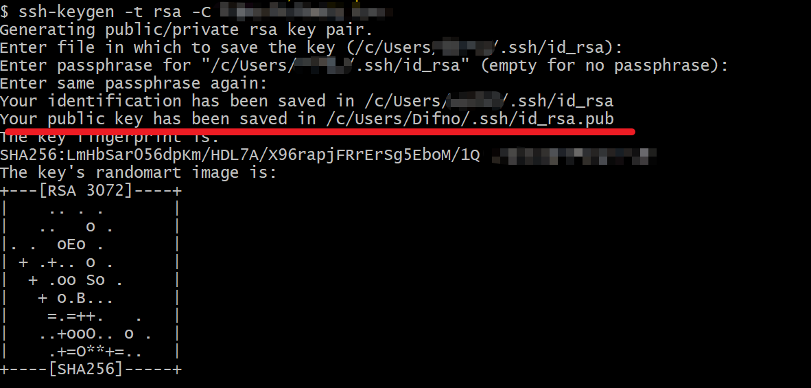
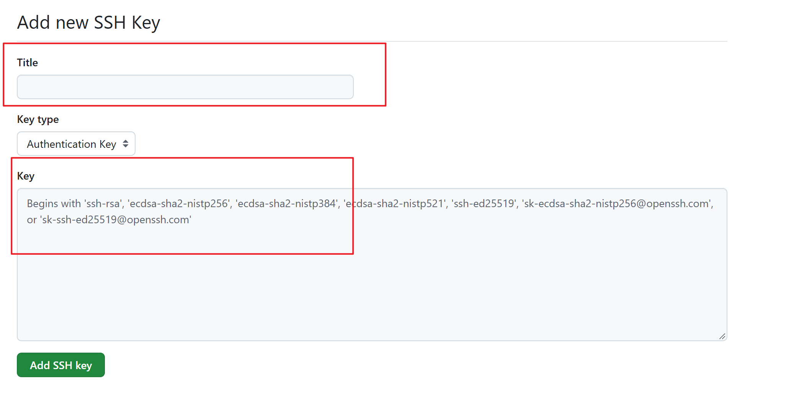
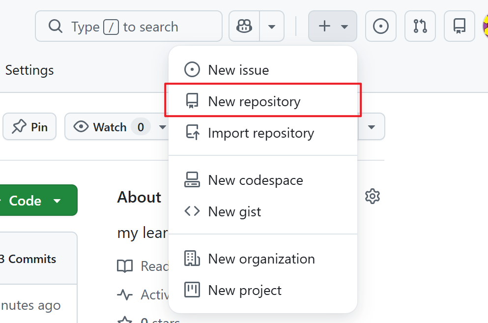
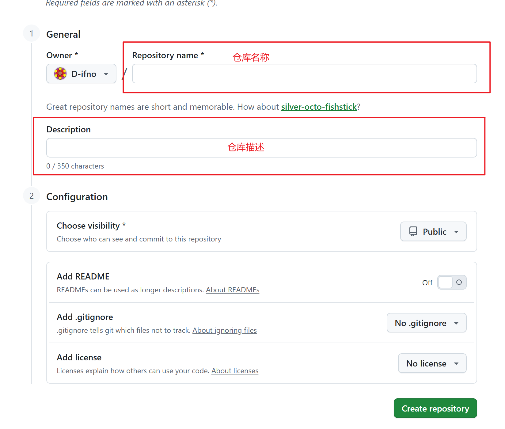
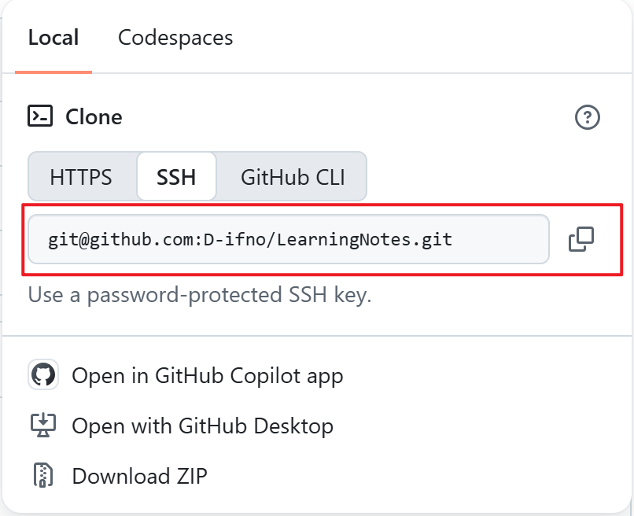
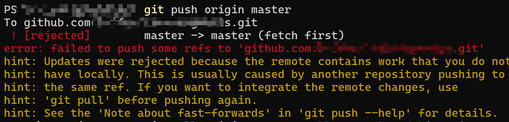

# 配置公钥
gitbash输入
```shell
$ ssh-keygen -t rsa -C 邮箱地址
```

找到公钥对于文件（id_rsa.pub），将其内容复制，然后点击github的用户头像，打开settings，点击SSH and GPG Keys,点击New SSH Keys，将id_rsa.pub的内容输入到Key中



# 创建远程仓库
点击New repository

输入仓库名称与描述，可选添加README.md

# 将远程仓库与本地代码库绑定
打开本地文件夹
输入
```shell
git init
git remote add origin git@github.com:D-ifno/LearningNotes.git
```
其中，git@github.com:D-ifno/LearningNotes.git通过SSH获得


然后输入
```shell
git add *
git commit -m "first"
git push origin master
```
## 问题1
如果遇到

说明是GitHub 远程仓库中已经有一些内容（比如在创建仓库时勾选了 Initialize this repository with a README 或 .gitignore 文件），而本地也有代码，两边历史记录不一致，导致 Git 拒绝直接覆盖。
最安全且最常用的解决方法是将远程仓库的代码拉取（pull）到本地合并，然后再推送。
按照以下步骤操作：
1.拉取并合并远程变更
```shell
git pull origin master --allow-unrelated-histories
```
2.重新推送代码到远程
```shell
git push origin master
```

## 问题2
遇到 **Failed to connect to github.com:443** 错误通常是因为 本地网络无法直接连接 GitHub（常见于国内网络环境没有配置代理，或者代理端口不匹配）。
按照以下步骤依次排查和解决：
1. 配置 Git 代理（最常见的解决方法）
如果你本地开启了科学上网工具（如 Clash、v2ray、SSR 等），Git 默认不会自动走系统的代理，需要手动将代理地址配置到 Git 中。

请在 PowerShell 中执行以下命令（假设你的本地代理端口是 7890，请根据实际软件的 HTTP/HTTPS 代理端口 进行修改）：
```shell
# 设置 HTTP 代理（请将 7890 替换为你的实际代理端口）
git config --global http.proxy http://127.0.0.1:7890
git config --global https.proxy http://127.0.0.1:7890
```
>验证方法：配置完成后，重新执行推送命令：
git push origin master