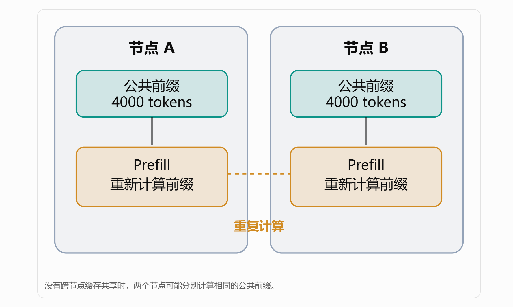
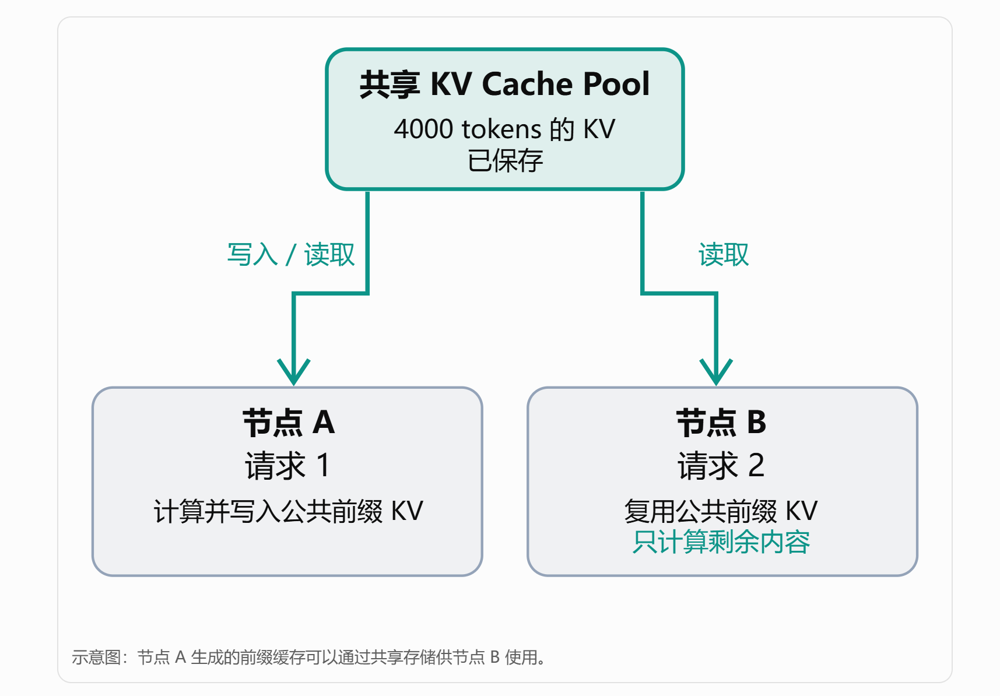
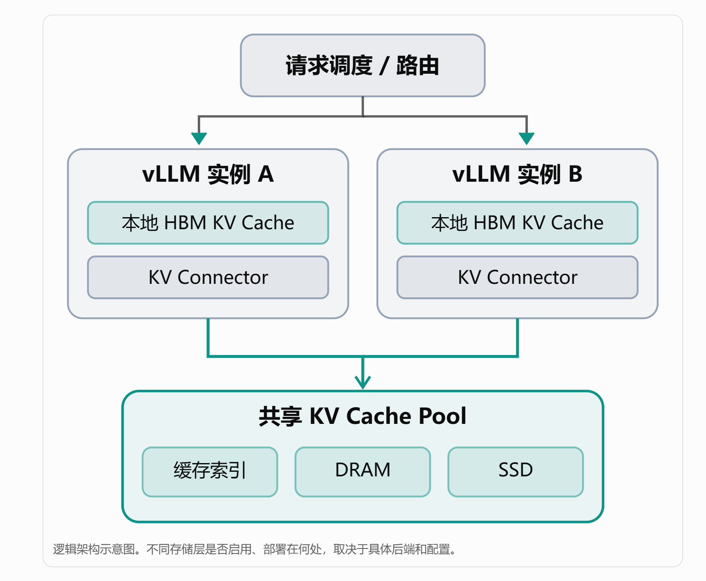
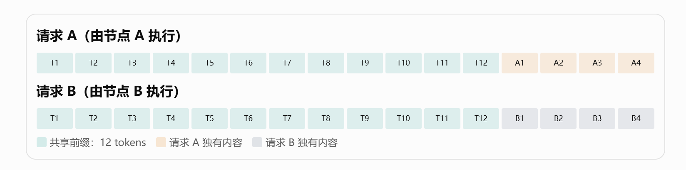
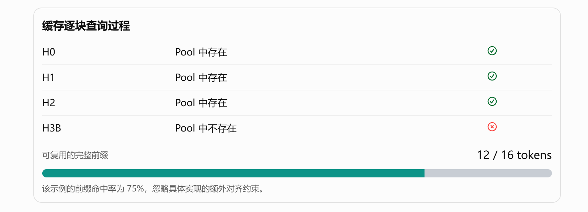
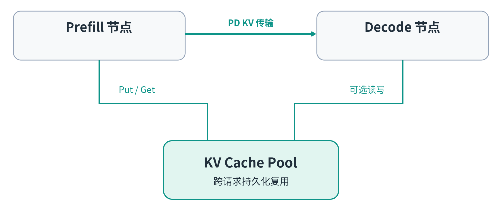

# KV Cache Pool 技术原理详解

> 本文介绍 KV Cache Pool 的定义、所解决的问题、工作原理、跨节点复用示例，以及与 Prefix Caching、PD 分离、KV Cache Group 的关系。

# 一、什么是 KV Cache Pool？

**KV Cache Pool（KV 缓存池）是一种将大模型推理产生的 KV Cache 进行集中管理、存储和复用的机制。**

它的核心思想是：**将 KV Cache 从单个推理请求、单个推理实例的局部资源，扩展为可以在多个请求甚至多个推理节点之间共享的缓存资源。**

需要注意，在 vLLM 生态中，有两个容易混淆的概念：

| 概念 | 主要作用 | 管理范围 |
| --- | --- | --- |
| Block Pool（块池） | 管理 KV Cache Block 的分配、释放和复用 | 通常是单个 vLLM 引擎内部 |
| KV Cache Pool（跨节点缓存池） | 将 KV Cache 存入外部存储，供不同推理实例复用 | 多个 vLLM 实例或节点 |

vLLM 官方源码中的 `BlockPool` 负责管理 KV Cache Block；而 vLLM-Ascend 的 **KV Cache Pool** 通常指通过 Mooncake、Memcache、Yuanrong 等后端实现的跨实例 KV Cache 池化存储。参考 [vLLM-Ascend KV Cache Pool 设计文档](https://docs.vllm.ai/projects/ascend/en/main/developer_guide/Design_Documents/KV_Cache_Pool_Guide.html) 和 [使用指南](https://docs.vllm.ai/projects/ascend/en/v0.30.0/user_guide/feature_guide/kv_cache_pool_ascend_store.html)。

下面重点介绍第二种，也就是分布式大模型推理中常说的 KV Cache Pool。

## 1.1 为什么需要 KV Cache Pool？

假设有两个独立的推理节点：

- 节点 A：运行一个 vLLM 实例。
- 节点 B：运行另一个 vLLM 实例。

现在有两个用户请求：

**请求 1：**

```text
系统提示词（1000 tokens）
+
共享文档（3000 tokens）
+
问题 A（100 tokens）
```

**请求 2：**

```text
系统提示词（1000 tokens）
+
共享文档（3000 tokens）
+
问题 B（100 tokens）
```

两个请求的前 4000 个 Token 完全相同。

如果请求 1 由节点 A 处理，请求 2 由节点 B 处理：



*图 1：没有跨节点缓存共享时，两个节点可能分别计算相同的公共前缀。*

虽然节点 A 已经计算过这 4000 个 Token 的 KV Cache，但是节点 B 无法直接访问节点 A 的本地缓存。

因此，节点 B 仍然需要重复计算相同的前缀。

**普通 Prefix Caching 可以解决单实例内的重复计算，但不能自动解决不同实例之间的缓存共享。**

KV Cache Pool 就是为了解决这一问题。

## 1.2 引入 KV Cache Pool 后

系统可以将计算完成的 KV Cache 保存到一个共享的存储池中。



*图 2：节点 A 生成的前缀缓存可以通过共享存储供节点 B 使用。*

因此，当请求 2 到达节点 B 时：

1. 节点 B 检查本地是否存在可复用的 KV Cache。
2. 如果本地没有，就查询共享 KV Cache Pool。
3. 如果共享池中存在对应前缀的缓存，就将这些 KV Cache 加载到节点 B 的设备内存。
4. 节点 B 无须重新计算前 4000 个 Token 的相关 KV 表示，只需继续处理问题 B 的 100 个 Token。

这里的 4000 个 Token 是说明原理的简化例子，实际可复用长度还受到 Block 对齐、模型缓存结构以及 KV Cache Group 等因素影响。

**核心收益：通过跨请求、跨节点复用 KV Cache，减少重复 Prefill 计算，并扩大可复用缓存的存储容量。**

# 二、KV Cache Pool 的具体工作原理

KV Cache Pool 本质上将三个过程组合起来：

**前缀识别（Lookup）→ 缓存传输（Get/Put）→ 缓存复用（Reuse）。**

## 2.1 整体架构

一个典型的架构由以下部分组成：



*图 3：KV Cache Pool 的逻辑架构。不同存储层是否启用、部署在何处，取决于具体后端和配置。*

其中，三个核心组成部分的职责不同：

| 组件 | 职责 |
| --- | --- |
| 本地 KV Cache | 将正在进行注意力计算的 KV 数据保存在 GPU/NPU 的 HBM 中 |
| KV Connector | 连接 vLLM 与外部缓存池，执行查询、写入、加载等操作 |
| KV Cache Pool | 通过共享存储后端管理和保存可供多个实例复用的缓存数据 |

例如，vLLM-Ascend 中的 `AscendStoreConnector` 可以对接 Mooncake、Memcache 和 Yuanrong 后端。详见 [vLLM-Ascend KV Cache Pool 使用指南](https://docs.vllm.ai/projects/ascend/en/v0.30.0/user_guide/feature_guide/kv_cache_pool_ascend_store.html)。

特别需要理解：**KV Cache Pool 并不是将所有 GPU/NPU 的显存直接合并成一块统一显存。**

它更接近一个具有共享索引的分布式缓存存储系统。不同节点通过 Connector 查找和搬运 KV 数据，而不是直接将远端存储地址当成本地 Block Table 地址使用。

## 2.2 KV Cache Pool 如何确定缓存是否可以复用？

这一步和 Prefix Caching 的哈希机制密切相关。

假设一个 KV Block 包含 4 个 Token：

```text
输入序列：
[A, B, C, D, E, F, G, H, I, J, K, L]

分块：
Block 0 = [A, B, C, D]
Block 1 = [E, F, G, H]
Block 2 = [I, J, K, L]
```

为了正确识别每个 Block 的 KV Cache，vLLM 可以采用与前缀相关的哈希标识：

$$
H_0 = \operatorname{Hash}(H_{\mathrm{root}}, [A,B,C,D])
$$

$$
H_1 = \operatorname{Hash}(H_0, [E,F,G,H])
$$

$$
H_2 = \operatorname{Hash}(H_1, [I,J,K,L])
$$

这里省略了模型适配信息、缓存隔离信息等其他可能影响缓存标识的字段。

为什么第二个 Block 的 Hash 要包含第一个 Block 的 Hash？

因为深层 Transformer 中，一个 Token 的 KV 表示可能依赖其前面的上下文。

因此，**即使两个 Block 的 Token 内容完全相同，只要它们前面的上下文不同，对应的 KV Cache 就不一定能够复用。**

官方 vLLM Prefix Caching 采用前缀感知的块哈希机制，并且只缓存完整的 Block。参见 [vLLM：Automatic Prefix Caching](https://docs.vllm.ai/en/stable/design/prefix_caching/)。

在分布式缓存池中，可以将这些哈希标识理解为用于查找缓存数据的逻辑 Key。

注意，**缓存 Key 与物理 Block ID 不是同一个概念。**

# 三、结合具体例子，完整演示 KV Cache Pool

为了清楚地理解整个过程，我们构造一个简化的 Transformer 推理系统。

## 3.1 实验条件

| 参数 | 设置 |
| --- | --- |
| Transformer 层数 | 2 |
| KV Block Size | 4 tokens |
| 推理节点 | A、B 两个节点 |
| KV Cache Pool | 1 个共享缓存池 |
| Attention | 标准因果自注意力 |
| Prefix Caching | 开启 |

假设两个请求分别是：



*图 4：请求 A 与请求 B 的前 12 个 Token 相同，最后 4 个 Token 分别为不同的内容。*

两个请求共有 12 个 Token 的前缀，因此理论上可以复用前 3 个完整 Block。

## 3.2 第一阶段：节点 A 执行 Prefill

节点 A 首先收到请求 A，执行完整的 Prefill。

在第 1 层 Transformer 中，计算：

$$
Q^{(1)} = XW_Q^{(1)}, \quad
K^{(1)} = XW_K^{(1)}, \quad
V^{(1)} = XW_V^{(1)}
$$

随后执行因果注意力和层内其他运算，得到第 1 层输出，再进入第 2 层计算对应的 Q、K、V。

对于每一层，各自产生一份 KV Cache。

为了简化，我们将两层 KV Cache 按相同的 Token 范围划分：

| 逻辑块 | Token 范围 | 缓存内容 |
| --- | --- | --- |
| Block 0 | T1–T4 | 第 1、2 层对应的 KV |
| Block 1 | T5–T8 | 第 1、2 层对应的 KV |
| Block 2 | T9–T12 | 第 1、2 层对应的 KV |
| Block 3 | A1–A4 | 第 1、2 层对应的 KV |

这里的逻辑块只是方便理解的表示，实际各层 KV 数据保存在相应的缓存张量中。

此时，节点 A 完成了 16 个 Token 的 Prefill。

## 3.3 第二阶段：节点 A 将 KV Cache 写入 Pool

节点 A 通过 KV Connector 将符合保存条件的 Block 写入共享缓存池。

假设所有写入都成功，缓存池中存在：

| 缓存标识 | 对应内容 | 状态 |
| --- | --- | --- |
| H0 | T1–T4 的 KV | 已保存 |
| H1 | T5–T8 的 KV | 已保存 |
| H2 | T9–T12 的 KV | 已保存 |
| H3A | A1–A4 的 KV | 已保存 |

每一个缓存对象都需要包含可以正确恢复相关层 KV 数据的内容，而不是仅保存 Token ID。

一个完整 KV Block 的主要数据规模，在这个标准注意力、单个模型分片的简化例子中为：

$$
S_{\mathrm{block}} = 2 \times L \times B \times H_{\mathrm{KV}} \times d_h \times s
$$

其中：

- $L=2$：Transformer 层数。
- $B=4$：每个 Block 的 Token 数量。
- $H_{\mathrm{KV}}$：每个模型分片的 KV Head 数。
- $d_h$：单个 Head 的维度。
- $s$：每个缓存元素的字节数。
- 系数 2：分别代表 K 和 V。

这也是为什么长上下文推理中的 KV Cache 会占据大量显存，以及为什么需要额外的存储池。

## 3.4 第三阶段：节点 B 收到请求 B

假设节点 B 没有请求 B 的本地 KV Cache。

它首先执行 Prefix Cache Lookup，发现本地缓存命中长度为 0。

随后查询远端 KV Cache Pool。



*图 5：请求 B 的前三个 Block 命中，最后一个 Block 未命中。*

| 缓存标识 | Pool 查询结果 |
| --- | --- |
| H0 | 命中 |
| H1 | 命中 |
| H2 | 命中 |
| H3B | 未命中 |

在这个简化示例中：

$$
\text{Prefix Cache 命中率} = \frac{12}{16} = 75\%
$$

为什么不能使用 H3A？

因为请求 B 的最后 4 个 Token 是 `[B1,B2,B3,B4]`，与请求 A 的 `[A1,A2,A3,A4]` 不同。

所以请求 B 只能复用前三个 Block。

## 3.5 第四阶段：将远端 KV Cache 加载到节点 B

节点 B 需要先分配本地 KV Cache Block，再把远端缓存的实际数据读入设备显存。

假设节点 B 分配到的物理 Block ID 分别为 7、2、9。

它们的对应关系可以表示为：

| 请求 B 的逻辑块 | Pool 中的缓存 | 节点 B 的物理 Block ID |
| --- | --- | --- |
| Block 0 | H0 | 7 |
| Block 1 | H1 | 2 |
| Block 2 | H2 | 9 |
| Block 3 | 尚未缓存 | 5（新分配） |

节点 B 的 Block Table 可以表示为：

```text
Request B:

逻辑块索引：   0    1    2    3
               │    │    │    │
物理 Block：  [7,   2,   9,   5]
               ↑    ↑    ↑    ↑
               └────┴────┘    │
               从 Pool 加载    新计算
```

这里有一个重要结论：

**KV Cache Pool 实现共享不要求两个推理节点上的物理 Block ID 相同。**

节点 A 的物理 Block 0 与节点 B 的物理 Block 7 可以保存相同内容，但它们是各自设备上的独立物理存储位置。

跨节点复用依赖缓存标识、正确的 KV 数据布局和传输过程，而非跨设备直接共享 Block ID。

## 3.6 第五阶段：节点 B 继续 Prefill

现在节点 B 已经取得：

```text
已计算、已加载的前缀：

T1 T2 T3 T4 | T5 T6 T7 T8 | T9 T10 T11 T12
     H0            H1             H2

尚需计算：

B1 B2 B3 B4
```

节点 B 无须重新计算 T1–T12 的 KV，而是直接用加载的 KV 作为历史上下文，处理 B1–B4。

例如，在第 1 层中，对于 Token B1：

$$
q_{B1}^{(1)} = x_{B1}^{(1)} W_Q^{(1)}
$$

当前新计算的 Query 可以与已加载的历史 Key 进行注意力计算：

$$
o_{B1}^{(1)} = \operatorname{Attention}\left(
q_{B1}^{(1)},
[K_{\mathrm{prefix}}^{(1)}; k_{B1}^{(1)}],
[V_{\mathrm{prefix}}^{(1)}; v_{B1}^{(1)}]
\right)
$$

其中，$K_{\mathrm{prefix}}^{(1)}$ 和 $V_{\mathrm{prefix}}^{(1)}$ 来自共享 KV Cache Pool。

第 2 层也使用其对应的已加载 KV Cache，继续处理 B1–B4 的表示。

最终，节点 B 完成剩余 Prefill，并进入 Decode 阶段。

**整个过程减少的是公共前缀的重复计算，而不是取消新 Token 的 Attention 计算。**

# 四、KV Cache Pool 究竟能带来多大的性能提升？

对于一个请求，可以近似将 TTFT 分解为：

$$
T_{\mathrm{TTFT}} \approx
T_{\mathrm{schedule}} +
T_{\mathrm{load}} +
T_{\mathrm{prefill,remaining}} +
T_{\mathrm{first\ token}}
$$

不使用 KV Cache Pool 时，远端加载时间为 0，但需要计算更多的 Prefill Token。

使用 KV Cache Pool 后，减少了重复的 Prefill 计算，但增加了缓存查询和数据传输开销。

假设上述例子的性能数据如下（仅为理解原理构造的假设值）：

| 性能环节 | 未使用 Pool | 使用 Pool |
| --- | ---: | ---: |
| 完整或剩余 Prefill 计算 | 20 ms | 5 ms |
| 缓存查询与加载 | 0 ms | 3 ms |
| 其他开销 | 2 ms | 2 ms |
| **TTFT** | **22 ms** | **10 ms** |

在这个假设中，TTFT 从 22 ms 降低到 10 ms。

但如果远端读取 KV Cache 需要 25 ms，性能反而可能下降。

因此，判断是否值得使用缓存池，一个重要条件是：

$$
\boxed{T_{\mathrm{lookup}} + T_{\mathrm{transfer}} < T_{\mathrm{recompute\ saved}}}
$$

实际还需要考虑传输与计算的重叠、设备内存占用、并发竞争和调度开销。

这说明 KV Cache Pool 更适合**长公共前缀、高重复率、快速缓存互联**的工作负载，而不是所有请求都无条件受益。

# 五、KV Cache Pool 与其他机制的关系

## 5.1 与 Prefix Caching 的关系

二者不是互相替代，而是相互配合。

| 对比维度 | 普通 Prefix Caching | KV Cache Pool |
| --- | --- | --- |
| 主要目标 | 复用已经计算过的前缀 | 扩大缓存共享范围和容量 |
| 缓存位置 | 通常在推理实例本地设备内存 | 外部共享存储，可包含 DRAM/SSD |
| 跨实例复用 | 通常不支持 | 支持 |
| 是否需要数据传输 | 本地命中一般无需远端传输 | 远端命中通常需要加载 KV |
| 主要代价 | 占用设备缓存空间 | 额外存储、通信与管理开销 |

实际使用中通常会优先检查本地 Prefix Cache，之后再查询远端 KV Cache Pool。这也是 [vLLM-Ascend 官方设计文档](https://docs.vllm.ai/projects/ascend/en/main/developer_guide/Design_Documents/KV_Cache_Pool_Guide.html) 描述的工作流程。

## 5.2 与 PD 分离的关系

KV Cache Pool 和 PD 分离是两种不同的机制。

**PD 分离**解决的是 Prefill 与 Decode 阶段的资源竞争问题。

**KV Cache Pool**解决的是可复用 KV Cache 的共享存储和跨实例复用问题。

在 PD 分离架构中，可以同时存在两种 KV 传输：



*图 6：PD 分离的单请求 KV 交接，与 KV Cache Pool 的跨请求 KV 存储复用。*

上方的 **P→D KV 传输** 是同一次请求从 Prefill 节点迁移到 Decode 节点时的数据交接。

下方的 **Pool Put/Get** 是为了让当前或后续请求复用已经计算过的缓存。

两者可以使用不同的 Connector。例如 vLLM-Ascend 可以使用 `MooncakeConnectorV1` 进行 P→D 数据传输，同时使用 `AscendStoreConnector` 进行缓存池读写。

在部分配置中，默认主要由 Prefill 节点向 Pool 写入；Decode 节点向 Pool 写入或从 Pool 读取需要额外配置，并非所有部署都会发生。参考 [vLLM-Ascend 官方设计文档](https://docs.vllm.ai/projects/ascend/en/main/developer_guide/Design_Documents/KV_Cache_Pool_Guide.html)。

## 5.3 与 KV Cache Group 的关系

KV Cache Group 是**模型内部 KV Cache 管理的分组单位**，而 KV Cache Pool 是**跨请求、跨实例的缓存存储机制**。

例如，在混合注意力模型中，不同 KV Cache Group 可能具有不同的缓存布局、Block Size 和复用规则。

因此，不能简单认为：

> KV Cache Pool 中找到了某段 Token 的缓存，就意味着模型所有层都可以直接跳过相应计算。

必须确保当前需要复用的 KV 数据满足各个相关 KV Cache Group 的要求。

vLLM 官方 [Hybrid KV Cache Manager](https://docs.vllm.ai/en/stable/design/hybrid_kv_cache_manager/) 文档也讨论了多 Group 的缓存命中协调问题。

# 六、实际使用中需要注意的三个问题

**第一，远端缓存并不是永久保存。** KV Cache Pool 受后端容量、淘汰策略、数据生命周期和写入策略约束。不能因为请求 A 结束，就假定它的全部 KV Cache 永久保留在共享池中。

**第二，缓存命中受到 Block 粒度限制。** 例如在普通固定块的 Prefix Caching 情况下，`block_size=128`，两个请求共享前缀长度为 4000 Token，那么最多有：

$$
\left\lfloor \frac{4000}{128} \right\rfloor = 31
$$

个完整 Block，即 3968 个 Token 可以按此粒度复用。实际还可能受到 Scheduler Block Size 和 KV Cache Group 的进一步约束。

**第三，跨节点复用需要缓存数据兼容。** 模型权重版本、KV 数据布局、并行配置、哈希规则和缓存隔离标识等都可能影响能否安全复用。特别是在 DeepSeek-V4 这类混合注意力模型中，应当按照实际部署版本验证读写格式与失败恢复策略。vLLM-Ascend v0.30.0 文档指出，`kv_load_failure_policy=recompute` 尚不支持 DeepSeekV4 等混合注意力模型，详见 [vLLM-Ascend 使用指南](https://docs.vllm.ai/projects/ascend/en/v0.30.0/user_guide/feature_guide/kv_cache_pool_ascend_store.html)。

---

# 七、总结

可以用三个层次来理解 KV Cache 相关技术：

| 层次 | 对应机制 | 解决的问题 |
| --- | --- | --- |
| 内存管理 | PagedAttention、Block Pool | 如何高效分配、管理设备内的 KV Cache |
| 本地计算复用 | Prefix Caching | 如何避免同一推理实例重复计算相同前缀 |
| 分布式缓存复用 | KV Cache Pool | 如何扩大缓存容量，并让不同推理实例复用 KV Cache |

**KV Cache Pool 的核心不是改变 Transformer 的注意力计算公式，而是改变已经计算完成的 KV Cache 的存储、访问与复用方式。**

对于大规模推理系统，它最有价值的地方是：让昂贵的 Prefill 计算结果不再局限于单个实例，而能够成为整个推理集群复用的资源。

## 官方参考资料

1. [vLLM-Ascend：KV Cache Pool 设计文档](https://docs.vllm.ai/projects/ascend/en/main/developer_guide/Design_Documents/KV_Cache_Pool_Guide.html)
2. [vLLM-Ascend：KV Cache Pool (Ascend Store) 使用指南](https://docs.vllm.ai/projects/ascend/en/v0.30.0/user_guide/feature_guide/kv_cache_pool_ascend_store.html)
3. [vLLM：Automatic Prefix Caching 原理](https://docs.vllm.ai/en/stable/design/prefix_caching/)
4. [vLLM：Hybrid KV Cache Manager 设计](https://docs.vllm.ai/en/stable/design/hybrid_kv_cache_manager/)

---

**图片说明：** 全文示意图保存在同级 `assets/` 目录。请将 Markdown 文件与 `assets/` 文件夹放在一起，以确保 VS Code Markdown 预览能够正确显示图片。
