# PD 分离部署的最优配置参数确定方法

在已知硬件运行环境、模型架构、模型权重以及推理框架版本的前提下，要确定 PD（Prefill-Decode）分离部署的最优配置，实际上需要解决三个核心问题：

- **资源分配问题**：多少张 NPU 用于 Prefill，多少张 NPU 用于 Decode？
- **并行策略问题**：Prefill 和 Decode 分别采用怎样的 TP、DP、EP、PCP、DCP 等并行策略？
- **运行参数问题**：如何设置两侧的 Batch Size、KV Cache 容量、调度参数、投机推理参数以及 KV Cache 传输和池化参数？

由于 Prefill 和 Decode 的计算特征、资源瓶颈存在差异，PD 分离允许对两个阶段分别进行优化。[vLLM 官方文档](https://docs.vllm.ai/en/latest/features/disagg_prefill/)也将独立配置并行策略、分别优化 TTFT 和 ITL 作为 PD 分离的重要优势。

**确定最优配置的总体思路是：通过理论分析缩小参数搜索空间，通过分阶段性能测试确定候选配置，最后通过端到端压测确定最优配置。**

<p align="center">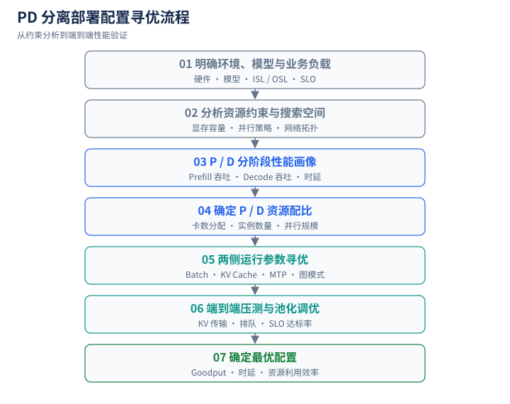</p>

## 一、明确优化目标与已知条件

### 1.1 仅知道硬件和模型信息还不够

例如，已知运行环境为昇腾 A5 双机，部署模型为 GLM-5.3-Flash，可以确定哪些部署方案具备可行性，但还不能直接确定哪种方案性能最优。

因为不同业务负载对 Prefill 和 Decode 的资源需求不同。

| 业务场景 | 输入长度 ISL | 输出长度 OSL | 资源需求倾向 |
|---|---:|---:|---|
| 长文档总结 | 32768 | 512 | Prefill |
| 普通问答 | 1024 | 512 | 相对均衡 |
| 深度推理 | 2048 | 8192 | Decode |
| 代码生成 | 4096 | 4096 | Decode |
| 多轮对话、高前缀命中率 | 8192 | 1024 | Prefill 重复计算减少 |

以上长度均为示例，实际资源配比还取决于模型结构、批处理效率、缓存命中率和通信开销。

因此，配置寻优需要以下四类输入信息。

| 信息类别 | 具体内容 |
|---|---|
| 硬件信息 | NPU 型号、数量、HBM 容量、计算能力、显存带宽、机内和机间通信带宽 |
| 模型信息 | 参数规模、Attention 类型、MoE 架构、权重量化方式、KV Cache 数据类型、MTP 支持情况 |
| 软件信息 | vLLM 版本、vLLM-Ascend 版本、CANN 版本、Mooncake 版本 |
| 业务信息 | ISL、OSL、请求速率、并发数、Prefix Cache 命中率、时延要求 |

其中：

- **ISL（Input Sequence Length）**：输入序列长度。
- **OSL（Output Sequence Length）**：输出序列长度。
- **SLO（Service Level Objective）**：服务性能目标，例如 P99 TTFT 不超过 2 s。

### 1.2 如何定义“最优配置”？

最优配置不一定是吞吐量最高的配置。

例如，在同样的硬件环境下，假设有以下三种配置：

| 配置 | 请求吞吐量 | P99 TTFT | P99 TPOT | 是否满足要求 |
|---|---:|---:|---:|---|
| A | 25 req/s | 1.5 s | 35 ms | 是 |
| B | 35 req/s | 3.2 s | 45 ms | 否 |
| C | 30 req/s | 1.8 s | 38 ms | 是 |

假设业务要求：

- P99 TTFT ≤ 2 s；
- P99 TPOT ≤ 40 ms。

那么，配置 C 优于配置 A 和配置 B。

在实际推理服务中，建议采用 **Goodput（有效吞吐量）** 作为核心优化指标之一。

$$
\mathrm{Goodput}=\frac{\text{同时满足时延要求的成功请求数}}{\text{测试时长}}
$$

[DistServe（OSDI 2024）](https://arxiv.org/abs/2401.09670)同样采用面向 TTFT 和 TPOT 服务目标的 Goodput 优化思路，联合考虑 P/D 资源分配、并行策略及部署位置。

因此，对于固定硬件资源下的在线推理服务，可以将优化目标定义为：

**在满足 TTFT、TPOT、请求成功率等业务约束的前提下，最大化端到端 Goodput。**

## 二、分析 Prefill 和 Decode 的资源需求

确定 PD 最优配置之前，需要理解两个阶段的性能瓶颈。这决定了后续应该优先调整哪些参数。

### 2.1 Prefill 和 Decode 的计算特征

<p align="center"></p>

| 对比维度 | Prefill | Decode |
|---|---|---|
| 主要任务 | 处理输入序列 | 自回归生成输出序列 |
| 典型性能瓶颈 | 算力、长序列 Attention | 显存带宽、通信、KV Cache 容量 |
| 主要优化指标 | TTFT、输入 Token 吞吐量 | TPOT、ITL、输出 Token 吞吐量 |
| Batch Size 增大 | 有助于提高计算资源利用率 | 有助于摊薄权重读取开销 |
| 长输入的影响 | 增加计算负担 | 增加 Attention 和缓存负担 |
| 长输出的影响 | 直接影响较小 | 增加运行时间与缓存占用 |
| 重点优化方向 | 计算并行、长序列并行 | 批处理、图模式、投机推理 |

上述是一般性规律。对于 MoE、MLA、稀疏注意力、混合注意力等架构，通信也可能成为主要瓶颈，需要结合实际 Profiling 结果判断。

### 2.2 根据显存约束排除不可行配置

在考虑性能之前，首先要保证模型能够在 P 和 D 两侧分别正常运行。

单个设备的显存需求可以近似表示为：

$$
M_{\mathrm{required}}=M_{\mathrm{weight}}+M_{\mathrm{KV}}+M_{\mathrm{activation}}+M_{\mathrm{runtime}}
$$

其中：

| 组成部分 | 含义 |
|---|---|
| $M_{\mathrm{weight}}$ | 模型权重占用 |
| $M_{\mathrm{KV}}$ | KV Cache 及相关状态占用 |
| $M_{\mathrm{activation}}$ | 中间激活值占用 |
| $M_{\mathrm{runtime}}$ | 通信缓冲区、图捕获、运行时等额外占用 |

例如，对于一个总参数量为 320B 的 W8A8 模型，仅按照每个权重参数占用 1 Byte 粗略估算：

$$
M_{\mathrm{weight}}\approx 320\ \mathrm{GB}
$$

假设每张 NPU 的显存为 96 GB，那么仅从权重容量考虑：

- 2 卡：192 GB，无法容纳完整权重；
- 4 卡：384 GB，剩余空间有限；
- 8 卡：768 GB，具有更大的 KV Cache 和运行时空间。

这里还没有计入量化元数据、高精度权重、MTP 模型、并行切分不均衡等因素。

**对于 MoE 模型，激活参数量主要用于分析计算开销，总参数量才是估算完整模型权重容量的重要依据。**

因此，第一步应当根据硬件容量、模型权重和并行策略，计算 P、D 两侧的最小可行部署规模。

此外，对于 DeepSeek-V4、GLM-5.3-Flash 等具有复杂缓存结构的模型，不能直接使用传统 MHA 的 KV Cache 容量公式估算全部缓存，应结合实际 KV Cache Spec、缓存组以及服务启动时输出的缓存容量进行判断。

## 三、确定 P/D 最优资源配比

这是 PD 分离配置寻优中最重要的环节之一。

假设现有 16 张 NPU，应该采用 4P + 12D、8P + 8D、12P + 4D，还是其他配置？这里的 P/D 数字表示分配的 NPU 数量，而非服务实例数量。

### 3.1 基本原则：使两个阶段的请求处理能力相匹配

<p align="center">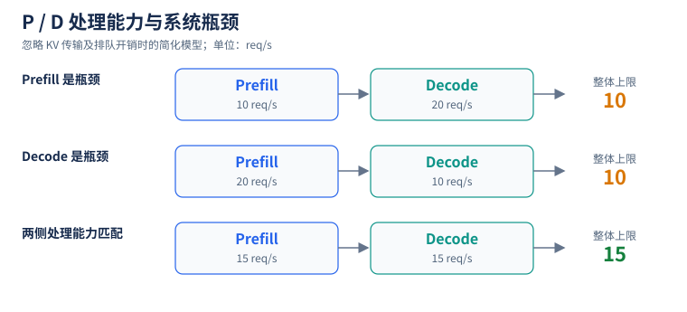</p>

PD 分离本质上可以看作一个两阶段处理流水线。每个请求都需要经过 Prefill 和 Decode。

因此：

$$
R_{\mathrm{system}}\leq\min(R_P,R_D)
$$

其中：

- $R_P$：Prefill 阶段可持续处理的请求速率；
- $R_D$：Decode 阶段可持续处理的请求速率；
- $R_{\mathrm{system}}$：端到端请求吞吐量。

如果 Prefill 处理能力明显高于 Decode，那么 Decode 将出现请求积压。

反之，如果 Decode 的处理能力明显高于 Prefill，则 Decode 的部分资源可能处于空闲状态。

所以，资源分配的基本目标是：

$$
R_P\approx R_D
$$

实际部署中还应保留一定的容量余量，应对突发请求以及输入输出长度的波动。

### 3.2 如何计算两个阶段的请求处理能力？

#### （1）Prefill 阶段

假设 Prefill 阶段的实际计算吞吐量为 $T_P$，单位为 tokens/s。平均输入长度为 $L_{\mathrm{in}}$，实际可跳过计算的前缀比例为 $h$。

则 Prefill 的请求处理能力可以初步估算为：

$$
R_P\approx\frac{T_P}{L_{\mathrm{in}}(1-h)}
$$

需要注意，这里 $T_P$ 指新计算的输入 Token 吞吐量，而不是包含缓存命中 Token 的逻辑输入吞吐量。

该公式忽略了缓存查询、加载、剩余 Token 访问历史 KV 等开销，不能用于直接预测接近 100% 命中率的场景。

#### （2）Decode 阶段

假设 Decode 阶段实际输出吞吐量为 $T_D$，平均由 Decode 侧生成的 Token 数量为 $L_D$。

则：

$$
R_D\approx\frac{T_D}{L_D}
$$

当输出序列较长时，可以近似认为：

$$
L_D\approx L_{\mathrm{out}}
$$

#### （3）KV Cache 传输阶段

PD 分离还存在 KV Cache 传输开销。假设每个请求平均需要跨 P/D 传输 $S_{\mathrm{KV}}$ Byte 数据，实际有效传输带宽为 $B_{\mathrm{eff}}$，则：

$$
R_{\mathrm{transfer}}\approx\frac{B_{\mathrm{eff}}}{S_{\mathrm{KV}}}
$$

所以，更完整的吞吐量上限估算为：

$$
R_{\mathrm{system}}\leq\min(R_P,R_D,R_{\mathrm{transfer}})
$$

这三个公式的主要作用是**辅助筛选候选资源配比和定位瓶颈**，最终性能仍需端到端测试。

### 3.3 结合具体例子理解

假设有 16 张 NPU，目标业务负载为：

| 参数 | 数值 |
|---|---:|
| NPU 数量 | 16 |
| 平均 ISL | 8192 |
| 平均 OSL | 1024 |
| Prefix Cache 命中率 | 0% |
| 单卡折算 Prefill 吞吐量 | 16000 tokens/s |
| 单卡折算 Decode 吞吐量 | 1000 tokens/s |

假设每卡吞吐能力可以近似线性扩展，暂时忽略通信和显存约束。

若分配 $N_P$ 张卡给 Prefill，分配 $N_D$ 张卡给 Decode，则：

$$
R_P=\frac{16000N_P}{8192}
$$

$$
R_D=\frac{1000N_D}{1024}
$$

令两侧处理能力相等：

$$
\frac{16000N_P}{8192}=\frac{1000N_D}{1024}
$$

可得：

$$
N_D=2N_P
$$

也就是说，在该假设负载下，理论上 P/D 卡数比例约为：

$$
\boxed{P:D=1:2}
$$

候选资源分配方案如下：

| P 卡数 | D 卡数 | P 处理能力 | D 处理能力 | 整体吞吐上限 |
|---:|---:|---:|---:|---:|
| 4 | 12 | 7.81 | 11.72 | 7.81 |
| 5 | 11 | 9.77 | 10.74 | **9.77** |
| 6 | 10 | 11.72 | 9.77 | **9.77** |
| 8 | 8 | 15.63 | 7.81 | 7.81 |
| 12 | 4 | 23.44 | 3.91 | 3.91 |

单位均为 req/s。

理论上，5P11D 和 6P10D 的整体处理能力最高。但实际并行策略可能只支持特定卡数，且每侧还要满足模型显存要求，因此需要从可行方案中选择。

### 3.4 P/D 资源配比计算器（静态 Markdown 版）

原对话中的交互计算器在此转换为静态 SVG 曲线和可复用计算公式。默认参数沿用上节示例，P、D 两侧最少卡数均为 4。

<p align="center">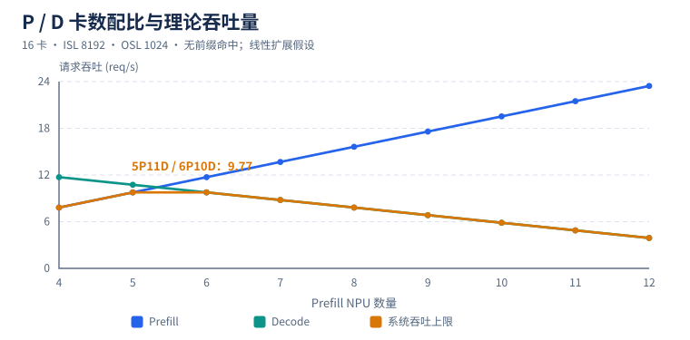</p>

设总卡数为 $N$，单卡折算吞吐量为 $t_P$ 和 $t_D$，则每卡折算请求处理能力为：

$$
a=\frac{t_P}{L_{\mathrm{in}}(1-h)},\qquad b=\frac{t_D}{L_{\mathrm{out}}}
$$

对于满足最小卡数限制的每个整数 $N_P$，令 $N_D=N-N_P$，计算：

$$
R(N_P)=\min(aN_P,b(N-N_P))
$$

取 $R(N_P)$ 最大的合法配置。连续近似下的资源比例为：

$$
\frac{N_P}{N_D}=\frac{b}{a}=\frac{t_D L_{\mathrm{in}}(1-h)}{t_P L_{\mathrm{out}}}
$$

采用线性扩展近似，未建模并行通信、拓扑、SLO 和缓存加载开销。仅用于初步筛选资源配比。

**ISL 增大，通常需要更多 Prefill 资源；OSL 增大，通常需要更多 Decode 资源；Prefix Cache 命中率提高，可能减少 Prefill 的计算资源需求。**

这也是为什么不存在脱离业务负载的固定最优 P/D 配比。

---

## 四、确定 Prefill 和 Decode 的最优并行策略

确定资源配比之后，还需要决定如何使用这些 NPU。例如，Prefill 和 Decode 分别分配 8 张 NPU，并不意味着两侧都应该使用 TP8。

### 4.1 各并行策略的优化目标

| 并行策略 | 主要作用 | 优先考虑的场景 |
|---|---|---|
| TP（张量并行） | 切分层内权重和计算 | 模型权重较大、降低单次计算时延 |
| DP（数据并行） | 并行处理不同请求 | 高并发、提高整体吞吐 |
| EP（专家并行） | 将不同专家分布到不同设备 | MoE 模型 |
| PP（流水线并行） | 将不同模型层部署到不同设备 | 超大模型、跨节点部署 |
| PCP（Prefill 上下文并行） | 分布式处理输入上下文 | 长输入、Prefill 优化 |
| DCP（Decode 上下文并行） | 分布式处理 Decode 的上下文相关计算和缓存 | 长上下文解码 |

对于 MoE 模型，DP 与 EP 可以联合组织专家和请求，因此不能简单地把每个 DP rank 都理解为保存一份完整且独立的模型权重。

### 4.2 相同卡数，不同并行布局

以 8 张 NPU 为例，暂时只考虑 TP 和 DP。

<p align="center">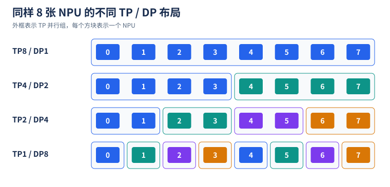</p>

不同布局的特点如下：

| 配置 | TP 通信规模 | 请求并行组数 | 主要特点 |
|---|---|---:|---|
| TP8 / DP1 | 较大 | 1 | 层内并行度较高 |
| TP4 / DP2 | 中等 | 2 | 平衡层内并行和请求并行 |
| TP2 / DP4 | 较小 | 4 | 提高请求并行度 |
| TP1 / DP8 | 无 TP 集合通信 | 8 | 最大化 DP rank 数量，但仍可能存在 EP 通信 |

这些配置是否可行取决于模型权重切分、专家布局、Attention 实现和 KV Connector 支持情况。

### 4.3 Prefill 并行策略如何寻优？

Prefill 侧主要关注：

**如何在充分利用计算资源的同时，降低长输入序列的处理时延。**

建议优先测试：

| 调优参数 | 测试方法 | 主要观察指标 |
|---|---|---|
| TP | 测试可行的 TP1、2、4、8 等 | TTFT、计算时间、通信时间 |
| DP | 在固定卡数下调整 DP | 输入吞吐量、排队时间 |
| EP | 测试受支持的专家布局 | MoE 通信、计算负载均衡 |
| PCP | 在长输入下测试不同并行度 | 长序列 TTFT、输入吞吐量 |
| PP | 针对支持的跨节点或超大模型场景测试 | 流水线效率、通信时间 |

例如，当 ISL 为 32768 或 65536 时，PCP 可能比短输入场景带来更明显的收益。但是，当 TP 或 PCP 规模继续增大时，额外的通信开销也可能抵消并行计算带来的收益。

### 4.4 Decode 并行策略如何寻优？

Decode 侧主要关注：

**如何提高并发请求处理能力，同时将 TPOT 和 ITL 控制在目标范围内。**

重点测试：

| 调优参数 | 测试方法 | 主要观察指标 |
|---|---|---|
| TP | 比较不同 TP 规模 | TPOT、通信耗时 |
| DP | 提高请求并行度 | 输出吞吐、请求吞吐 |
| EP | 优化 MoE 专家分布 | All-to-All 耗时、专家负载 |
| DCP | 针对长上下文测试 | KV Cache 容量、TPOT |
| 图模式 | 比较受支持的 eager 与图执行配置 | TPOT、算子启动开销 |

一般而言，Decode 更需要关注高并发下的显存访问效率、通信开销和 KV Cache 容量。

不过，**不能直接得出 Prefill 必须采用大 TP、Decode 必须采用大 DP 的结论**。应以模型和硬件对应的官方支持矩阵作为约束。

### 4.5 官方部署配置实例

以 [vLLM-Ascend v0.30.0 的 GLM-5.3-Flash 官方部署文档](https://docs.vllm.ai/projects/ascend/zh-cn/v0.30.0/tutorials/models/GLM5.3-Flash.html)为例，其不同硬件环境下的参考布局如下：

| 硬件环境 | Prefill | Decode |
|---|---|---|
| 950DT（A5）双机 | TP8 / DP1 | TP1 / DP8 |
| A3 双机，每机 16 个逻辑设备 | TP8 / DP2 | TP4 / DP4 |

可以看到，在相同模型下，硬件环境发生变化，官方选取的并行策略也发生了变化。

对于 A5 双机 GLM-5.3-Flash 部署研究，可以直接将官方 TP8/DP1 + TP1/DP8 配置作为第一组基线，而不是一开始就进行全量参数组合搜索。

## 五、确定 P/D 两侧的运行参数

在确定资源分配和并行策略之后，下一步是对 vLLM 的运行参数进行调优。建议按照参数的重要程度进行分层，而不是同时修改所有参数。

### 5.1 核心参数及调优方向

| 参数 | Prefill 调优方向 | Decode 调优方向 | 优先级 |
|---|---|---|---|
| `max-num-batched-tokens` | 提高输入 Token 处理效率 | 平衡批处理规模与 TPOT | 高 |
| `max-num-seqs` | 控制同时处理的请求数 | 提高并发解码能力 | 高 |
| `gpu-memory-utilization` | 满足缓存与计算需求 | 提高 KV Cache 容量 | 高 |
| `max-model-len` | 根据业务上下文需求设置 | 根据业务上下文需求设置 | 高 |
| `speculative-config` | 满足模型及连接器约束 | 优化生成效率 | 高 |
| `compilation-config` | 根据 Prefill 算子特性配置 | 优先验证图模式收益 | 中 |
| `kv-cache-dtype` | 减少缓存和传输开销 | 提升缓存容量 | 中 |
| `block-size` | 平衡缓存管理与前缀复用粒度 | 平衡缓存管理效率 | 中 |
| `additional-config` | 优化计算与通信 | 优化访存、通信与调度 | 中 |

### 5.2 max-num-batched-tokens

该参数表示调度器单次迭代允许调度处理的 Token 数量上限。

#### Prefill 侧

假设：

```bash
--max-num-batched-tokens 8192
```

在满足其他调度约束的情况下，一次迭代可以处理的输入 Token 总数不超过 8192。

如果启用了 Chunked Prefill，那么一个长度为 32768 的新输入可以被拆分成多个 Chunk 进行处理。

<p align="center">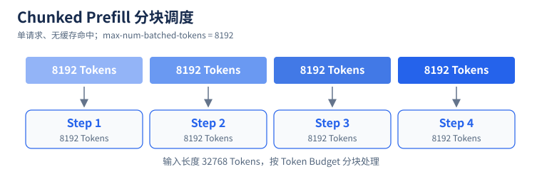</p>

参数过小，可能导致长请求被拆分为过多计算步骤，影响 TTFT 和计算效率；参数过大，则可能增加激活值占用、单次迭代时间以及其他请求的等待时间。

建议在版本和模型支持范围内，从以下候选值开始测试：

```text
4096
8192
16384
24576
32768
```

#### Decode 侧

在不考虑投机推理的普通 Decode 阶段，每条活跃序列通常每次迭代处理一个新 Token。

因此，Decode 侧的 `max-num-batched-tokens` 通常可以远小于 Prefill 侧。

开启 MTP 后，一次迭代可能处理多个待验证 Token，因此需要结合 `max-num-seqs` 和 `num_speculative_tokens` 联合调优。

例如，假设：

```bash
--max-num-seqs 32
```

如果每条序列最多涉及 1 个常规 Token 和 5 个推测 Token，则完整容纳这些 Token 的预算可粗略估算为：

$$
32\times(1+5)=192
$$

实际调度不一定每轮都达到这个预算，具体取决于 MTP 实现及序列状态。

### 5.3 max-num-seqs

该参数限制单个调度器在一次迭代中处理的序列数量。尤其对于 Decode，它是决定批处理规模的重要参数。

<p align="center">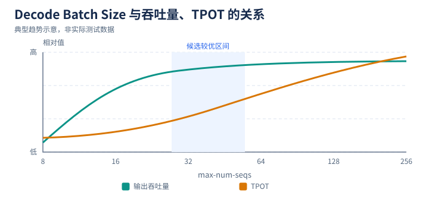</p>

随着 Decode Batch Size 增大：

- 模型权重的读取开销可以由更多请求共同分摊；
- 输出 Token 吞吐量通常先提高，再逐渐趋于饱和；
- KV Cache 占用量增加；
- TPOT 可能逐渐增大；
- 达到缓存容量瓶颈后，可能触发抢占或重计算。

因此，需要寻找的是**吞吐量与 TPOT 之间的最佳平衡点**。

建议候选参数为：

```text
8 / 16 / 32 / 64 / 128 / 256
```

实际搜索范围应围绕官方配置及显存容量确定。

### 5.4 gpu-memory-utilization

虽然参数名称中包含 GPU，但在 vLLM-Ascend 中同样用于 NPU。

```bash
--gpu-memory-utilization 0.90
```

该参数用于控制模型执行器的设备内存预算，并不是表示 90% 的显存全部用于 KV Cache。

<p align="center"></p>

对于 Decode 侧，更多可用 KV Cache 容量通常意味着能够容纳更多并发请求或者更长的上下文。

可以围绕官方配置测试：

| 候选值 | 特点 |
|---|---|
| 0.85 | 内存余量较大 |
| 0.90 | 常用测试起点 |
| 0.92 | 提高可用内存预算 |
| 0.95 | 更充分利用 HBM，需要验证运行稳定性 |

最终应根据以下指标判断：KV Cache 容量、KV Cache 使用率、抢占次数、OOM 情况、TPOT、输出吞吐量。

### 5.5 MTP 投机推理参数

对于支持 MTP 的 DeepSeek-V4、GLM-5.3-Flash 等模型，可以进一步测试：

```json
{
    "num_speculative_tokens": 3,
    "method": "deepseek_mtp"
}
```

候选推测 Token 数量可以包括关闭 MTP、1、2、3、5，具体以模型支持情况为准。

重点关注：

| 指标 | 作用 |
|---|---|
| Acceptance Rate | 推测 Token 的接受情况 |
| TPOT | 是否降低每个输出 Token 的平均时延 |
| Output Throughput | 是否提高实际生成吞吐量 |
| KV Cache Usage | 是否增加缓存压力 |
| Goodput | 是否提高满足业务要求的请求吞吐量 |

推测 Token 数量并非越多越好。推测失败会产生额外的计算开销，并可能降低高并发场景下的收益。

在 PD 分离场景下，MTP 配置还必须满足 P/D 两侧模型状态和 KV Connector 的兼容性要求。

---

## 六、KV Cache 传输和池化参数寻优

结合目前研究的 Mooncake KV Cache 池化场景，这一部分也需要单独开展实验。

### 6.1 区分 PD 传输与 KV Cache 池化

<p align="center">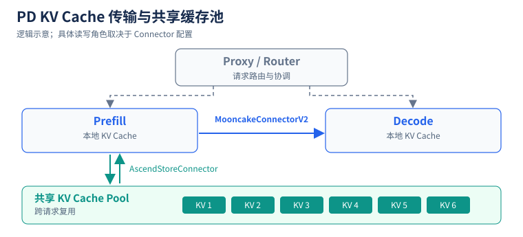</p>

| 功能 | PD KV Cache 传输 | KV Cache 池化 |
|---|---|---|
| 主要目的 | 将当前请求的 KV 交给 Decode | 实现不同请求间的 KV 复用 |
| 典型连接器 | `MooncakeConnectorV2` | `AscendStoreConnector` |
| 主要收益 | 支持 P/D 分离执行 | 减少重复 Prefill 计算 |
| 主要瓶颈 | 传输带宽、传输时延 | 缓存容量、命中率、加载时延 |
| 核心指标 | KV Transfer Latency | Pool Hit Rate、TTFT |

两者需要分别验证和调优。

### 6.2 Mooncake 参数调优

| 参数 | 主要作用 | 调优依据 |
|---|---|---|
| `global_segment_size` | 每个 worker 注册到缓存池的内存容量 | 工作集大小、主机内存 |
| `local_buffer_size` | 本地传输缓冲区，部分模式适用 | 并发传输压力 |
| `MOONCAKE_OFFLOAD_LOCAL_BUFFER_SIZE_BYTES` | 缓存卸载相关的本地缓冲区 | KV 容量、缓冲区溢出情况 |
| `protocol` | 传输协议 | 硬件与网络拓扑 |
| `preferred_segment` | 缓存存储位置偏好 | 数据局部性 |
| 缓存淘汰策略 | 决定缓存保留与淘汰行为 | 工作集特征、命中率 |
| Connector Timeout | 缓存传输及生命周期相关超时 | 长序列、高负载运行稳定性 |

Mooncake 池容量通常需要结合每个 worker 的配置计算，而不能只看单个节点的配置值。相关参数还存在内存对齐与平台兼容性约束。参见 [KV Cache Pool 部署指南](https://docs.vllm.ai/projects/ascend/en/v0.30.0/user_guide/feature_guide/kv_cache_pool_ascend_store.html)。

### 6.3 Prefix Cache 命中率对最优配置的影响

假设业务输入输出长度固定为：

$$
\mathrm{ISL}=8192,\qquad\mathrm{OSL}=1024
$$

忽略缓存加载开销，不同有效前缀命中率下，Prefill 需要新计算的输入 Token 数量如下：

<p align="center">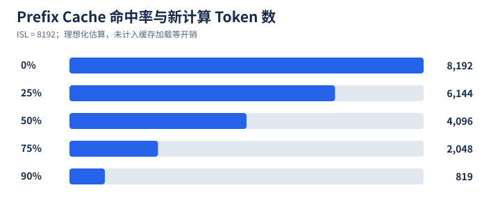</p>

可以看到，当命中率较高时，原本合理的 P/D 配比可能变成 Prefill 资源过剩、Decode 资源不足。

因此：

**普通 PD 分离的最优配置，不一定是开启 KV Cache 池化之后的最优配置。**

建议在以下场景中分别寻找最优配置。

| 实验场景 | 本地 Prefix Cache | 共享 KV Pool | 目的 |
|---|---|---|---|
| A | 关闭 | 关闭 | 建立纯计算基线（连接器支持时） |
| B | 开启 | 关闭 | 评估本地缓存收益 |
| C | 开启 | 开启，冷缓存 | 评估池化额外开销 |
| D | 开启 | 开启，热缓存 | 评估共享缓存复用收益 |

结合之前使用的 AISBench Prefix Cache 插件，还可以构造不同目标前缀命中率的数据集，例如 0%、25%、50%、75%、90%，观察最优 P/D 配置是否随命中率发生变化。

实验分析时应使用**实际测得的命中率**，而不是数据集生成阶段的目标命中率。

---

## 七、如何设计实验确定最优配置

实际工程中，建议采用 **分层搜索（Hierarchical Search）+ 粗粒度搜索 + 局部精细搜索** 的方法。

不建议直接对所有参数做全排列。

假设有 10 个待调参数，每个参数有 4 个候选值，则组合数量达到：

$$
4^{10}=1048576
$$

对于大模型部署而言，每次配置变更可能涉及模型重新加载、图捕获和通信初始化，因此全量搜索成本很高。

### 7.1 第一阶段：建立基线配置

直接使用对应硬件和模型的官方部署参数。

例如，vLLM-Ascend v0.30.0 的 GLM-5.3-Flash 950DT（A5）双机普通 PD 分离示例包含以下配置：

| 参数 | Prefill | Decode |
|---|---:|---:|
| NPU 数量 | 8 | 8 |
| TP | 8 | 1 |
| DP | 1 | 8 |
| EP | 开启 | 开启 |
| max-num-seqs | 256 | 30 |
| max-num-batched-tokens | 24576 | 120 |
| max-model-len | 133120 | 133120 |
| gpu-memory-utilization | 0.90 | 0.95 |
| KV Cache dtype | FP8 | FP8 |
| MTP 推测 Token 数量 | 5 | 5 |

来源：[GLM-5.3-Flash 官方部署文档（v0.30.0）](https://docs.vllm.ai/projects/ascend/zh-cn/v0.30.0/tutorials/models/GLM5.3-Flash.html)。

这组参数是官方部署参考配置，而不是针对你的业务负载验证过的最优配置。

另外，该版本模型教程的池化章节主要提供 A3 Memcache 和 A2 Mooncake 示例。A5 双机采用 Mooncake 作为共享池后端的方案，需要另外核对所用版本的特性支持情况，不能将 `MooncakeConnectorV2` 的传输支持直接等同于 Mooncake 存储池支持。

### 7.2 第二阶段：确定测试负载

在尚未明确真实业务负载的情况下，可以先设计以下六种典型场景。

| 场景编号 | ISL | OSL | 场景特点 |
|---|---:|---:|---|
| W1 | 1024 | 1024 | 短输入、短输出 |
| W2 | 1024 | 8192 | Decode 密集型 |
| W3 | 8192 | 1024 | Prefill 偏重 |
| W4 | 8192 | 8192 | 长输入、长输出 |
| W5 | 32768 | 1024 | Prefill 密集型 |
| W6 | 32768 | 8192 | 长上下文、高缓存压力 |

每种场景进一步测试不同并发档位：

```text
1、4、8、16、32、64、128、256
```

具体测试上限根据实际模型承载能力动态调整。

### 7.3 第三阶段：开展 P/D 分阶段性能测试

#### Prefill 性能测试

使用不同输入长度，并将输出长度设为 1，减少 Decode 计算的干扰。

| ISL | OSL | 并发数 |
|---:|---:|---|
| 1024 | 1 | 1～256 |
| 8192 | 1 | 1～256 |
| 32768 | 1 | 1～256 |

记录：TTFT、Prefill 执行时间、输入 Token 吞吐量、NPU 计算利用率、通信耗时。

这一阶段可以使用单独部署的等价 Prefill 布局进行近似测试，或者在完整 PD 服务中利用阶段级 Metrics 和 Profiling 获取结果。

#### Decode 性能测试

保持 ISL 固定，增加 OSL 和并发数。

| ISL | OSL | 并发数 |
|---:|---:|---|
| 1024 | 2048 | 1～256 |
| 8192 | 2048 | 1～256 |
| 32768 | 2048 | 1～256 |

记录：TPOT、ITL、输出 Token 吞吐量、KV Cache 使用率、抢占次数、显存带宽利用率。

这里要特别注意：**不能只使用很短的 ISL 来测量 Decode 性能**，因为上下文长度也会影响 Decode 阶段的 Attention 开销和 KV Cache 容量需求。

实际 PD 服务中的 Decode 请求需要对应的 KV Cache，因此不能简单地将普通请求直接发送至 KV Consumer 并将结果视为标准 Decode 测试。

### 7.4 第四阶段：搜索资源分配及并行策略

对于两台各有 8 张 NPU 的 A5 服务器，如果优先维持一台 P、一台 D 的拓扑，可以先固定 8P8D 卡数分配，搜索不同并行策略。

| 实验编号 | Prefill TP/DP | Decode TP/DP |
|---|---|---|
| E1（官方基线） | TP8/DP1 | TP1/DP8 |
| E2 | TP8/DP1 | TP2/DP4 |
| E3 | TP8/DP1 | TP4/DP2 |
| E4 | TP4/DP2 | TP1/DP8 |
| E5 | TP4/DP2 | TP2/DP4 |
| E6 | TP4/DP2 | TP4/DP2 |

这些是待验证的搜索候选项，不代表所有组合都受到 GLM-5.3-Flash 的模型实现和 Connector 支持。

首先通过支持矩阵、显存分析和功能测试排除不可行方案，再进行性能测试。

### 7.5 第五阶段：搜索调度参数

假设已经选定某个较优的 P/D 并行策略。

第一轮固定 D 侧配置，调整 P 侧：

| 实验编号 | P max-num-batched-tokens | P max-num-seqs |
|---|---:|---:|
| P1 | 4096 | 64 |
| P2 | 8192 | 64 |
| P3 | 16384 | 64 |
| P4 | 24576 | 64 |
| P5 | 32768 | 64 |

找到较优的 Token Budget 后，再搜索 P 侧的 `max-num-seqs`。

第二轮固定 P 侧较优配置，搜索 D 侧：

| 实验编号 | D max-num-seqs | D Token Budget |
|---|---:|---|
| D1 | 8 | 根据 MTP 配置确定 |
| D2 | 16 | 根据 MTP 配置确定 |
| D3 | 32 | 根据 MTP 配置确定 |
| D4 | 64 | 根据 MTP 配置确定 |
| D5 | 128 | 根据 MTP 配置确定 |

随后针对较优配置继续测试：

- `gpu-memory-utilization`；
- MTP 推测 Token 数量；
- 图捕获规模；
- KV Cache 数据类型；
- 模型支持的通信优化参数。

最后保留排名前 2～3 的 P/D 配置，进行交叉组合测试，避免由于参数之间相互影响而遗漏更优组合。

这种方法属于近似寻优，不能严格保证获得全局最优解，但能够有效降低实验成本。

---

## 八、如何判断系统当前的性能瓶颈？

仅仅记录 TTFT、TPOT 和吞吐量还不够。如果发现性能较差，需要能够进一步判断问题出现在 P 节点、D 节点，还是 KV Cache 传输过程中。

<p align="center">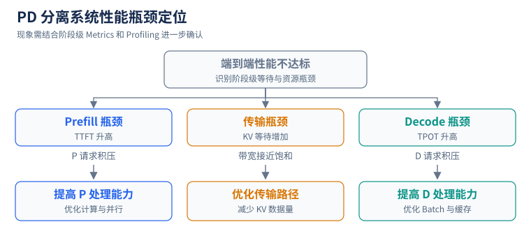</p>

### 8.1 常见性能现象与调优方向

| 实验现象 | 可能的原因 | 优先调优方向 |
|---|---|---|
| P 请求持续排队，D 负载较低 | Prefill 处理能力不足 | 增加 P 资源、优化 P 并行策略 |
| TTFT 较高，P 算力利用率较低 | Batch 效率低或通信开销大 | 调整 Token Budget、检查通信 |
| TTFT 正常，TPOT 随并发快速升高 | Decode 处理压力较大 | 调整 D 并行策略、Batch Size |
| D KV Cache 使用率高且发生抢占 | KV Cache 容量不足 | 增加缓存容量或限制并发 |
| P、D 利用率均较低，整体吞吐较低 | KV 传输、Proxy 或调度瓶颈 | 检查网络及阶段间等待时间 |
| 开启池化后 TTFT 反而增大 | 缓存加载成本超过重计算收益 | 优化缓存查询及加载机制 |
| 吞吐量不再增长，时延持续升高 | 系统达到饱和状态 | 确定最大可承载负载 |
| MoE 通信耗时占比过高 | 专家通信或负载不均衡 | 优化 EP、EPLB、通信算子 |

这些现象只能作为瓶颈定位线索，需要结合阶段级监控和 Profiling 进一步确认。

### 8.2 建议监控的 Metrics

vLLM 提供 Prometheus 兼容的 `/metrics` 接口，可以分别采集 Prefill 和 Decode 实例的监控指标。参见 [vLLM Production Metrics](https://docs.vllm.ai/en/latest/usage/metrics/)。

例如：

| Metrics | 作用 |
|---|---|
| `vllm:num_requests_running` | 当前运行请求数量 |
| `vllm:num_requests_waiting` | 当前等待请求数量 |
| `vllm:kv_cache_usage_perc` | KV Cache 使用率 |
| `vllm:prefix_cache_queries` | 本地前缀缓存查询 Token 数 |
| `vllm:prefix_cache_hits` | 本地前缀缓存命中 Token 数 |
| `vllm:external_prefix_cache_queries` | 外部前缀缓存查询 Token 数 |
| `vllm:external_prefix_cache_hits` | 外部前缀缓存命中 Token 数 |
| `vllm:num_preemptions` | 抢占次数 |
| `vllm:time_to_first_token_seconds` | 首 Token 时延 |
| `vllm:inter_token_latency_seconds` | Token 间时延 |
| `vllm:request_queue_time_seconds` | 请求排队时间 |
| `vllm:request_prefill_time_seconds` | Prefill 阶段耗时 |
| `vllm:request_decode_time_seconds` | Decode 阶段耗时 |

不同版本暴露的指标名称可能存在差异，应以实际服务的 `/metrics` 输出为准。

对于多 DP rank 部署，还应采集各个 rank 的负载及缓存使用情况，避免平均值掩盖局部瓶颈。

---

## 九、使用什么工具进行性能寻优？

结合昇腾和 vLLM-Ascend 环境，推荐使用以下工具组合。

| 工具 | 主要用途 |
|---|---|
| AISBench | 服务化压测、不同输入输出长度和并发测试 |
| AISBench Prefix Cache 插件 | 构造可控前缀命中率的工作负载 |
| vLLM Benchmark | 请求速率测试、吞吐及 Goodput 测试 |
| Prometheus | 持续采集 P/D 实例运行指标 |
| Grafana | 可视化性能指标 |
| npu-smi | 监控 NPU 资源和显存使用情况 |
| MindStudio Profiler / msprof | 分析算子、计算和通信耗时 |
| Mooncake Metrics / Logs | 分析 KV 传输和池化情况 |

### 9.1 vLLM Benchmark 测试示例

假设完整 PD 服务已经通过 Proxy 暴露在 8000 端口。

可以使用以下命令开展端到端测试：

```bash
vllm bench serve \
    --backend vllm \
    --base-url http://<PROXY_IP>:8000 \
    --endpoint /v1/completions \
    --model glm \
    --tokenizer <MODEL_PATH> \
    --dataset-name random \
    --random-input-len 8192 \
    --random-output-len 1024 \
    --ignore-eos \
    --num-prompts 1000 \
    --request-rate 10 \
    --percentile-metrics ttft,tpot,itl,e2el \
    --metric-percentiles 50,90,95,99 \
    --goodput ttft:2000 tpot:40
```

其中：

| 参数 | 含义 |
|---|---|
| `--request-rate 10` | 目标请求到达速率为 10 req/s |
| `--ignore-eos` | 减少提前结束导致的输出长度差异 |
| `--num-prompts 1000` | 本轮测试请求数量 |
| `--goodput ttft:2000 tpot:40` | 统计同时满足 TTFT 2 s、TPOT 40 ms 的请求吞吐量 |

[vLLM Benchmark](https://docs.vllm.ai/en/latest/benchmarking/cli/) 支持请求速率控制、最大并发控制以及请求级 Goodput 统计。

参数名称以部署环境中的 `vllm bench serve --help` 为准。命令中的 `<PROXY_IP>` 和 `<MODEL_PATH>` 为待替换占位符。

### 9.2 如何确定最大可承载请求速率？

针对每种配置进行多档请求速率测试，例如：

```text
1 req/s
2 req/s
4 req/s
8 req/s
12 req/s
16 req/s
20 req/s
```

观察 Goodput、TTFT、TPOT 和等待请求数量随负载的变化。

<p align="center">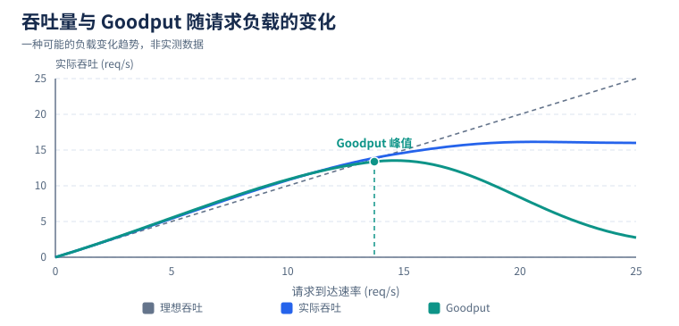</p>

当系统逐渐达到饱和状态时，实际吞吐量可能不再增长，但请求排队时延会持续增大，导致 Goodput 下降。

因此，应该同时开展两类测试：

| 测试类型 | 主要目的 |
|---|---|
| 固定并发数测试 | 寻找较优 Batch Size 和并发承载能力 |
| 固定请求到达速率测试 | 寻找满足 SLO 的最大可持续服务能力 |

AISBench 官方也提供了[多档并发场景服务化性能测试](https://ais-bench-benchmark.readthedocs.io/zh-cn/latest/advanced_tutorials/multi-concurrency_performance.html)，适合用来比较不同配置在负载上升过程中的性能变化。

---

## 十、是否有自动化方法确定最优 PD 配置？

有。对于后续需要反复进行不同模型、不同硬件环境下的部署调优，可以考虑构建一个自动化配置寻优工具。

### 10.1 自动化寻优方法比较

| 方法 | 基本原理 | 推荐程度 |
|---|---|---|
| Grid Search | 遍历全部候选参数组合 | 适合少量参数 |
| Random Search | 随机采样参数组合 | 适合大规模初步搜索 |
| Coordinate Search | 依次搜索各个参数 | 适合当前入门及工程调优 |
| Bayesian Optimization | 利用已有实验结果选择下一组参数 | 适合单次实验成本较高的情况 |
| 性能建模 + 搜索 | 先预测性能，再筛选配置 | 适合大规模部署方案规划 |
| 多目标优化 | 同时优化吞吐量、时延和资源效率 | 适合复杂生产场景 |

Python 中可以使用 Optuna、Ray Tune 等工具构建参数搜索过程。

### 10.2 自动化寻优工具的整体架构

<p align="center">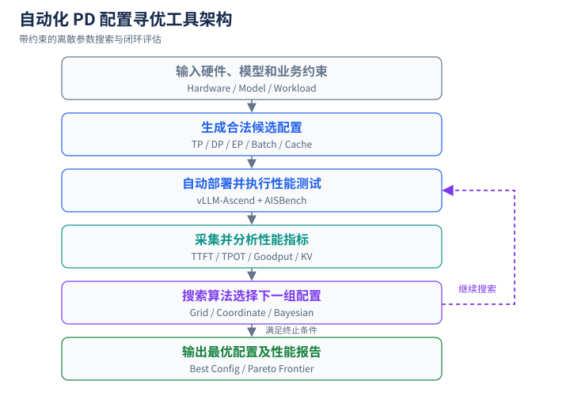</p>

其核心优化问题可以表示为：

$$
\begin{aligned}
\max_{\boldsymbol{\theta}\in\Omega}\quad &G(\boldsymbol{\theta},W)\\
\text{s.t.}\quad &\mathrm{TTFT}_{P99}\leq\tau_1\\
&\mathrm{TPOT}_{P99}\leq\tau_2\\
&N_P+N_D\leq N_{\mathrm{total}}\\
&M_{\mathrm{required},i}\leq M_{\mathrm{available},i},\quad\forall i\\
&\mathrm{SuccessRate}\geq\eta
\end{aligned}
$$

其中：

- $\boldsymbol{\theta}$：待搜索的 PD 分离配置参数集合；
- $\Omega$：满足模型、硬件及软件兼容性的合法配置空间；
- $W$：业务工作负载；
- $G$：有效请求吞吐量；
- $\tau_1,\tau_2$：时延约束；
- $\eta$：最低请求成功率。

这种方法将人工调优问题转化为一个**带约束的离散参数优化问题**。

## 十一、最终应该形成怎样的实验结果？

建议最终形成三类结果，而不是只输出一组启动命令。

### 11.1 最优配置参数表

| 配置项 | Prefill | Decode |
|---|---|---|
| NPU 数量 | 待实验确定 | 待实验确定 |
| TP | 待实验确定 | 待实验确定 |
| DP | 待实验确定 | 待实验确定 |
| EP / PCP / DCP | 待实验确定 | 待实验确定 |
| max-num-seqs | 待实验确定 | 待实验确定 |
| max-num-batched-tokens | 待实验确定 | 待实验确定 |
| gpu-memory-utilization | 待实验确定 | 待实验确定 |
| MTP | 待实验确定 | 待实验确定 |
| KV Pool 配置 | 待实验确定 | 待实验确定 |

### 11.2 性能对比结果

以下为假设性实验结果，用于说明报告形式：

| 指标 | 官方基线 | 调优后 | 调优及池化后 |
|---|---:|---:|---:|
| P99 TTFT | 2350 ms | 1850 ms | 920 ms |
| P99 TPOT | 48 ms | 38 ms | 37 ms |
| 请求吞吐量 | 12 req/s | 16 req/s | 19 req/s |
| Goodput | 8 req/s | 15 req/s | 18 req/s |
| 抢占次数 | 15 | 0 | 0 |

三组配置需要使用相同的数据集、请求到达模式及统计口径进行比较。涉及缓存复用时，还应记录冷缓存和热缓存状态。

### 11.3 不同业务场景下的最优配置

最终可能不是得到唯一一组最优参数，而是形成一份配置推荐表。

| 业务场景 | 资源分配倾向 | 重点优化参数 |
|---|---|---|
| 短输入、短输出 | P/D 相对均衡 | DP、Batch Size |
| 长输入、短输出 | Prefill | TP、PCP、Token Budget |
| 短输入、长输出 | Decode | DP、MTP、图模式 |
| 长输入、长输出 | 两侧联合优化 | KV Cache 容量、CP、通信 |
| 高前缀命中率 | 根据缓存加载成本重新分配 | KV Pool、Decode 并发 |
| 低时延服务 | 优先保障时延约束 | Batch Size、并行策略 |
| 高吞吐离线服务 | 优先提高资源利用率 | 并发、Batch、DP |

---

## 十二、针对当前研究的建议

结合目前涉及的 **A3 单机 DeepSeek-V4-Flash、A5 双机 GLM-5.3-Flash、PD 分离及 KV Cache 池化** 等研究任务，建议按照以下顺序开展工作。

**PD 分离性能调优实施清单**

- [ ] 确定官方部署基线，完成普通 PD 分离功能验证。
- [ ] 确定 ISL、OSL、并发数及请求速率测试矩阵。
- [ ] 开展 Prefill 和 Decode 分阶段性能测试。
- [ ] 筛选可行的 P/D 资源配比及 TP、DP、EP 布局。
- [ ] 调优 P/D 两侧的 `max-num-seqs` 和 `max-num-batched-tokens`。
- [ ] 调优 KV Cache 容量、MTP、图模式等参数。
- [ ] 引入 KV Cache 池化，测试不同实际前缀命中率。
- [ ] 重新评估 P/D 资源配比与运行参数。
- [ ] 开展端到端 SLO、Goodput 和长时间稳定性测试。
- [ ] 形成最优配置推荐表和性能分析报告。

其中，最值得优先研究的是四个方面：

| 优先级 | 研究内容 | 核心问题 |
|---|---|---|
| 1 | P/D 资源与并行策略 | 如何确定两个阶段的处理能力配比？ |
| 2 | P/D Batch 参数 | 如何找到吞吐量与时延之间的平衡点？ |
| 3 | Decode KV Cache 使用率 | 缓存使用率如何影响 TPOT、吞吐量及抢占？ |
| 4 | Prefix Cache 命中率与池化 | 缓存复用是否会改变最优 P/D 配置？ |

这四个问题可以形成一套完整且相互关联的大模型推理性能研究体系。

---

## 十三、推荐参考资料

| 参考资料 | 主要学习内容 |
|---|---|
| [vLLM：Disaggregated Prefilling](https://docs.vllm.ai/en/latest/features/disagg_prefill/) | PD 分离的设计目的 |
| [vLLM-Ascend：Disaggregated Prefill](https://docs.vllm.ai/projects/ascend/en/main/developer_guide/Design_Documents/disaggregated_prefill.html) | 昇腾 PD 分离设计原理 |
| [GLM-5.3-Flash 官方部署指南](https://docs.vllm.ai/projects/ascend/zh-cn/v0.30.0/tutorials/models/GLM5.3-Flash.html) | 实际部署参数与性能调优 |
| [DeepSeek-V4-Flash 官方部署指南](https://docs.vllm.ai/projects/ascend/zh-cn/v0.30.0/tutorials/models/DeepSeek-V4-Flash.html) | DeepSeek-V4 部署与并行策略 |
| [KV Cache Pool 部署指南](https://docs.vllm.ai/projects/ascend/en/v0.30.0/user_guide/feature_guide/kv_cache_pool_ascend_store.html) | Mooncake 缓存池及参数 |
| [vLLM Production Metrics](https://docs.vllm.ai/en/latest/usage/metrics/) | 性能指标与瓶颈定位 |
| [vLLM Benchmark CLI](https://docs.vllm.ai/en/latest/benchmarking/cli/) | 压测方法与负载控制 |
| [DistServe（OSDI 2024）](https://arxiv.org/abs/2401.09670) | P/D 资源分配及 Goodput 优化方法 |

其中，尤其推荐阅读 DistServe 这篇论文。它所研究的核心问题与本文提出的问题高度一致：如何针对给定模型、硬件资源、工作负载及服务时延约束，确定 Prefill 和 Decode 的资源分配及并行配置。

**总结：硬件与模型信息决定配置的可行空间，业务负载决定优化方向，分阶段性能测试负责缩小搜索范围，而端到端 Goodput 测试最终决定哪组配置最优。** 上述候选参数和示例性能数据均用于设计寻优实验，尚未在实际服务器上验证，不能直接视为实测最优参数。
