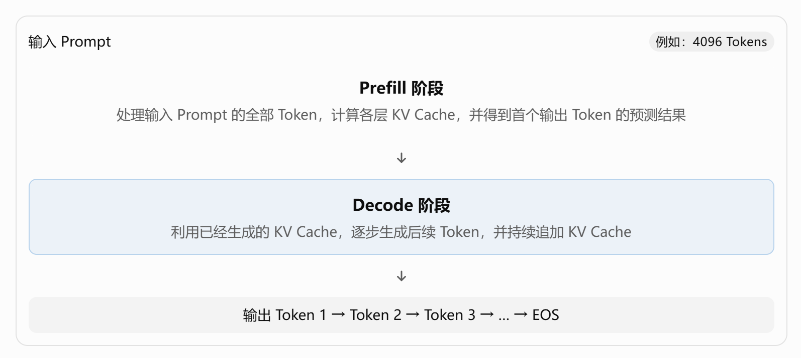
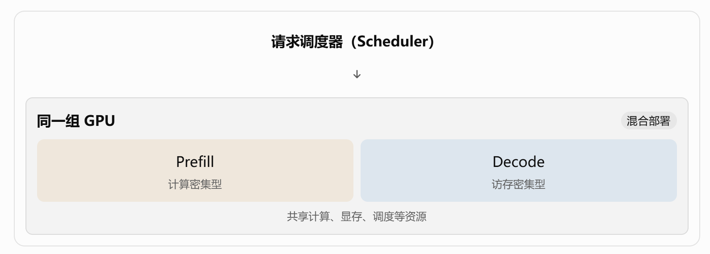
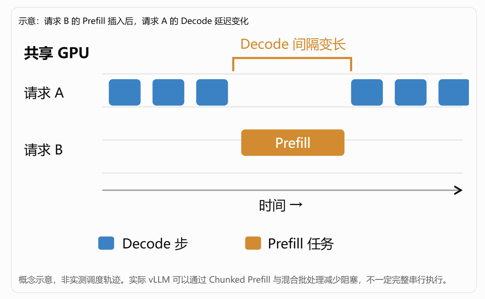
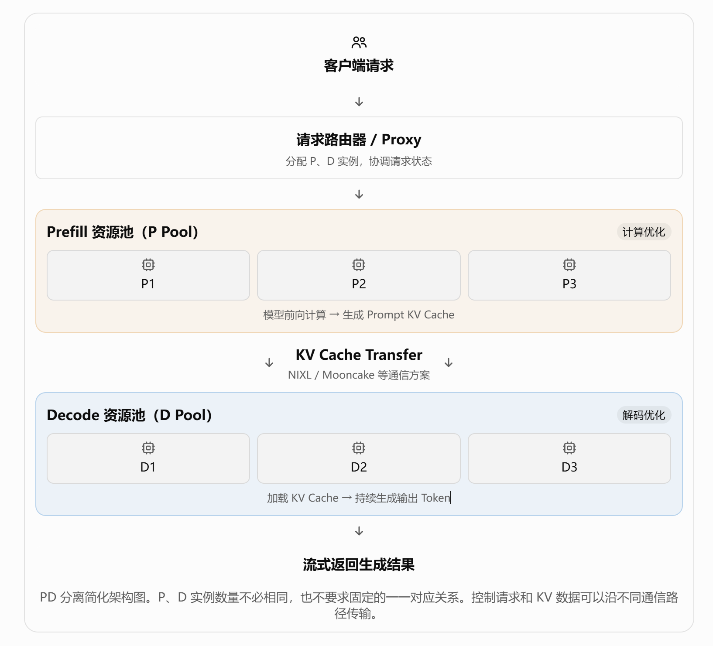
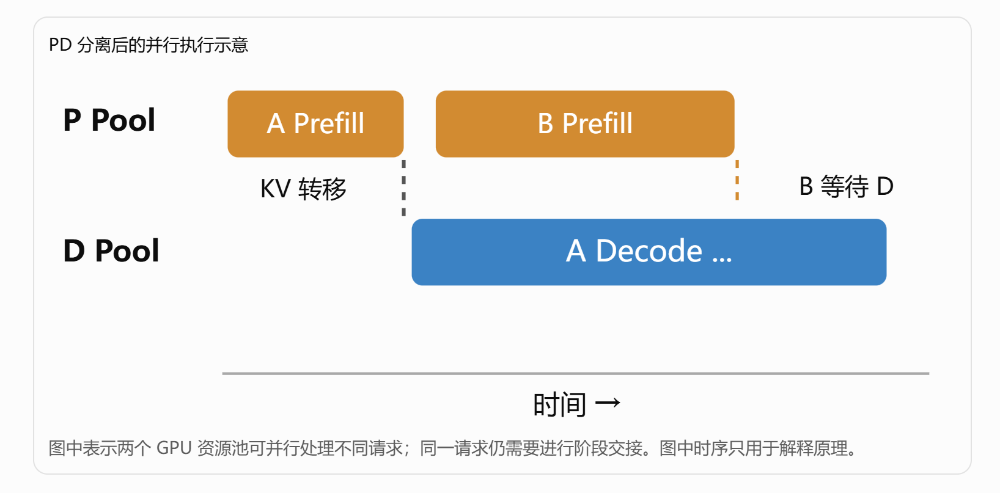

# 大模型推理技术详解：PD 分离（Prefill-Decode Disaggregation）

**PD 分离（Prefill-Decode Disaggregation）** 是大模型推理服务中的一种架构优化技术。它的核心思想是：**将大模型推理过程中的 Prefill（预填充）和 Decode（解码）两个阶段部署在不同的计算资源上，分别进行调度和优化，并通过 KV Cache 传输实现两个阶段的衔接。**

PD 分离主要解决传统混合部署中 Prefill 和 Decode 之间的资源竞争、性能干扰以及资源配置难以独立优化的问题。

它并不改变 Transformer 的基本计算逻辑，而是改变模型推理任务的执行位置、资源分配方式和调度方式。

为了理解 PD 分离，建议按照下面的逻辑建立知识体系：

1. **基础知识：** Prefill 和 Decode 分别是什么，为什么它们的计算特征不同？
2. **问题分析：** 传统混合部署存在哪些问题，为什么需要 PD 分离？
3. **工作原理：** PD 分离的整体架构是什么，KV Cache 如何在不同推理实例之间传输？
4. **具体示例：** 一个实际请求如何在 Prefill 节点和 Decode 节点之间流转？
5. **适用场景：** PD 分离在什么情况下能够改善性能，又有哪些额外开销？
6. **工程实践：** vLLM 如何实现 PD 分离，与 Chunked Prefill、Prefix Caching 有什么关系？

这一讲解以 vLLM 官方文档、vLLM-Ascend 设计文档，以及 OSDI 2024 论文 [DistServe: Disaggregating Prefill and Decoding for Goodput-optimized Large Language Model Serving][ref-distserve] 为主要参考依据。

---

## 一、基础知识：理解 Prefill 和 Decode

### 1.1 大模型推理包含两个阶段

对于采用自回归生成方式的 Decoder-only Transformer 模型，通常将一次文本生成过程划分为两个阶段。



假设用户发送一个包含 4096 个 Token 的问题，要求模型生成 200 个 Token 的回答。

**Prefill 阶段：** 模型处理输入的 4096 个 Token，通过 Transformer 各层计算产生对应的 KV Cache，并预测第一个输出 Token。

**Decode 阶段：** 模型利用已经计算好的 KV Cache，自回归地生成后续 Token，直到达到输出长度限制或遇到结束标记。

这里需要强调：Prefill 和 Decode 本来就是自回归推理天然存在的两个计算阶段，**PD 分离不是创造了这两个阶段，而是将它们放到不同的推理实例中执行。**

### 1.2 为什么 Prefill 和 Decode 的计算特征不同？

这是理解 PD 分离最重要的前提。

在 Transformer 的自注意力计算中，有：

$$
Q=XW_Q,\quad K=XW_K,\quad V=XW_V
$$

$$
\operatorname{Attention}(Q,K,V)=
\operatorname{Softmax}\left(\frac{QK^{\mathrm T}}{\sqrt{d_k}}\right)V
$$

虽然两个阶段都执行 Transformer 前向计算，但每次参与计算的 Token 数量不同，导致 GPU 工作负载存在明显差异。

#### （1）Prefill：一次处理多个 Token

假设输入序列长度为 $L=4096$，隐藏维度为 $d$。

在某一 Transformer 层中，输入矩阵形状为：

$$
X\in\mathbb{R}^{4096\times d}
$$

模型需要对全部输入 Token 执行线性投影、注意力计算及前馈网络计算。

其中大量线性计算能够使用矩阵乘法（GEMM）并行完成，具有较高的计算密度。

因此，在典型的大规模推理工作负载中：

**Prefill 通常表现为计算密集型（Compute-bound）阶段，比较依赖 GPU 的算力。**

#### （2）Decode：每次只处理一个新增 Token

进入 Decode 后，假设当前 KV Cache 中已经存储了 4096 个 Token 的历史信息。

下一步只需要为新增 Token 计算当前层的 Query、Key 和 Value。

在单个请求、单次解码步的场景中：

$$
Q_{\text{new}}\in\mathbb{R}^{1\times d_k}
$$

$$
K_{\text{cache}}\in\mathbb{R}^{4096\times d_k}
$$

此时注意力计算相当于由一个 Query 对历史 Key 进行查询，再对 Value 做加权聚合。

与 Prefill 相比，Decode 的单步计算规模较小，但需要反复读取模型权重和已有 KV Cache。

尤其在单步批量较小时，GPU 计算单元可能无法被充分利用，而显存带宽成为主要约束。

因此：

**Decode 通常表现为访存密集型（Memory-bound）阶段，比较依赖显存带宽。**

需要说明，这是一种典型情况下的归纳，并非绝对规律。模型结构、上下文长度、Batch Size 和硬件平台都可能改变两个阶段的实际性能瓶颈。

### 1.3 两个阶段的核心差异

| 比较维度 | Prefill | Decode |
|---|---|---|
| 主要任务 | 处理输入 Prompt | 自回归生成 Token |
| 单次计算 Token 数 | 通常多个 | 每个请求通常 1 个 |
| 计算形式 | 大规模矩阵计算 | 较小规模计算与历史 KV 读取 |
| 典型性能瓶颈 | GPU 计算能力 | 显存带宽 |
| KV Cache 操作 | 批量生成和写入 | 读取历史 KV，追加新 KV |
| 重点性能指标 | TTFT | TPOT / ITL |
| 优化重点 | 缩短输入处理时间 | 降低每个 Token 的生成延迟 |

这里出现了两个非常重要的性能指标：

- **TTFT（Time To First Token）**：从请求发出到收到第一个输出 Token 的时间，包含排队、Prefill、必要的阶段衔接等开销。
- **TPOT（Time Per Output Token）**：通常指首个 Token 之后，平均每生成一个输出 Token 所花费的时间。
- **ITL（Inter-Token Latency）**：相邻两个输出 Token 之间的时间间隔，可以进一步观察 P95、P99 等尾延迟。

例如，一个请求的 TTFT 为 300 ms，后续每个 Token 平均生成时间为 30 ms。

对于用户而言，TTFT 决定开始看到回答需要等待多久，而 TPOT / ITL 则影响回答的流式输出速度和流畅度。

> **补充：** TPOT 是平均值，ITL 是单个相邻 Token 间隔，两者相关但并不完全相同。PD 分离尤其关注 Decode 阶段 ITL 的稳定性。

---

## 二、为什么需要 PD 分离？传统部署存在哪些问题？

### 2.1 传统方案：Prefill 和 Decode 混合部署

在传统推理服务中，同一个推理实例既负责 Prefill，也负责 Decode。

例如，一张 GPU 上运行一个 vLLM 实例：



同一 GPU 上的两类任务可以通过 Continuous Batching（连续批处理）被统一调度，甚至在某个批次中混合执行。

这种设计有一个明显优势：资源能够共享，并且两种任务的计算特征有时可以互补，提高整体硬件利用率。

但是，当请求并发量增加、输入长度差异较大时，也会产生性能问题。

### 2.2 问题一：Prefill 与 Decode 相互干扰

假设 GPU 正在为请求 A 执行 Decode。

请求 A 已经生成了 50 个 Token，正常情况下每隔约 30 ms 生成一个新 Token。

此时，请求 B 到达，包含 8192 个输入 Token，需要执行计算量较大的 Prefill。

由于两个请求共享计算资源，调度器必须决定如何协调它们。

下面用一个简化时间轴说明这种干扰。



*概念示意，非实测调度轨迹。实际 vLLM 可以通过 Chunked Prefill 与混合批处理减少阻塞，不一定完整串行执行。*

当新的 Prefill 请求进入调度批次时，GPU 需要为其分配计算和显存带宽资源。这可能增加正在进行的 Decode 步的执行时间，或者让 Decode 等待后续调度。

最终表现为：

**请求 A 的某些 Token 生成间隔突然变长，导致 ITL 波动，甚至产生较高的 P99 ITL。**

这对于流式对话应用尤其不利，因为用户希望看到连续、稳定的内容输出。

vLLM 官方文档指出，PD 分离的一个核心目标正是控制这种由 Prefill 插入引起的尾部 ITL 增大问题。参见 [vLLM Disaggregated Prefilling][ref-vllm-pd]。

### 2.3 问题二：两个阶段难以独立优化

Prefill 和 Decode 的硬件需求不同，但在传统混合部署下，它们使用同一套 GPU 资源和推理实例配置。

假设一个推理集群中有 8 张 GPU。

如果采用传统混合部署，可能需要在整个推理实例上统一设置 Tensor Parallel Size、GPU 数量、批处理大小等参数。

但是两个阶段的最佳配置不一定相同。

例如，Prefill 可能希望通过更大的计算并行度缩短长输入处理时间；Decode 则可能更关注模型权重、KV Cache 容量、显存带宽，以及每步跨设备通信的开销。

这意味着：

**一套对 Prefill 最优的并行配置，不一定对 Decode 最优。**

PD 分离使两个阶段可以分别设置 TP、PP 等并行策略和实例数量。需要注意，Prefill 或 Decode 谁适合更大的 TP，取决于具体模型、硬件和负载，不能一概而论。

### 2.4 问题三：资源难以按负载独立扩展

假设某个在线推理服务存在两类工作负载：

| 业务类型 | 输入长度 | 输出长度 | 主要资源需求 |
|---|---|---|---|
| 长文档问答 | 10000 Tokens | 100 Tokens | Prefill 较重 |
| 长文本生成 | 500 Tokens | 4000 Tokens | Decode 较重 |

如果两类请求采用同一套混合推理实例，增加实例会同时增加 Prefill 和 Decode 的处理资源。

但实际瓶颈可能只出现在某一个阶段。

例如，在长文本生成占比较高的情况下，Decode 资源已经不足，而 Prefill 资源仍然相对空闲。

此时扩容更多完整的混合推理实例，可能不是成本最优的方案。

**PD 分离允许根据不同阶段的负载，分别扩容 Prefill 节点或 Decode 节点。**

---

## 三、PD 分离的工作原理

### 3.1 核心架构：两个独立的推理资源池

PD 分离将推理实例划分成两类：

- **P 节点（Prefill Worker）**：负责处理输入 Prompt，计算 KV Cache。
- **D 节点（Decode Worker）**：接收并加载 P 节点生成的 KV Cache，执行后续自回归生成。

两组节点通过专门的通信机制传输 KV Cache，同时由一个路由器或协调器负责整个请求的调度。



*PD 分离简化架构图。P、D 实例数量不必相同，也不要求固定的一一对应关系。控制请求和 KV 数据可以沿不同通信路径传输。*

与传统混合部署相比，这种架构最大的变化有三个。

首先，P 节点和 D 节点分别负责不同的计算阶段。其次，两个阶段可以拥有不同数量的实例和不同的并行配置。最后，**P 与 D 之间必须建立 KV Cache 传输机制，这是实现 PD 分离的关键。**

一个特别容易误解的地方是：PD 分离并不是把 Transformer 的前几层放到 P 节点、后几层放到 D 节点。

那属于模型层级切分，例如 Pipeline Parallelism（流水线并行）。

PD 分离则是按照**推理阶段**划分任务。通常 P 节点和 D 节点都需要能够执行完整模型的相应计算，因此两侧需要分别加载模型权重；如果模型采用张量并行或流水线并行，则可以在各自资源池内分片存放权重。

### 3.2 为什么 P 节点计算完后，可以交给 D 节点继续？

关键在于 KV Cache。

对于采用标准因果自注意力的 Transformer，在已经处理完前 $L$ 个 Token 后，每一层都维护了对应的 Key 和 Value 缓存。

对于新 Token，注意力可以写为：

$$
q_{L+1}=h_{L+1}W_Q
$$

$$
k_{L+1}=h_{L+1}W_K,\quad
v_{L+1}=h_{L+1}W_V
$$

然后，将当前新增的 Key 和 Value 与历史缓存拼接：

$$
K_{\text{all}}=[K_{\text{cache}};k_{L+1}]
$$

$$
V_{\text{all}}=[V_{\text{cache}};v_{L+1}]
$$

最后计算注意力输出：

$$
o_{L+1}=
\operatorname{Attention}(q_{L+1},K_{\text{all}},V_{\text{all}})
$$

其中，$h_{L+1}$ 是该层当前 Token 的输入表示。

这里有一个重要结论：

**如果 D 节点获得了模型各层所需的历史 KV Cache，就不需要重新对全部 Prompt 进行 Prefill 计算。**

它可以直接利用历史 KV Cache，处理新生成的 Token，继续完成自回归推理。

这里传递的是模型运行过程中形成的中间状态，而不是模型参数。

对于标准 Transformer，需要的是各相关注意力层的 KV Cache；对于 MLA、滑动窗口注意力等架构，具体缓存形式可能有所不同。

### 3.3 KV Cache 在不同 GPU 之间如何传输？

P 节点计算得到的 KV Cache 最初存储在自身的设备显存中，而 D 节点的注意力计算需要访问这些数据。

因此必须把数据传递到 D 节点可访问的缓存空间。

以 vLLM 的常见 PD 分离实现为例，传输过程可以分为三个层次。

**第一层：控制信息传递**

Proxy 协调 P、D 节点，并传递请求 ID、Token 信息、KV 缓存位置及传输状态等必要元数据。

**第二层：KV Cache 数据传输**

通过 KV Connector 进行数据搬运。具体实现可以是 P 节点主动推送，也可以是 D 节点根据元数据主动拉取。

传输可能使用 GPU 间高速互联、RDMA 等机制，具体取决于部署环境和 Connector 的实现。

**第三层：D 节点缓存接入**

D 节点接收 KV Cache，将其放入自身缓存管理系统分配的空间，再让注意力计算使用这些缓存块。

这一步不要求 P、D 两侧使用相同的物理缓存块编号，但必须能够正确映射 Token 对应的 KV 数据，并满足缓存布局、模型结构和数据格式兼容性要求。

如果你已经了解 vLLM 的 PagedAttention，可以把它理解为：

P 节点生成的 KV Cache 原本由其自己的 Block 管理，传输到 D 节点之后，需要被正确接入 D 节点的 KV Cache 管理体系。

**传输的是 KV Cache 的数据和必要的定位信息，并不是直接把 P 节点的物理 Block 身份原样交给 D 节点。**

vLLM 官方采用 KV Connector 抽象支持这一机制，例如 NixlConnector、MooncakeConnector。vLLM-Ascend 文档还分别描述了 D 端拉取 KV 和 P 端按层推送 KV 的实现方式。参见 [vLLM PD 分离文档][ref-vllm-pd] 与 [vLLM-Ascend PD 分离设计文档][ref-ascend-pd]。

### 3.4 完整推理过程：以一个具体请求为例

假设用户提交以下任务：

> 请根据下面的一份技术文档进行总结，输出一段 200 Token 左右的摘要。

输入文档经过 Tokenization 后包含 4096 个 Token。

设定使用 2 个独立推理实例：

- GPU 0 运行 P 实例。
- GPU 1 运行 D 实例。

**单个请求的 PD 分离执行流程：**

1. **接收和路由请求**

   Proxy 收到包含 4096 个 Token 的输入，选择 GPU 0 上的 P 实例进行处理。

2. **执行 Prefill**

   P 实例通过 Transformer 前向计算处理输入 Token，生成各层的 Prompt KV Cache，并可根据最后一个位置的 logits 得到第一个输出 Token。

3. **建立 KV Cache 传输**

   P 实例保留需要传输的 KV Cache。Proxy 协调 GPU 1 上的 D 实例，为其提供传输所需的请求信息。

4. **D 实例接收 KV Cache**

   GPU 1 为该请求分配缓存空间，通过 Connector 接收 P 实例中的 KV Cache，完成必要的布局映射和状态同步。

5. **执行 Decode**

   D 实例利用已加载的历史 KV Cache，继续逐 Token 生成回答。

   假设 P 已预测第一个输出 Token，那么 D 可以从该 Token 继续计算，生成第二个及后续 Token，同时追加新 KV。

6. **返回结果并释放资源**

   生成结果通过服务端流式返回。P 端的缓存可在确认不再需要后释放，D 端在请求结束后按缓存管理策略释放或保留相关块。

这里需要注意，P 端是否负责生成第一个 Token、D 端何时开始对外输出，以及是否采用异步或按层 KV 传输，都与具体实现有关。

例如，vLLM-Ascend 的 MooncakeConnector 路径会在 Prefill 完成后保留 P 端 KV，D 端进入等待远程 KV 的状态，并在加载完成后继续 Decode。参见 [vLLM-Ascend PD 分离设计文档][ref-ascend-pd]。

### 3.5 PD 分离后，两个阶段是否仍然需要等待？

需要，但要区分**单个请求的依赖关系**和**不同请求之间的并发关系**。

对于同一个请求，Decode 仍然依赖 Prefill 生成的历史 KV Cache。传统 PD 分离方案下，D 必须获得必要的 KV 数据后，才能执行依赖这些数据的解码。

但对不同请求，P、D 资源池可以并行工作。

例如，当 P 节点正在处理请求 B 的长 Prompt 时，D 节点可以继续为请求 A 生成 Token。

这就是 PD 分离能够减少阶段干扰的本质。



*图中表示两个 GPU 资源池可并行处理不同请求；同一请求仍需要进行阶段交接。图中时序只用于解释原理。*

此外，一些实现支持按层 KV 传输、异步数据搬运，进一步重叠计算和通信，但这属于基础 PD 分离之上的工程优化。

---

## 四、PD 分离的代价：KV Cache 传输开销

到目前为止，PD 分离似乎有不少优势。那么为什么不是所有推理服务都采用它？

原因在于：**PD 分离消除了部分计算干扰，但同时引入了额外的数据传输、资源占用和调度开销。**

### 4.1 KV Cache 传输的数据量有多大？

对于采用标准多头注意力或 GQA 的 Transformer，在不考虑缓存量化、稀疏化等优化的情况下，KV Cache 的理论大小可以近似计算为：

$$
M_{\mathrm{KV}}=
2\times N_{\mathrm{layer}}\times S
\times H_{\mathrm{KV}}\times d_h\times b
$$

其中：

| 参数 | 含义 |
|---|---|
| $N_{\mathrm{layer}}$ | Transformer 层数 |
| $S$ | 已缓存 Token 数 |
| $H_{\mathrm{KV}}$ | 每层 KV Head 数 |
| $d_h$ | 每个 KV Head 的维度 |
| $b$ | 每个元素的字节数 |
| $2$ | 分别存储 Key 和 Value |

假设一个采用 GQA 的模型具有以下配置：

| 参数 | 数值 |
|---|---:|
| Transformer 层数 | 32 |
| KV Heads | 8 |
| Head Dimension | 128 |
| Prompt Tokens | 4096 |

如果 KV Cache 采用 FP16，每个元素占 2 字节，那么：

$$
\begin{aligned}
M_{\mathrm{KV}}
&=2\times32\times4096\times8\times128\times2\\
&=536870912\text{ Bytes}\\
&=512\text{ MiB}
\end{aligned}
$$

**单个 4096-Token 请求的理论 KV Cache 大小：512 MiB（约 0.5 GiB）。** 这里尚未考虑缓存分配和传输协议开销。

也就是说，对于这个示例，如果缓存没有提前复用，P 节点和 D 节点之间就需要传输约 512 MiB 的 KV Cache 数据。

当并发量较高时，这种传输可能对网络带宽造成很大压力。

对于采用 MLA 等注意力机制的模型，缓存结构和大小会不同，不能直接使用上述 GQA 公式。

### 4.2 为什么 PD 分离不一定降低 TTFT？

传统混合部署下，Prefill 和 Decode 使用同一个推理实例，通常无需跨实例传输完整的 Prompt KV Cache。

而 PD 分离后，请求必须经历额外的阶段交接。

可以近似写成：

$$
\begin{aligned}
T_{\mathrm{TTFT}}^{\mathrm{PD}}
\approx {}&
T_{\mathrm{queue,P}}+
T_{\mathrm{prefill}}\\
&+T_{\mathrm{transfer}}+
T_{\mathrm{queue,D}}+
T_{\mathrm{first}}
\end{aligned}
$$

其中，$T_{\mathrm{first}}$ 表示 D 端准备完成到用户实际看到首个 Token 的其余开销；具体组成取决于首 Token 在 P 端还是 D 端生成、传输是否重叠等实现细节。

虽然 PD 分离可以减少 Prefill 与 Decode 的相互干扰，但它额外引入了 KV Cache 传输和跨实例调度开销。

因此，在并发量较低、原本不存在明显资源竞争时，**PD 分离反而可能增大 TTFT。**

NVIDIA Dynamo 官方文档也明确指出，低并发下混合部署通常能够避免传输及资源池拆分开销，而在持续高负载、P/D 竞争明显时，分离式资源池更容易体现优势。参见 [NVIDIA Dynamo 官方文档][ref-dynamo]。

### 4.3 PD 分离还有哪些额外成本？

除了 KV Cache 传输，系统还要面对显存容量和资源分配问题。

由于 P、D 两侧通常都需要加载模型权重，部署后可能出现模型权重的重复占用；同时，KV Cache 在交接期间也可能暂时保留两份。

此外，如果 P 节点处理速度明显快于 D 节点，待解码请求会不断积累；反过来，如果 D 节点能力充足但 Prefill 节点不足，就可能出现 Decode 资源空闲的问题。

因此，实际部署还需要解决合理的 **P:D 资源比例** 和负载均衡问题。

---

## 五、PD 分离适用于哪些场景？

理解了收益与开销，就可以判断什么时候值得使用 PD 分离。

| 应用场景 | 适用性 | 原因 |
|---|---|---|
| 高并发在线聊天服务 | 较适合 | 大量 Prefill 和 Decode 并发执行，容易发生干扰 |
| 长输入和长输出混合负载 | 较适合 | P、D 资源需求差异明显，独立扩展有价值 |
| 严格限制 P99 ITL 的流式服务 | 较适合 | Decode 需要较稳定的服务时间 |
| 具备高速 GPU 互联的推理集群 | 较适合 | 可以降低 KV Cache 传输成本 |
| 单用户或低并发推理 | 通常不优先 | 计算干扰有限，额外传输成本可能大于收益 |
| 短输入、短输出的小请求 | 需要实测 | 阶段交接开销可能占比较高 |
| 网络带宽有限的跨节点部署 | 谨慎采用 | 大量 KV Cache 传输可能成为新瓶颈 |

### 一个容易忽略的指标：Goodput

研究 PD 分离时，还需要区分两个概念。

**Throughput（吞吐量）** 通常表示单位时间内处理的请求数或生成的 Token 数。

**Goodput（有效吞吐量）** 在这类研究中更强调满足服务级别目标（SLO）的请求处理能力，例如：请求不仅需要完成，还必须满足指定的 TTFT 和 TPOT 限制。

假设有一个推理服务：

- 系统 A 每秒完成 100 个请求，但大量请求无法满足 TPOT 限制。
- 系统 B 每秒完成 90 个请求，但绝大多数请求都满足延迟要求。

在一定 SLO 定义下，系统 B 的 Goodput 可能高于系统 A。

这也解释了为什么 vLLM 官方文档特别提醒：**PD 分离本身并不保证提高原始吞吐量。**

PD 分离的主要价值在于降低阶段干扰、独立优化延迟，并在特定工作负载和资源配置下提高满足 SLO 的服务能力。DistServe 的研究重点也正是 Goodput，而非单纯增加 Token/s。参见 [DistServe 论文][ref-distserve] 和 [vLLM 官方文档][ref-vllm-pd]。

---

## 六、vLLM 中的 PD 分离是如何实现的？

vLLM 官方的 Disaggregated Prefilling 功能采用不同的 vLLM 实例分别执行 Prefill 和 Decode，并通过 KV Connector 完成阶段间缓存传输。

截至上一轮讲解所参考的官方文档，这项能力仍标注为 Experimental（实验性功能），具体 Connector 的兼容性、配置和行为会随版本变化。参见 [vLLM Disaggregated Prefilling][ref-vllm-pd]。

### 6.1 三个关键组件

| 组件 | 职责 |
|---|---|
| Proxy / Router | 路由请求，选择 P、D 实例，管理阶段交接 |
| Prefill / Decode vLLM Instance | 负责各自阶段的计算和 KV Cache 管理 |
| KV Connector | 协调并执行 KV Cache 的传输和接收 |

在 vLLM 的配置中，还会涉及 `kv_producer` 和 `kv_consumer` 两种角色。

前者对应生成 KV Cache 的 P 实例，后者对应消费 KV Cache 的 D 实例。

### 6.2 一个最小化的配置示例

下面是基于 vLLM 官方 NixlConnector 使用指南整理的双 GPU 单机示例。

假设 GPU 0 用于 Prefill，GPU 1 用于 Decode。

**启动 Prefill 实例**

```bash
CUDA_VISIBLE_DEVICES=0 \
UCX_NET_DEVICES=all \
VLLM_NIXL_SIDE_CHANNEL_PORT=5600 \
vllm serve Qwen/Qwen3-0.6B \
  --port 8100 \
  --enforce-eager \
  --kv-transfer-config '{"kv_connector":"NixlConnector","kv_role":"kv_producer","kv_load_failure_policy":"fail"}'
```

**启动 Decode 实例**

```bash
CUDA_VISIBLE_DEVICES=1 \
UCX_NET_DEVICES=all \
VLLM_NIXL_SIDE_CHANNEL_PORT=5601 \
vllm serve Qwen/Qwen3-0.6B \
  --port 8200 \
  --enforce-eager \
  --kv-transfer-config '{"kv_connector":"NixlConnector","kv_role":"kv_consumer","kv_load_failure_policy":"fail"}'
```

随后还需要启动一个 Proxy，将客户端请求先送往 P 实例，再协调 D 实例执行后续解码。

这些命令展示了基本配置关系，并非脱离环境即可直接运行的完整教程；还需要满足相应版本、NIXL、UCX 及平台依赖条件。

官方完整示例可以参考 [vLLM NixlConnector Usage Guide][ref-nixl]。

如果使用 vLLM-Ascend，整体 PD 分离原理相同，但应参考对应 Ascend 版本的部署方案，例如 MooncakeConnector、MooncakeLayerwiseConnector 等，而不能直接照搬 CUDA 环境下的命令。

### 6.3 PD 分离与 Chunked Prefill 有什么区别？

这两个技术都能缓解 Prefill 和 Decode 的干扰，但它们解决问题的方式不同。

| 比较维度 | Chunked Prefill | PD 分离 |
|---|---|---|
| 核心思想 | 将长 Prefill 切成较小的计算块 | 将 P/D 放入不同资源池 |
| 是否需要额外 GPU 资源池 | 不需要 | 典型部署需要 |
| 是否引入跨实例 KV 传输 | 不需要 | 需要 |
| 是否能缓解 Decode 干扰 | 可以 | 可以 |
| 能否独立扩容 P、D | 不可以 | 可以 |
| 实现复杂度 | 较低 | 较高 |

**Chunked Prefill 的关键思想是改善同一个推理实例内部的调度。**

例如，原本需要处理 8192 个 Token 的 Prefill，可以分成多个较短的计算片段，让 Decode 在调度中获得更好的执行机会。

vLLM V1 在适用配置下默认启用 Chunked Prefill，并优先调度 Decode 请求，再利用剩余 Token 预算安排 Prefill。参见 [vLLM Chunked Prefill 文档][ref-chunked]。

**PD 分离的关键思想则是物理或资源层面的阶段隔离。**

它不依赖于将 P/D 混合到同一个 GPU 调度批次，而是通过独立资源池完成阶段计算。

二者并不互斥。例如，P 节点内部仍然可以采用 Chunked Prefill 处理长输入。

### 6.4 PD 分离与 Prefix Caching 有什么关系？

这也是一个很值得区分的概念。

**Prefix Caching 解决的是重复计算问题；PD 分离解决的是阶段资源组织问题。**

Prefix Caching 通过复用已经计算好的前缀 KV Cache，避免相同前缀被重复执行 Prefill。

而 PD 分离关注的则是不同阶段分别在哪些实例上执行，以及 KV Cache 如何在实例之间传输。

二者可以结合使用，但也会带来新的工程问题。

例如，在多轮对话中，D 节点已经持有上一轮生成过程形成的 KV Cache。下一轮请求再次到达 P 节点时，如何避免重新计算这些历史 Token？

目前 vLLM 的 NixlConnector 文档介绍了双向 KV 传输机制，允许 P 节点从 D 节点读取可复用的缓存块，减少多轮对话中的重复 Prefill。该机制存在具体的配置和兼容性约束。参见 [vLLM NixlConnector Usage Guide][ref-nixl]。

---

## 七、如果你要研究 PD 分离，应该重点关注什么？

从大模型推理性能分析的角度，我建议不要仅以单个请求的完成时间来评价 PD 分离，而是将它视为一个**资源调度与性能隔离问题**。

最直接的实验是固定总 GPU 资源，比较三种推理方案：

| 实验组 | 推理方案 | 主要研究目的 |
|---|---|---|
| A | P/D 混合部署 | 获取基础性能 |
| B | P/D 混合部署 + Chunked Prefill | 研究分块调度的效果 |
| C | PD 分离部署 | 研究资源隔离带来的收益与开销 |

为了保证比较公平，应控制模型、硬件总量、输入输出长度分布、请求到达速率等因素，尽可能保持一致。

重点记录下面这些指标：

| 指标 | 关注的问题 |
|---|---|
| TTFT P50 / P99 | 分离后首 Token 是否更慢，排队是否改善 |
| TPOT / ITL P50 / P99 | Decode 延迟是否更稳定 |
| 请求吞吐量 / Token 吞吐量 | 总体处理能力是否下降或提高 |
| SLO Goodput | 有多少请求在规定延迟内完成 |
| KV Cache 传输延迟 | 跨实例通信开销有多大 |
| GPU 利用率 / 显存占用 | P、D 资源是否存在浪费 |
| P/D 排队时长 | 两个阶段是否出现负载失衡 |

尤其需要注意一个容易出现的误判：PD 分离后 P99 ITL 明显下降，并不意味着整个系统的吞吐量一定提高，或者 TTFT 一定下降。

如果你的目标是分析在线推理服务的用户体验，建议将 **TTFT、ITL 尾延迟和满足 SLO 的请求比例** 作为主要指标，同时报告吞吐量与 KV 传输成本。

---

## 八、总结：如何准确理解 PD 分离？

可以用下面这张表将整个知识体系串联起来。

| 核心问题 | 对应答案 |
|---|---|
| PD 分离是什么？ | 将 Prefill 与 Decode 部署到独立推理资源池 |
| 为什么需要？ | 两个阶段的计算特征不同，混合部署容易产生资源竞争 |
| 主要解决什么？ | 阶段干扰、Decode 尾延迟、资源配置耦合 |
| 核心工作原理？ | P 计算 KV Cache，通过 Connector 传给 D，D 继续生成 |
| 为什么可行？ | 自回归 Decode 可以使用已计算的历史 KV Cache，而不必重新执行整个 Prompt 的 Prefill |
| 主要收益？ | 降低阶段干扰，分别优化与扩展 P/D 资源 |
| 主要代价？ | KV Cache 传输、额外显存占用、调度与管理复杂度 |
| 什么情况适合？ | 高并发、长短请求混合、严格 Decode 延迟约束 |
| 是否一定更快？ | 不一定，需要结合负载、硬件和网络实际评估 |

**最后需要把握一个核心逻辑：**

Prefill 和 Decode 具有不同的计算特征，因此可能需要不同的资源配置和调度策略。传统混合部署容易让两个阶段相互竞争资源，而 PD 分离通过独立部署，将这种竞争转化为跨实例的 KV Cache 传输和阶段协调问题。

因此，PD 分离不是简单地“用更多 GPU 加速推理”，而是一种通过**计算阶段解耦、资源独立配置和 KV Cache 迁移**改善推理服务性能的系统架构。

### 推荐进一步阅读

以下两张参考图对应上一轮对话结尾的资料预览，采用官方文档及论文相关网页提供的在线图片链接。需要联网才能显示；前文五张核心原理图则已经保存在本地 `assets/` 中。

**1. [DistServe — OSDI 2024][ref-distserve]**


理解 PD 分离的设计动机、Prefill/Decode 干扰问题、独立资源优化和 Goodput。

**2. [vLLM — Disaggregated Prefilling][ref-vllm-pd]**


理解 vLLM 的核心设计、KV Connector 抽象以及阶段交接过程。

**3. [vLLM-Ascend — PD 分离设计文档][ref-ascend-pd]**

进一步学习 Mooncake 的 KV 拉取、按层推送以及 P/D 节点的请求流转。

如果接下来希望真正理解 PD 分离的工程实现，我建议优先深入研究 **KV Cache 跨节点传输的全过程**，包括 P/D 两端 Block 的分配与映射、P 端缓存释放时机、D 端如何跳过重复 Prefill，以及 P/D 实例数量如何影响 TTFT 和 TPOT。这几个问题是从掌握概念走向理解 vLLM 源码及实际部署的关键。

---

## 参考链接

[ref-distserve]: https://www.usenix.org/conference/osdi24/presentation/zhong-yinmin "DistServe (OSDI 2024)"
[ref-vllm-pd]: https://docs.vllm.ai/en/latest/features/disagg_prefill/ "vLLM Disaggregated Prefilling"
[ref-ascend-pd]: https://docs.vllm.ai/projects/ascend/en/main/developer_guide/Design_Documents/disaggregated_prefill.html "vLLM-Ascend Disaggregated Prefill"
[ref-nixl]: https://docs.vllm.ai/en/latest/features/nixl_connector_usage/ "vLLM NixlConnector Usage Guide"
[ref-dynamo]: https://docs.nvidia.com/dynamo/latest/knowledge-base/concepts/system-architecture/disaggregated-serving "NVIDIA Dynamo Disaggregated Serving"
[ref-chunked]: https://docs.vllm.ai/en/latest/configuration/engine_args/ "vLLM Chunked Prefill Engine Arguments"
