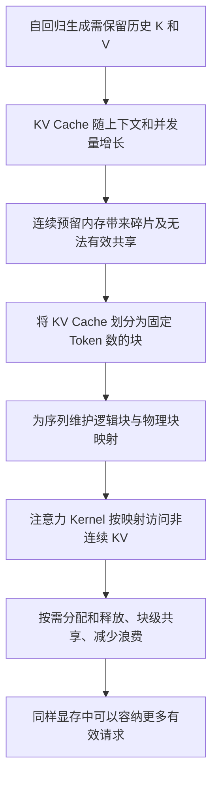
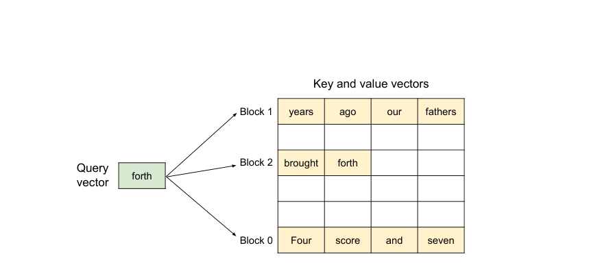
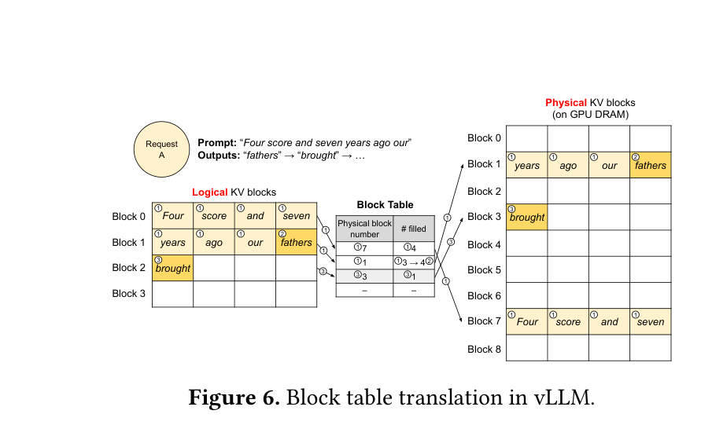
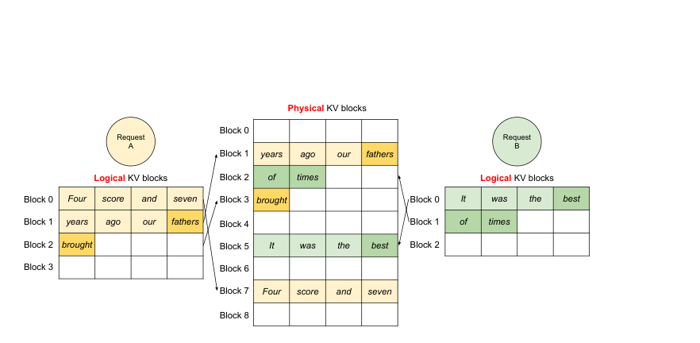
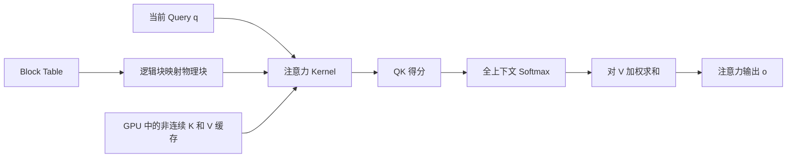
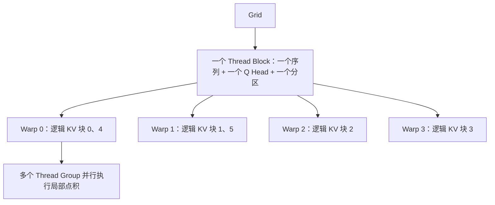
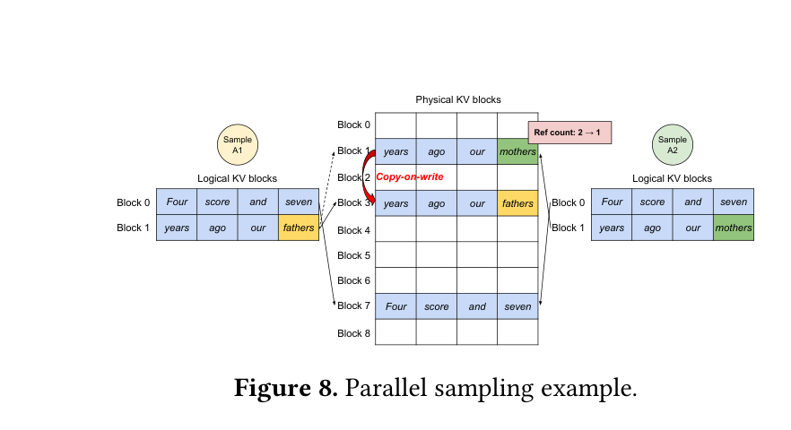
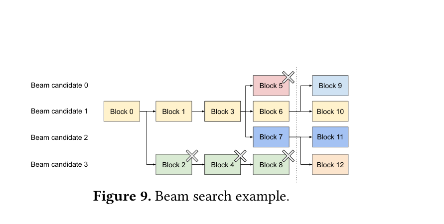
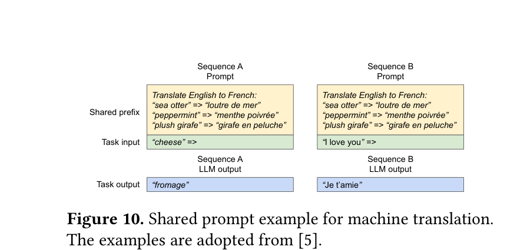
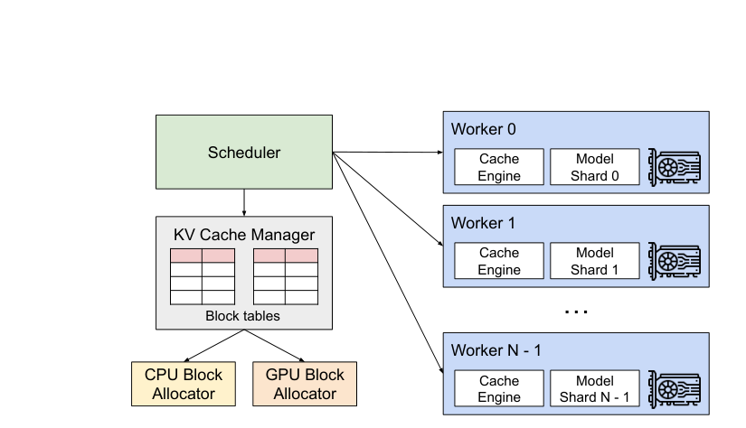

# PagedAttention 技术深度解读：从 KV Cache 分页管理到 GPU Kernel

> **阅读对象**：刚开始学习大模型推理、vLLM、KV Cache 和 GPU 注意力 Kernel 的工程学习者。  
> **阅读目标**：理解「为什么需要分页」「逻辑块如何映射到物理块」「非连续 KV 如何参与正确的注意力计算」「GPU 线程如何协同完成计算」，并能明确区分 2023 年原论文、历史 Kernel 文档与当代 vLLM 实现。

## 资料来源、适用范围与重要勘误

本文结合两份材料进行教学式重构：

1. **官方网页**：[vLLM — Paged Attention](https://docs.vllm.ai/en/latest/design/paged_attention/)，重点是**历史版单 Query CUDA 注意力 Kernel** 的张量布局、线程分工、QK、Softmax、LV 归约和输出流程。
2. **上传论文**：Kwon 等，*Efficient Memory Management for Large Language Model Serving with PagedAttention*，SOSP 2023，重点是问题动机、PagedAttention 分页原理、KV Cache 管理、共享、调度以及性能评估。可在线核查：[arXiv:2309.06180](https://arxiv.org/abs/2309.06180)。下面提及的“论文第 X 页/图 Y”均对应上传 PDF 的页码和原图编号。

**必须首先注意：**官网现在明确提示：该网页是**历史文档**，原先讲解的 `csrc/attention/attention_kernels.cu` 已不再是当前主干的实际实现文件；现有 vLLM 可以由 Triton / FlashAttention 等注意力后端结合调度器提供的 Block Table 实现分页注意力。网页保留的 Kernel 逻辑适合**学习原理**，不能无条件当作最新版、所有模型与所有硬件的实现描述。参见[官方网页开头的 Warning](https://docs.vllm.ai/en/latest/design/paged_attention/)。

**官网一个明显的概念性笔误：**其 `Inputs` 段落将 `PARTITION_SIZE` 解释为“张量并行 GPU 数”，这与同页的 `max_num_partitions`、`partition_idx` 及历史 Kernel 的上下文分区处理不一致。这里的 `PARTITION_SIZE` 应理解为**一次处理的上下文 Token 分区大小**；`PARTITION_SIZE = 0` 表示不启用该分区方案，并不等于“禁用张量并行”。可用历史源码中 `Zero means no partitioning` 的注释以及[相关 vLLM 源码讨论](https://github.com/vllm-project/vllm/issues/27656)交叉核实。下文采用纠正后的含义。

**资料标记约定**：

- **[论文]**：2023 年研究论文明确给出的机制、数据或结论。
- **[历史 Kernel 文档]**：官方网页所描述的早期 CUDA 实现。
- **[教学例子]**：为便于理解构造的 Token、物理块编号、数值和伪代码，不代表实测结果或当前源码的硬编码行为。
- **[现代实现提醒]**：对当前 vLLM 的官方文档补充；细节须结合具体版本、设备和注意力后端判断。

---

## 1. 文档概览：先用五分钟建立全局认识

### 1.1 PagedAttention 到底解决什么问题？

大语言模型（LLM）在自回归生成时，需要保留历史 Token 的 Key、Value 表示，供后续注意力计算使用，这些数据称为 **KV Cache**。随着请求数和上下文长度增长，KV Cache 可能占据大量 GPU 显存。

传统的连续内存分配方案往往需要为请求预留较大、连续的 KV 空间。然而：

- 一个请求最终会生成多少 Token，通常**事先不知道**；
- 多条请求的输入长度、生成长度不同，显存需求会**动态增长和释放**；
- 不同请求或同一请求的不同候选输出可能拥有共同前缀，理论上可以**复用同一份历史 KV**。

因此，问题不只是“KV Cache 太大”，更是**大而动态的 KV Cache 不容易被高效分配、共享和回收**。[论文，第 1—4 页]

PagedAttention 的关键突破是：

> **让 Token 在逻辑上连续，但其 KV Cache 在 GPU 物理内存中可以分散存放；计算时通过块映射找到需要的 K/V。**

这种思路借鉴了操作系统的**分页（Paging）与虚拟内存（Virtual Memory）**。

### 1.2 记住一个完整因果链



*图：本文重新绘制的机制链路示意图，并非论文原图。*

关键是区分三层：

| 层次 | 关心什么 | 代表性概念 |
|---|---|---|
| **算法语义层** | 注意力的数学结果是否正确 | Q、K、V、Softmax、注意力输出 |
| **KV 存储/管理层** | KV 放在哪里，如何分配与复用 | Logical Block、Physical Block、Block Table、引用计数 |
| **GPU Kernel 执行层** | 线程如何高效读取与计算 | Warp、Thread Group、Thread Block、寄存器、Shared Memory、归约 |

**PagedAttention 不是把注意力公式替换成一种新的近似公式。它主要改变了 KV 的存储访问方式，并配合分页式管理提升显存利用率。**

### 1.3 两份资料的侧重点不同

| 问题 | 2023 年原论文 | 所提供的官网 Kernel 网页 |
|---|---|---|
| 为什么引入 PagedAttention | **重点** | 基本不展开 |
| 逻辑块—物理块映射 | **重点** | 作为 Kernel 输入的前提 |
| Copy-on-Write、并行采样、Beam Search | **重点** | 基本不展开 |
| GPU 张量形状和访存布局 | 只讲总体思想 | **重点** |
| 线程组、Warp、Softmax 归约和输出写回 | 简述 | **重点** |
| 是否代表当前源码 | 反映 2023 年研究方案 | **官方已标为历史实现** |

---

## 2. 必要基础知识

### 2.1 Token、自回归生成、Prefill 与 Decode

**Token** 是模型处理文本的离散单位，不必恰好等于一个汉字或单词。自回归语言模型按条件概率预测下一个 Token：

$$
P(x_1,\ldots,x_T)=\prod_{t=1}^{T}P(x_t\mid x_1,\ldots,x_{t-1}).
$$

在典型因果注意力模型中，推理可以从概念上分为两部分：

1. **Prefill（提示词处理阶段）**：已知完整的 Prompt，可并行处理很多输入 Token，并计算其 KV Cache；同时产生首个新 Token 的预测分布。
2. **Decode（逐步生成阶段）**：利用已知 Token 和缓存的历史 KV，每次向前推进生成过程。典型**单 Token Decode** 迭代只需重新计算当前输入 Token 的新 KV，而不必重算全部历史 KV。

**容易弄错的细节**：某一步计算输出了预测 Token `x_{t+1}`，并不表示此时已经计算好了 `x_{t+1}` 在各层的 KV。常见自回归执行流程是：把 `x_t` 输入模型 → 计算/写入 `x_t` 的 KV → 利用上下文预测 `x_{t+1}`。下一迭代再处理 `x_{t+1}`。不同实现可能融合不同操作，但这个区分有助于正确理解缓存长度。[论文 §2.2]

### 2.2 Q、K、V 与标准因果注意力

对某一层、某个注意力头，记第 $i$ 个位置的层输入隐藏状态为 $h_i$。为简化符号，采用列向量约定：

$$
q_i=W_Qh_i,\quad k_i=W_Kh_i,\quad v_i=W_Vh_i.
$$

计算位置 $i$ 的注意力得分、权重与输出：

$$
s_{i,j}=\frac{q_i^\top k_j}{\sqrt{d_h}},\qquad j\le i,
$$

$$
a_{i,j}=\frac{\exp(s_{i,j})}{\sum_{t=1}^{i}\exp(s_{i,t})},
\qquad o_i=\sum_{j=1}^{i}a_{i,j}v_j.
$$

其中：

- $d_h$：每个注意力头的维度（Head Size）；
- $q_i$：当前 Token 用于查询上下文的 Query；
- $k_j$：第 $j$ 个历史/当前位置的 Key；
- $v_j$：与 Key 对应、参与加权汇总的 Value；
- $a_{i,j}$：当前 Token 对位置 $j$ 的归一化注意力权重。

**为什么 KV Cache 有价值？** 第 $i$ 个 Token 计算注意力时，历史 $k_1,\ldots,k_{i-1}$ 和 $v_1,\ldots,v_{i-1}$ 已经在早先迭代中产生。复用它们，就无需为了生成每个新 Token 都从头运行整个历史上下文。

**进一步澄清：一个 Token 的 KV 是否只由它自身决定？** 在某一注意力层内，确实有 $k_i=W_Kh_i$、$v_i=W_Vh_i$；但是这里的 $h_i$ 是**该层的输入隐藏状态**，不是在所有层都保持不变的原始 Token Embedding。除最底层等特殊情形外，深层 $h_i$ 通常已经整合了此前位置的信息，因此深层 KV 可能依赖前缀上下文。即使在底层，位置编码也可能让相同 Token 在不同位置产生不同 K。因此**不能仅按 Token 字面相同就认定跨上下文 KV 可直接复用**。[论文 §2.2]

### 2.3 为什么 KV Cache 会这么占显存？

对常规多头注意力（MHA），若采用相同 KV 头数和精度，缓存长度为 $T$，Transformer 层数为 $L$，KV 头数为 $H_{kv}$，每头维度为 $d_h$，每元素占 $s$ 字节，则：

$$
M_{\mathrm{KV}}=2\times L\times T\times H_{kv}\times d_h\times s.
$$

前面的 $2$ 来自 **Key + Value**。若同时处理 $N$ 条等长请求，粗略乘以 $N$；真实服务还要考虑共享、块尾空槽、模型分片和其他显存占用。

**[论文实例]** OPT-13B 的一个 Token KV Cache 约为：

$$
2\times40\times5120\times2=819{,}200\ \text{bytes}\approx800\ \text{KiB}.
$$

一个长度为 2048 的序列约需要 $1.56$ GiB（论文采用约 **1.6 GB** 的表述）。注意此数字是**论文选定模型的配置**，不是所有 13B 模型或 MQA/GQA/MLA 模型的通用结果。[论文第 4 页，§3]

### 2.4 必要的 GPU 执行基础

| 概念 | 简明解释 | 在历史 Kernel 中的用途 |
|---|---|---|
| Global Memory | 大容量设备显存，访问开销相对较高 | 存放 `q`、`k_cache`、`v_cache`、`out` |
| Register | 线程私有的高速寄存器 | 暂存 K 向量、部分乘积及累加器 |
| Shared Memory | 同一 GPU Thread Block 内线程可共享的片上存储 | 放 Q 的复用片段、Softmax logits、跨 Warp 归约数据 |
| Thread | GPU 执行线程 | 负责向量的一部分元素 |
| Warp | CUDA 通常 32 个线程组成的执行组 | 并行处理某些 KV 块及归约 |
| Thread Group | 该历史 Kernel 特意组织的小线程组 | 合作计算一个 Query 与一个 Key 的点积 |
| Thread Block | 多个 Warp 构成的 CUDA 线程块 | 共同计算一个序列、头和可选分区 |
| Grid | 所有 Thread Block 的网格 | 为多个序列/头/分区部署并行任务 |

**请特别区分**：存储 KV 的 **KV Block**、CUDA 执行单元 **Thread Block**，以及下文长上下文计算的 **Partition**，是三种不同的“块”。

---

## 3. 设计动机：为什么传统 KV Cache 存储方式不够好？

### 3.1 连续预留方式的局限

**[教学例子]** 假设每条请求最大可能长度为 1000 Token，系统为每条请求提前预留相应的连续 KV 空间。一条请求实际只处理了 120 Token 就结束：其余空间在请求处理期间不能被别的请求使用，最终会有大量预留槽位没有承载有效 Token。

还会出现：

- **内部碎片（Internal Fragmentation）**：已分配区域中不能有效利用的部分，例如申请大块连续空间而实际使用不足。
- **外部碎片（External Fragmentation）**：空闲显存分散成不相邻的小区域，虽然总空闲容量足够，但无法满足某次较大连续分配。
- **提前预留（Reservation）**：为未来 Token 预先占住当前尚未使用的空间。这与真正的内部碎片在统计口径上需要区分，因为预留区域将来*有可能*被使用。



*论文原图 Figure 5（PDF 第 5 页）：**逻辑序列连续**与**物理存储连续**不必相同。本文从上传论文中截取原图。*

**[论文实测]** 图 2 对当时的 Orca 基线展示了显存浪费的不同构成：有效 Token 状态仅约占 KV 空间的 **20.4%—38.2%**。这一统计属于其特定实验设置，不能直接推广为所有当前服务系统的显存利用率。[论文第 2 页，Figure 2]

### 3.2 为什么“统一固定长度块”是合理的选择？

操作系统解决类似问题时，不要求每个进程申请一整片物理连续区域，而是让连续的**虚拟页**映射到离散的**物理页框**。PagedAttention 将这一思想借给 KV Cache：

- 每个请求保持有序的 **Logical KV Blocks**；
- 物理显存中准备统一容量的 **Physical KV Blocks**；
- 利用 **Block Table** 记录两者映射；
- 随着实际 Token 增长，**按需**申请新的物理块。

这种设计将大块预留造成的浪费，主要缩小到序列末尾那个尚未填满的 KV 块。[论文 §4.1—4.3]

---

## 4. PagedAttention 的存储管理机制（系统层）

### 4.1 Logical Block、Physical Block 和 Block Table

设每个 KV 块最多存放 $B$ 个 Token 的 KV。Token 使用 **0 基索引**，其逻辑块编号和块内偏移是：

$$
\operatorname{logicalBlock}(t)=\left\lfloor\frac{t}{B}\right\rfloor,
\qquad \operatorname{offset}(t)=t\bmod B.
$$

通过该序列的 Block Table 查找物理块：

$$
\operatorname{physicalBlock}(t)=
\operatorname{blockTable}\!\left[\left\lfloor\frac{t}{B}\right\rfloor\right].
$$

最后，Kernel 用**物理块编号、KV 头编号、块内 Token 偏移、Head 内元素位置**来确定 K/V 的实际内存地址。注意不同后端的具体布局和寻址公式可以不同。

**[教学例子]** 设 $B=4$，一条请求目前有 9 个需要缓存的 Token：

| 逻辑块编号 | 包含的 Token（1 基位置） | 物理块编号（示例） | 使用槽位 |
|---|---|---:|---:|
| 0 | 1、2、3、4 | 7 | 4 / 4 |
| 1 | 5、6、7、8 | 1 | 4 / 4 |
| 2 | 9 | 3 | 1 / 4 |

于是 `block_table = [7, 1, 3]`。**逻辑块 0、1、2 连续；物理块 7、1、3 不连续**，但注意力计算完全可以按逻辑 Token 次序读取。



*论文原图 Figure 6（PDF 第 6 页）：请求从 7 Token 开始，接着写满当前块，再新增物理块。该图与本文教学例子均取 $B=4$，但物理块编号来自论文中的示意，不代表分配算法固定顺序。*

### 4.2 动态分配与空间浪费的上界

若单个序列缓存 $T$ 个 Token、块容量为 $B$，所需 KV 块数为：

$$
N_{\mathrm{blocks}}=\left\lceil\frac{T}{B}\right\rceil.
$$

剩余槽位数（这里仅统计**最后一个分配块内部**的空槽）为：

$$
W=B\left\lceil\frac{T}{B}\right\rceil-T,
\qquad 0\le W<B.
$$

如 $T=9,B=4$，需 3 块、共 12 个槽位，未使用 3 个。继续添加 Token 时，先填满现有块，满了再申请新块。

**严格限定：**“每条序列浪费小于一个 KV 块”是**理想化的基础分页布局结论**，不是对所有现代 KV Cache 管理场景的完整显存上界。真实系统中还可能有暂未被请求引用的缓存块、分组预留、不同注意力类型、内存池粒度、元数据及运行时开销。

### 4.3 块的存储粒度：逻辑示意与真实字节大小不是一回事

**特别重要的论文脚注（论文第 5 页，§4.1 脚注 1）**：一个 Token 在**多个 Transformer 层、多个 KV Head** 上有不同的 KV。论文说明，可以把所有层/头的 KV 一起作为一个逻辑 KV Block 管理；也可以按**不同层和 Head 分开组织物理存储和 Block Table**。作者当时为了实现方便选择后一种组织方式。

因此，前文 `[7,1,3]` 是**一组相关 KV 存储的概念性映射例子**，不表示所有层的 K/V 一定在同一个 GPU 物理块对象中，也不意味着一块只占 `B` 个字节。

对某一层、某个 KV Head，如果 K/V 共计 $B$ 个 Token、单头维度 $d_h$、每元素 $s$ 字节，所需有效数据量近似为：

$$
M_{\mathrm{block}}=2\times B\times d_h\times s.
$$

例如 `B=16, d_h=128, FP16`，该 Head 的 K+V 数据为 $2\times16\times128\times2=8192$ Byte（8 KiB）。一个模型全部层和全部 KV Head 的块池总量还要乘上相应层/头规模，并考虑各实际实现的存储布局或分片。

### 4.4 两条请求怎样共用 GPU 的物理块池？



*论文原图 Figure 7（PDF 第 6 页）：请求 A 和 B 有各自逻辑块表，但从同一物理块池取得不连续物理块。*

每条序列单独维护自己的**逻辑顺序**；物理分配器从共享池中发放空闲块。KV Cache 的读写操作由映射关系决定，所以请求 A 不要求占一段“连续显存”，也不要求与请求 B 隔离成独立大区间。

---

## 5. 最关键的连接：非连续 KV 为什么不会改变注意力结果？

### 5.1 逻辑位置决定语义，物理地址只决定读取位置

标准注意力关心的是“第 $j$ 个逻辑 Token 的 $k_j$、$v_j$ 是多少”，**并不要求**这些向量必须按 Token 位置在物理显存中连续排放。

对于单个 Query $q$，以块为单位组织 K 和 V，可写为：

$$
\mathcal K=[K^{(0)},K^{(1)},\ldots],
\qquad \mathcal V=[V^{(0)},V^{(1)},\ldots].
$$

将所有**有效 Token** 的注意力得分合并后做一次全局 Softmax：

$$
s_j=\frac{q^\top k_j}{\sqrt{d_h}},
\quad a_j=\frac{e^{s_j}}{\sum_{t\in\mathcal C}e^{s_t}},
\quad o=\sum_{j\in\mathcal C}a_jv_j,
$$

其中 $\mathcal C$ 是当前 Query 允许关注的逻辑位置集合。物理地址的变化不会修改 $q$、$k_j$、$v_j$ 与其逻辑关系，因此数学结果应一致（允许不同 Kernel 浮点运算顺序带来的细小舍入差异）。

**一个常见错误：**将每个 KV 块单独做 Softmax、得到块内归一化权重，再把块输出直接相加。这一般**不等价**于整条上下文上的 Softmax，因为各块分母不同。必须使用全局归一化，或在分区/块之间正确组合归一化统计量。

### 5.2 Block Table 与注意力 Kernel 的协作



*图：本文重绘的单头、单 Query 逻辑数据流；Kernel 内部会进一步拆成多线程并行操作。*

**关键分工：**

- **缓存管理器 / 调度器**：决定一个请求占用哪些物理块，并把块映射提供给计算后端。
- **Paged Attention Kernel**：按照提供的映射，找到正确的 K/V、完成注意力计算；并不负责为请求制定全局显存调度策略。

---

## 6. 深入官方网页：历史 CUDA PagedAttention Kernel 的计算流程

> 本节对应官方网页的 `Inputs → Concepts → Query → Key → QK → Softmax → Value → LV → Output`。下述张量形状和线程分工**明确限定为网页描述的历史 CUDA Kernel**，不是现代所有 vLLM 后端的统一 ABI。

### 6.1 输入张量：首先看 Shape

网页核心接口抽象如下（省略部分参数）：

```cpp
// 教学摘录：历史 Kernel 关键参数与 Shape；非完整可编译源码。
q:       [num_seqs, num_heads, head_size]
k_cache: [num_blocks, num_kv_heads, head_size/x, block_size, x]
v_cache: [num_blocks, num_kv_heads, head_size, block_size]
out:     [num_seqs, num_heads, max_num_partitions, head_size]
```

| 符号 | 含义 | 注意事项 |
|---|---|---|
| `num_seqs` | 该次单 Query Kernel 处理的序列数 | **在此历史单 Query 场景中**，每条序列每次提供一个 Query Token |
| `num_heads` | Query Attention Head 数 | GQA 下不一定等于 KV Head 数 |
| `num_kv_heads` | KV Head 数 | 可能少于 Q Head 数 |
| `head_size` / `HEAD_SIZE` | 单头向量长度 $d_h$ | 例如 128 |
| `num_blocks` | GPU 内可寻址的物理 KV 块总数 | 不是某条序列的逻辑块个数 |
| `block_size` / `BLOCK_SIZE` | 每个 KV Block 能存多少 Token | 以 **Token 数**为单位，不是字节数 |
| `x` | Key 布局的最内层向量化宽度 | 与编排/数据类型有关；不是逻辑 Token 数 |
| `max_num_partitions` | 计算分区数上限 | 不等于张量并行卡数 |

一般 MHA 可令 `num_heads = num_kv_heads`；GQA 可令多个 Query 头共享一个 KV 头。历史 Kernel 的 Key 指针用 `kv_head_idx`，因此**“每个 Query Head 都有自己的一套 KV Head”并非通用前提**。

### 6.2 为什么 Key 和 Value 的物理形状不同？

这恰恰是官网网页最值得深究的点之一：**两者都存储同一组 Token 的缓存，但会围绕不同的访问方向做布局优化**。

**Key：**

```text
[num_blocks, num_kv_heads, head_size/x, block_size, x]
```

计算 $q\cdot k_j$ 时，需要对**某个 Token 在一个 Head 内的全部维度**求点积。Key 在最后一维组织长度为 $x$ 的连续片段，方便线程组按向量化粒度读出所需元素，并促成邻近线程合并访存。

**Value：**

```text
[num_blocks, num_kv_heads, head_size, block_size]
```

计算 $o_r=\sum_j a_jv_{j,r}$ 时，固定**输出维度 $r$**，要沿着**不同 Token $j$** 汇总 Value。因此 Value 让 `block_size`（块内 Token 维度）作为最内层维度，方便一条线程读多个 Token 的同一维 Value。

**官网原图（对应历史 Kernel 的真实布局）**：


*上图来自官方历史 Kernel 文档：Key 侧沿 `HEAD_SIZE/x` 与小线程组组织 Vec。图片为官方在线引用；离线阅读时可能需要联网。*


*上图来自官方历史 Kernel 文档：Value 侧沿 `HEAD_SIZE` 组织行，沿 `BLOCK_SIZE` 组织列，便于同一维度的多 Token 累加。图片为官方在线引用。*

通俗地说：

- 计算 **QK**：倾向于沿着一个 Token 的 **Head 维度**读取；
- 计算 **AV / LV**：倾向于沿着多个 **Token 维度**读取。

这不是 K 与 V 数学含义不同造成的，而是**乘法求和方向不同，访存优化侧重点也不同**。现代不同后端可能采用其他 KV 排布；不要误认为这两个 Shape 是 PagedAttention 的数学定义。

### 6.3 Thread Group、Warp、Thread Block 各负责什么？

历史文档给出的分工层次是：

1. **Thread Group**：多个线程合作完成一个 Query 与一个 Key Token 的点积；
2. **Warp**：协作处理一个 KV Block 中的 Key Token（随后循环到其他块）；
3. **Thread Block**：合作完成一个序列、一个 Query Head、一个可选上下文分区的计算；
4. **Grid**：覆盖多个序列、Query Head 和可选分区。

官方网页描述的 Grid 是：

```text
(num_heads, num_seqs, max_num_partitions)
```

**[历史文档例子]** 若某条序列有 6 个逻辑 KV 块，一个 CUDA Thread Block 拥有 4 个 Warp，则处理块的分配可以是：

| Warp | 第一次迭代 | 第二次迭代 |
|---|---|---|
| Warp 0 | 块 0 | 块 4 |
| Warp 1 | 块 1 | 块 5 |
| Warp 2 | 块 2 | 无 |
| Warp 3 | 块 3 | 无 |

此处“块 0～5”按**当前上下文的逻辑 KV 块序号**理解，实际 Key 读取还要通过 Block Table 找到物理地址。



*图：根据历史 Kernel 文档中的 4 Warp、6 KV 块示例重绘。*

### 6.4 Vec 与 16 Byte 读取：怎么算出 `VEC_SIZE`？

官网示例规定：

- Query/Key：以 **一个 Thread Group 合计 16 Byte** 为向量化读取单位；
- Value：以 **每个 Thread 16 Byte** 为向量化读取单位。

假设 FP16 元素占 2 Byte，`THREAD_GROUP_SIZE = 2`：

$$
\operatorname{VEC\_SIZE}=\frac{16}{2\times2}=4,
$$

$$
\operatorname{V\_VEC\_SIZE}=\frac{16}{2}=8.
$$

因此：一个线程一次抓取 **4 个 FP16 的 Q/K 元素**；而在 Value 的访问路径中，一个线程一次可抓取 **8 个 FP16 的 V 元素**。注意这说明的是文档所选向量化安排，不表示任何 GPU 上所有 Kernel 都必须选 16 Byte。

### 6.5 Query：为什么先从 Global Memory 放进 Shared Memory？


*官网原图：一个 Token、一个 Head 的 Query 被按 `VEC_SIZE` 划分成多个 Vec。*

历史代码把一个 Query 向量读取到：

```cpp
__shared__ Q_vec q_vecs[THREAD_GROUP_SIZE][NUM_VECS_PER_THREAD];
```

**为什么这样做？** 对当前 Query 来说，必须分别与许多历史 Key 求点积，因此 **Q 被频繁复用**。读到共享内存后，不同 Thread Group 可以较低开销地访问所需 Q 片段；相邻线程在加载时也可以配合合并访存（Memory Coalescing）。

作为对比，每个 Key 通常在当前 QK 循环中被加载、计算并结束使用，因此历史实现让 Key 片段临时存在**线程寄存器** `k_vecs` 中。

### 6.6 Key：Block Table 如何参与真实地址计算？

历史代码的核心指针模式：

```cpp
const scalar_t* k_ptr = k_cache
    + physical_block_number * kv_block_stride
    + kv_head_idx * kv_head_stride
    + physical_block_offset * x;
```

关键变量：

- `physical_block_number`：当前逻辑 KV 块通过 **Block Table** 映射出的**物理块 ID**；
- `kv_head_idx`：当前 Q Head 对应的 KV Head；
- `physical_block_offset`：Token 在物理 KV 块里的偏移（通常即逻辑块内偏移）；
- `kv_block_stride` 和 `kv_head_stride`：按照具体内存布局计算跨越物理块、KV 头时的元素跨度；
- `x`：最内层向量化布局宽度。

此外还需要根据具体 `head_size/x` 维度和线程编号，读出分配给线程的其余片段。**上述 `k_ptr` 只是基址计算的一部分，并不足以单独读取完整 Key。**

### 6.7 QK：多个线程如何完成一个完整点积？

QK 阶段的数学目标是：

$$
s_j=\frac{1}{\sqrt{d_h}}\sum_{r=0}^{d_h-1}q_rk_{j,r}.
$$

历史实现采用类似：

```cpp
float qk = scale * Qk_dot<scalar_t, THREAD_GROUP_SIZE>::dot(
    q_vecs[thread_group_offset], k_vecs);
```

其中 `scale` 通常为 $1/\sqrt{d_h}$。即使每条线程只持有向量的一部分，`Qk_dot` 也会在参与的线程间**归约局部点积**，返回完整的当前 Query-Key 得分。

**[教学数值例子]** 设 `HEAD_SIZE = 8`、`THREAD_GROUP_SIZE = 2`，按文档举例的奇偶维分工：

$$
q=(1,2,3,4,5,6,7,8),\quad k=(1,0,1,0,1,0,1,0).
$$

- 线程 0 负责下标 `0,2,4,6`：贡献 $1\times1+3\times1+5\times1+7\times1=16$；
- 线程 1 负责下标 `1,3,5,7`：贡献 $2\times0+4\times0+6\times0+8\times0=0$；
- 线程组归约：$q^\top k=16$；
- 缩放后：$s=16/\sqrt8\approx5.657$。

**注意**：实际向量化读法可以按 Vec 组织，不必真的逐个元素执行上述“奇偶循环”；这段分工是解释性例子。关键是**线程分别做一部分乘法，最后归约为整个 Head 的 QK 结果**。

### 6.8 Softmax：为什么要先求最大值，再求指数和？

一条序列可能有大量 QK 得分。数学上：

$$
a_j=\frac{e^{s_j}}{\sum_t e^{s_t}}.
$$

若 $s_j$ 很大，直接求 $e^{s_j}$ 可能溢出。稳定版 Softmax 先计算：

$$
m=\max_j s_j,
\qquad z_j=e^{s_j-m},
\qquad \ell=\sum_j z_j,
\qquad a_j=\frac{z_j}{\ell}.
$$

网页将此拆为两轮关键归约：

**第一轮：求 `qk_max`。** 每个 Thread Group 收集各自负责的 QK，随后跨 Warp、跨 Thread Block 内的线程合作求全局最大值 $m$；无效 Token 位置通过 Mask 排除。

**第二轮：求 `exp_sum`。** 各线程对自己负责的 `logits` 计算 $e^{s_j-m}$，并通过 Block 级归约得到总和 $\ell$；然后做归一化。

历史代码包含类似：

```cpp
float val = __expf(logits[i] - qk_max);
logits[i] = val;
exp_sum += val;
// 跨线程归约 exp_sum 后
logits[i] *= 1.0f / (exp_sum + 1e-6f);
```

`+1e-6f` 是实现中的数值稳定处理；理论推导通常写为除以 $\ell$。

**为什么不能仅在 Thread Group / Warp 内求一个 Softmax？** 因为注意力权重需要在**当前 Query 所覆盖的所有有效上下文 Token** 上归一化；如果只在局部范围归一化而不再合并，将改变数值语义。这里的“全局”指同一 Query Head、同一有效上下文范围；启用多 Partition 时还必须进一步合并各分区的统计量。

### 6.9 Value：为何每条线程连续读取多个 Token 的 V？

历史 Value 布局：

```text
[num_blocks, num_kv_heads, head_size, block_size]
```

对某一个输出维度 $r$：

$$
o_r=\sum_{j\in\mathcal C} a_jv_{j,r}.
$$

同一维度需要把多个 Token 的 Value 按 Softmax 权重加起来，因此读取方向与 QK 不同。代码中的思路是：

```cpp
float accs[NUM_ROWS_PER_THREAD];
for (...) {                // 不同 KV Block
    logits_vec = ...;      // 一组 Token 的注意力权重
    for (...) {            // 不同 Value 行（Head 内维度）
        v_vec = ...;
        accs[i] += dot(logits_vec, v_vec);
    }
}
```

**[历史文档例子]** `BLOCK_SIZE=16`、`V_VEC_SIZE=8`，一条线程一次取 8 个 Token 在同一个输出维度上的 Value，并与相应的 8 个 `logits` 做点积；之后切换到其他输出维度或其他物理块累加。

若 `HEAD_SIZE=128`、一个 Warp 有 32 线程，则一次内循环可覆盖的元素数为 $32\times8=256$；一个块的 Value 总共 $128\times16=2048$ 个元素，所以按此组织方式，需要 $2048/256=8$ 次内循环读取计算。[历史 Kernel 文档 `Value`]

### 6.10 LV：为什么还需要两级归约？

上一阶段各线程算出的 `accs` 仅是**局部加权和**。完整输出需要覆盖：

- 每个输出维度；
- 这个 Query 可见的**所有有效 Token**；
- 分布在不同线程、Warp 以及物理 KV 块中的 Value 数据。

历史 Kernel：先在 **Warp 内**通过 Shuffle 等方式合并对应输出维度的局部结果；再用 **Shared Memory** 在不同 Warp 之间归约，最后把相应维度的输出写回。

这和 QK 的“先局部点积、再组合全维结果”方向相似，只不过：

- **QK 归约**沿着 **Head Size 维度**求 $q^\top k_j$；
- **LV 归约**沿着 **Token 维度**求 $\sum_j a_jv_j$。

**因此 QK 和 LV 不是同一次归约，也不是同一种数据排布。**

### 6.11 Output：谁写最终输出？

网页给出的输出基址形如：

```cpp
scalar_t* out_ptr = out
    + seq_idx * num_heads * max_num_partitions * HEAD_SIZE
    + head_idx * max_num_partitions * HEAD_SIZE
    + partition_idx * HEAD_SIZE;
```

可以把结果看作：

```text
out[seq_idx][head_idx][partition_idx][head_dimension]
```

每个线程只写自己负责的输出维度，避免重复写。**如果未启用上下文 Partition**，单次该 Kernel 的计算结果即可对应完整 Query/Head 注意力输出；**如果启用了 Partition**，这里可能是某个分区的中间输出，还需要通过合并步骤得到完整上下文的输出，不能把中间 `out` 直接当作最终 Attention Output。

### 6.12 `PARTITION_SIZE` 与 `BLOCK_SIZE` 是两个不同粒度

| 参数 | 含义 | 主要用途 |
|---|---|---|
| `BLOCK_SIZE` | 每个物理 KV Cache 块容纳多少 Token | KV 存储、分配、映射、访问粒度 |
| `PARTITION_SIZE` | 一个注意力计算分区处理多少上下文 Token（历史 Kernel） | 将长上下文计算拆给多个线程块，随后合并结果 |
| `NUM_THREADS` | 每个 CUDA Thread Block 多少线程 | GPU 执行并行度 |
| 张量并行度 `TP` | 模型被分到多少个并行工作单元/GPU | 模型与注意力头的分片，与上述两种 Token 数粒度不同 |

**数学上怎样合并多个注意力分区？** 设分区 $p$ 的得分最大值、指数和及其**局部归一化** Value 输出为：

$$
m_p=\max_{j\in p}s_j,\quad
\ell_p=\sum_{j\in p}e^{s_j-m_p},\quad
y_p=\frac{\sum_{j\in p}e^{s_j-m_p}v_j}{\ell_p}.
$$

令 $m=\max_pm_p$，则整个上下文的输出可组合为：

$$
o=\frac{\sum_p e^{m_p-m}\ell_p y_p}
        {\sum_p e^{m_p-m}\ell_p}.
$$

这是**解释分区 Softmax 如何保持正确性的通用数学推导**，不是宣称目前 vLLM 的所有后端都调用这个具体合并 Kernel。它说明“分区计算”与“只在各块独立 Softmax 然后简单相加”有本质区别。

---

## 7. 论文扩展机制：块级共享、Copy-on-Write 与调度

### 7.1 Parallel Sampling：同一个 Prompt 生成多个候选

假如同一个 Prompt 生成两个答案，最初两条候选序列的前缀完全一致，前缀 KV 也相同。**[论文]** vLLM 可以让两个序列的逻辑块都指向同一份物理块，并在物理块上维护**引用计数**。



*论文原图 Figure 8（PDF 第 7 页）：两条采样序列共享历史 Prompt；一条分支要改写共享的末尾块时发生块级 Copy-on-Write。*

如果被共享的**最后一块还未填满**，两个候选下一步可能要往同一个块的剩余槽位写入各自不同的 KV。不能同时直接改写同一物理块，于是采用 **Copy-on-Write（COW，写时复制）**：

1. 先共享已存在的完整前缀块；
2. 某分支需要写共享的未填满块，且该块有多个引用时，为该分支申请新物理块；
3. 把原块已有有效 KV 复制过去，修改 Block Table；
4. 分支再写入自己的新 Token KV，另一分支继续引用原块（或也发生相应调整）。

**为什么是块级 COW 而不是复制全部前缀？** 因为若绝大部分前缀块都已经填满且不会被修改，只需要处理末尾可能继续写入的块，可以显著减少重复拷贝。[论文 §4.4]

### 7.2 Beam Search：共享关系可以动态变化



*论文原图 Figure 9（PDF 第 7 页）：多个候选可共享不止 Prompt，还能共享生成过程中的公共路径。*

Beam Search 会不断筛选候选序列。每一步可能出现：

- 一些旧候选不再被选中 → 引用计数递减；
- 引用计数变为 0 的物理块 → 可以回收；
- 新候选继承相同历史序列 → 可以共享相同物理 KV 块；
- 新候选开始分叉、需要改写共享块 → 触发必要的 COW。

**这是“KV Cache 可以共享”与“所有序列永远共享相同 KV”之间的区别**：共享依赖**真实的共同上下文**，并且会随解码路径动态变化。

### 7.3 Shared Prefix 与现代 Automatic Prefix Caching 的联系



*论文原图 Figure 10（PDF 第 8 页）：两条请求共享任务指令与示例，后续输入不同。*

**[论文]** 当多条请求带有相同的长前缀时，服务端可以事先保留该前缀的 KV 物理块，后续请求将逻辑块映射到这些共享块。论文举的是**服务提供方预定义共享前缀**的机制。

**[现代实现提醒]** 当前 vLLM 的 [Automatic Prefix Caching 文档](https://docs.vllm.ai/en/latest/design/prefix_caching/) 采用了更一般化的块哈希缓存与命中匹配思路。它与论文中的“共享前缀”**目标一致**，但“是否预定义前缀、哈希如何构成、是否只复用完整块、淘汰策略”等实现细节不能直接从 2023 年论文推出。

### 7.4 请求增加、KV 块不足时怎么办？

**[论文 §4.5，历史系统]** vLLM 的服务系统需要在请求之间进行调度和必要的**抢占（Preemption）**。论文描述了按请求到达顺序选择、对同一 Sequence Group 联合调度，并讨论两种恢复方式：

- **Swapping（换出/换入）**：将被抢占序列的 KV 从 GPU 拷到 CPU 内存，之后搬回 GPU 继续计算。
- **Recomputation（重新计算）**：不保留被抢占序列的现有 GPU KV，而是在恢复时根据已有 Token 序列重新执行计算，重建所需 KV。

两者的取舍取决于 CPU–GPU 传输带宽、GPU 算力、块大小与请求形态。不要把论文里的具体调度/抢占策略说成“当前 vLLM 一定采用此策略”；实际行为有版本和后端差异。

### 7.5 Tensor Parallel 场景下的块映射



*论文原图 Figure 4（PDF 第 5 页）：中心化 Scheduler、KV Cache Manager，以及多个计算 Worker 和 CPU/GPU Block Allocator 的协作关系，反映论文时期的架构。*

**[论文 §4.6]** 在所描述的张量并行方案中，各 GPU Worker 可以处理同一批 Token、分别负责部分注意力头；调度器维护共享的逻辑—物理块映射，向 Worker 分发对应的块 ID。**各 Worker 即便看到同样的物理块编号，也只在自己的设备上存储并计算所负责头的那一份 KV 数据**。

这再次说明：**KV Block ID 是某个内存管理域中的地址索引，不等于“多个 GPU 之间共享同一物理显存地址”。**

---

## 8. 完整实例推演：从请求进入到一次完整 Decode Attention

下面是贯穿系统管理与 Kernel 计算的**统一教学例子**。数值是人为选择的简化数值，目的是演示机制而非模拟真实大模型分布。

### 8.1 环境与初始请求

设：

- 单头维度 $d_h=2$，仅演示 1 个 Query Head、1 个 KV Head；
- `BLOCK_SIZE=4`；
- Prompt 已处理 7 个 Token：`x1 x2 x3 x4 x5 x6 x7`；
- 物理空闲块池至少有编号 `7、1、3` 的块。

Prefill 后：

| 时刻 | Logical Block 0 | Logical Block 1 | Logical Block 2 | Block Table |
|---|---|---|---|---|
| 处理完 7 个 Prompt Token | `x1 x2 x3 x4` | `x5 x6 x7 _` | 未分配 | `[7,1]` |

此时模型已经根据 Prompt 产生下一 Token 的预测，可得到 `x8`。但**`x8` 的 KV 要在模型实际处理 `x8` 时产生**。

### 8.2 Decode：输入 `x8`，填满当前末尾块

下一个 Decode 调用处理 `x8`：

1. 计算 `x8` 的当前层 Q、K、V；
2. 将 `x8` 的 KV 写到逻辑块 1 的空槽（对应物理块 1 的槽 3）；
3. 读取需要关注的逻辑上下文 K/V，计算 `x8` 的注意力输出；
4. 模型向前传播，最终生成对 `x9` 的预测。

此时：

```text
Logical block 0:  x1  x2  x3  x4   -> Physical block 7
Logical block 1:  x5  x6  x7  x8   -> Physical block 1
Block table:      [7, 1]
```

### 8.3 Decode：输入 `x9`，分配新物理块

下一次处理 `x9`，原先两个物理块已满：

1. 调度/缓存管理层申请新的逻辑块 2 和物理块 3；
2. Block Table 变为 `[7,1,3]`；
3. 将 `x9` 的 K/V 写入物理块 3 的槽 0；
4. 在该层计算 Query `q9` 对逻辑位置 1～9 的注意力。

下面继续展示第 4 步的**完整数值计算**。

### 8.4 QK：物理块乱序，逻辑得分仍按 `x1 → x9` 对应

为易于计算，故意构造：

$$
q_9=(\sqrt2,0),\qquad
k_1=(\ln2,0),\qquad
k_2=\cdots=k_9=(0,0).
$$

取 $d_h=2$，则缩放点积为：

$$
s_1=\frac{q_9^\top k_1}{\sqrt2}=\ln2,
\qquad s_2=\cdots=s_9=0.
$$

Kernel 实际按 Block Table 读：

```text
logical 0 -> physical 7 -> x1 x2 x3 x4  -> logits: ln2, 0, 0, 0
logical 1 -> physical 1 -> x5 x6 x7 x8  -> logits: 0, 0, 0, 0
logical 2 -> physical 3 -> x9 _  _  _   -> logits: 0, MASK, MASK, MASK
```

**注意 Mask**：物理块 3 只存了一个有效 Token，后面三个空槽不可以被当作得分为 0 的真实 Token，否则会污染 Softmax 分母。

### 8.5 Softmax：计算全局归一化权重

先求最大值：

$$
m=\ln2.
$$

9 个有效 Token 的指数和：

$$
\ell=e^{\ln2-\ln2}+8e^{0-\ln2}=1+8\times\frac12=5.
$$

因此：

$$
a_1=\frac15=0.2,
\qquad a_2=\cdots=a_9=\frac{1/2}{5}=0.1.
$$

核对：$0.2+8\times0.1=1$。这一步说明**即使 9 个 Token 分散在三个物理块中，Softmax 仍然是对 9 个有效 Token 一起归一化**。

### 8.6 LV：对 Value 做加权求和

为便于核算，设：

$$
v_1=(1,0),\qquad v_2=(0,2),\qquad
v_3=\cdots=v_9=(0,0).
$$

则当前 Head 的输出：

$$
\begin{aligned}
o_9&=\sum_{j=1}^{9}a_jv_j\\
&=0.2(1,0)+0.1(0,2)+\sum_{j=3}^{9}0.1(0,0)\\
&=(0.2,0.2).
\end{aligned}
$$

GPU 执行时，多线程负责不同 QK 片段、Token 位置和 Value 输出维度，最后通过归约得到同样的数学结果（存在可允许的浮点舍入差异）。

### 8.7 推演结论

- **Block Table** 解决“KV 在哪”；
- **QK + Softmax + LV** 解决“注意力怎么算”；
- **Mask** 解决“末尾物理块还有空槽，不能当作真实上下文”；
- **Block 申请与回收**解决“序列动态增长/结束，内存如何分配”；
- **Copy-on-Write**解决“多个序列共享历史，但后续分支会不同”。

五者协同后，PagedAttention 才能同时保持注意力计算的语义正确性，并带来内存管理方面的灵活性。

---

## 9. 进一步理解：收益、代价和工程权衡

### 9.1 主要收益

| 收益 | 产生原因 | 不应过度解释为 |
|---|---|---|
| 显著降低提前预留造成的浪费 | 按需分配固定大小 KV Block | 任何时刻显存 100% 用于有效 Token |
| 减轻外部碎片问题 | 统一块容量、物理空间可非连续 | GPU 内部完全不存在碎片或任何元数据开销 |
| 支持块级共享 | 多个逻辑块可以映射同一物理块 | 不同上下文的同名 Token 可任意共享 KV |
| 提升可容纳请求规模 | 同显存可支持更多有效 KV | 单次 Attention Kernel 必然更快 |
| 支持复杂解码场景 | 引用计数与 COW、灵活块映射 | 所有解码算法都不需额外内存复制 |

### 9.2 为什么 KV Block 越大并不一定越好？

设 `BLOCK_SIZE = B`。增大 $B$：

- **潜在优点**：访问同一块时可覆盖更多 Token，减少 Block Table 项与跨块调度/寻址次数，有利于某些访存/并行优化。
- **潜在代价**：每条序列最后一个块平均可能有更多未填满槽位；短上下文更易浪费；块级共享与 COW 的最小粒度也变大。

**[论文 §7.2]** 在当时的实验里，ShareGPT 上较宽的块大小范围表现良好，Alpaca 的较短序列更偏好较小块；论文最终选 16 作为当时 vLLM 的默认块容量。这是**2023 年实验选择**，并非当前所有模型、后端、硬件的最优经验值。调优前应检查当前版本支持的 `block_size` 取值与不同 Attention Backend 的约束。

### 9.3 系统更快，并不代表 Attention Kernel 本身更快

**[论文 §7.1]** 作者实测其历史 PagedAttention Kernel 相对当时高度优化的 FasterTransformer Attention Kernel，存在约 **20%—26% 的 Kernel 延迟额外开销**，因为需要访问 Block Table、处理可变长度、执行额外分支。但通过改善整体显存利用和并发批处理能力，系统仍可能实现更高整体吞吐。

这是系统优化的重要思想：**局部算子略慢，可能换来端到端系统显著更快**。因此不能仅凭 Kernel Microbenchmark 判定 PagedAttention 服务系统是否更优。

**[论文 Abstract/§6]** 原论文在其模型、A100 GPU、ShareGPT/Alpaca 工作负载与历史基线下报告 vLLM 的吞吐提升约 **2—4 倍**。此数字不是当前任何 vLLM 版本、设备或请求分布的性能保证。

### 9.4 PagedAttention 与 FlashAttention 是什么关系？

| 技术 | 主要解决的问题 | 主要优化点 |
|---|---|---|
| **PagedAttention / Paged KV Cache** | KV 长期驻留显存如何按需分配、映射、复用 | **KV 存储/管理与非连续读取** |
| **FlashAttention** | Attention 计算的内存读写开销与中间张量开销 | **Attention 算子的数据分块、片上融合和 IO 优化** |

两者不是“二选一”的竞争关系：**分页 KV 的地址映射**可以由支持 paged KV 的注意力后端读取；现代 vLLM 也明确提及 FlashAttention 类后端。[官网 Paged Attention Warning](https://docs.vllm.ai/en/latest/design/paged_attention/)

### 9.5 当前 vLLM 学习中还需注意哪些版本差异？

**[现代实现提醒]**

- 当前 vLLM 会根据设备、模型结构、Attention Backend 和配置选择不同计算路径；历史页面中的 `q_vecs`、`k_vecs`、CUDA Shuffle 路径**不是每个现代后端都必须具有的变量或代码**。
- Automatic Prefix Caching 的实际命中匹配和保留/淘汰方式，请另见 [官方 Prefix Caching 设计文档](https://docs.vllm.ai/en/latest/design/prefix_caching/)；**“是否使用 Paged KV”不等价于“本次请求一定发生前缀缓存命中”**。
- 对有滑动窗口注意力、全局注意力等混合结构的模型，不能假定所有层都持有相同完整历史 KV；需结合 [Hybrid KV Cache Manager 官方设计文档](https://docs.vllm.ai/en/latest/design/hybrid_kv_cache_manager/) 分析。
- MQA、GQA、MLA 等可能影响每 Token 的有效 KV 存储量、KV Head 分配或缓存布局；不能无条件使用 OPT-13B 的 800 KiB/Token 估算。

---

## 10. 关键概念对比与常见误区

| 常见说法或疑问 | 正确理解 |
|---|---|
| “PagedAttention 就是把 Token 切成块。” | 更关键的是**逻辑块与物理块分离、Block Table 映射**，并且 Kernel 能访问非连续 KV。 |
| “物理 KV 块不连续，会改变 Attention 计算结果。” | 只要读到与逻辑位置对应的正确 K/V，并使用正确 Mask 与 Softmax，注意力数学语义不变。 |
| “`BLOCK_SIZE=16` 表示 16 Byte。” | 错。这里是**16 个 Token 槽位/块**；字节大小还取决于层数、KV 头数、Head Size 和数据类型。 |
| “KV Block 就是 CUDA Thread Block。” | 完全不同：前者是**数据存储粒度**，后者是**执行线程组织**。 |
| “一个 Warp 永远只处理一个 KV 块。” | 在官网历史示例中，它**每次迭代**处理一个块，可多轮处理不同块。 |
| “两个 Thread 只算了半个 QK，最终得到的 QK 也只有一半。” | 线程组内做了归约，得到完整 $q^\top k$。 |
| “每块自己做 Softmax，然后把输出加起来。” | 通常错误；跨块/分区必须保持全局归一化。 |
| “Shared Memory 和 GPU 显存是一个东西。” | 不同：前者通常是线程块可共享的片上空间；后者指规模更大的 Global Memory。 |
| “所有请求相同的字词一定可以共享 KV。” | 错。KV 与逻辑位置、模型层输入及前缀上下文有关，必须保证缓存语义一致。 |
| “Prefill 输出 `x8` 后，必然立即已经缓存 `x8` 的 KV。” | 不一定。典型自回归流程中预测 Token 和处理该 Token 以计算 KV 是不同环节。 |
| “`PARTITION_SIZE` 就是 TP 数。” | 错。历史 Kernel 中是上下文 Token 的计算分区大小。官网此处存在笔误。 |
| “PagedAttention 会让单次 Attention Kernel 绝对更快。” | 不保证；核心收益常来自更高显存利用率与更大的可服务批量。 |
| “2023 年论文介绍的前缀共享等于当前 APC 实现。” | 目标相关，但具体块哈希和生命周期管理已演进，应分别核查版本文档。 |

---

## 11. 学习自测：8 个问题与参考答案

**Q1：为什么对每条请求一次性分配最大长度的 KV Cache 会浪费显存？**  
A：输出长度不可预知；提前预留的尚未使用空间会挡住其他请求，且不同大小连续分配会带来碎片问题。

**Q2：`BLOCK_SIZE=4`、一条序列需要缓存 10 个 Token，至少需要几个 KV 块？基础块尾空槽是多少？**  
A：$\lceil10/4\rceil=3$ 块，分配 12 个槽位，空槽 2 个。

**Q3：逻辑块 `[0,1,2]` 映射物理块 `[9,3,6]`，为什么依旧能按正确顺序计算？**  
A：Kernel 先查询 Block Table，再从相应物理块读取对应位置的 K/V；逻辑顺序并不要求物理地址连续。

**Q4：为什么历史 Kernel 的 K 和 V Tensor Shape 不相同？**  
A：QK 主要沿 Head 维度求点积；LV 主要沿 Token 维度求加权和，因此按不同的合并访存方向布局。

**Q5：`THREAD_GROUP_SIZE=2`，两个线程各有 64 个 Q/K 维度，如何产生 128 维完整 QK 得分？**  
A：两个线程分别求局部点积，再在线程组内归约求和，最后按 $1/\sqrt{128}$ 缩放。

**Q6：为什么不能对三个 KV Block 各自做 Softmax，再直接相加三个局部结果？**  
A：各局部结果的归一化分母不同，无法自动得到全上下文的归一化权重；必须采用全局统计量或数学上等价的分区合并。

**Q7：并行采样为什么需要 Copy-on-Write？**  
A：多个采样分支可共享相同历史前缀 KV，但后续 Token 不同。共享的未满 KV 块若要被分支改写，就必须分离，以免互相污染缓存。

**Q8：一个 Kernel 比旧方案慢 20%，为什么整体服务仍可能更快？**  
A：Paged KV 减少显存预留和碎片浪费，使同样显存容纳更多有效请求，增大可批处理规模；端到端吞吐取决于全系统，而不只由单个 Kernel 耗时决定。

---

## 12. 最终复习提纲与汇报顺序

可以用下面的顺序向别人解释 PagedAttention：

1. **背景**：Decode 不断依赖并积累历史 KV；并发时，KV Cache 是主要显存压力之一。
2. **旧方案问题**：最大长度连续预留使显存碎片化和浪费，且共同前缀不易共享。
3. **核心思想**：固定 Token 容量的 KV Block + Logical/Physical Block 解耦 + Block Table。
4. **正确性**：注意力计算依然依赖逻辑 Token 序列；通过映射读取正确 K/V，对全上下文正确归一化。
5. **GPU 实现**：历史 Kernel 的 Q 复用、K 向量化读取、线程组 QK 归约、全局 Softmax、V 向量化读取、Warp/Block 级 LV 归约。
6. **扩展性**：动态增长与释放；引用计数、COW、并行采样、Beam Search、共享前缀；显存不足时的历史抢占方案。
7. **权衡**：多了映射和 Kernel 处理开销，但减少浪费，提高整体并发吞吐；块大小需兼顾并行性与碎片。
8. **版本声明**：网页专讲历史 CUDA Kernel，不能直接代替当前 Triton / FlashAttention 等后端的源码分析。

**一句话总结：**

> **PagedAttention 把连续的 Token 上下文与不连续的 KV 物理存储解耦，借助 Block Table 使注意力 Kernel 正确读取分散的 KV，并结合按需分配和块级共享提高大模型服务的显存利用效率。**

---

## 参考链接与原图说明

1. vLLM 官方文档（**历史 Kernel 解读**）：https://docs.vllm.ai/en/latest/design/paged_attention/
2. Kwon et al., SOSP 2023 原论文：https://arxiv.org/abs/2309.06180 （本文附图源自用户上传的此论文 PDF）
3. vLLM 官方 Automatic Prefix Caching：https://docs.vllm.ai/en/latest/design/prefix_caching/
4. vLLM 官方 Hybrid KV Cache Manager：https://docs.vllm.ai/en/latest/design/hybrid_kv_cache_manager/
5. vLLM 官方仓库：https://github.com/vllm-project/vllm
6. 历史 `PARTITION_SIZE` 含义的源码交叉核查：https://github.com/vllm-project/vllm/issues/27656

**图片许可/来源说明**：`assets/fig04`～`assets/fig10` 系原论文图示从用户提供的 `PagedAttention.pdf` 裁剪而来；本文使用了 Figure 4—10。Kernel 的 Query、Key、Value 图来自 vLLM 官方文档的在线图片。Mermaid 图均为根据资料**重新绘制**的教学示意，非论文原图。

**VS Code 显示建议**：使用支持 GitHub Flavored Markdown、Mermaid 与 MathJax/KaTeX 的 Markdown 预览扩展；本文件数学公式使用 `$...$` / `$$...$$`，Mermaid 使用标准围栏。若单独移动 `.md` 文件，请将同级 `assets/` 一并带走，否则原论文图片的相对路径会失效；来自官方网页的 Query/Key/Value 图片是联网引用。
