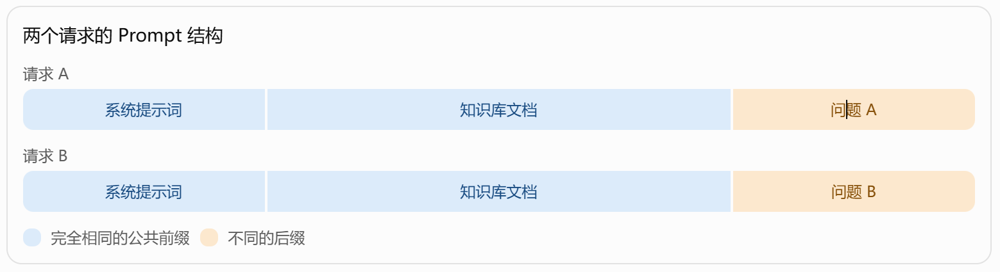
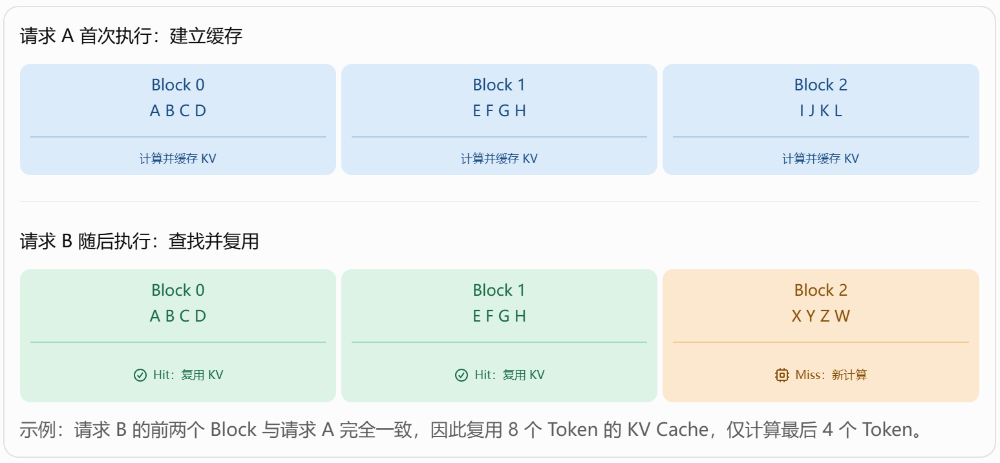
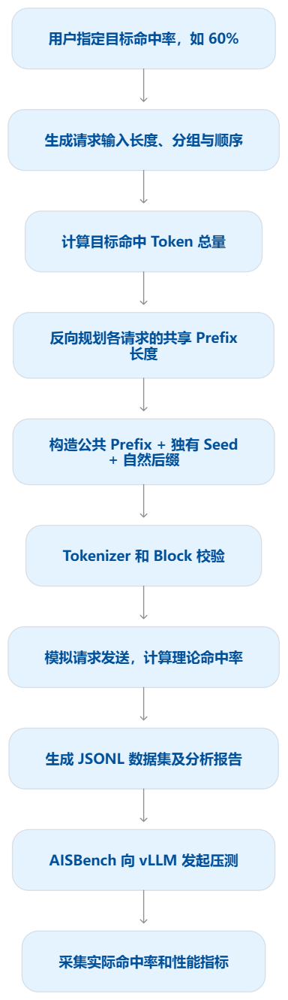
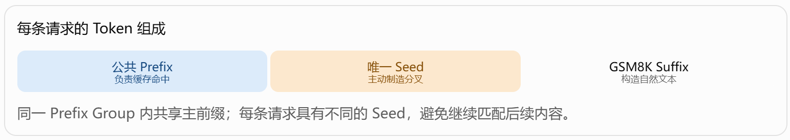
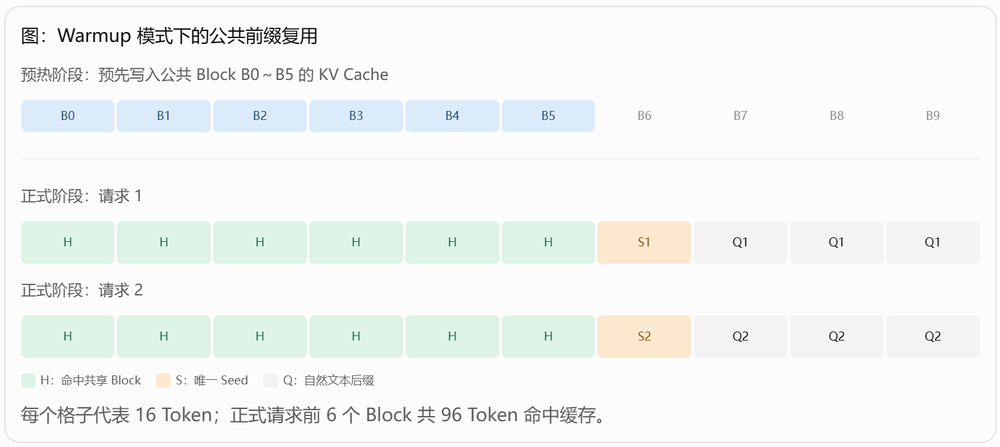
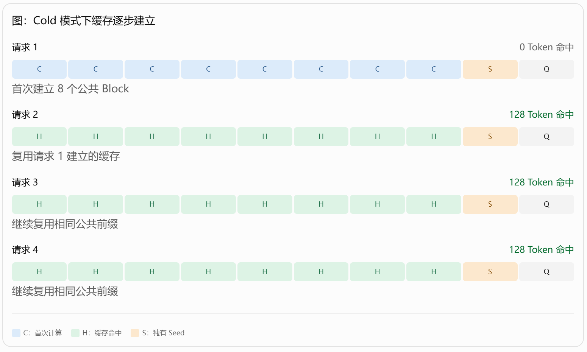
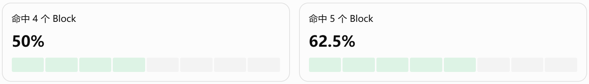
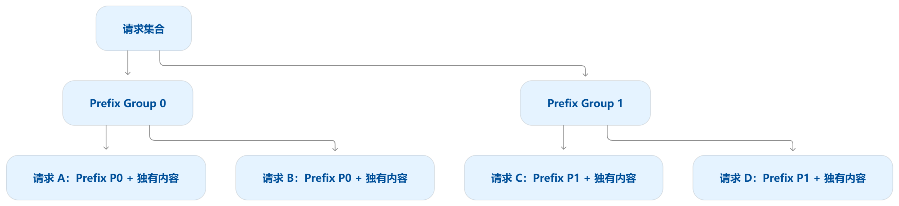
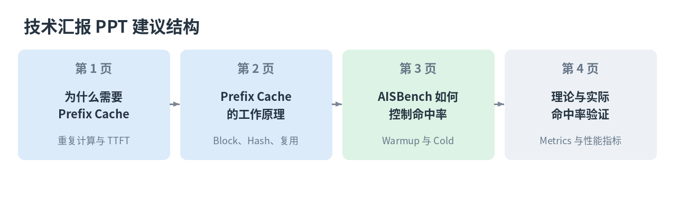
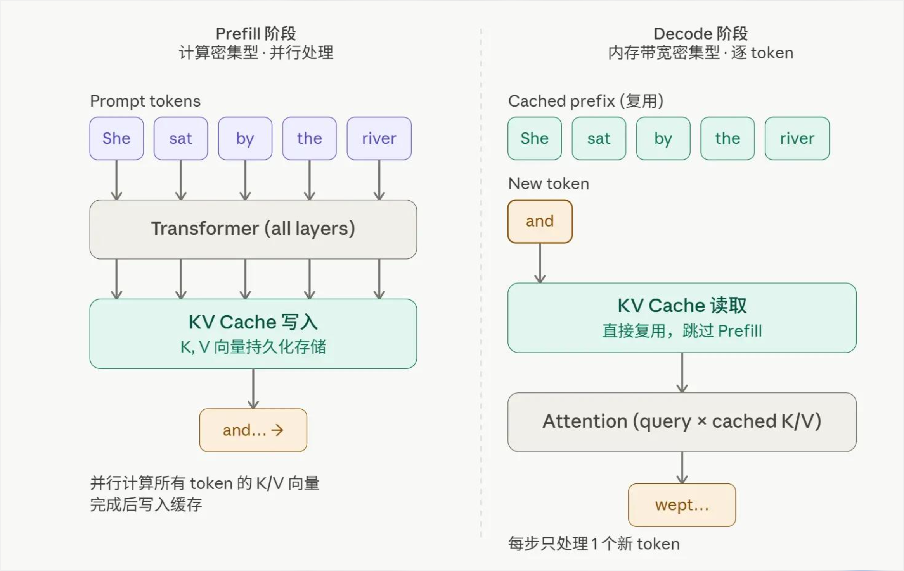

# Prefix Cache 原理与 AISBench 指定命中率数据集生成机制

结合 [AISBench Prefix Cache 官方教程](https://ais-bench-benchmark.readthedocs.io/zh-cn/latest/advanced_tutorials/prefix_cache.html) 和 vLLM 官方文档，可以把整个问题分为四个部分：

1. **Prefix Cache 为什么存在**：解决不同请求在 Prefill 阶段的重复计算问题。
2. **Prefix Cache 如何实现**：通过 Token 前缀匹配，复用已经计算好的 KV Cache Block。
3. **AISBench 如何生成指定命中率的数据集**：反向规划各请求的共享前缀长度，控制理论缓存命中 Token 数量。
4. **如何验证命中率及性能收益**：对比理论命中率、服务端实际命中率，以及 TTFT、吞吐量等指标。

**最核心的区别是：vLLM 的 Prefix Cache 负责判断哪些 KV Cache 可以复用；AISBench Prefix Cache 插件负责构造具有可控复用关系的请求数据，并验证实际复用效果。**

---

## 一、Prefix Cache 为什么存在？

### 1.1 大模型推理中的重复计算问题

大模型推理通常分为两个阶段：

- **Prefill（预填充阶段）**：处理输入 Prompt，计算各层 Attention 所需的 Key、Value，并生成首个输出 Token。
- **Decode（解码阶段）**：逐 Token 生成后续输出，复用之前计算的 KV Cache，避免重复处理已有上下文。

假设一个智能问答系统使用相同的系统提示词和知识库文档回答不同问题：



假设每个请求均包含：

- 公共前缀：3,000 Token。
- 独立问题：500 Token。
- 总输入长度：3,500 Token。

**不使用 Prefix Cache：** 请求 A、请求 B 都需要分别对 3,500 个输入 Token 执行 Prefill，其中公共的 3,000 Token 被重复计算。

**使用 Prefix Cache：** 请求 A 计算完成后，其公共前缀对应的 KV Cache 可以保留。请求 B 到来时，如果这些缓存仍然有效，就可以直接复用 3,000 Token 对应的 KV Cache，只需计算新增的 500 Token。

| 对比项 | 不使用 Prefix Cache | 使用 Prefix Cache |
| --- | ---: | ---: |
| 请求 B 需要新计算的 Prefill Token 数 | 3,500 | 500 |

这个例子中，**请求 B 有约 85.7% 的输入 Token 能够复用已有 KV Cache**。

需要注意：这是 Prefill Token 计算量的简化示例，不代表 TTFT 必然降低 85.7%。实际加速效果还受到 Attention 计算、调度、缓存查找、GPU 负载等因素影响。

### 1.2 Prefix Cache 的主要价值

| 优化目标 | 作用 |
| --- | --- |
| 降低 TTFT | 复用公共前缀 KV，减少 Prefill 计算 |
| 提升吞吐量 | 相同计算资源可以处理更多请求 |
| 减少重复计算 | 避免反复计算系统提示词、知识库文档等公共内容 |
| 提高 KV 共享效率 | 多个请求可以引用相同的物理 KV Cache Block |

Prefix Cache 对于 RAG、长文档问答、多轮对话、共享系统提示词和 Agent 工作流等场景尤其有价值。vLLM 官方将其称为 Automatic Prefix Caching（APC）。

---

## 二、Prefix Cache 的具体工作原理

### 2.1 Prefix Cache 复用的究竟是什么？

Prefix Cache 复用的是已经计算完成的 **Key、Value 张量**，而不是原始 Prompt 文本，也不是历史模型回答。

对于 Transformer Attention：

$$
Q=XW_Q,\quad K=XW_K,\quad V=XW_V
$$

对于采用因果注意力的模型，某个 Token 对应的 KV 表示依赖于该 Token 及其之前的上下文。因此：

- 如果两个请求从开头开始具有完全相同的 Token 序列，那么其公共前缀计算出的 KV 可以复用。
- 如果 Token 相同，但之前的上下文不同，则不能简单认为 KV 相同。
- 如果只有中间某段文本相同，开头不同，通常不能直接作为 Prefix Cache 命中。

这也是为什么它叫 **Prefix Cache（前缀缓存）**，而不是任意文本片段缓存。

### 2.2 vLLM 如何按 Block 组织缓存？

vLLM 结合 PagedAttention 的块式 KV 管理机制，将 Token 划分为固定大小的 Block。

例如，假设 Block Size = 4，即每个 Block 容纳 4 个 Token。



请求 B 的前两个 Block 与请求 A 完全一致，因此复用 8 个 Token 的 KV Cache，仅计算最后 4 个 Token。

vLLM 的实现还涉及两个关键机制。

**（1）基于 Hash 的缓存查找**

对第 $i$ 个完整 KV Cache Block，可以抽象为：

$$
h_i=\operatorname{Hash}\left(h_{i-1},\operatorname{TokenIDs}_i,E_i\right)
$$

其中：

- $h_{i-1}$：前一个 Block 的 Hash，体现历史前缀信息。
- $\operatorname{TokenIDs}_i$：当前 Block 中的 Token ID。
- $E_i$：必要的额外身份信息，例如 LoRA、模态内容 Hash、缓存隔离信息等。

因此，vLLM 不是单纯比较当前 Block 的文本，而是识别**包含此前全部上下文信息的前缀块**。

**（2）物理 KV Cache Block 共享**

缓存命中后，新的请求可以将自己的逻辑 Block 映射到已有物理 KV Cache Block，避免重新计算和存储一份完全相同的 KV。

请求完成时，缓存块不一定马上被清空。可复用的完整块可以继续保留，直到缓存管理器需要回收或淘汰。

需要强调：vLLM 官方设计中，**只有完整的 Block 可以被缓存并供后续请求匹配复用**。例如 Block Size = 128，虽然两个请求共享前 200 Token，但可按完整 Block 复用的部分通常只有前 128 Token。

---

## 三、AISBench 如何生成指定 Prefix Cache 命中率的数据集？

这是整个技术汇报中最值得重点讲解的部分。

### 3.1 首先明确：AISBench 控制的是什么命中率？

AISBench Prefix Cache 插件采用**按输入 Token 数加权的全局理论命中率**。

假设一共有 $N$ 条请求，第 $i$ 条请求的输入长度为 $L_i$，能够命中缓存的 Token 数量为 $H_i$，则：

$$
\boxed{R_{\mathrm{theory}}=\frac{\sum_{i=1}^{N}H_i}{\sum_{i=1}^{N}L_i}}
$$

因此，指定命中率为 60%，实际含义是：

> 整个数据集预计能够从缓存中复用的输入 Token 总数，占整个数据集输入 Token 总数的 60%。

**不是**以下两种含义：

- 60% 的请求能够命中缓存。
- 每一条请求都必须有 60% 的 Token 命中缓存。

例如，某个数据集包含 10 条请求，每条输入 1,000 Token，总输入长度为 10,000 Token。

只要这些请求预计总共命中 6,000 Token，其全局理论命中率就为 60%，并不要求每条请求都恰好命中 600 Token。

这是理解 AISBench 数据集生成机制的基础。

### 3.2 数据生成的核心思想

AISBench 采用的不是“先随机生成一批请求，再查看它们的命中率”，而是**根据目标命中率，反向规划请求之间的公共前缀关系**。



这个过程可以进一步分解为三个关键环节。

**第一步：确定每条请求的输入长度。**

插件支持固定长度、显式指定长度、区间采样、截断正态分布以及 CSV 导入。

例如：

$$
L=[1024,2048,1024,4096,\ldots]
$$

**第二步：根据目标命中率规划共享前缀。**

例如目标为 60%，需要使理论命中 Token 总量接近：

$$
H_{\mathrm{target}}=0.6\sum_i L_i
$$

考虑 Block 对齐、最小非共享长度、缓存初始状态和发送顺序后，求解各请求的共享前缀长度。

**第三步：真正构造符合规划的 Prompt。**

AISBench 的请求结构可以概括为：



同一 Prefix Group 内共享主前缀；每条请求具有不同的 Seed，避免继续匹配后续内容。

| 组成 | 具体作用 |
| --- | --- |
| 公共 Prefix | 通过相同的 Token 序列制造预期缓存命中 |
| 唯一 Seed | 在指定位置打断相同前缀，防止出现非预期额外命中 |
| GSM8K Suffix | 使用自然语言语料填充剩余 Token，形成具有一定文本自然性的请求 |

其中，`seed_blocks` 控制唯一 Seed 占用的 Block 数量，默认值为 1。

如果 Block Size = 128，`seed_blocks=1`，则每条请求至少拥有一个 128 Token 的独有分叉 Block。

为什么 Seed 很重要？因为如果只是随机拼接文本，不同请求的后缀可能意外产生相同的 Token Block。虽然一般的连续前缀匹配已经在分叉处停止，但唯一分叉设计仍有助于保证理论规划不被额外共享关系干扰。

插件还会进行 Tokenizer 编码校验和 Block 冲突检测，确保生成的数据尽量符合预期规划。

---

## 四、结合具体例子：如何构造 60% 命中率的数据集？

AISBench 支持两种缓存模式：

- `warmup`：正式压测之前先建立缓存。
- `cold`：从空缓存开始，正式请求逐步建立缓存。

这两种模式的理论命中率计算方式不同。

### 4.1 Warmup：预热固定前缀模式

假设配置如下：

| 参数 | 配置 |
| --- | ---: |
| Block Size | 16 Token |
| 请求数量 | 10 |
| 每条输入长度 | 160 Token |
| 目标命中率 | 60% |
| Prefix Group | 1 |
| 缓存模式 | warmup |
| DP 数量 | 1 |

为了实现 60% 的理论命中率，可以构造所有请求共享前 96 Token 的数据集：

$$
P=160\times60\%=96\ \text{Token}
$$

由于：

$$
96=6\times16
$$

正好对应 6 个完整 Block，因此可以直接复用。



对于所有 10 条正式请求：

$$
\begin{aligned}
H_{\mathrm{total}}&=10\times96=960\\
L_{\mathrm{total}}&=10\times160=1600\\
R_{\mathrm{theory}}&=\frac{960}{1600}=60\%
\end{aligned}
$$

这就是通过预热公共前缀构造 60% 理论命中率的一种典型方式。

注意，**预热请求本身不进入正式命中率统计窗口**，统计从预热之后开始。

### 4.2 Cold：从零缓存逐步填充模式

Cold 模式更有代表性，因为它体现了 Prefix Cache 的动态形成过程。

假设：

- 总共 4 条请求。
- 每条输入长度 160 Token。
- Block Size = 16。
- 每条请求规划的公共 Prefix 为 128 Token。
- 所有请求属于同一个 Group，由同一个 DP 处理。
- 请求依次完成，且缓存未发生淘汰。

每条请求都包含 8 个共享 Prefix Block、1 个唯一 Seed Block 和 1 个自然后缀 Block。

但由于没有预热，第一条请求发送时缓存为空。



对应计算如下：

| 请求 | 输入 Token | 理论命中 Token | 单请求命中率 |
| --- | ---: | ---: | ---: |
| 请求 1 | 160 | 0 | 0% |
| 请求 2 | 160 | 128 | 80% |
| 请求 3 | 160 | 128 | 80% |
| 请求 4 | 160 | 128 | 80% |
| **全局** | **640** | **384** | **60%** |

$$
R_{\mathrm{theory}}=\frac{0+128+128+128}{4\times160}=60\%
$$

这个例子说明：

**Cold 模式下，即使每条请求规划了 80% 的公共前缀，全局理论命中率仍然只有 60%。原因是第一条请求必须先建立缓存。**

### 4.3 AISBench 如何在 Cold 模式下进行理论计算？

AISBench 使用缓存水位（Watermark）来模拟公共前缀已经建立到哪个位置。

定义：

- $P_i$：请求 $i$ 规划的共享 Prefix 长度。
- $C_i$：请求 $i$ 到来之前，该缓存域已建立的公共 Prefix 长度。
- $H_i$：请求 $i$ 的理论命中 Token 数。

则：

$$
\boxed{H_i=\min(P_i,C_i)}
$$

请求执行完成后，公共前缀缓存水位更新为：

$$
\boxed{C_{i+1}=\max(C_i,P_i)}
$$

例如，四条请求规划的公共前缀分别是：

$$
P=[32,64,96,128]
$$

初始 $C_1=0$，则：

| 请求 | 规划 Prefix | 请求前水位 | 理论命中 | 请求后水位 |
| --- | ---: | ---: | ---: | ---: |
| 1 | 32 | 0 | 0 | 32 |
| 2 | 64 | 32 | 32 | 64 |
| 3 | 96 | 64 | 64 | 96 |
| 4 | 128 | 96 | 96 | 128 |

虽然请求 4 的公共前缀规划了 128 Token，但发送之前只有 96 Token 的公共前缀缓存，因此它只能命中 96 Token。

这种模拟方式考虑了**缓存逐步建立的时间顺序**，比只计算请求中公共前缀占比更加准确。

需要注意，以上缓存水位是 AISBench 的理论规划模型，并不等同于 vLLM 运行时真实 KV Cache 占用状态。实际命中仍受缓存淘汰、请求调度和实现细节影响。

---

## 五、结合 Block Size = 128，理解为什么目标命中率不一定能精确实现

在 Block Size 设置为 128 的 vLLM 测试场景中，这个问题尤其值得关注。

假设：

- 每条请求输入 1,024 Token。
- Block Size = 128。
- 目标理论命中率为 60%。
- 使用 Warmup 模式。

单条请求希望命中：

$$
1024\times0.6=614.4\ \text{Token}
$$

但是 Prefix Cache 按完整 Block 复用，因此 614.4 Token 不满足 Block 对齐要求。

可采用的相邻共享前缀长度是：

$$
4\times128=512
$$

或者：

$$
5\times128=640
$$



单条请求无法实现精确的 60% Block 命中比例。

但是，如果生成 100 条请求，则可以从全局角度进行规划。

例如，一种可行的理论分配方式为：

- 80 条请求，每条复用 5 个 Block，即 640 Token。
- 20 条请求，每条复用 4 个 Block，即 512 Token。

总命中 Token 数为：

$$
H=80\times640+20\times512=61440
$$

总输入 Token 数为：

$$
L=100\times1024=102400
$$

因此：

$$
\boxed{R_{\mathrm{theory}}=\frac{61440}{102400}=60\%}
$$

这里展示的是一种数学上可行的分配方案，并非声称 AISBench 求解器必然采用这组具体分配。

AISBench 实际上会结合目标命中 Token 预算、Block 粒度和场景约束求解，并检查目标是否可达。当无法精确实现时，会给出最近可达目标及相应分析信息。

**汇报时可以强调：AISBench 控制的是整个数据集的命中 Token 总量，因此能够利用不同请求之间的 Block 数量分配，缓解单请求 Block 粒度造成的量化误差。**

---

## 六、Prefix Group、请求顺序和 DP 数量有什么影响？

这三个配置对理论命中率至关重要。

### 6.1 Prefix Group：定义哪些请求共享前缀

一个 Prefix Group 可以理解为一组共享同一条主 Prefix 的请求。

例如：



同一个 Group 内的请求共享主前缀，不同 Group 的主前缀独立生成。

AISBench 支持均匀分组、Zipf 热点分布和自定义权重分组。

因此可以模拟两类典型业务：

- 单 Prefix：大量请求具有相同的系统提示词或知识库文档。
- 多 Prefix：不同业务、不同用户群或不同知识库具有各自的共享前缀。

### 6.2 请求顺序：影响 Cold 模式的缓存建立

同样的数据内容，发送顺序不同，Cold 模式下的理论命中率就可能不同。

比如先发送短请求，再发送长请求，缓存可以逐步扩展；如果先发送长请求，其较长的公共前缀可能更早被建立。

AISBench 支持 `sequential`、`interleave`、`global_shuffle`、`within_group_shuffle` 和 `input_len_asc` 等策略。

其中，若希望模拟无预热状态下短请求逐步扩展为长请求，官方推荐使用：

```json
{
  "prefix_cache": {
    "mode": "cold",
    "order": {
      "strategy": "input_len_asc"
    }
  }
}
```

### 6.3 DP 数量：相同 Prefix 不代表跨 DP 自动共享缓存

这是多 DP 推理部署中特别容易忽略的问题。

假设使用前面 4 条请求、每条 160 Token、共享前缀 128 Token 的例子。

如果是单 DP，Cold 模式下：

$$
H=[0,128,128,128]
$$

理论命中率为 60%。

如果改为两个 DP，采用交替路由：

- 请求 1、3 分配给 DP0。
- 请求 2、4 分配给 DP1。

并假设两个 DP 的 KV Cache 相互独立，那么：

$$
H=[0,0,128,128]
$$

理论命中率就变为：

$$
R=\frac{256}{640}=40\%
$$

| 场景 | 理论命中率 |
| --- | ---: |
| 单 DP，Cold | 60% |
| 双 DP，Cold，交替分配 | 40% |
| 单 DP，Warmup，公共 128 Token | 80% |
| 双 DP，Warmup，两个 DP 均预热 | 80% |

这说明同样的数据集，缓存初始状态和 DP 路由方案会影响命中率。

AISBench 在 Cold 模式下按照 `(group_id, dp_rank)` 维护独立缓存水位；在 Warmup 模式下，可以为每个 Prefix Group 与 DP rank 分别进行预热。

这也是为什么官方示例中特别配置了 `service.dp_size` 和 `X-data-parallel-rank` 定向路由能力。

---

## 七、AISBench 如何验证真正的命中率？

### 7.1 需要区分四个数值

AISBench 的分析结果中涉及四个容易混淆的概念：

| 指标 | 含义 |
| --- | --- |
| Requested | 用户在 Scenario 中指定的目标命中率 |
| Effective | 求解器选择的最近可达目标命中率 |
| Theoretical | 基于最终数据和发送顺序模拟的理论命中率 |
| Actual | 从 vLLM 服务端指标计算得到的实际命中率 |

例如，用户配置目标 60%，但由于 Block 约束，最终得到的理论结果可能为 59.8%，而实际压测结果为 57.5%。

这里的 59.8% 和 57.5% 只是用于说明的假设值，并非实际测试结果。

需要分别分析：

$$
\Delta_{\mathrm{construction}}=R_{\mathrm{theory}}-R_{\mathrm{target}}
$$

$$
\Delta_{\mathrm{runtime}}=R_{\mathrm{actual}}-R_{\mathrm{theory}}
$$

前者反映数据集构造与目标之间的偏差；后者反映真实服务运行与理论模型之间的偏差。

### 7.2 实际命中率如何计算？

vLLM 提供两个重要的 Prometheus Counter：

- `vllm:prefix_cache_queries`：Prefix Cache 查询的 Token 数。
- `vllm:prefix_cache_hits`：Prefix Cache 命中的 Token 数。

插件在正式压测前后分别采集指标快照。

$$
Q_{\Delta}=Q_{\mathrm{after}}-Q_{\mathrm{before}}
$$

$$
H_{\Delta}=H_{\mathrm{after}}-H_{\mathrm{before}}
$$

最终：

$$
\boxed{R_{\mathrm{actual}}=\frac{H_{\Delta}}{Q_{\Delta}}}
$$

注意，必须计算 Counter 差值，而不是直接拿压测结束时的累计 Hits 除以累计 Queries，否则可能混入之前请求的历史数据。

多 DP 场景下，应对各 DP 的 Counter 增量求和后再计算全局比率，不能直接对各 DP 命中率求算术平均。

### 7.3 为什么理论 60%，实际未必是 60%？

主要可能存在以下原因：

| 原因 | 具体解释 |
| --- | --- |
| KV Cache 被淘汰 | 缓存容量不足，已建立的前缀 Block 不再可复用 |
| 请求调度差异 | 后续请求执行查找时，之前的公共前缀可能尚未计算完成 |
| DP 路由差异 | 请求没有落到包含相应缓存的 DP |
| Tokenizer 不一致 | 离线构造和服务端实际 Token ID、Block 边界不同 |
| Prompt 被额外加工 | 服务端或中间层增加模板、特殊 Token，改变实际前缀 |
| 模型或 KV 管理差异 | 不同模型、推理框架版本的缓存管理与统计口径可能不同 |

还需要区分 **Prefix Cache 命中率**与 **KV Cache 使用率**：

- Prefix Cache 命中率描述历史计算结果被复用的比例。
- KV Cache 使用率描述缓存资源当前被占用的程度。

两者可能相关，但不是同一个指标。

尤其对于包含多种 Attention 结构的混合模型，vLLM 还需要协调不同 KV Cache Group 的可复用区域。官方 Hybrid KV Cache Manager 文档说明，不同 Group 的命中结果可能需要进一步求交，因此不能简单把普通 Full Attention 的单一 Block 模型不加区分地套用到所有模型。

---

## 八、如何使用 AISBench Prefix Cache 插件进行实验？

官方提供以下五个主要命令：

| 命令 | 功能 |
| --- | --- |
| `inspect` | 预览目标命中率是否可达、分组、请求长度与理论规划 |
| `prepare` | 生成请求数据集和理论分析报告 |
| `validate` | 检查数据完整性与顺序是否发生变化 |
| `run` | 执行 vLLM 在线压测并采集实际命中率和性能指标 |
| `analyze` | 利用已有 Prometheus 快照离线复算实际命中率 |

推荐流程如下：

```bash
# 1. 检查理论可达性
ais-bench-prefix-cache inspect --scenario ./scenario.json

# 2. 生成文本数据集
ais-bench-prefix-cache prepare --mode text --scenario ./scenario.json

# 3. 校验数据
ais-bench-prefix-cache validate --manifest <manifest路径>

# 4. 在线压测
ais-bench-prefix-cache run --scenario ./scenario.json
```

官方 Scenario 示例包含以下核心配置：

```json
{
  "run": {
    "run_id": "gsm8k-prefix-cache-60",
    "random_seed": 42,
    "output_dir": "./outputs/gsm8k-prefix-cache-60"
  },
  "tokenizer": {
    "path": "/path/to/tokenizer",
    "block_size": 16
  },
  "corpus": {
    "path": "./GSM8K.jsonl",
    "field": "question",
    "selection": {"mode": "random"}
  },
  "requests": {
    "count": 100,
    "input_length": {"mode": "fixed", "value": 1024},
    "output_length": {"mode": "fixed", "value": 32}
  },
  "prefix_cache": {
    "mode": "warmup",
    "target_hit_rate": 0.6,
    "seed_blocks": 1,
    "groups": {
      "count": 1,
      "assignment": {"mode": "uniform"}
    },
    "order": {"strategy": "interleave"}
  },
  "service": {
    "dp_size": 2
  }
}
```

这份示例配置表示：生成 100 条、输入固定为 1,024 Token 的正式请求，目标理论命中率 60%，单 Prefix Group，使用 Warmup 模式，并按 2 个 DP 进行预热规划。在线 `run` 还需要补充实际服务 URL、模型名称及 AISBench 运行配置等。

如果用于 Block Size = 128 的部署环境，必须将配置中的 `tokenizer.block_size` 与服务端实际值保持一致。

另外，vLLM 的 `/reset_prefix_cache` 在官方当前开发接口中需要启用 `VLLM_SERVER_DEV_MODE=1`，该模式仅适合受控测试环境，不应在生产服务中开启。

---

## 九、建议汇报时如何组织 PPT

我建议按照四页组织，避免从一开始就陷入参数和公式。



| 页码 | 主题 | 重点展示内容 |
| --- | --- | --- |
| 第 1 页 | **为什么需要 Prefix Cache** | 重复的系统提示词、知识库文档导致 Prefill 重复计算；使用请求 A/B 图，突出减少 TTFT 和重复计算 |
| 第 2 页 | **Prefix Cache 如何工作** | Token 分块、Hash 匹配、物理 KV Cache 共享；用三个 Block 的示例展示 Hit/Miss |
| 第 3 页 | **AISBench 如何控制指定命中率** | 全局 Token 加权命中率；公共 Prefix + 唯一 Seed + 自然后缀；Warmup 和 Cold 的区别 |
| 第 4 页 | **验证指标与性能测试设计** | Requested、Theoretical、Actual 的关系；命中率与 TTFT、吞吐量、KV Cache 使用率的联合测试思路 |





其中第 3 页最适合使用 Cold 模式下四条请求的示例，因为它能直观说明：**为什么每条请求包含 80% 的公共前缀，最后全局命中率却只有 60%。**

---

## 十、汇报中建议强调的四个结论

1. **Prefix Cache 是对 Prefill 阶段重复 KV 计算的优化。** 通过复用历史请求中相同前缀对应的 KV Cache，降低重复计算开销，主要影响 TTFT，并可能改善吞吐表现。
2. **AISBench 控制的是理论命中率，不是直接控制 vLLM 的真实缓存状态。** 它通过反向规划 Prefix 长度、生成独有分叉块、模拟缓存水位和请求顺序，构造具有预期命中行为的数据集。
3. **决定命中率的不只有 Prefix 长度。** Block Size、请求顺序、Warmup/Cold 模式、Prefix Group、DP 路由及实际缓存淘汰情况均可能影响结果。
4. **评估 Prefix Cache 性能时应建立“目标—理论—实际—性能”完整证据链。** 先验证数据集的理论命中率，再确认服务端实际命中率，最后分析 TTFT、吞吐量和 KV Cache 资源使用变化。

这样组织，既可以解释 Prefix Cache 本身的技术原理，也能清晰说明 AISBench 插件为什么能够生成指定命中率的数据集，以及它的控制能力和局限。

---

## 参考资料

- [AISBench Prefix Cache 官方教程](https://ais-bench-benchmark.readthedocs.io/zh-cn/latest/advanced_tutorials/prefix_cache.html)
- [vLLM Automatic Prefix Caching 设计文档](https://docs.vllm.ai/en/latest/design/prefix_caching/)
- [vLLM Automatic Prefix Caching 用户指南](https://docs.vllm.ai/en/latest/features/automatic_prefix_caching/)
