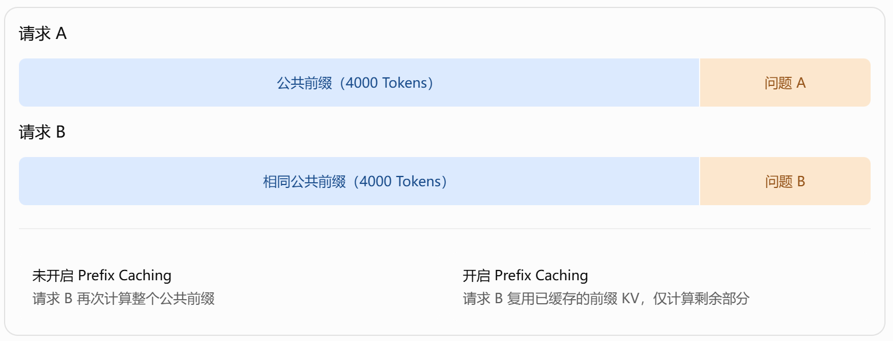
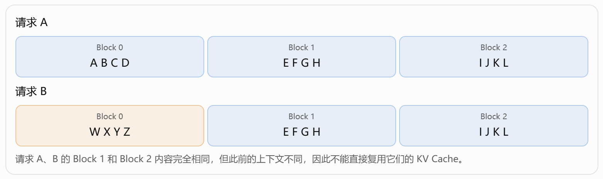
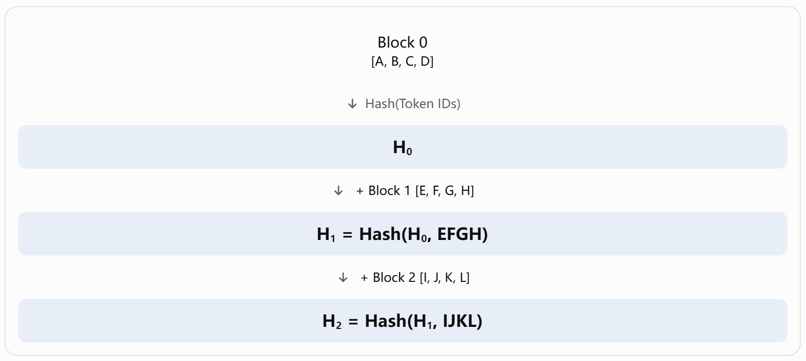
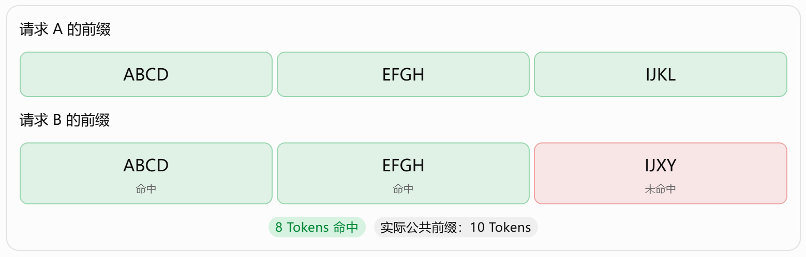
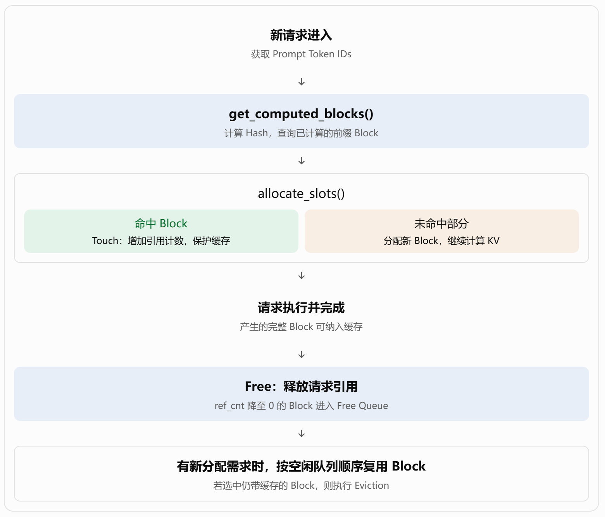
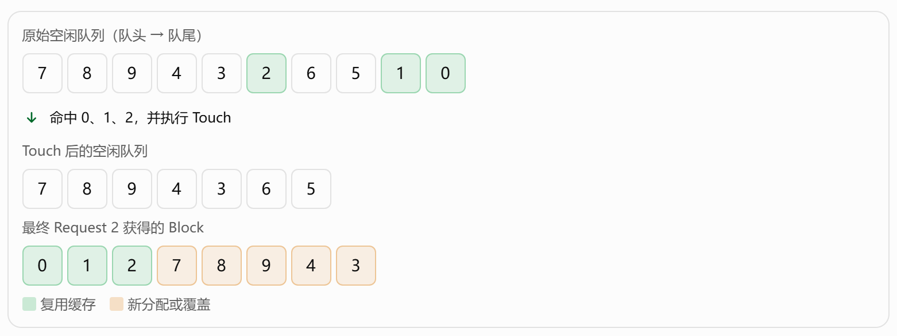

# vLLM Automatic Prefix Caching 原理与实现梳理

> 参考文档：[vLLM 官方设计文档：Automatic Prefix Caching](https://docs.vllm.ai/en/latest/design/prefix_caching/)  
> 本文根据上一轮对话整理为标准 Markdown，并将对话中的六幅示意图保存为本地 PNG 图片。阅读时请保持本文件与 `images/` 文件夹的相对位置不变。

这篇文档主要介绍 **vLLM V1 如何利用 Hash 管理和复用 KV Cache Block**，包括数据结构、缓存查找、Block 分配、请求结束后的释放、LRU 淘汰，以及完整的运行示例。

理解这篇文档，最重要的是掌握以下四点：

1. **缓存复用以 Block 为单位**，并且通常只缓存完整的 Block。
2. **Block 的 Hash 不仅取决于当前 Block 的 Token，还取决于此前的所有前缀 Token。**
3. **请求结束不等于 KV Cache 内容立即被删除。**已经缓存的 Block 可以在空闲状态下继续保留。
4. **缓存命中时，vLLM 优先保护命中的 Block，再分配新的 Block**，避免刚命中的缓存被覆盖。

## 一、为什么需要 Prefix Caching？

在大模型推理中，通常分为 Prefill 和 Decode 两个阶段。

- **Prefill：**处理输入 Prompt，计算各层的 KV Cache，并建立用于后续生成的上下文。
- **Decode：**在已有上下文基础上逐步生成新的 Token，并使用此前缓存的 K、V。

假设有两个请求，它们共享相同的系统提示词和知识库上下文：



**未开启 Prefix Caching：**请求 B 再次计算整个公共前缀。

**开启 Prefix Caching：**请求 B 复用已缓存的前缀 KV，仅计算剩余部分。

对于采用因果注意力的 Transformer，已有前缀对应的 KV Cache 不会因为后面追加了新的 Token 而改变。因此，请求 B 可以复用请求 A 已经计算好的公共前缀。

Prefix Caching 的本质是：

**通过跨请求复用已经计算的前缀 KV Cache，减少重复 Prefill 计算。**

它主要优化：

- TTFT（Time To First Token，首 Token 延迟）
- Prefill 阶段的计算开销
- 存在大量公共前缀时的系统吞吐量

需要注意，Prefix Caching 并不会直接消除新 Token 在 Decode 阶段的计算开销。

参考：[vLLM Automatic Prefix Caching 功能介绍](https://docs.vllm.ai/en/latest/features/automatic_prefix_caching/)

## 二、核心机制：Hash-based Prefix Caching

这是整篇文档最重要的部分。

### 2.1 为什么一个 Block 的 Hash 不能只根据自己的 Token 计算？

假设 Block Size = 4，每个 Block 包含 4 个 Token。



请求 A、B 的 Block 1 和 Block 2 内容完全相同，但此前的上下文不同，因此不能直接复用它们的 KV Cache。

原因是：在因果注意力中，一个位置的最终隐藏状态依赖于自身及之前的 Token。虽然当前 Block 的 Token 相同，但之前的上下文不同，经过多层 Transformer 后，该 Block 的 KV Cache 可能不同。

这里要特别区分：**某一层的 K/V 投影取决于该层输入的隐藏状态，而这个隐藏状态可能已经聚合了此前 Token 的信息。**

因此，vLLM 使用链式 Hash。

### 2.2 Block Hash 如何计算？

忽略额外元数据时，可简化为：

$$
H_0=\operatorname{Hash}(\text{Tokens}_0)
$$

$$
H_i=\operatorname{Hash}(H_{i-1},\text{Tokens}_i)
$$

其中：

- $H_i$：第 $i$ 个 Block 的 Hash。
- $H_{i-1}$：前一个 Block 的 Hash，间接包含此前所有 Block 的 Token 信息。
- $\text{Tokens}_i$：当前 Block 的 Token IDs。



实际的 Hash 输入还可能包含 `extra_hashes`，例如 LoRA ID、多模态输入 Hash、`cache_salt` 等，用于避免错误复用不同模型配置或不同内容的缓存。

**结论：某个 Block 能否复用，不仅要看当前 Block 的 Token 是否相同，还要看它前面的整个前缀是否一致，以及相关缓存身份信息是否一致。**

参考：[官方文档：Automatic Prefix Caching（Hash 设计）](https://docs.vllm.ai/en/latest/design/prefix_caching/)

### 2.3 为什么只能命中完整 Block？

假设 Block Size = 4：



尽管两个请求有 10 个相同的前缀 Token，但只有前 8 个 Token 组成了两个完整且相同的 Block。

第 3 个 Block 只匹配了 2 个 Token，不满足完整 Block 匹配，因此不会命中。

对于一般的固定 Block Size $B$，假设公共前缀长度为 $P$，且对应完整 Block 已缓存，则：

$$
N_{\mathrm{hit}}=B\left\lfloor\frac{P}{B}\right\rfloor
$$

这是理想命中长度；实际命中还取决于缓存是否仍然存在及其他匹配条件。

这也解释了为什么在进行 Prefix Cache 命中率测试时，不能简单地把公共前缀 Token 的数量直接当作命中 Token 数。

> **适用范围：**上述公式用于理解普通的固定 Block Size、完整 Block 命中的场景。混合注意力、Mamba 等模型的具体命中粒度，需要结合 KV Cache Group 和相关配置分析。

## 三、vLLM V1 使用了哪些核心数据结构？

官方文档重点介绍了 `KVCacheBlock` 以及负责管理这些 Block 的四个组件。

### 3.1 KVCacheBlock

简化后的定义如下：

```python
class KVCacheBlock:
    block_id: int
    block_hash: BlockHash
    ref_cnt: int
    prev_free_block: "KVCacheBlock | None"
    next_free_block: "KVCacheBlock | None"
```

| 字段 | 作用 |
| --- | --- |
| `block_id` | Block 的物理标识，初始化后不变 |
| `block_hash` | 标识该 Block 所缓存的 Token 前缀 |
| `ref_cnt` | 当前引用该 Block 的请求数量 |
| `prev_free_block` | 空闲队列中的前驱指针 |
| `next_free_block` | 空闲队列中的后继指针 |

其中最需要理解的是 `ref_cnt`：

- `ref_cnt > 0`：Block 正在被请求使用，不能被淘汰。
- `ref_cnt = 0`：Block 没有正在使用它的请求，可以进入空闲队列。但其中的缓存内容可能仍然有效，允许后续命中复用。

### 3.2 四个管理组件

| 组件 | 核心功能 |
| --- | --- |
| Block Pool | 保存所有预先创建的 `KVCacheBlock` 对象 |
| Free Block Queue | 双向链表，管理可供分配或回收的 Block |
| Cache Blocks | Hash → Block IDs，支持 Prefix Cache 查询 |
| Request Blocks | Request ID → Block IDs，记录每个请求使用的 Block |

尤其要区分：

**Free Block Queue 并不等于没有缓存内容的 Block 集合。**

一个 Block 即使位于 Free Block Queue 中，只要其 Hash 仍然有效、缓存数据尚未被覆盖，就可能被新请求命中。

这是理解后续释放、淘汰机制的关键。

参考：[官方文档：Data Structure](https://docs.vllm.ai/en/latest/design/prefix_caching/#data-structure)

## 四、核心操作：查找、分配、释放和淘汰



这里有两个值得特别记住的操作。

### 4.1 Touch 操作

当某个 Block 命中缓存时，vLLM 会增加其引用计数。如果该 Block 原先在空闲队列中，还会将它移出队列。

这样做是为了防止正在复用的 KV Cache 被新的 Block 分配操作覆盖。

### 4.2 Eviction 操作

当需要重新分配一个仍包含有效缓存内容的空闲 Block 时，vLLM 会将其缓存身份信息从 Hash 索引中移除，清除对应的 `block_hash`，再复用这块物理空间。

换句话说，**淘汰的是 Block 中旧 KV Cache 的可复用资格，不是销毁 Block 对象。**

参考：[官方文档：Block Allocation](https://docs.vllm.ai/en/latest/design/prefix_caching/#block-allocation)、[Free](https://docs.vllm.ai/en/latest/design/prefix_caching/#free)、[Eviction (LRU)](https://docs.vllm.ai/en/latest/design/prefix_caching/#eviction-lru)

## 五、官方 Example：六个时间点的完整运行过程

这是网页最后的例子，也是最值得重点理解的部分。

官方假设：

- `block_size = 4`
- KV Cache 总共拥有 10 个 Block，编号 0～9
- 依次进入 Request 0、Request 1、Request 2

下面用表格还原整个过程。

| 时间点 | 事件 | 重点 |
| --- | --- | --- |
| Time 1 | Request 0 到来，分配 4 个 Block | 前 3 个 Block 已满并缓存，第 4 个尚未填满 |
| Time 2 | Request 0 继续生成 | Block 3 填满，开始缓存；再分配 Block 4 |
| Time 3 | Request 1 到来，与 Request 0 共享前 10 个 Token | 只命中前 2 个完整 Block，即 8 个 Token |
| Time 4 | Request 0 完成 | 释放其独占 Block；共享的 Block 0、1 继续被 Request 1 使用 |
| Time 5 | Request 1 完成 | 释放其引用，相关 Block 可以进入空闲队列 |
| Time 6 | Request 2 到来，共享 Request 0 的前 12 个 Token | 命中 Block 0、1、2，其余部分分配新 Block |

参考：[官方 Example](https://docs.vllm.ai/en/latest/design/prefix_caching/#example)

其中，最重要的是 Time 6。

### Time 6：为什么需要先 Touch，再分配？

假设此时 Free Block Queue 的排列是：



原始空闲队列：

```text
7 → 8 → 9 → 4 → 3 → 2 → 6 → 5 → 1 → 0
```

命中并 Touch Block 0、1、2 后，空闲队列变为：

```text
7 → 8 → 9 → 4 → 3 → 6 → 5
```

最终 Request 2 使用：

```text
0(缓存命中) → 1(缓存命中) → 2(缓存命中)
    → 7 → 8 → 9 → 4 → 3(淘汰旧缓存并复用)
```

这说明：

1. Request 2 先找到三个命中 Block。
2. `Touch` 把 Block 0、1、2 从空闲队列中移除，防止它们被复用覆盖。
3. 再从空闲队列中分配其他所需 Block。
4. 最后的 Block 3 原来有缓存内容，此时被淘汰并复用。

**核心原则：缓存命中的保护优先于新 Block 分配。**

## 六、官方文档中另外三个值得关注的细节

### 6.1 为什么 vLLM V1 允许 Duplicate Blocks？

假设已经缓存了 `[A B C D]` 和 `[E F G H]`。

一个新请求可能只能复用第一个 Block，而在后续 Decode 中再次生成 `[E F G H]`，最终形成两个物理 Block，它们拥有相同的 Hash。

官方说明，V1 的 Block Table 采用 append-only 设计，不允许像早期 V0 那样直接将已分配的 Block ID 替换为另一个 Block ID。

因此，V1 可以临时存在重复缓存块，并在请求释放时消除重复。

参考：[vLLM Prefix Caching：Block Allocation](https://docs.vllm.ai/en/latest/design/prefix_caching/#block-allocation)

### 6.2 多模态输入如何避免错误命中？

对于图像输入，多个不同图像在 Token 层面可能表现为相同的图像占位符。

因此，仅依靠 Token IDs 无法区别图像内容。

vLLM 会把实际图像对应的 Hash 加入 `extra_hashes`，使不同图像不会仅因占位符相同而错误命中。LoRA ID 等也可以作为额外的缓存身份信息。

参考：[vLLM Prefix Caching：多模态 Hash 示例](https://docs.vllm.ai/en/latest/design/prefix_caching/)

### 6.3 Hash 冲突和租户隔离

官方文档当前列出的默认算法为 `sha256`，还提供 `sha256_cbor`、`xxhash` 等选项。

同时，可以通过 `cache_salt` 对不同信任域进行缓存隔离，避免不同租户仅因为 Prompt 一样就共享缓存，并降低基于缓存命中时延推断其他用户内容的风险。

参考：[vLLM Prefix Caching：Cache Isolation for Security](https://docs.vllm.ai/en/latest/design/prefix_caching/)

## 七、联系性能测试：需要关注什么？

对于 Prefix Caching 性能测试，建议至少区分以下三个指标。

| 指标 | 衡量什么 | 主要价值 |
| --- | --- | --- |
| Prefix Cache Hit Rate | 被查询的缓存中有多少成功命中 | 衡量前缀复用效果 |
| KV Cache Usage | 当前 KV Cache 资源使用情况 | 衡量缓存资源压力 |
| TTFT | 请求从发出到首 Token 返回的时间 | 衡量用户感知的首 Token 响应速度 |

vLLM 官方 Metrics 文档提供了 `vllm:prefix_cache_queries`、`vllm:prefix_cache_hits` 和 `vllm:kv_cache_usage_perc` 等指标。

参考：[vLLM Production Metrics](https://docs.vllm.ai/en/latest/usage/metrics/)

在选定的统计区间内，可通过计数器增量计算：

$$
\text{Hit Rate}=
\frac{\Delta\text{prefix\_cache\_hits}}{\Delta\text{prefix\_cache\_queries}}
\times100\%
$$

这里的两个前缀缓存计数器均以 **Token 数量**为统计单位，而不是命中请求数或命中 Block 数。

需要注意：**Prefix Cache 命中率和 KV Cache 使用率是两种不同的指标**，两者不能混用。

例如，Block Size = 128，在本文介绍的完整 Block 匹配机制下，如果两个请求共享前 1000 个 Token，最多可以直接命中：

$$
\left\lfloor\frac{1000}{128}\right\rfloor=7\text{ Blocks}
$$

也就是 896 个 Token，剩余 104 个公共前缀 Token 不能依靠完整 Block 命中。这属于简化的单一固定 Block 粒度示例；对于采用混合注意力或 Mamba 结构的模型，需要结合实际 KV Cache Group 与前缀匹配粒度分析。

相关参考：[vLLM Automatic Prefix Caching 功能说明](https://docs.vllm.ai/en/latest/features/automatic_prefix_caching/)

## 八、最终总结：快速记住这张表

| 问题 | 结论 |
| --- | --- |
| Prefix Caching 解决什么问题？ | 避免跨请求重复计算相同前缀 |
| 缓存复用的基本单位？ | 完整 KV Cache Block |
| 如何判断 Block 能否复用？ | 当前 Token、父 Hash 和额外身份信息共同决定 |
| 缓存命中后如何处理？ | Touch，增加引用计数，保护缓存 |
| 请求结束后 KV Cache 是否立即删除？ | 不一定；释放引用后仍可能保留为可复用缓存 |
| 缓存什么时候被淘汰？ | 空闲 Block 需要被重新分配时，按 LRU 思路淘汰旧缓存 |
| Prefix Caching 主要改善什么？ | Prefill 计算开销和 TTFT |
| 能否直接加速 Decode？ | 不会直接减少新生成 Token 的 Decode 计算 |

**用一句话概括整篇文档：**

vLLM V1 通过链式 Hash 识别可复用的前缀 KV Cache Block，通过引用计数管理并发共享，通过 Free Block Queue 和 LRU 管理缓存生命周期，从而实现跨请求的高效前缀复用。

如果后续需要向领导汇报，建议重点讲清楚 **Hash 计算机制、Block 命中与分配流程，以及请求结束后的缓存保留与淘汰机制**。这三部分足以解释 Prefix Cache 的核心原理及其对性能指标的影响。

---

## 参考链接

1. [vLLM：Automatic Prefix Caching（设计文档）](https://docs.vllm.ai/en/latest/design/prefix_caching/)
2. [vLLM：Automatic Prefix Caching（功能文档）](https://docs.vllm.ai/en/latest/features/automatic_prefix_caching/)
3. [vLLM：Production Metrics](https://docs.vllm.ai/en/latest/usage/metrics/)
4. [vLLM：KV Cache Manager API](https://docs.vllm.ai/en/latest/api/vllm/v1/core/kv_cache_manager/)
