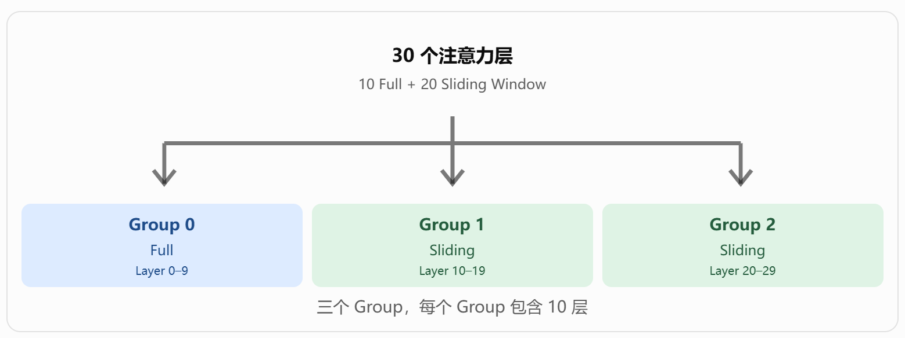
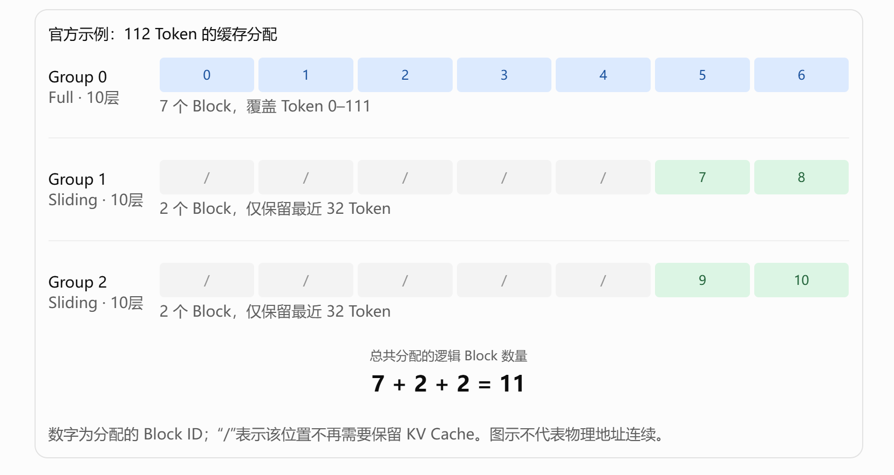
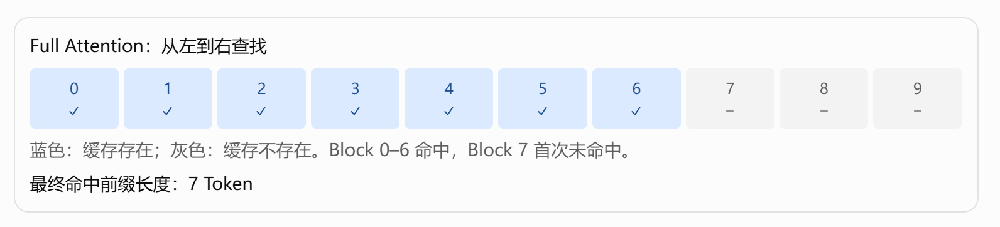
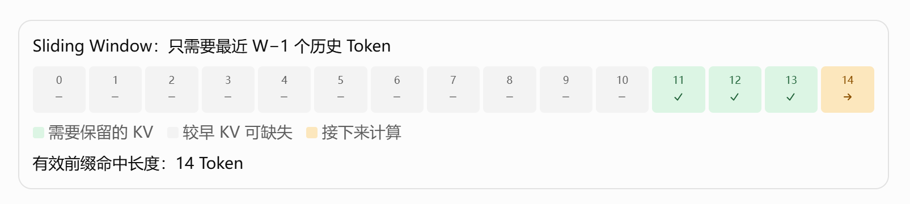
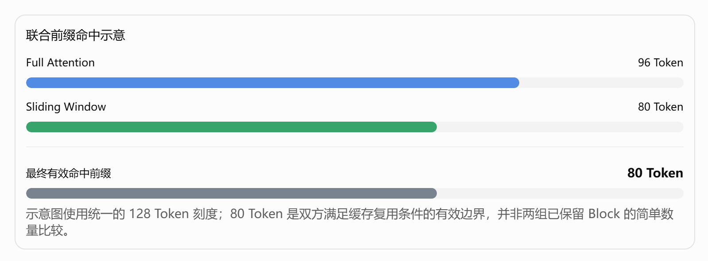
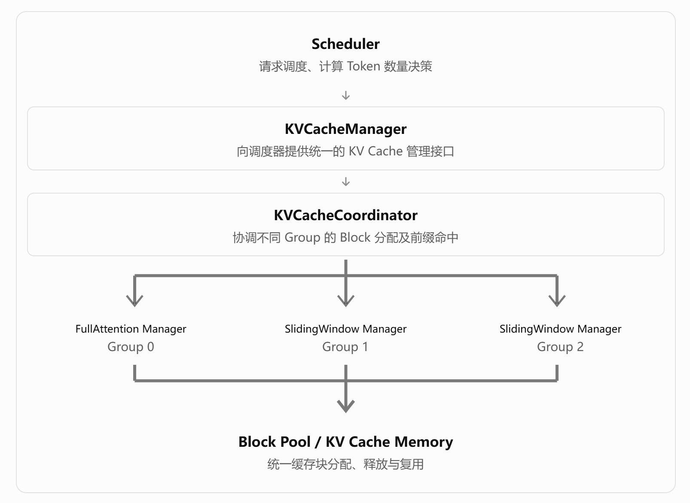

# vLLM Hybrid KV Cache Manager 技术原理梳理

> 基于 [vLLM 官方设计文档：Hybrid KV Cache Manager][vllm-design]，结合具体例子进行解释。

## 一、先理解：Hybrid KV Cache Manager 解决什么问题？

**Hybrid KV Cache Manager（混合 KV 缓存管理器）主要解决混合注意力模型中，不同类型的注意力层具有不同的 KV Cache 存储需求和 Prefix Cache 复用规则的问题。**

传统 Transformer 模型通常全部采用 Full Attention（全注意力），所有层的 KV Cache 管理规则基本一致。

但一些混合模型会同时包含多种类型的注意力层，例如：

| 模型类型 | 注意力组合 |
|---|---|
| Gemma 2/3、GPT-OSS | Full Attention + Sliding Window Attention |
| Llama 4 | Full Attention + Local Chunked Attention |
| Jamba、Bamba | Full Attention + Mamba |

不同类型的层存在两方面的差异。

**1. KV Cache 分配需求不同**

- **Full Attention**：当前 Token 可能需要关注之前的所有 Token，因此通常需要保留整个上下文的 KV Cache。
- **Sliding Window Attention**：当前 Token 只关注最近一个窗口内的 Token，因此较早的 KV Cache 可以被释放。
- **Mamba**：采用状态空间建模，缓存的数据结构和存储需求与普通注意力不同。

**2. Prefix Cache 命中规则不同**

- **Full Attention**：要复用前 $N$ 个 Token 的计算结果，需要对应前缀的所有 KV Cache 块仍然可用。
- **Sliding Window Attention**：为了继续计算，不一定需要保留全部历史 KV Cache，只需要保留复用边界之前窗口内所需的 KV Cache。

因此，Hybrid KV Cache Manager 需要同时做到：

1. 按照不同注意力类型的需求分配 KV Cache Block，减少显存浪费。
2. 将注意力层组织为 KV Cache Group，提高内存分配效率。
3. 根据不同注意力类型的规则判断 Prefix Cache 命中情况。
4. 协调不同 Group 的缓存结果，确定整个请求能够复用的前缀。

这也是整篇文档的两条核心主线：**Allocation（缓存分配）和 Prefix Caching（前缀缓存复用）**。

参考：[vLLM 官方设计文档][vllm-design]。

## 二、几个必须掌握的基础概念

| 概念 | 含义 | 单位 |
|---|---|---|
| KV Hidden Size | 单层存储一个 Token 的 KV Cache 所需空间 | Byte/Token |
| Block Size | 一个 Block 可容纳的 Token 数量 | Token |
| Page Size | 一个物理内存分配块占用的空间 | Byte |
| KV Cache Group | 一组具有相同注意力类型，并共同使用一套 Block ID 分配结果的层 | — |
| Block ID | 标识缓存池中某个逻辑分配块的编号 | — |

### 2.1 Block Size 与 Page Size 的区别

文档给出的通用公式是：

$$
\text{Page Size}
=\text{Num Layers}\times\text{Block Size}\times\text{KV Hidden Size}
$$

这里的 Num Layers **并不一定是模型总层数**，而是当前内存布局中每个物理分配块所覆盖的层数。

例如，假设：

- Block Size = 16 Token；
- KV Hidden Size = 1024 Byte/Token；
- 一个 Group 有 10 层。

那么：

$$
\text{Page Size}=10\times16\times1024
=163840\ \text{Byte}
$$

也就是一个物理分配块占用 **160 KiB**。

需要特别注意：官方文档明确指出，这里的 Page Size 与源码中的 `KVCacheSpec.page_size_bytes` 并不完全相同。

源码中后者的定义通常是：

$$
\text{KVCacheSpec.page\_size\_bytes}
=\text{Block Size}\times\text{KV Hidden Size}
$$

即单层对应的块大小，不包含上述跨层聚合因子。

参考：[官方设计文档][vllm-design]、[官方 KV Cache 相关源码][vllm-utils]。

### 2.2 KV Cache Group 是什么？

可以把 KV Cache Group 理解为：

**将具有相同缓存管理需求的多个注意力层组织到一起，使这些层共享 Block ID 分配结果，但并不共享实际的 KV 数据。**

例如，一个模型有：

- 10 层 Full Attention；
- 20 层 Sliding Window Attention。

可以划分成：



这种分组遵循两个原则：

1. **同一个 Group 内具有相同的注意力类型**，从而具有相同的缓存分配规则。
2. **不同 Group 的物理 Page Size 相同**，从而使用统一的缓存内存池。

注意：不同 Group 之间可以分配不同数量的 Block，也可以复用相同的 Token 位置，但不会因此共享 KV 数据。

参考：[vLLM 官方设计文档][vllm-design]。

## 三、Allocation：不同类型的 KV Cache 如何分配？

这是网页的第一个重点。

### 3.1 核心设计：统一内存池 + 按 Group 分配

vLLM 的思路是：

- 所有 KV Cache Group 从统一的内存池中分配 Block。
- 同一 Group 内的所有层使用相同的 Block ID 列表。
- 不同 Group 根据各自的注意力规则，分配不同数量的 Block。
- 不同 Group 的 Page Size 必须一致。

### 3.2 结合官方例子理解

假设一个模型具有：

| 参数 | 值 |
|---|---|
| Full Attention 层数 | 10 |
| Sliding Window 层数 | 20 |
| Block Size | 16 Token |
| Sliding Window Size | 32 Token |
| 当前请求长度 | 112 Token |

按照前面的规则，划分为三个 Group，每个 Group 10 层。

首先看 Full Attention Group：

$$
N_{\mathrm{full}}=\left\lceil\frac{112}{16}\right\rceil=7
$$

需要 7 个 Block。

再看 Sliding Window Group：

$$
N_{\mathrm{sw}}=\left\lceil\frac{32}{16}\right\rceil=2
$$

每个 Sliding Window Group 在这个示例中只需要保留 2 个 Block。



*图示中数字为分配的 Block ID，“/”表示该位置不再需要保留 KV Cache。图示不代表物理地址连续。*

这里最容易产生误解的是：**为什么每个 Group 都有 10 层，却只需要给 Full Attention 分配 7 个 Block，而不是 70 个？**

原因是这 10 层共同使用同一套 Block ID，但每一层都有独立的物理 KV 存储区域。

例如，Group 0 的 Block ID 0，在实际物理布局中包含了 Group 0 的 10 层各自对应的 KV 数据，而不是 10 层共享同一份 KV。

这就实现了**分组管理、跨层统一分配以及层内数据独立存储**。

参考：[vLLM 官方设计文档][vllm-design]。

### 3.3 如果不同注意力层数量不是整数倍怎么办？

官方使用 Gemma-3-27B 举例：

- 52 层 Sliding Window Attention；
- 10 层 Full Attention。

一种精确均分方式是根据 $\gcd(52,10)=2$，每个 Group 2 层，但这样会产生 31 个 Group，管理开销较大。

文档介绍的启发式方案是选择数量最少的注意力类型的层数作为 Group Size：

$$
G=\min(52,10)=10
$$

因此最终为：

| Group | 类型 | 有效层数 |
|---|---|---:|
| 0 | Full | 10 |
| 1 | Sliding Window | 10 |
| 2 | Sliding Window | 10 |
| 3 | Sliding Window | 10 |
| 4 | Sliding Window | 10 |
| 5 | Sliding Window | 10 |
| 6 | Sliding Window | 2 + 8 Padding |

通过 Padding，使最后一个 Group 也满足统一 Page Size 的要求。

这里存在权衡：

- Group 过小：分配和协调开销增加。
- Group 过大：可能产生 Padding，造成显存浪费。

因此 Group Size 并不是固定地取最大公约数或者最小层数，而是需要结合实际模型的层数比例与内存布局确定。文档中的最小层数方法是一种启发式策略。

参考：[vLLM 官方设计文档][vllm-design]。

### 3.4 对于 Mamba 等特殊模型怎么办？

Mamba 与普通 Attention 不同，缓存的是状态空间模型的状态，其单层状态存储大小可能远大于 Attention 层单个 Token 的 KV Cache。

文档介绍了以下处理思路：

1. 增大 Attention 层的 Block Size，使其单块存储空间能够容纳对应的 Mamba State。
2. 对 Mamba State 所需空间进行 Padding。
3. 再按照相应的分组方式组织缓存。

例如，假设单个 Attention Token 的 KV Cache 需要 1 KiB，而 Mamba State 需要 64 KiB，那么在这一简化示例中，Attention 的 Block Size 至少需要 64 Token 才能达到 64 KiB。

但是，这也可能使 Attention 的 Block Size 过大，因此文档明确说明相关 Padding 优化仍在探索中。

另外，对于 KV Sharing（某些层直接复用其他层的 KV Cache）的模型，管理器可以跳过不需要独立分配缓存的层。

参考：[vLLM 官方设计文档][vllm-design]。

---

## 四、Prefix Caching：不同 Group 如何判断缓存命中？

这是整篇文档的第二个重点，也是最值得理解的部分。

### 4.1 为什么不能直接采用传统 Prefix Cache 规则？

传统 Full Attention 中，缓存命中要求连续前缀的所有缓存块都可用。

例如，假设 Block Size = 1，缓存状态如下：



Full Attention 的查找规则是：**从左向右逐个检查，遇到第一个缺失的 Block 即停止。**

但 Sliding Window Attention 并不一样。

### 4.2 Sliding Window Attention 的命中规则

假设：

- Sliding Window Size = 4；
- Block Size = 1；
- 新请求的 Prompt 有 15 个 Token（编号 0–14）。

对于 Sliding Window Attention，如果希望跳过前 14 个 Token 的计算，并从 Token 14 继续执行 Prefill，那么它只需要在各相关层中保留前一个窗口所需的状态，也就是 Token 11、12、13 对应的 KV Cache。



虽然 Token 0–10 的 KV Cache 已经不存在，但并不妨碍从 Token 14 继续计算。

一般地，对一个大小为 $W$ 的因果滑动窗口，在前缀边界 $N$ 之后继续计算时，需要的历史 KV 位置是：

$$
[N-(W-1),\ N-1]
$$

也就是最近 $W-1$ 个历史 Token。

因此，Sliding Window Attention 的 Prefix Cache 不要求完整历史 KV 全部保留。

**需要强调：这并不意味着只要最后几个 Token 的文本相同就能命中。** 缓存哈希仍然需要保证对应的历史上下文一致，才能安全复用此前计算出的 KV 表示。

文档还提到，在 Sliding Window 场景中，可以从右向左查找最长的可复用前缀，而不是像 Full Attention 一样只能从左向右检查。

参考：[vLLM 官方设计文档][vllm-design]。

### 4.3 Full Attention + Sliding Window 如何联合判断命中？

假设某模型只有这两类缓存 Group。

当一个新请求到来时：

- Full Attention Group 可以复用前 96 个 Token。
- Sliding Window Group 在该范围内，最多只能支持复用前 80 个 Token。

那么整个模型不能直接复用前 96 个 Token。

原因是：虽然 Full Attention 已经具备前 96 个 Token 的缓存，但是 Sliding Window 在 Token 96 处所需要的历史窗口 KV 不完整。

因此，最终只能复用双方都满足条件的前缀，即 **80 个 Token**。



*示意图使用统一的 128 Token 刻度；80 Token 是双方满足缓存复用条件的有效边界，并非两组已保留 Block 的简单数量比较。*

可以将官方文档所述算法概括为：

1. 先对 Full Attention 从左向右扫描，找到最长连续命中前缀 $L_{\mathrm{full}}$。
2. 以 $L_{\mathrm{full}}$ 为上界，从右向左检查 Sliding Window Group 是否具备相应的窗口缓存。
3. 找到双方均可支持的最长前缀，作为本次请求的 Prefix Cache 命中长度。

这样可以避免分别穷举每个 Group 的所有候选前缀再求交集。

参考：[vLLM 官方设计文档][vllm-design]。

### 4.4 不同 Group 的缓存是独立管理的吗？

文档给出了一个重要设计：

```text
(block_hash, group_id) -> block
```

也就是说，Block Pool 的缓存索引不仅包含 Block Hash，还包含 Group ID。

因此：

- 同一个 Token 区间，在不同 Group 中可能对应不同的 KV Cache Block。
- Group 0 的缓存命中不代表 Group 1 一定命中。
- 不同 Group 中的 Block 可以独立释放和复用。
- 只有满足各相关 Group 的缓存复用条件，整个请求才能跳过对应的计算。

**不过，缓存查找与生命周期的独立性不等于每个 Group 都有完全独立的物理缓存池或 LRU 队列。**

文档介绍的是统一内存池，并使用一个 LRU 队列管理释放后可被回收的缓存块。Block 可在请求结束后或滑动窗口推进时进入这个 LRU 队列。

因此，**请求结束不意味着所有 KV Cache 必然立即清空，也不意味着所有 KV Cache 永久保留。** 后续是否还能命中，取决于具体 Block 是否仍然存在且未被回收覆盖。

参考：[vLLM 官方设计文档][vllm-design]。

---

## 五、Implementation：Hybrid KV Cache Manager 的内部架构

官方将实现划分为三个层次。



其中，`SingleTypeKVCacheManager` 是负责某一类 KV Cache Group 的管理组件，而 `KVCacheCoordinator` 负责协调这些组件。

物理内存方面，对于文档中每组 10 层、共 3 组的例子，可以组织成 10 个 `KVCacheTensor` Buffer，每个 Buffer 对应三个 Group 各一层的缓存区域。逻辑 Block ID 决定访问各 Buffer 中的哪个分块。

参考：[vLLM 官方设计文档][vllm-design]。

### 一个需要特别注意的版本差异

这篇设计文档基于特定历史 Commit 编写，明确提示设计仍可能变化。其中部分文字将 `HybridKVCacheCoordinator` 的 Prefix Caching 支持范围限制为两个 Group。

但上一轮回答对照了官方 API 源码：`HybridKVCacheCoordinator.find_longest_cache_hit()` 已采用**迭代式固定点算法**，能够在多个缓存类型之间反复协调候选命中长度，而不再只是简单的两个 Group 查找。

所以应区分：

- **设计文档的核心思想**：单池分配、按类型分组、独立命中判断、协调有效前缀。
- **具体版本的实现限制**：Group 数量、Block Size 对齐要求、查找策略和特殊模型支持情况，必须以实际部署版本的源码为准。

参考：[vLLM 官方设计文档][vllm-design]、[vLLM KV Cache Manager 官方源码][vllm-manager]。

## 六、最后总结：只需要记住这 5 点

1. **为什么需要 Hybrid KV Cache Manager？** 因为不同注意力类型对 KV Cache 的保留范围、分配粒度和前缀复用条件不同。

2. **KV Cache Group 是什么？** 一组具有相同缓存管理规则的层。同一 Group 可以共享 Block ID 分配结果，但不共享实际的 KV 数据。

3. **为什么需要统一 Page Size？** 为了让不同 Group 能够从统一的物理缓存池中分配和回收 Block。

4. **Prefix Caching 如何处理不同 Group？** 每个 Group 根据自身的缓存规则判断可复用前缀，再协调得到整个模型能够安全复用的最长前缀。

5. **为什么 Full Attention 和 Sliding Window 不一样？** Full Attention 需要完整连续前缀的 KV，而 Sliding Window 在继续计算时只依赖最近窗口内的历史 KV，因此可以释放较早的缓存。

如果后续准备深入阅读 vLLM 的源码，建议按这个顺序理解：

```text
KVCacheSpec
    ↓
KVCacheGroup
    ↓
BlockPool
    ↓
SingleTypeKVCacheManager
    ↓
KVCacheCoordinator
    ↓
KVCacheManager
```

其中最关键的是理解：**Block 的物理存储组织、Group 的逻辑分配，以及 Prefix Cache 的命中判断，是相互关联但并不等价的三个层面。**

---

## 参考链接

1. [vLLM 官方设计文档：Hybrid KV Cache Manager][vllm-design]
2. [vLLM 官方源码：KV Cache Manager][vllm-manager]
3. [vLLM 官方源码：KV Cache Utilities][vllm-utils]

> **文档说明**：本文由上一轮对话转换为标准 Markdown。原回答中的可视化图块已重绘为 6 张 PNG 图片，并通过标准 Markdown 图片语法引用。图片文件位于同级 `images/` 目录中，建议整个文件夹一起保存，以保证 VS Code Markdown 预览正确显示。

[vllm-design]: https://docs.vllm.ai/en/stable/design/hybrid_kv_cache_manager/
[vllm-manager]: https://github.com/vllm-project/vllm/blob/main/vllm/v1/core/kv_cache_manager.py
[vllm-utils]: https://github.com/vllm-project/vllm/blob/main/vllm/v1/core/kv_cache_utils.py
