# 大模型推理并行策略：从基本原理到实际部署

大模型推理中的并行策略（Parallelism Strategies），本质上是在解决一个问题：

**如何将大模型的计算任务、模型参数和运行时数据合理分配到多个计算设备上，使模型能够运行，并尽可能提高推理性能。**

你已经具备一定的 Transformer 架构基础，因此我们可以从 Attention、FFN、Transformer Block 这些你熟悉的结构出发，逐步理解各种并行策略。

## 一、首先建立整体认知

### 1.1 为什么大模型推理需要并行？

大模型推理主要面临三个问题。

**问题一：单张 GPU 无法容纳整个模型。**

以一个 70B（700 亿参数）的 Dense 模型为例，在 BF16 精度下，仅模型权重理论上就需要：

$$
70\times10^9\times2\ \mathrm{Bytes}\approx140\ \mathrm{GB}
$$

> 这里按十进制 GB 计算，尚未包含 KV Cache、中间激活、运行时缓冲区等显存开销。

如果只有单张 80GB 显存的 GPU，显然无法直接加载完整的 BF16 模型。

因此，我们需要将模型拆分到多张 GPU 上。

**问题二：即使模型能够加载，推理速度也可能不够快。**

对于自回归大语言模型，推理分为两个主要阶段：

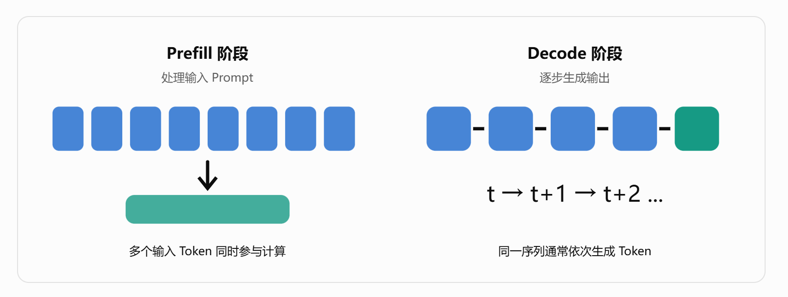

两者的性能特征不同：

- **Prefill：** 通常具有较大的计算并行度，较长的 Prompt 往往使计算更容易成为瓶颈。
- **Decode：** 单请求每步处理的新增 Token 很少，低批量下通常受模型权重和 KV Cache 的显存访问带宽限制。

因此，适合 Prefill 的并行方式不一定适合 Decode。

**问题三：需要同时处理大量用户请求。**

例如，一个在线推理服务同时收到 100 条请求。如果只采用一组 GPU 串行处理，可能导致请求排队和响应延迟增加。

我们希望多个请求能同时被处理，从而提高系统吞吐量。

这就引出了数据并行以及批处理、调度等技术。

### 1.2 大模型推理有哪些主要并行策略？

通常需要重点掌握以下六种。前五种是核心分类，第六种与张量并行紧密相关。

| 并行策略 | 拆分维度 | 核心目的 |
|---|---|---|
| **DP** 数据并行 | 请求或 Batch | 提高多请求吞吐量 |
| **TP** 张量并行 | 层内权重和计算 | 分摊模型参数与层内计算 |
| **PP** 流水线并行 | Transformer 层 | 分摊模型层、流水化执行 |
| **CP** 上下文并行 | 序列长度 | 加速长上下文处理、分摊 KV Cache |
| **EP** 专家并行 | MoE 专家 | 分摊专家参数和计算 |
| **SP** 序列并行 | 部分激活的序列维度 | 降低激活显存及部分冗余计算 |

以上分类与 NVIDIA Megatron Core 的[并行策略框架](https://docs.nvidia.com/megatron-core/developer-guide/latest/user-guide/parallelism-guide.html)基本一致。需要注意，SP 与 CP 虽然都涉及序列维度，但覆盖的计算范围不同。

可以用一个直观的类比理解：

- DP：**多套完整生产线**，各自处理不同订单。
- TP：**多名工人共同加工一个零件**，每个人负责一部分。
- PP：**流水线分工**，不同工位负责不同加工步骤。
- CP：**把一份很长的材料分段处理**，然后交换必要信息。
- EP：**不同专业工位负责不同类型的任务**，由路由机制分配工作。

其中，一个特别重要的区别是：

**DP 主要扩展请求处理能力，而 TP、PP、CP 和 EP 可以让多张 GPU 协作完成同一条请求的推理。**

下面分别讨论它们的工作原理、适用场景和性能代价。

---

## 二、数据并行（Data Parallelism，DP）

### 2.1 DP 要解决什么问题？

DP 主要解决的是：**当模型已经能够正常运行时，如何同时服务更多请求，提高系统吞吐量。**

假设现在有 4 张 GPU，每张 GPU 都能独立运行一个 7B 模型，同时有 8 个用户发送请求。

数据并行的思路是：每张 GPU 都保存完整的模型副本，但处理不同的请求。

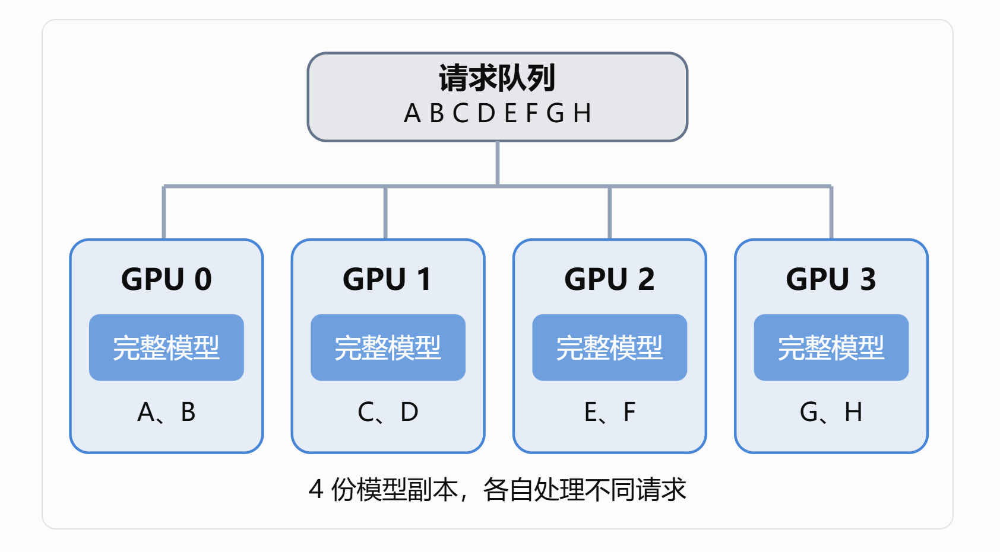

### 2.2 DP 的具体工作原理

假设模型表示为 $F$，输入请求分别为 $x_1,x_2,x_3,x_4$。

四张 GPU 分别执行：

$$
\begin{aligned}
\mathrm{GPU}_0 &: y_1=F(x_1)\\
\mathrm{GPU}_1 &: y_2=F(x_2)\\
\mathrm{GPU}_2 &: y_3=F(x_3)\\
\mathrm{GPU}_3 &: y_4=F(x_4)
\end{aligned}
$$

各 GPU 持有相同的模型权重，但拥有独立的运行状态和 KV Cache。

对于普通 Dense 模型的纯推理，每个副本通常不需要在前向计算过程中与其他副本交换张量，也不需要像训练中的 DDP 那样同步梯度。

### 2.3 适用场景与局限

**适合：** 模型已经能放进一张 GPU（或者一组 TP/PP GPU），在线服务请求量较大，希望通过增加副本扩展吞吐量。

**不适合：** 单个模型权重已经超过一张 GPU 的显存容量，却没有采用其他模型并行方式。DP 本身不会降低单个副本的模型权重显存需求。

例如，70B 模型需要 4 张 GPU 才能运行，那么 8 张 GPU 可以划分成两个 TP=4 的模型副本，再利用 DP=2 同时服务不同请求。

这就是 **TP + DP 混合并行**。

需要特别注意：

DP 不会直接加速一条请求内部的 Transformer 计算。它的主要价值是扩展整体服务能力，实际吞吐提升还取决于请求分布、负载均衡和硬件资源。

vLLM 官方的[数据并行文档](https://docs.vllm.ai/en/latest/serving/data_parallel_deployment/)也将其定义为模型副本处理独立请求批次，并支持多副本负载均衡。

---

## 三、张量并行（Tensor Parallelism，TP）

TP 是大模型推理中最重要的并行策略之一，也是理解其他模型并行策略的基础。

### 3.1 TP 要解决什么问题？

TP 要解决的问题是：

**如果单张 GPU 无法容纳某个模型，能否将 Transformer 每一层的权重与计算拆分到多个 GPU 上？**

答案是可以的。

但与 DP 不同，TP 让多张 GPU **共同执行同一层 Transformer 的计算**。

为了理解它，我们从你熟悉的矩阵乘法开始。

### 3.2 基本原理：矩阵如何并行计算？

考虑线性变换：

$$
Y=XW
$$

假设：

$$
X\in\mathbb R^{B\times4},\qquad
W\in\mathbb R^{4\times8}
$$

输出为：

$$
Y\in\mathbb R^{B\times8}
$$

其中 $B$ 表示当前参与计算的 Token 数量。

现在使用两张 GPU，TP=2。

#### 第一种：列并行（Column Parallelism）

将权重矩阵沿着输出特征维度拆分：

$$
W=[W_0,W_1]
$$

其中：

$$
W_0,W_1\in\mathbb R^{4\times4}
$$

GPU 0 计算：

$$
Y_0=XW_0
$$

GPU 1 计算：

$$
Y_1=XW_1
$$

最终：

$$
Y=[Y_0,Y_1]
$$

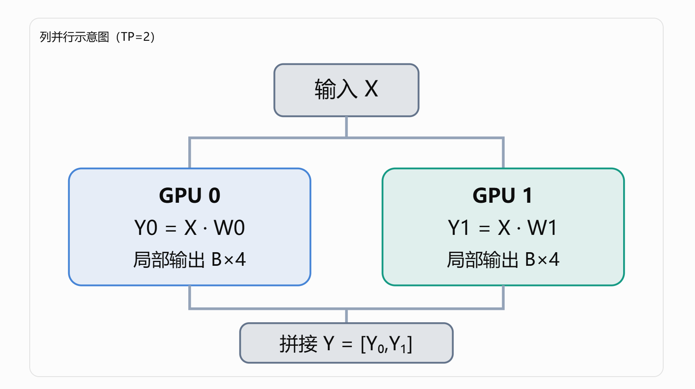

这里有一个关键点：

**列并行之后，不一定要立即把两个输出收集到同一张 GPU 上。**

如果后续运算也采用与之匹配的张量并行方式，可以让各张 GPU 继续持有各自的局部输出，减少通信开销。

这也是高性能 TP 实现的重要思想。

#### 第二种：行并行（Row Parallelism）

这次沿着输入特征维度拆分权重：

$$
W=
\begin{bmatrix}
W_0\\
W_1
\end{bmatrix}
,\qquad
X=[X_0,X_1]
$$

那么：

$$
Y=X_0W_0+X_1W_1
$$

两张 GPU 分别计算：

$$
Y_0=X_0W_0,\qquad Y_1=X_1W_1
$$

最后对局部计算结果求和：

$$
Y=Y_0+Y_1
$$

在典型的复制输出布局中，这一步可以通过 **All-Reduce** 集合通信完成。

理解 All-Reduce 的直观方式是：

各 GPU 先计算自己的部分结果，再将这些结果相加，并使参与通信的 GPU 获得求和结果。

与列并行不同，行并行产生的通常不是互不重叠的输出特征，而是对同一输出的部分贡献。

### 3.3 Transformer 中具体如何实现 TP？

现在将前面的矩阵并行应用到 Transformer。

#### （1）Attention 模块的 TP

以标准多头注意力为例：

$$
Q=XW_Q,\quad K=XW_K,\quad V=XW_V
$$

假设模型具有 16 个注意力头，使用 TP=4。

一种典型实现是将注意力头划分给四张 GPU：

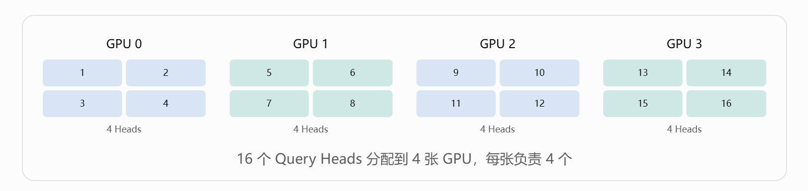

每张 GPU 负责计算自己持有的 Q、K、V 投影以及对应的 Attention Heads。

例如：

$$
O_i=\operatorname{Attention}(Q_i,K_i,V_i)
$$

这些局部结果再通过输出投影 $W_O$ 进行组合。

在经典 Megatron 风格的 TP 实现中，QKV 投影通常采用列并行，Attention 输出投影采用行并行。

这样可以在每张 GPU 上完成各自的注意力头计算，并通过一次必要的跨 GPU 归约获得完整结果。

注意，对于 GQA、MQA、MLA 等模型，KV Head 的分片与复制方式会更加复杂。尤其当 KV Head 数量少于 TP 数量时，不能简单认为 KV Cache 一定按 TP 比例继续缩小。

#### （2）FFN 模块的 TP

再来看 Transformer 的 FFN。

以常见的两层前馈网络为例：

$$
\operatorname{FFN}(X)
=\sigma(XW_{\mathrm{up}})W_{\mathrm{down}}
$$

其中：

$$
W_{\mathrm{up}}\in\mathbb R^{d\times d_{\mathrm{ff}}}
$$

$$
W_{\mathrm{down}}\in\mathbb R^{d_{\mathrm{ff}}\times d}
$$

可以这样拆分：

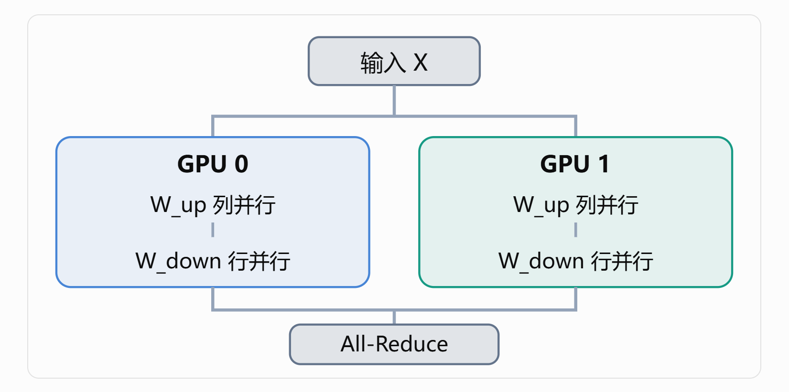

工作过程是：

第一层 $W_{\mathrm{up}}$ 采用列并行，每张 GPU 计算一部分中间特征。

激活函数（例如 ReLU、SiLU）是逐元素操作，因此可以直接对局部特征进行计算。

第二层 $W_{\mathrm{down}}$ 采用行并行，各 GPU 得到对最终输出的部分贡献。

最后通过 All-Reduce 等通信操作组合结果。

对于 SwiGLU 结构，Gate 和 Up 两个投影同样可以进行列并行，Down 投影采用行并行，基本思想不变。

### 3.4 TP 的优点和代价

**优点：**

TP 可以将大规模权重分散到不同 GPU 上，使单卡显存无法容纳的模型能够运行，同时让多个 GPU 参与单层计算。在适合的硬件和负载条件下，它还可能降低单请求的计算延迟。

**最重要的代价：GPU 间通信。**

例如，假设某个 Transformer Block 的 Attention 输出和 FFN 输出均需要一次 All-Reduce，那么具有 80 层的模型，在一次完整前向传播中，仅这两处就可能涉及大约：

$$
80\times2=160
$$

次逻辑上的集合通信操作。

这只是用于说明的典型模型，并非所有实现都固定执行 160 次通信；不同融合算子、并行布局及通信优化会改变具体次数。

当 GPU 之间通过 NVLink 等高速互连通信时，TP 的收益通常更容易发挥。若通信需要经过较慢的跨节点网络，通信开销就可能抵消并行计算带来的收益。

因此，**TP 并行度并不是越大越好。**

如果一个模型在 2 张 GPU 上已经可以高效运行，盲目将 TP 从 2 增加到 8，未必能降低推理延迟，也可能因额外通信和更小的局部矩阵计算而降低效率。

这一点也是 vLLM 官方推荐在单节点内优先采用 TP、跨节点时考虑结合 PP 的重要原因。参见 [vLLM：Parallelism and Scaling](https://docs.vllm.ai/en/latest/serving/parallelism_scaling/)。

---

## 四、流水线并行（Pipeline Parallelism，PP）

### 4.1 PP 要解决什么问题？

TP 是在每一层内部拆分矩阵，而 PP 采用另一种思路：

**既然 Transformer 是由多个 Block 堆叠而成，为什么不将不同的 Block 分配到不同 GPU 上？**

例如，一个模型具有 32 层 Transformer Block，使用 4 张 GPU。

可以将其分配为：

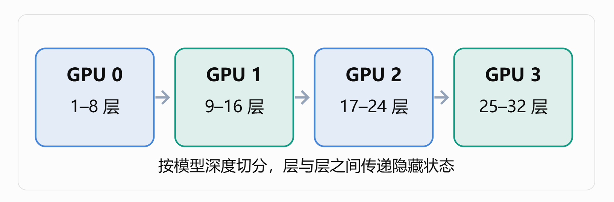

这样，每张 GPU 只需要存储自己负责的 Transformer 层权重。

不同阶段通过传递隐藏状态协作完成模型推理。

### 4.2 PP 的工作原理

设模型由四个连续计算阶段组成：

$$
F=F_4\circ F_3\circ F_2\circ F_1
$$

对于一条输入 $X$，计算流程为：

$$
X\xrightarrow{\mathrm{GPU}_0}H_1
\xrightarrow{\mathrm{GPU}_1}H_2
\xrightarrow{\mathrm{GPU}_2}H_3
\xrightarrow{\mathrm{GPU}_3}Y
$$

这里需要强调：

对于**单个请求的同一次前向计算**，后面的阶段依赖前面阶段的输出，不能简单让四张 GPU 完全独立、同时计算同一个 Token 的所有层。

这就引出了流水线并行的另一个重要问题。

### 4.3 什么是流水线气泡（Pipeline Bubble）？

假设有 3 个流水线阶段和 3 个相互独立的微批次 A、B、C。

理想化执行过程如下：

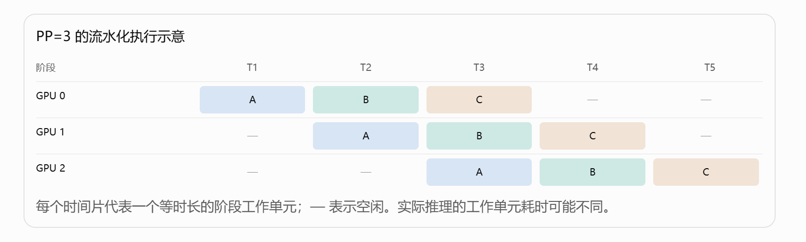

> 每个时间片代表一个等时长的阶段工作单元；“—”表示空闲。实际推理的工作单元耗时可能不同。

可以发现：

在初始时刻，只有 GPU 0 在工作，其他 GPU 空闲。随着 A 进入后续阶段，GPU 0 才能继续处理 B。

这种因流水线未填满或正在排空而导致部分 GPU 空闲的现象称为 **Pipeline Bubble（流水线气泡）**。

并行阶段越多、独立工作单元越少，气泡的相对影响通常越大。

在推理中，工作单元可以来自不同请求、不同微批次或可调度的 Prefill 分块，但不能忽略同一请求相邻生成 Token 之间的自回归依赖。

### 4.4 PP 适合什么场景？

PP 特别适合模型层数较多、单个 TP 组无法容纳完整模型，或者需要跨节点部署的情况。

例如，拥有两台服务器，每台配备 8 张 GPU，可以采用：

$$
TP=8,\qquad PP=2
$$

第一台服务器的 8 张 GPU 共同负责模型前半部分的层，第二台服务器的 8 张 GPU 负责后半部分。

这种部署通常可以将频繁的 TP 集合通信限制在服务器内部，而在服务器之间主要传输阶段间的隐藏状态。

不过 PP 同样存在局限：流水线气泡、阶段间通信、负载不均衡，以及低并发时难以充分利用各阶段 GPU。

**TP 与 PP 的核心区别：**

TP 让多张 GPU 一起计算某一层；PP 让不同 GPU 负责不同层。

因此，两者既可以单独使用，也可以组合。

vLLM 官方的[多节点部署指南](https://docs.vllm.ai/en/latest/serving/parallelism_scaling/)采用 TP 负责节点内并行、PP 负责节点间分层作为常见的起始配置，但具体是否最优仍需实测。

---

## 五、上下文并行（Context Parallelism，CP）

CP 是理解长上下文推理、KV Cache 管理时非常重要的一种并行策略。

### 5.1 CP 要解决什么问题？

假设用户向模型提交一个长度为 128K Token 的 Prompt。

即使模型参数已经通过 TP 分散到多张 GPU，仍可能面临两个问题：

**第一，Prefill 阶段计算量较大。**

对于标准全注意力：

$$
\operatorname{Attention}(Q,K,V)
=\operatorname{Softmax}\left(\frac{QK^{\mathrm T}}{\sqrt{d_k}}\right)V
$$

序列长度为 $T$ 时，Attention 的主要计算复杂度包含 $O(T^2)$ 项。

序列越长，计算开销越大。

**第二，Decode 阶段 KV Cache 显存占用较大。**

对于标准的 KV Cache 存储形式，单个请求的 KV Cache 大小可以近似表示为：

$$
M_{\mathrm{KV}}
=2LT H_{\mathrm{KV}}d_{\mathrm{head}}b
$$

其中 $L$ 是 Transformer 层数，$T$ 是缓存的 Token 数量，$H_{\mathrm{KV}}$ 是 KV Head 数量，$d_{\mathrm{head}}$ 是 Head 维度，$b$ 是每个元素的字节数。

随着上下文长度和并发请求数量增加，KV Cache 可能成为限制系统并发能力的重要因素。

**CP 的核心思想是沿着序列长度维度分配工作，而不是主要沿着模型权重维度拆分。**

### 5.2 CP 的基本工作原理

假设输入序列长度为 8192，使用两张 GPU 进行上下文并行：

$$
X=[X_0;X_1]
$$

其中：

$$
X_0\in\mathbb R^{4096\times d}
$$

$$
X_1\in\mathbb R^{4096\times d}
$$

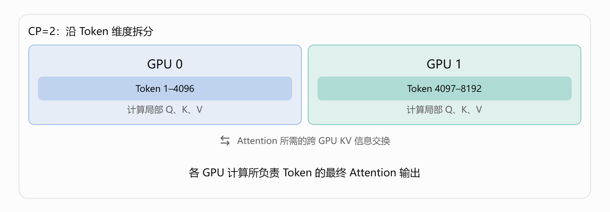

这里有一个值得深入理解的问题：

**Attention 明明需要考虑完整上下文，为什么可以把序列分到不同 GPU 上？**

因为我们并不是让 GPU 完全忽略其他 Token。

例如，在因果注意力中，第 6000 个 Token 需要关注它之前允许访问的 Token。虽然第 6000 个 Token 所在的 GPU 只负责一部分序列，但它仍然需要获得其他 GPU 上相关 Token 的 K、V 信息。

因此，CP 通常需要跨 GPU 的 KV 交换或分布式 Attention 计算。

### 5.3 Prefill 阶段如何实现 CP？

对于长上下文 Prefill，常见实现思路有两类。

**方式一：Partial Query + Full KV**

每张 GPU 仅计算自己的 Query 分块，同时通过 All-Gather 等操作获取所需的完整 K、V。

然后各自计算对应 Query 的 Attention 输出。

这种方案比较直观，适合完整 KV 可以容纳在设备内存中的场景，但通信量和临时显存占用可能较大。

**方式二：Partial Query + Partial KV**

各 GPU 保留自己的 Q、K、V 分块，通过 Ring Attention 等机制分块交换 K、V，并逐步累积 Attention 计算结果。

这样就不必在每张 GPU 上同时保存完整的长序列 K、V。

需要注意，Ring Attention 是实现分布式 Attention 的一种技术方案，不能把它与所有 CP 实现画等号。

### 5.4 Decode 阶段如何实现 CP？

Decode 更有特点。

假设模型已经处理完 8192 个 Token，现在需要生成第 8193 个 Token。

此时通常只有一个新的 Query：

$$
q_{8193}
$$

但 Attention 需要读取此前所有相关 Token 的 KV Cache。

如果使用 CP=2，可以让两张 GPU 分别存储部分 KV Cache：

$$
K=[K_0;K_1],\quad V=[V_0;V_1]
$$

各 GPU 利用本地 KV 分块计算 Attention 的局部贡献，再进行必要的跨设备归约，获得正确的全局 Attention 输出。

这里的合并不是简单地将两个局部 Softmax 输出相加或取平均，因为不同 KV 分块对应的 Softmax 归一化分母必须统一处理。实际可通过分布式在线 Softmax、Log-Sum-Exp 等数值稳定算法完成。

这样做有两个重要收益：

一是减少单张 GPU 的 KV Cache 存储压力；二是使较长的 Attention 计算能够在多个设备之间分摊。

### 5.5 CP 与 TP 在 KV Cache 上的区别

这是推理系统中很容易混淆的地方。

TP 通常沿注意力头或权重维度进行分片，而 CP 可以沿 Token 序列维度对 KV Cache 进行分片。

假设模型只有 4 个 KV Heads，但是 TP=8。

在某些标准 GQA 的 TP 部署中，由于 KV Head 数量不足以继续划分，部分 KV Heads 需要在不同 TP Rank 之间复制。此时增加 TP 并不一定能够继续有效减少每卡 KV Cache。

通过 Decode Context Parallelism（DCP）进一步沿 Token 维度分割 KV Cache，可以减少这种复制。

vLLM 官方文档给出了类似实例：Qwen3-235B-A22B 的 4 个 KV Heads 在 TP=8 时可出现 2 倍 KV 复制，而增加 DCP=2 可以消除对应的复制。参见 [vLLM：Context Parallel Deployment](https://docs.vllm.ai/en/stable/serving/context_parallel_deployment/)。

**适用场景：** 超长 Prompt、长上下文推理、KV Cache 显存压力大，以及因 KV Head 数量较少而发生缓存复制的模型。

需要说明的是，CP 在不同推理框架中的具体支持程度不同。vLLM 文档明确区分了 Prefill CP 和 Decode CP；其中某些 Prefill CP 方案仍处于持续开发状态，而 Decode CP 已有具体支持路径。

---

## 六、专家并行（Expert Parallelism，EP）

EP 主要用于 Mixture of Experts（MoE）模型。

### 6.1 为什么 MoE 模型需要 EP？

标准 Dense Transformer 的 FFN 通常是一个统一的前馈网络，而 MoE 模型将其替换为多个 Expert 网络，通过 Router 选择其中一部分参与计算。

假设某个 MoE 层包含 8 个专家，每个 Token 只激活 2 个专家。

对于 Token $x$，输出可以简化表示为：

$$
y=\sum_{i\in\operatorname{TopK}(x)}
g_i(x)E_i(x)
$$

其中 $E_i$ 表示专家网络，$g_i(x)$ 表示对应的路由权重。

这类模型的特点是：

**总参数量可能很大，但每个 Token 实际激活的参数只占其中一部分。**

例如，具有大量专家的 MoE 模型，即使单 Token 计算量相对可控，全部专家权重仍可能占用非常大的显存。

EP 就是针对这一结构特点设计的。

### 6.2 EP 的工作原理

假设模型有 8 个专家，使用 EP=4。

每张 GPU 存储两个专家：

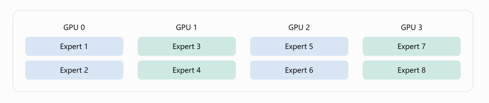

当一批 Token 到达 MoE 层时：

首先，Router 计算各 Token 应由哪些专家处理。

假设 Token A 选择 Expert 2 和 Expert 7，那么它对应的隐藏状态就需要送到持有这两个专家的 GPU。

各 GPU 对收到的 Token 执行本地专家计算。

之后，各专家输出被送回相应的 Token 所属位置，并根据 Router 权重进行加权组合。

整个过程可以概括为：

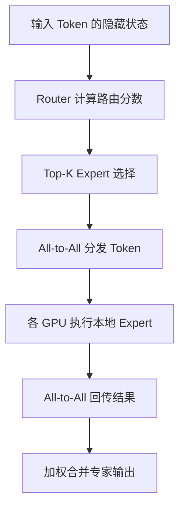

### 6.3 EP 的通信代价：All-to-All

EP 中非常重要的通信操作是 **All-to-All**。

它与 TP 常用的 All-Reduce 不同。

All-Reduce 主要是在参与设备之间汇总计算结果；All-to-All 则更像是交换不同设备之间需要处理的数据。

例如，GPU 0 上的 Token 可能需要 GPU 1 上的 Expert，而 GPU 1 上的 Token 又可能需要 GPU 3 上的 Expert。

因此，EP 的主要性能瓶颈可能来自专家间的数据分发与回收。

另外，Router 的选择并不保证每个 Expert 的负载完全相同。

假设 GPU 0 上的专家收到 1000 个 Token，而 GPU 1 上的专家只收到 100 个 Token，那么 GPU 0 可能成为整体计算瓶颈。

这就是 **Expert Load Imbalance（专家负载不均衡）**。

因此，现代 EP 系统除了专家分片，还常常需要负载均衡、专家副本、专家重映射以及专门的 All-to-All 通信优化。

vLLM 已提供专家负载均衡机制（EPLB）和针对不同负载特征的 EP 通信实现。参见 [vLLM：Expert Parallel Deployment](https://docs.vllm.ai/en/latest/serving/expert_parallel_deployment/)。

### 6.4 EP 与 TP 有什么不同？

虽然 TP 和 EP 都能分散模型权重，但它们拆分的是不同对象。

| 对比维度 | TP | EP |
|---|---|---|
| 拆分对象 | 矩阵、特征、注意力头 | 独立的专家网络 |
| 计算形式 | 多 GPU 协作完成某个层内运算 | 不同专家分别处理路由到的 Token |
| 典型通信 | All-Reduce、All-Gather | All-to-All |
| 适用模型 | Dense、MoE | 主要是 MoE |
| 主要瓶颈 | 频繁的层内同步 | Token 分发与专家负载不均衡 |

对于 MoE 模型，还可以在 Attention 层使用 TP 或 DP，在专家层使用 EP。

例如，vLLM 支持一种部署方式：Attention 使用 DP=8、TP=1，而专家层在这 8 张 GPU 上形成 EP=8 的专家组。

此时总共是 8 张 GPU，而不是简单计算成 DP×EP=64 张。这是因为不同类型的层复用了同一批物理设备，并行维度并非彼此独立。

---

## 七、序列并行（Sequence Parallelism，SP）

SP 和 CP 的名字很接近，但需要区分。

### 7.1 SP 是用来解决什么问题的？

经典 Megatron Sequence Parallelism 主要是为了解决 TP 场景中的部分激活显存开销与冗余操作问题，最初主要面向训练。

假设 TP 中存在一些操作，例如 LayerNorm。它们并不像大规模线性层那样自然地沿权重维度拆分。

对于某些操作，TP 方案可能让不同 GPU 持有重复的激活数据。

SP 的思路是：

**对于这些可以沿序列维度独立计算的操作，让不同 GPU 负责不同 Token 的激活。**

例如：

$$
X\in\mathbb R^{8192\times4096}
$$

使用 SP=2 后，两张 GPU 可以分别持有：

$$
X_0,X_1\in\mathbb R^{4096\times4096}
$$

每张 GPU 对自己负责的 Token 执行相应的 LayerNorm 等操作。

### 7.2 SP 和 CP 究竟有什么区别？

| 对比维度 | 经典 SP | CP |
|---|---|---|
| 主要目标 | 减少部分激活显存及冗余 | 支持长序列分布式计算 |
| 典型操作范围 | LayerNorm、Dropout 等 | 包含 Attention 的更广泛计算 |
| Attention 跨 Token 依赖 | 不以分布式 Attention 为核心 | 必须解决 |
| 推理中的重要性 | 实现相关，通常不是首选部署维度 | 长上下文场景很重要 |

NVIDIA Megatron Core 的[Context Parallel Overview](https://docs.nvidia.com/megatron-core/developer-guide/latest/user-guide/features/context_parallel.html)明确区分：经典 SP 对部分操作的序列维度进行切分，而 CP 可以在更广泛的网络计算中对序列进行切分，并需要处理 Attention 的跨 Token 信息交换。

对于初学者，**建议优先掌握 TP 与 CP，再理解 SP**。

因为在实际推理部署中，TP、PP、DP、EP、CP 通常是更直接影响资源配置和性能选择的策略，而 SP 在很多框架中并不是一个单独暴露给用户的常用推理部署选项。

---

## 八、还有三类经常与并行策略一起讨论的技术

前面讲解的是主要的模型和数据并行方式。实际部署中，你还会经常遇到以下三个概念。

它们与并行密切相关，但不应直接等同于 TP、PP、DP 等模型分片方式。

### 8.1 连续批处理（Continuous Batching）

它主要解决的是：**如何高效调度多个长度不同、开始时间不同的请求。**

假设请求 A 需要生成 100 个 Token，请求 B 需要生成 20 个 Token。

传统的静态 Batch 方式可能需要把一批请求固定在一起，导致较短请求完成后仍需等待其他请求。

Continuous Batching 则允许在调度步骤之间动态加入新请求、移除已经完成的请求，使 GPU 能持续处理活跃请求。

它和 DP 的区别在于：

DP 是创建多个模型副本，分配不同请求；Continuous Batching 是在某个模型副本内部动态组织请求。

两者能够结合使用。

### 8.2 Prefill/Decode 分离（PD Disaggregation）

它要解决的问题是：**Prefill 与 Decode 的资源需求和性能目标不同，放在同一组 GPU 上可能相互干扰。**

例如，某个 GPU 正在为多个请求执行 Decode，如果此时插入一个非常长的 Prefill，Decode 请求的 Token 输出间隔可能被拉长。

PD 分离的思路是使用不同实例处理两个阶段：

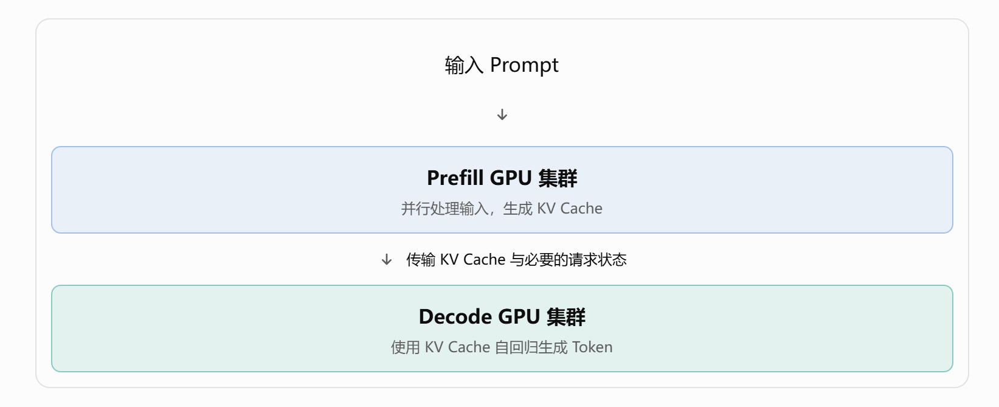

这样可以为 Prefill 和 Decode 分别调整 TP、PP、DP 以及资源分配。

不过，它会引入 KV Cache 传输、路由、同步等额外开销，因此不保证在所有负载下都更快。

vLLM 官方将独立调优 TTFT 和 ITL、降低 Prefill 对 Decode 尾延迟的影响列为该技术的主要动机。参见 [vLLM：Disaggregated Prefilling](https://docs.vllm.ai/en/latest/features/disagg_prefill/)。

### 8.3 推测解码（Speculative Decoding）

推测解码主要解决的是 Decode 阶段自回归生成速度受限的问题。

基本思路是使用一个较轻量的 Draft 模型提前预测多个候选 Token，然后由主模型通过一次并行计算验证这些候选 Token。

例如，Draft 模型提出 4 个候选 Token，主模型一次性计算相应位置的验证结果，根据接受规则决定可以一次提交多少个 Token。

它能够减少主模型串行执行的 Decode 步数，但并不意味着完全消除了自回归依赖。

推测解码不是传统意义上的模型分片策略，而是一种通过增加候选计算与并行验证来提高生成效率的方法。

vLLM 官方也将它作为优化中低 QPS、内存带宽受限 Decode 场景的重要手段。参见 [vLLM：Speculative Decoding](https://docs.vllm.ai/en/latest/features/spec_decode/)。

---

## 九、不同策略如何组合使用？

在实际部署中，很少有一种策略能够解决所有问题。

下面通过几个场景理解如何选择。

### 场景一：一个 7B 模型，8 张 GPU，同时服务大量用户

假设模型可以完整放进单张 GPU，且目标是提高整体吞吐量。

可以考虑：

$$
DP=8,\qquad TP=1,\qquad PP=1
$$

8 张 GPU 分别保存模型副本。

这通常比直接 TP=8 更符合高并发吞吐的目标，但仍要比较单副本 Batch 效率和部署开销。

### 场景二：一个 70B BF16 Dense 模型，4 张 80GB GPU

模型权重约 140GB，无法放在一张 GPU 上。

可以考虑：

$$
TP=4
$$

此时每张 GPU 的模型权重理想均摊量约为 35GB，剩余显存可以用于 KV Cache、运行时缓冲区等。

需要强调：35GB 只是权重的简化均摊估计，不是实际显存需求的完整结果。

### 场景三：一个超大 Dense 模型，需要两台 8-GPU 服务器

可以考虑：

$$
TP=8,\quad PP=2
$$

每台服务器负责一个 Pipeline Stage，节点内采用 TP。

这样可以避免将所有高频 TP 集合通信都放在跨节点网络上。

### 场景四：模型本身能运行，但 128K 长上下文导致 KV Cache 压力很大

需要分析 KV Cache 占用，并考虑：

$$
TP+CP
$$

特别是 GQA、MLA 等模型中，如果 TP 已经无法有效继续分摊 KV Cache，CP 可能更有意义。

### 场景五：一个非常大的 MoE 模型

可以考虑：

$$
\text{Attention：DP/TP}
$$

$$
\text{MoE FFN：EP}
$$

通过 EP 分散专家权重，并通过适当的 DP/TP 策略执行 Attention。

但必须同时关注 All-to-All 通信和专家负载均衡。

### 场景六：8 张 GPU，希望兼顾吞吐量与模型容量

一个比较容易理解的混合配置是：

$$
TP=2,\quad PP=2,\quad DP=2
$$

8 张 GPU 被划分为两个独立模型副本，每个副本使用 4 张 GPU（TP=2、PP=2）。

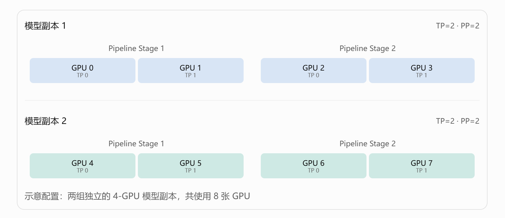

这里你可以理解为：TP 解决层内拆分，PP 解决层间拆分，DP 解决多副本扩展。

注意，并不是所有并行度都能无条件相乘。尤其在 EP、CP、TP 混合部署中，需要根据框架的实际并行组定义判断物理 GPU 数量。

---

## 十、最终如何判断应该使用哪种并行策略？

下面这张表可以作为实际部署时的快速参考。

| 主要问题 | 优先考虑的策略 | 需要重点检查 |
|---|---|---|
| 单卡放不下模型 | TP | 权重显存、TP 通信 |
| 单节点仍放不下模型 | TP + PP | 节点划分、流水线气泡 |
| 用户请求量很大 | DP + Continuous Batching | 吞吐量、负载均衡 |
| 长 Prompt 导致 Prefill 慢 | CP 或其他 Prefill 优化 | TTFT、Attention 开销 |
| KV Cache 占用过大 | CP、TP、KV 管理优化 | KV 利用率、并发容量 |
| MoE 专家参数很多 | EP | All-to-All、专家负载 |
| Prefill 影响 Decode 延迟 | PD 分离或调度优化 | TTFT、ITL、传输开销 |
| 单请求 Decode 较慢 | TP 调优、推测解码等 | TPOT、通信、接受率 |

### 推理性能应该看哪些指标？

仅仅看模型是否能运行还不够。

对比不同并行配置时，建议至少观察以下指标：

| 指标 | 含义 | 重点影响 |
|---|---|---|
| TTFT | Time To First Token，首 Token 延迟 | Prefill、调度 |
| TPOT | Time Per Output Token，平均输出 Token 时间 | Decode 效率 |
| ITL | Inter-Token Latency，相邻输出 Token 的时间间隔 | Decode 稳定性 |
| Throughput | 每秒完成请求数或处理 Token 数 | 整体服务能力 |
| GPU Memory | 显存占用 | 模型容量和并发 |
| KV Cache Usage | KV Cache 使用率 | 并发容量与缓存压力 |
| Communication Overhead | 多 GPU 通信开销 | TP、PP、CP、EP |

例如，TP=4 相比 TP=2，虽然可能降低单卡权重显存占用，但不代表 TTFT、TPOT 和吞吐量都会同时改善。

不同指标甚至可能存在相互制约关系。

## 十一、推荐的学习路径

对于已经了解 Transformer 的初学者，我建议采用下面的顺序：

1. **第一阶段：TP**

   掌握列并行、行并行、All-Reduce，以及 Attention 和 FFN 的分片方式。这是最值得优先深入的内容。

2. **第二阶段：DP 与 PP**

   理解模型复制、请求分配、Pipeline Stage、流水线气泡，以及 TP+PP+DP 如何组合。

3. **第三阶段：CP 与 KV Cache**

   重点理解 Prefill/Decode 阶段的 KV 分片、GQA/MLA 对 KV Cache 分片的影响，以及长上下文为什么需要额外的通信机制。

4. **第四阶段：EP 与 MoE**

   重点理解 Router、Token Dispatch、All-to-All、专家负载均衡，以及 Attention DP + Expert EP 等混合架构。

5. **第五阶段：推理系统整体优化**

   将各种并行方法与 Continuous Batching、PD 分离、推测解码、KV Cache 管理结合，建立完整的性能分析体系。

### 推荐官方学习资料

下面几份文档适合进一步学习，内容与本次讲解直接对应：

| 官方文档 | 建议学习重点 |
|---|---|
| [vLLM — Parallelism and Scaling](https://docs.vllm.ai/en/latest/serving/parallelism_scaling/) | TP、PP、跨节点部署 |
| [vLLM — Data Parallel Deployment](https://docs.vllm.ai/en/latest/serving/data_parallel_deployment/) | DP 多副本部署与请求分配 |
| [vLLM — Context Parallel Deployment](https://docs.vllm.ai/en/stable/serving/context_parallel_deployment/) | Prefill CP、DCP、KV Cache 分片 |
| [vLLM — Expert Parallel Deployment](https://docs.vllm.ai/en/latest/serving/expert_parallel_deployment/) | EP、All-to-All、EPLB |
| [NVIDIA — Parallelism Strategies Guide](https://docs.nvidia.com/megatron-core/developer-guide/latest/user-guide/parallelism-guide.html) | 各类并行策略的统一理论框架 |

**最后总结：**

理解大模型推理并行策略，最关键的是明确究竟拆分了什么。

DP 拆分请求，TP 拆分层内张量，PP 拆分模型层，CP 拆分上下文序列，EP 拆分专家网络，经典 SP 拆分部分激活的序列维度。

而真正决定系统性能的，不仅是计算是否被并行化，还包括**每张 GPU 保存什么、需要与其他 GPU 交换什么、交换频率多高，以及这些开销在 Prefill 和 Decode 阶段如何变化**。

掌握这一逻辑后，后续研究 vLLM 的分布式执行、KV Cache 管理，以及不同并行配置对 TTFT、TPOT 和吞吐量的影响，会容易得多。
